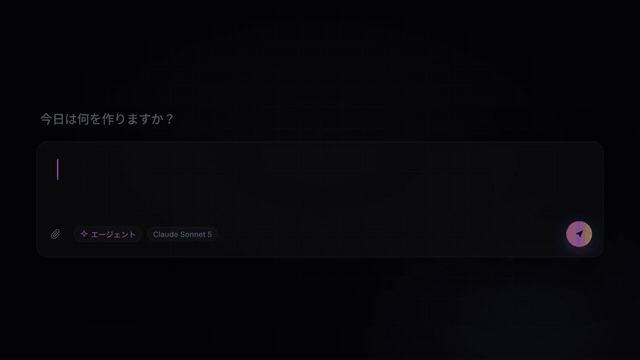

# NodeTool

[English](README.md) · [简体中文](README.zh-CN.md) · 日本語 · [한국어](README.ko.md)

**オープンソースのAI映画スタジオ · エージェント + ノードワークフロー**

**AI映画を、ショットごとに演出する。** 一文から始めましょう。エージェントがストーリーを書き、ショットごとに静止画を描き、タイムライン上でクリップを編集します。クリップの料金を払う前に静止画を承認でき、どのショットも個別に撮り直せます。うまくいった手順は、もう一度実行できるワークフローとして保存できます。

**[NodeTool Studioをダウンロード](https://github.com/nodetool-ai/nodetool/releases/latest)** ·
**[ブラウザで試す](https://app.nodetool.ai)**（アルファ版）·
**[日本語の紹介ページ](https://nodetool.ai/ja)** ·
**[ドキュメント（英語）](https://docs.nodetool.ai/)**



StudioはmacOS、Windows、Linux向けに無料のオープンソースで提供しています。Studioでは、ChatGPTまたはClaudeのプランでサインインすると、エージェントがそのプランで動きます。自分のプロバイダーAPIキーを追加して、上乗せなしの定価で支払うこともできます。

## 映画

脚本を書き、すべてのショットの絵コンテを作り、タイムラインでクリップを編集します。すべてが一つのプロジェクトに入っています。絵コンテにはショットごとに一枚の静止画があり、承認したショットだけが動画になります。

クリップにワークフローを結び付けます。入力を一つ変えるとそのクリップが古くなったと表示されるので、そのテイクだけを再生成し、残りの編集はそのまま残ります。

キャラクター、場所、スタイル、プロップは**エンティティ**として保存されます。エンティティを名前で呼ぶすべてのプロンプトに同じ説明が入るので、ショットが変わっても登場人物の見た目がぶれません。

## エージェント

変えたいことを普段の言葉で伝えると、エージェントがプロジェクトを編集します。いつでも自分で作業を引き継げます。各エディターは自分の操作をツールとしてエージェントに公開しているので、エージェントはノードグラフをつなぎ、レイヤーを描き、クリップを切り、ショットを直し、セリフに声を当てられます。使うのは、あなたが作業しているのと同じドキュメントです。

## ノードワークフロー

一度できたら、もう一度実行する。すべてのプロジェクトの下にはノードグラフがあります。うまくいった流れを保存して、次のエピソード、20種類の広告バリエーション、新しいシーンの同じキャラクターに実行できます。手持ちのComfyUIワークフローを読み込んだり、ノードを手でつないだり、エージェントにグラフを組ませて有料の実行前にチェックさせたりできます。

## プラン、APIキー、モデル

Studioでは、ChatGPTまたはClaudeでサインインすると、エージェントは従量課金のAPIではなくそのサブスクリプションで動きます。ChatGPTとGeminiのプランは画像も生成でき、Geminiは動画も生成できます。これらの実行はプランの利用上限にカウントされます。

| プラン | チャットとエージェント | 画像 | 動画 |
| :--- | :---: | :---: | :---: |
| ChatGPT | ○ | ○ | × |
| Claude | ○ | × | × |
| Gemini | ○ | ○ | ○ |

サブスクリプションが使えるのはデスクトップアプリのStudioだけで、Cloudでは使えません。Geminiには、サインインしているブラウザに[NodeTool Chrome拡張機能](https://docs.nodetool.ai/chrome-extension)（英語）が必要です。

ほかのモデルは、自分のプロバイダーAPIキーを **設定 → モデルとプロバイダー** に追加して使います。NodeToolはそのプロバイダーを直接呼び出し、料金はプロバイダーの定価で、間に課金の仕組みは挟みません。対応するオープンウェイトモデルは、MLX、Ollama、llama.cpp、vLLM、LM Studioでローカル実行でき、呼び出しごとのプロバイダー料金はかかりません。必要なハードウェアはモデルによって異なります。どのモデルがどこで動くかは [Models and Providers](docs/models-and-providers.md)（英語）にあります。

## 日本語の画面

**設定 → 一般 → 外観** で表示言語を日本語に切り替えられます。翻訳は機械翻訳で、まだ英語のまま表示される画面もあります。ドキュメントは英語です。不自然な訳を見つけたら、issueかPRで知らせてください。

## はじめかた

1. お使いのOS向けの[最新リリース](https://github.com/nodetool-ai/nodetool/releases/latest)をダウンロードしてインストールします。動作環境とOSごとの手順は[インストールガイド](docs/installation.md)（英語）にあります。
2. **設定 → モデルとプロバイダー** でプロバイダーを接続するか、ChatGPTまたはClaudeでサインインして、エージェントとメディア生成を有効にします。
3. 新しいプロジェクトを作って始めます。

## Claude Codeなどのコーディングエージェントから使う

NodeToolは、Claude Code、Codex、OpenCodeから使えるMCPサーバーとして動きます。次のコマンド一つで、見つかったクライアントすべてにサーバーを登録します。デスクトップアプリのインストールは不要です。

```bash
npx -y --package=@nodetool-ai/cli-mcp nodetool-mcp install
```

詳しくは [NodeTool as an MCP Server](https://docs.nodetool.ai/mcp-server)（英語）を参照してください。

## コントリビュート

バグ修正、ノード、プロバイダー、ワークフロー、ドキュメントのPull Requestを歓迎します。開発の手順は [`AGENTS.md`](AGENTS.md) と[開発規約](docs/DEVELOPMENT_STANDARDS.md)（英語）にあります。質問や提案は日本語で [GitHub Issues](https://github.com/nodetool-ai/nodetool/issues) に書いてください。

## ライセンス

NodeToolは [AGPL-3.0](LICENSE.txt) ライセンスで公開しています。

[GitHub](https://github.com/nodetool-ai/nodetool) · [ウェブサイト](https://nodetool.ai/ja)
