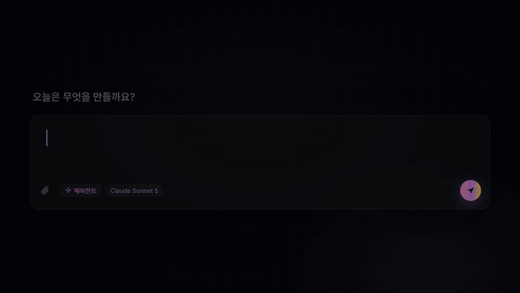

# NodeTool

[English](README.md) · [简体中文](README.zh-CN.md) · [日本語](README.ja.md) · 한국어

**오픈소스 AI 영화 스튜디오 · 에이전트 + 노드 워크플로**

**AI 영화를 샷 단위로 연출하세요.** 한 문장으로 시작하세요. 에이전트가 이야기를 쓰고, 샷마다 스틸 이미지를 그리고, 타임라인에서 클립을 편집합니다. 클립 비용을 내기 전에 스틸을 확인하고 승인할 수 있고, 어떤 샷이든 따로 다시 만들 수 있습니다. 잘 된 과정은 다시 실행할 수 있는 워크플로로 저장하세요.

**[NodeTool Studio 다운로드](https://github.com/nodetool-ai/nodetool/releases/latest)** ·
**[브라우저에서 사용해 보기](https://app.nodetool.ai)**(알파) ·
**[한국어 소개 페이지](https://nodetool.ai/ko)** ·
**[문서(영어)](https://docs.nodetool.ai/)**



Studio는 macOS, Windows, Linux용 무료 오픈소스입니다. Studio에서 ChatGPT 또는 Claude 플랜으로 로그인하면 에이전트가 그 플랜으로 실행됩니다. 내 프로바이더 API 키를 추가해 추가 요금 없이 정가로 결제할 수도 있습니다.

## 영화

대본을 쓰고, 모든 샷의 스토리보드를 만들고, 타임라인에서 클립을 편집합니다. 모두 하나의 프로젝트 안에 있습니다. 스토리보드에는 샷마다 스틸 이미지가 한 장씩 있고, 승인한 샷만 동영상이 됩니다.

클립에 워크플로를 연결합니다. 입력 하나를 바꾸면 그 클립이 오래된 것으로 표시되므로 그 테이크만 다시 생성하고 나머지 편집은 그대로 둡니다.

캐릭터, 위치, 스타일, 소품은 **엔터티**로 저장됩니다. 엔터티 이름이 들어간 모든 프롬프트에 같은 설명이 들어가므로, 샷이 바뀌어도 등장인물의 모습이 흔들리지 않습니다.

## 에이전트

바꾸고 싶은 점을 평소 말투로 전하면 에이전트가 프로젝트를 편집합니다. 언제든 직접 이어서 작업할 수 있습니다. 각 편집기는 자신의 기능을 도구로 에이전트에게 제공하므로, 에이전트는 노드 그래프를 연결하고, 레이어를 그리고, 클립을 자르고, 샷을 고치고, 대사에 목소리를 입힐 수 있습니다. 에이전트가 쓰는 문서는 내가 작업하는 문서와 같습니다.

## 노드 워크플로

한 번 잘 됐다면 다시 실행하세요. 모든 프로젝트 아래에는 노드 그래프가 있습니다. 잘 된 과정을 저장해 다음 에피소드, 광고 변형 20개, 새 장면 속 같은 캐릭터에 다시 실행할 수 있습니다. 가지고 있는 ComfyUI 워크플로를 가져오거나, 노드를 직접 연결하거나, 에이전트에게 그래프를 만들게 하고 유료 실행 전에 점검하게 할 수 있습니다.

## 플랜, API 키, 모델

Studio에서 ChatGPT 또는 Claude로 로그인하면 에이전트가 종량제 API 대신 그 구독으로 실행됩니다. ChatGPT와 Gemini 플랜은 이미지도 생성하고, Gemini는 동영상도 생성합니다. 이 실행은 플랜의 사용 한도에 포함됩니다.

| 플랜 | 채팅과 에이전트 | 이미지 | 동영상 |
| :--- | :---: | :---: | :---: |
| ChatGPT | ○ | ○ | × |
| Claude | ○ | × | × |
| Gemini | ○ | ○ | ○ |

구독은 데스크톱 앱인 Studio에서만 쓸 수 있고 Cloud에서는 쓸 수 없습니다. Gemini는 로그인한 브라우저에 [NodeTool Chrome 확장 프로그램](https://docs.nodetool.ai/chrome-extension)(영어)이 필요합니다.

다른 모델은 내 프로바이더 API 키를 **설정 → 모델 및 제공자**에 추가해 사용합니다. NodeTool이 해당 프로바이더를 직접 호출하며, 요금은 프로바이더 정가이고 중간에 별도 과금이 없습니다. 지원되는 오픈 웨이트 모델은 MLX, Ollama, llama.cpp, vLLM, LM Studio로 로컬에서 실행할 수 있으며 호출당 프로바이더 요금이 없습니다. 필요한 하드웨어는 모델에 따라 다릅니다. 어떤 모델이 어디서 실행되는지는 [Models and Providers](docs/models-and-providers.md)(영어)에 있습니다.

## 한국어 화면

**설정 → 일반 → 외관**에서 표시 언어를 한국어로 바꿀 수 있습니다. 번역은 기계 번역이라 아직 영어로 표시되는 화면도 있습니다. 문서는 영어입니다. 어색한 번역을 발견하면 issue나 PR로 알려 주세요.

## 시작하기

1. 사용하는 OS에 맞는 [최신 릴리스](https://github.com/nodetool-ai/nodetool/releases/latest)를 내려받아 설치합니다. 시스템 요구 사항과 OS별 단계는 [설치 가이드](docs/installation.md)(영어)에 있습니다.
2. **설정 → 모델 및 제공자**에서 프로바이더를 연결하거나 ChatGPT 또는 Claude로 로그인해 에이전트와 미디어 생성을 켭니다.
3. 새 프로젝트를 만들어 시작합니다.

## Claude Code 같은 코딩 에이전트에서 사용하기

NodeTool은 Claude Code, Codex, OpenCode에서 쓸 수 있는 MCP 서버로 동작합니다. 아래 명령 하나로 찾은 모든 클라이언트에 서버를 등록합니다. 데스크톱 앱을 설치할 필요는 없습니다.

```bash
npx -y --package=@nodetool-ai/cli-mcp nodetool-mcp install
```

자세한 내용은 [NodeTool as an MCP Server](https://docs.nodetool.ai/mcp-server)(영어)를 참고하세요.

## 기여하기

버그 수정, 노드, 프로바이더, 워크플로, 문서에 대한 Pull Request를 환영합니다. 개발 방법은 [`AGENTS.md`](AGENTS.md)와 [개발 규칙](docs/DEVELOPMENT_STANDARDS.md)(영어)에 있습니다. 질문과 제안은 한국어로 [GitHub Issues](https://github.com/nodetool-ai/nodetool/issues)에 남겨 주세요.

## 라이선스

NodeTool은 [AGPL-3.0](LICENSE.txt) 라이선스로 공개됩니다.

[GitHub](https://github.com/nodetool-ai/nodetool) · [웹사이트](https://nodetool.ai/ko)
