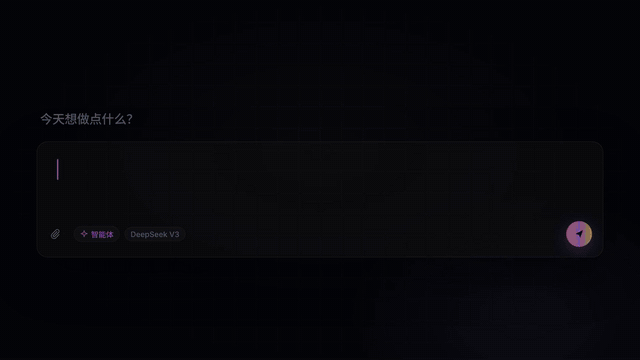

# NodeTool

[English](README.md) · 简体中文 · [日本語](README.ja.md) · [한국어](README.ko.md)

**开源 AI 电影工作室 · 智能体 + 节点工作流**

**逐个镜头，导演你的 AI 电影。** 从一句话开始。智能体编写故事，为每个镜头绘制一张静帧，并在时间线上剪辑片段。在为片段付费之前先审批静帧，任何镜头都可以单独重拍，把有效的做法保存为可以再次运行的工作流。

**[下载 NodeTool Studio](https://github.com/nodetool-ai/nodetool/releases/latest)** ·
**[在浏览器中试用](https://app.nodetool.ai)**（alpha）·
**[中文介绍](https://nodetool.ai/zh)** ·
**[文档（英文）](https://docs.nodetool.ai/)**



Studio 免费且开源，支持 macOS、Windows 和 Linux。

## 电影

编写剧本，为每个镜头制作故事板，并在时间线上剪辑片段，全部在一个项目中完成。故事板中每个镜头有一张静帧，只有你审批通过的镜头才会生成视频。

把工作流绑定到时间线片段上。更改其中一个输入，该片段会显示为已过期，你只需重新生成这一条，剪辑的其余部分保持不变。

## 智能体

用日常语言告诉智能体要改什么。它会编辑项目，你可以随时接手。每个编辑器都把自己的操作作为工具提供给智能体，所以它可以连接节点图、绘制图层、剪辑片段、修改镜头或为台词配音，使用的就是你工作时用的同一份文档。

## 节点工作流

做好一次，再运行一次。每个项目的底层都是一张节点图。保存有效的流程，在下一集、20 个广告变体或新场景中的同一个角色上再次运行。可以导入已有的 ComfyUI 工作流，手动连接节点，或者让智能体搭建这张图，并在付费运行之前检查它。

## 模型与服务商

在 **设置 → 模型和提供方** 中添加服务商的 API 密钥，NodeTool 就会直接调用该服务商，按官方价格付费，不加价。

| 服务商 | 能做什么 | 中国大陆密钥 |
| :--- | :--- | :--- |
| DeepSeek | 对话（V3 和 R1 推理模型） | 可直接使用 |
| 阿里云百炼（通义千问、通义万相） | Qwen 对话，Qwen-Image 和 Wan 图像生成，Wan 视频生成，Qwen TTS 语音合成 | 把 `DASHSCOPE_BASE_URL` 设为 `https://dashscope.aliyuncs.com/compatible-mode/v1` |
| 智谱 GLM（Z.ai / bigmodel.cn） | GLM 对话，GLM-Image 图像生成，CogVideoX 视频生成，语音识别 | 把 `ZAI_REGION` 设为 `china` |
| 月之暗面（Kimi） | Kimi 对话 | 目前需要国际版平台的密钥 |
| MiniMax | 对话、图像生成、海螺 Hailuo 视频生成、语音合成 | 目前需要国际版平台的密钥 |
| 可灵 Kling AI | 视频生成和图像生成 | 目前需要国际版平台的密钥 |
| BytePlus ModelArk | Seed 对话，Seedream 图像生成和编辑，Seedance 视频生成 | 目前需要国际版平台的密钥 |

受支持的开放权重模型可以通过 MLX、Ollama、llama.cpp、vLLM、LM Studio 在本地运行，不产生按次计费的服务商费用。所需硬件取决于模型。

在 Studio 中，也可以用 ChatGPT 或 Claude 订阅登录，智能体就在该订阅上运行，计入订阅方案的额度。完整的服务商列表见 [Models and Providers](docs/models-and-providers.md)（英文）。

## 中文界面

在 **设置 → 常规 → 外观** 中可以把界面语言切换为简体中文。部分尚未翻译的页面仍显示英文。文档为英文。翻译不通顺的地方，欢迎提 issue 或 PR。

## 快速开始

1. 下载适合你操作系统的[最新版本](https://github.com/nodetool-ai/nodetool/releases/latest)并安装。系统要求和各平台步骤见[安装指南](docs/installation.md)（英文）。
2. 在 **设置 → 模型和提供方** 中连接服务商，启用智能体和媒体生成。
3. 新建一个项目，开始创作。

## 在 Claude Code 等编程智能体中使用

NodeTool 可以作为 MCP 服务器，供 Claude Code、Codex 或 OpenCode 使用。一条命令会为找到的每个客户端注册服务器，不需要安装桌面应用：

```bash
npx -y --package=@nodetool-ai/cli-mcp nodetool-mcp install
```

详见 [NodeTool as an MCP Server](https://docs.nodetool.ai/mcp-server)（英文）。

## 参与贡献

欢迎提交修复问题、节点、服务商、工作流和文档的 Pull Request。开发说明见 [`AGENTS.md`](AGENTS.md) 和[开发规范](docs/DEVELOPMENT_STANDARDS.md)（英文）。问题和建议可以用中文在 [GitHub Issues](https://github.com/nodetool-ai/nodetool/issues) 中提出。

## 许可证

NodeTool 以 [AGPL-3.0](LICENSE.txt) 许可证发布。

[GitHub](https://github.com/nodetool-ai/nodetool) · [网站](https://nodetool.ai/zh)
