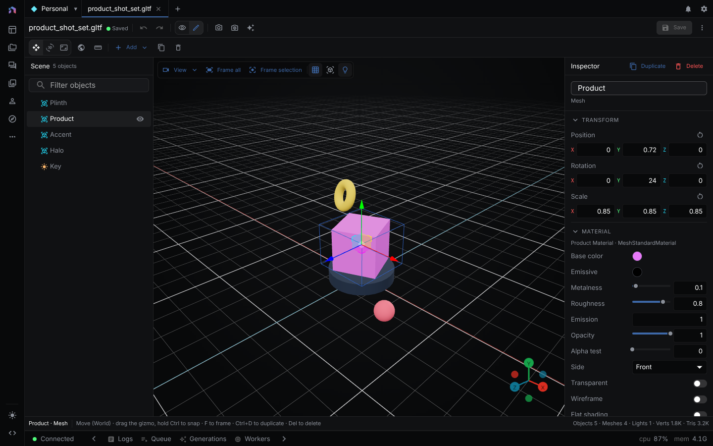

The 3D Editor edits glTF scenes made of boxes, spheres, planes, cylinders, cones, tori, and lights. You move objects by hand or ask the agent, then render the scene as a reference image.

> **Runs:** locally in the browser. Rendering needs Blender 5.2 or newer on the machine that runs the server (see [Blender Nodes](blender.md)) and is off on cloud deployments. **Needs:** an LLM provider only for the agent (see [Providers](providers.md)).
{: .callout-note}



---

## What a 3D model is

A 3D model in NodeTool is a glTF asset. The editor reads and writes `.glb` and `.gltf` files only. A new model is a `.glb`, and **Save** always writes binary glTF back over the same asset. The asset id does not change, so anything that points at it keeps working.

| File | Opens in the editor | Notes |
|---|---|---|
| `.glb`, `.gltf` | Yes | Editable and saveable |
| `.obj`, `.fbx`, `.stl`, `.ply`, `.usdz` | No | The tab opens, but the viewer reports that the format is not supported. Supported formats are `.glb` and `.gltf` |

When a model is not editable, or the tab is in view mode, you get the viewer instead. See [Asset Management](asset-management.md#asset-viewers).

---

## Creating or opening a model

1. **New model.** **+** in the workspace tab bar, then **New 3D model**. NodeTool creates an asset in the current project holding one box named "Box" and opens it in edit mode.
2. **From an asset.** Open a `.glb` or `.gltf` in the asset viewer and click **Edit in 3D Editor** (library assets only).
3. **From the examples.** The Examples page **3D models** tab lists low-poly game models in six packs: Adventure, Dungeon, Platformer, Seaside, Sci-fi, and Sci-fi outpost. **Open model** copies the model into the current project and opens the copy.
4. **From the agent.** See [Asking the agent](#asking-the-agent).

---

## Layout

Toolbar on top, **Scene** outliner on the left, viewport in the middle, **Inspector** on the right, and an optional resizable **Assistant** chat panel on the far right. The status bar names the selection, shows what the mouse does in the current mode, and counts objects, lights, vertices, and triangles.

The viewport frames the whole model, draws a ground grid with a red X axis and a blue Z axis, and lights the scene with a built-in studio environment. That lighting is for editing only. It is not saved and works offline.

### Toolbar

| Control | What it does |
|---|---|
| Undo, redo | Steps back and forward through your edits. The tooltip names the step |
| Move, rotate, scale | Sets the gizmo mode |
| Transform space | Switches the gizmo between world axes and the object's own axes |
| Snapping | Turns snapping on or off: 0.25 units, 15 degrees, and 0.1 scale. Holding `Ctrl` while you drag inverts the setting |
| **Add** | Adds a shape, light, or empty group. See [Adding and deleting objects](#adding-and-deleting-objects) |
| Duplicate, delete | Act on the selected object and its children |
| Keyboard shortcuts | Lists every shortcut |
| Assistant | Shows or hides the chat panel. NodeTool remembers whether you left it open |
| **Export** | Downloads the scene or the selected object as a file. See [Exporting](#exporting) |
| **Save** | Writes the scene back to the asset. A dot next to the model name marks unsaved changes |
| Close | Returns the tab to view mode. With unsaved changes, it asks before discarding them |

### Viewport controls

The top-left bar holds **View** (six axis views), frame all, focus on selection, and toggles for the grid, wireframe overlay, and light icons. The toggles are remembered between sessions. The axis widget at the bottom right turns the camera to an axis. Drag orbits, right-drag pans, scroll zooms. Click a light icon to select the light. Directional and spot lights draw a dashed line in their direction.

---

## Keyboard shortcuts

The shortcuts work only while this editor is the visible tab and no text field has focus. Press `?` to see them in the editor.

| Keys | Action |
|---|---|
| `Ctrl+Z`, `Ctrl+Shift+Z` or `Ctrl+Y` | Undo, redo |
| `Ctrl+S` | Save |
| `G` or `W`, `R` or `E`, `S` | Move, rotate, scale |
| `X` | Toggle world and local space |
| `J` | Toggle snapping |
| `Ctrl+D` or `Shift+D` | Duplicate |
| `Delete` or `Backspace` | Delete |
| `Esc` | Clear the selection |
| `H`, `Alt+H` | Hide or show the selection, show everything |
| `F` | Focus the selection |
| `Home` or `Shift+A` | Frame the whole scene |
| `1`, `3`, `7` | Front, right, and top views. Add `Ctrl` for back, left, and bottom |
| `Shift+G`, `Shift+W` | Toggle the grid, toggle the wireframe overlay |

On macOS, `Cmd` works in place of `Ctrl` for undo, redo, save, and duplicate.

---

## Undo and redo

Every edit can be undone: gizmo drags, Inspector values, adding, duplicating, deleting, renaming, hiding, and moving objects in the outliner. Agent edits go into the same history. A slider drag or a run of typing in one field is one step. History keeps the last 200 steps and clears when the model reloads.

---

## The outliner

**Scene** lists every object as a tree with a type icon, name, and a hover eye button that hides or shows it. Hidden objects and their children are dimmed.

- Filter box: shows matching objects and their parents.
- `F2` or double-click renames. Arrow keys move through the list, left and right collapse and expand.
- Drag a row onto another to make it a child, or onto empty space to move it to the scene root. The object keeps its place in the world.
- Right-click: rename, duplicate, focus, hide, move to scene root, delete.

---

## Adding and deleting objects

**Add** opens a menu of shapes, lights, and an empty group:

| Entry | Starts as |
|---|---|
| Box | 1 x 1 x 1 |
| Sphere | Radius 0.5 |
| Plane | 2 x 2, laid flat |
| Cylinder | Radius 0.5, height 1 |
| Cone | Radius 0.5, height 1 |
| Torus | Radius 0.5, tube 0.2 |
| Directional Light | White, intensity 1, aimed at the view center |
| Point Light | White, intensity 1, 2 units above the view center |
| Spot Light | White, intensity 10, 30-degree cone, aimed at the view center |
| Empty | An empty group to organize other objects under |

New objects appear at the point the camera orbits around, and shapes rest on the ground. New shapes get a light grey material with low metalness and high roughness. Each new object gets a unique name, so you can address it later by name.

**Duplicate** copies the selection with its children, its own geometry, and its own materials, so editing the copy leaves the original alone. The copy gets the next free name, for example "Crate 3" after "Crate 2".

There is no entry for cameras. A camera that comes in with an imported model shows up in the outliner.

### Importing a model

To add another model to the scene, choose **Import model…** at the bottom of the **Add** menu, drop a model file onto the viewport, or drag a model asset from the Asset Explorer onto the viewport. The model arrives as one group named after the file, centered on the view and resting on the ground, and is selected. Its objects are listed under that group, so it moves, hides, and deletes as one. Its animations are not imported. Importing can be undone like any other edit.

| Format | Extensions | Notes |
|---|---|---|
| glTF | `.glb`, `.gltf` | Keeps materials, textures, lights, and editor settings |
| Wavefront OBJ | `.obj` | Materials come from the `.mtl` file the OBJ names, when you pick it too |
| FBX | `.fbx` | Units are not converted, so a file modeled in centimeters arrives 100 times too large. Scale the group down |
| STL | `.stl` | Geometry only. Gets a grey material |
| PLY | `.ply` | Keeps vertex colors. A PLY without faces arrives as a point cloud |
| Collada | `.dae` | |
| 3MF | `.3mf` | |
| USD | `.usdz`, `.usda`, `.usdc` | |

Pick or drop the files a model refers to together with it: the `.mtl` of an OBJ, the `.bin` of a `.gltf`, and texture images. The editor matches them to the model's references by file name. A model asset dragged from the Asset Explorer resolves its references next to the asset, so a `.gltf` asset must be self-contained. OBJ, Collada, and 3MF materials are converted to the PBR material the Inspector edits, keeping color, textures, and transparency.

---

## Animation playback

When the model has animations, a playback bar sits at the bottom of the viewport with play (loops), a scrub slider, and a clip picker. Playback moves objects without editing them and hides the gizmo. Stop restores every object to its pre-playback pose. Saving stops the preview first, so the saved model keeps the rest pose. The animations themselves are kept.

---

## Transforms and the gizmo

Drag the gizmo handles to move, rotate, or scale. For exact values use **Transform** in the Inspector. Rotation is in degrees. Drag an X, Y, or Z label to scrub its value, with `Shift` for fine steps or `Ctrl` for coarse ones. The reset button sets position and rotation to zero and scale to one. Transforms are relative to the parent, so children follow it.

---

## Inspector

Collapsible sections that depend on the selection.

### Light

A light has **Color** and **Intensity**. A point or spot light also has **Range** and **Decay**, and a spot light has **Angle** and **Penumbra**.

Directional and spot lights shine down their own forward axis. Use the rotate gizmo to aim them. Lights are written into the file with the glTF `KHR_lights_punctual` extension, so other glTF tools read them.

### Geometry

Shapes from the **Add** menu get a **Geometry** section with size and segment counts, and the mesh rebuilds live. Meshes inside an imported model have no geometry parameters and no **Geometry** section.

### Material

Meshes get a **Material** section. A mesh with several materials shows a **Slot** picker first. The section has:

- Colors: **Base Color**, **Emissive**, and a few specialty colors
- Sliders: **Metalness**, **Roughness**, **Emission** intensity, **Opacity**, and the physical-material set (**Clearcoat**, **Sheen**, **Transmission**, **Iridescence**, **IOR**, and others)
- Toggles: **Transparent**, **Wireframe**, **Flat Shading**, **Depth Test**, **Depth Write**, and others
- **Side**, with Front, Back, and Double

Lowering **Opacity** turns on transparency. Raising it back to 1 turns it off again, unless the material was transparent before you changed it.

### Rendering

**Visible**, **Cast Shadow** and **Receive Shadow** for meshes, **Frustum Cull**, and **Render Order**.

---

## Asking the agent

The sparkle button in the toolbar opens the **3D Assistant**. While the editor is the visible tab, the agent works on the live scene and every change is an undoable step. Changes reach the asset only when you press **Save**.

The agent can list the scene and read an object in full, add shapes, lights, and groups, select, rename, duplicate, hide, and delete objects, reparent them, set transforms (rotation in degrees), change material and light values, resize a shape's geometry, undo and redo, frame the scene, and capture a screenshot of the viewport to check its own work. The screenshot shows the model only. Objects are addressed by id or by name (case-insensitive), so give objects distinct names.

With no editor open, the agent edits a model by asset id through `list_model3ds`, `create_model3d`, `get_model3d`, `edit_model3d`, `validate_model3d`, and `render_model3d`. These edits save straight to the asset, and an open editor reloads it. See the [nodetool-3d-scene skill](https://github.com/nodetool-ai/nodetool/blob/main/packages/system-skills/nodetool-3d-scene/SKILL.md) for the operation list. Framing the scene and capturing the viewport need an open editor with WebGL.

### Trace: building a scene by asset id

From `packages/agents/tests/capabilities-model3d.test.ts`. The prompt is illustrative.

```text
User: Add a crate and a sun, then lift the crate, color it orange, and call it Cargo.
```

```json
{
  "tool": "create_model3d",
  "arguments": {
    "name": "studio",
    "ops": [
      { "op": "add_object", "kind": "box", "name": "Crate" },
      { "op": "add_object", "kind": "directionalLight" }
    ]
  }
}
```

The result holds `model_id`, `name` (`studio.gltf`), and `url` (`asset://<model_id>.gltf`). The scene has two objects: `Crate` (a mesh) and `Directional Light`. Then:

```json
{
  "tool": "edit_model3d",
  "arguments": {
    "model_id": "<model_id>",
    "ops": [
      { "op": "set_transform", "target": "Crate", "position": [0, 2, 0] },
      { "op": "set_material_color", "target": "Crate", "color": "#ff8800" },
      { "op": "rename_object", "target": "Crate", "name": "Cargo" }
    ]
  }
}
```

The result reports `validation.ok: true` and the first object as `{ "name": "Cargo", "position": [0, 2, 0], "materialColor": "#ff8800" }`. A fresh `get_model3d` returns the same state, because the edit is written to the asset.

### If an edit fails

- A failing operation rejects the whole call and leaves the asset unchanged. The error names the operation, for example `ops[1] (set_material_color) failed: No object found matching "Ghost"`.
- An unknown `op` returns an error that lists the valid operations. An operation with missing arguments, such as `set_visibility` without a boolean, returns an error and applies no default.
- An empty `ops` array fails with "non-empty array". One call takes at most 60 operations.

---

## Rendering a shot reference

The editor has no **Render** button. Ask the agent in chat, for example "render the set from a low angle at 1920 by 1080". `render_model3d` renders the saved model through headless Blender and stores a PNG image asset.

| Setting | Default | Notes |
|---|---|---|
| Camera | Scene camera if the model has one, otherwise an orbit camera | Orbit: azimuth 45, elevation 25, field of view 35 (degrees), and a zoom multiplier |
| Size | 1024 x 1024 | Plus a resolution percentage |
| Lighting | `studio` | `studio`, `soft`, or `flat`. Used only when the scene has no lights |
| Light intensity | 1 | Multiplies the preset lights |
| Background | `#808080` | Or transparent |
| Engine | `eevee` | `cycles` is slower and cleaner |
| Samples | 16 | Denoise is on by default and applies to Cycles |

Behavior and errors:

- Blender 5.2 or newer must be installed on the server machine. Discovery order and `BLENDER_PATH` are in [Blender Nodes](blender.md#find-blender-blender_path-and-auto-detection).
- On a cloud deployment the tool answers "Rendering 3D models is not available on this deployment." It works on the desktop app, a local server, and a self-hosted install.
- A server without Blender answers "this server has no Blender installed. Rendering needs a desktop install with Blender 5.2 or newer (set BLENDER_PATH to its executable)."
- The render reads the **saved** asset. Save first or the image misses your edits.
- A render can run in the background. The agent gets a generation id and collects the image later.

If you prefer a graph, the Blender nodes (`nodetool.blender.RenderImage`, `RenderAnimation`, `RenderPasses`, `PrepareForEngine`, and `ExportModel`) use the same Blender install.

---

## Exporting

**Save** serializes the scene to a `.glb` and updates the asset, then shows "Saved" with the asset name. Animations that came with an imported model are kept, also after you rename the animated object. Hidden objects are saved too, marked with a `nodetool_hidden` value in the node's `extras`, and come back hidden when the model is reopened. Other glTF tools ignore that value and show them. Names keep their spaces and punctuation. If saving fails, a banner over the viewport shows the error with a button to report it. Open the asset in the Asset Explorer to download or reuse the file like any other asset. See [Asset Management](asset-management.md).

**Export** downloads a file for another tool and leaves the asset alone. Pick **Scene as** a format to export everything, or **Selection as** a format to export the selected object and its children, placed where it sits in the scene. The Cmd+K menu lists the scene exports too. Hidden objects are left out. Unsaved edits are included. If an animation preview is playing, it stops first, so the file holds the rest pose.

| Format | What it keeps |
|---|---|
| GLB | Geometry, materials, textures, lights, and, for the whole scene, the model's animations |
| glTF | The same as GLB, as one JSON file with its data embedded |
| OBJ | Geometry. No materials |
| STL | Geometry, in binary STL, for 3D printing |
| PLY | Geometry with vertex colors, in binary PLY |
| USDZ | Geometry, materials, and textures, for Apple AR Quick Look |

A selection exported to GLB or glTF has no animations. OBJ, STL, and PLY need at least one visible mesh. If an export fails, a banner over the viewport shows the error with a button to report it.

---

## Using a model elsewhere

- **Workflows.** Drag the asset from the Asset Explorer onto the canvas to add a `nodetool.constant.Model3D` node.
- **Timelines.** The timeline add menu has a **3D model** entry that lists the glTF assets in your library and places the one you pick as a clip on a video or overlay track. You can also drag the asset onto a track. See [Video Editor](video-editor.md).
- **Image references.** A rendered PNG is an ordinary image asset, so you can drop it into a sketch or use it as a reference in an image workflow.

The editor has no direct link to the storyboard surface. Use a rendered image asset to bring a set into one.

---

## Limits

- Only `.glb` and `.gltf` assets open in the editor. Other formats import into an open model.
- No cameras from **Add**, and no new materials or textures. Existing material values are editable.
- The viewport camera is not saved.
- The agent works on the live scene only while the editor is the visible tab.

---

## Related

- [Asset Management](asset-management.md)
- [Video Editor](video-editor.md)
- [Sketch Editor](sketch-editor.md)
- [Game Editor](game-editor.md), where a 3D game binds glTF models to its entities
