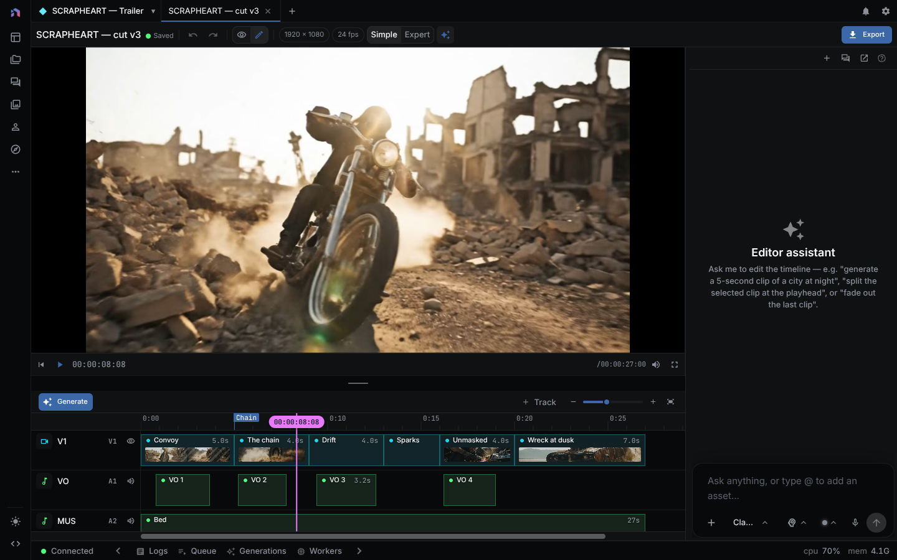

Takes, subject tracks, reframing, and generative edits all change media or framing on a clip. They never change the clip's start, duration, or track.



## Compare takes without moving the edit

Every generated result is a take on its clip. A take records the generated
asset and its generation context. Selecting another take swaps the clip's media
and leaves its start time, duration, track, effects, and linked media alone.

1. Generate a clip, then create another take with **Regenerate as new clip** or generate again.
2. Select the clip, open **History** in the Inspector, and choose **Preview Candidate** to audition a take in place.
3. Choose **Use take** on the take that belongs in the cut.
The active take is the one used by preview, render, and interchange export.
If a generated take fails, the previously active take remains in place.

## Track a subject

A media track stores a subject's position over source time. Bind a clip's
position, scale, or mask to that track when a title, graphic, or mask must
follow a moving subject.

Create the track with the agent's `track_object` tool (it needs a provider that implements `track_object`, and a box around the subject at the start of the range), then attach the dependent clip. The Inspector's **Tracking** section lists a clip's tracks. Its **Follow object** section binds the clip to a track in **Position** or **Position + scale** mode, with offsets and smoothing. The **Subject matte** section uses a track for a mask.
The binding follows trims and clip movement because it uses source time rather
than the timeline's absolute position. A changed source asset makes its media
tracks stale. Re-run tracking before relying on a stale track.

## Adapt a cut for another frame

Choose **Adapt format** in the timeline's overflow menu (the three-dot button in the tab row). Pick one or more target formats (9:16, 1:1, 4:5), a strategy, and a safe margin of 0 to 30 percent. Each format becomes a new sequence that shares the source media. The source sequence stays unchanged.

| Strategy | Behavior |
| --- | --- |
| Center | Crops each clip around the center. |
| Smart Reframe | Uses subject tracks or authored framing. Unavailable until every visual clip has a current subject track or authored framing. |
| Follow selected object | Follows one ready subject track. Unavailable until a track exists. |

Review the derived cut, then open **Smart Reframe** in the Inspector for a clip. Choose its subject (auto, center, or a track) and add manual framing keys where the automatic crop needs direction. Framing is stored in source time, so it follows trims and moves. The section flags automatic framing as stale when the source asset changes. Preview and render use the same framing data.

## Repair or extend a shot

Generative timeline edits (the **AI Edit** section for a video clip, or the agent's `ui_timeline_generatively_edit_clip` tool) create a candidate take. They do not replace the
active media until you select the result.

Available operations include:

- Extend a shot at its start or end (`extend`).
- Replace a source range (`replace_range`).
- Remove or replace a tracked object (`remove_object`, `replace_object`).
- Restyle a shot (`restyle`) or regenerate it (`regenerate`).

The clip must be a video clip with a current asset and a positive duration.

Object operations require a ready media track for the active source. Before
running an edit, NodeTool checks the requested operation against the selected
model's capabilities. If the model cannot perform the edit, choose another
model or change the operation.

## Hand off a sequence

`exportInterchange` in `@nodetool-ai/timeline` writes an editable project document for another editor. The native editor's **File > Export to Premiere Pro** calls it through the server, and **File > Import Premiere XML** reads a sequence back. Both need a timeline opened from a server. No other editor menu, CLI command, or agent tool calls it yet.

| Target | Output | Carries |
| --- | --- | --- |
| Final Cut Pro | FCPXML | sequence format, active media, timing, tracks, and markers |
| Premiere Pro | Legacy FCP XML | sequence format, active media, audio and video tracks, timing, markers, Basic Motion (scale, rotation, position, anchor), opacity, constant speed and reverse, clip volume, fades, track fader and pan, with keyframes |

The export report names missing media and edits that need baking, including
effects, masks, 3D transforms, speed ramps and freezes, presets and keyframes
on other properties, captions, and unsupported clip types. FCPXML also lists
transforms, opacity, speed, volume, and fades. Resolve or bake those items before delivery. NodeTool never reports an
incomplete editable export as lossless.

## Work with the agent

The agent reads each clip's active take id with `ui_timeline_get_state` and edits through `ui_timeline_apply_take`, `track_object`, `ui_timeline_retarget_format`, `ui_timeline_set_reframe_subject`, `ui_timeline_add_reframe_keyframe`, and `ui_timeline_generatively_edit_clip`. Check the resulting takes, tracks, and framing before export.

A repair, as the agent runs it. The prompt is illustrative. The arguments and result fields come from
`packages/agents/tests/timeline-generative-edit.test.ts`, where `fal` and `video-edit-model` are fixture values.

```text
User: Make this station deserted at night.
```

```json
{
  "tool": "ui_timeline_generatively_edit_clip",
  "arguments": {
    "clip_id": "clip-1",
    "instruction": "Make this station deserted at night",
    "provider": "fal",
    "model": "video-edit-model"
  }
}
```

The result is a candidate take. The clip keeps its active take (`take-1`) and its trimmed source range:

```json
{
  "generationId": "<candidate id>",
  "activeTakeId": "take-1",
  "candidate": { "id": "<candidate id>", "status": "success", "source": "video_to_video" },
  "clip": { "currentAssetId": "asset-1", "inPointMs": 40000, "outPointMs": 44000 }
}
```

The candidate's `mediaEdit` records the instruction, provider, model, and the source context (sequence, clip, source asset, source range, timeline start and duration). The edit takes effect only after a second call:

```json
{ "tool": "ui_timeline_apply_take", "arguments": { "clip_id": "clip-1", "take_id": "<candidate id>" } }
```

The clip then points at a `generative://clip-1/...` asset with `inPointMs` 0 and `outPointMs` 4000.

### If it fails

- Unknown `clip_id`: the tool throws a "clip with id" error. Clip ids must be explicit.
- `ui_timeline_apply_take` on a take that is not an AI edit candidate throws an "AI edit candidate" error.
- `provider` without `model` (or the reverse) is rejected before any call.

## Related features

- [Video Editor](video-editor.md): timeline, playback, clip editing, and MP4 export
- [Workflow Editor](workflow-editor.md): edit a workflow bound to a generated clip
- [Asset Management](asset-management.md): organize imported media
