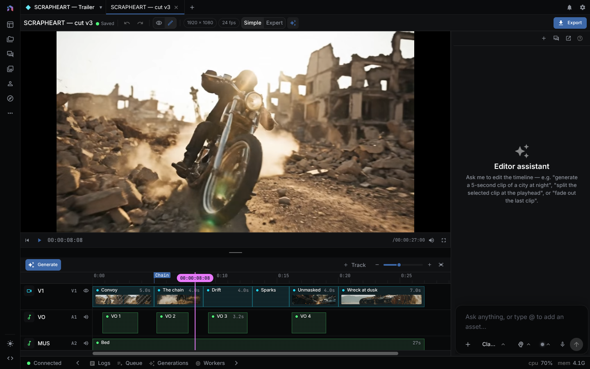

Takes, subject tracks, reframing, and generative edits all change media or framing on a clip. They never change the clip's start, duration, or track.

## Compare takes without moving the edit

Every generated result is a take on its clip. A take records the generated
asset and its generation context. Selecting another take swaps the clip's media
and leaves its start time, duration, track, effects, and linked media alone.

1. Generate a clip, then create another take with **Regenerate as new clip** or generate again.
2. Select the clip, open **History** in the Inspector, and choose **Preview Candidate** to audition a take in place.
3. Choose **Use take** on the take that belongs in the cut.
The active take is the one used by preview, render, and interchange export.
If a generated take fails, the previously active take remains in place.

## Track a subject

A subject track records where a subject is in the footage. Bind a clip's
position, scale, or mask to that track when a title, graphic, or mask must
follow a moving subject.

Ask the assistant to track the subject (see [Ask the assistant](#ask-the-assistant)), then attach the dependent clip. Tracking needs a model provider that supports object tracking, and a box around the subject at the start of the range. The **AI** panel's **Tracking** section lists a clip's tracks. Its **Follow object** section binds the clip to a track in **Position** or **Position + scale** mode, with offsets and smoothing. The **Subject matte** section uses a track for a mask.
The binding stays locked to the footage even when you trim or move the clip. A track is marked out of date when its source file changes. Run tracking again before relying on it.

## Adapt a cut for another frame

Choose **Adapt format** in the timeline's overflow menu (the three-dot button in the tab row). Pick one or more target formats (9:16, 1:1, 4:5), a strategy, and a safe margin of 0 to 30 percent. Each format becomes a new sequence that shares the source media. The source sequence stays unchanged.

| Strategy | Behavior |
| --- | --- |
| Center | Crops each clip around the center. |
| Smart Reframe | Uses subject tracks or authored framing. Unavailable until every visual clip has a current subject track or authored framing. |
| Follow selected object | Follows one ready subject track. Unavailable until a track exists. |

Review the derived cut, then open **Smart Reframe** in the **AI** panel for a clip. Choose its subject (auto, center, or a track) and add manual framing keys where the automatic crop needs direction. Framing stays locked to the footage even when you trim or move the clip. The section flags automatic framing as out of date when the source file changes. Preview and render use the same framing data.

## Repair or extend a shot

Generative edits (the **AI Edit** section for a video clip, or a request to the assistant) create a candidate take. They do not replace the
active media until you select the result.

Available operations include:

- Extend a shot at its start or end.
- Replace a range of the footage.
- Remove or replace a tracked object.
- Restyle a shot, or regenerate it.

The clip must be a video clip with a current asset and a positive duration.

Object operations need a finished subject track on the clip. Before
running an edit, NodeTool checks the requested operation against the selected
model. If the model cannot perform the edit, choose another model or change the operation.

## Hand off a sequence

The native editor's **File > Export to Premiere Pro** writes an editable project document for another editor, and **File > Import Premiere XML** reads a sequence back. Both need a timeline opened from a server.

| Target | Output | Carries |
| --- | --- | --- |
| Final Cut Pro | FCPXML | sequence format, active media, timing, tracks, and markers |
| Premiere Pro | Legacy FCP XML | sequence format, active media, audio and video tracks, timing, markers, Basic Motion (scale, rotation, position, anchor), opacity, constant speed and reverse, clip volume, fades, track fader and pan, with keyframes |

The export report names missing media and effects that must be rendered into the video before export, including
effects, masks, 3D transforms, speed ramps and freezes, presets and keyframes
on other properties, captions, and unsupported clip types. FCPXML also lists
transforms, opacity, speed, volume, and fades. Resolve or render those items into the video before delivery. NodeTool never reports an
incomplete editable export as lossless.

## Ask the assistant

- "Track the person in the red jacket on clip 2 so the title follows them."
- "Make this station deserted at night." The result is a new take. Choose **Use take** to put it in the cut.
- "Make a 9:16 version of this timeline."
- "Extend the last shot by two seconds."

Check the resulting takes, tracks, and framing before export.

Builders driving this from code or MCP: see [Creative Agent Tools](developer/creative-agent-tools.md#timelines).

## If it fails

- The assistant says it cannot find the clip: name the clip or select it first.
- A generative edit is refused when the model does not support that operation, or when only one of provider and model is given. Pick both, or pick another model.
- A take that did not come from an AI edit cannot be applied as one. Use **Use take** in the clip's **History** instead.
- Follow and reframe options stay unavailable until the clip has a current subject track. Run tracking again if the source file changed.

## Related features

- [Video Editor](video-editor.md): timeline, playback, clip editing, and MP4 export
- [Workflow Editor](workflow-editor.md): edit a workflow bound to a generated clip
- [Asset Management](asset-management.md): organize imported media
