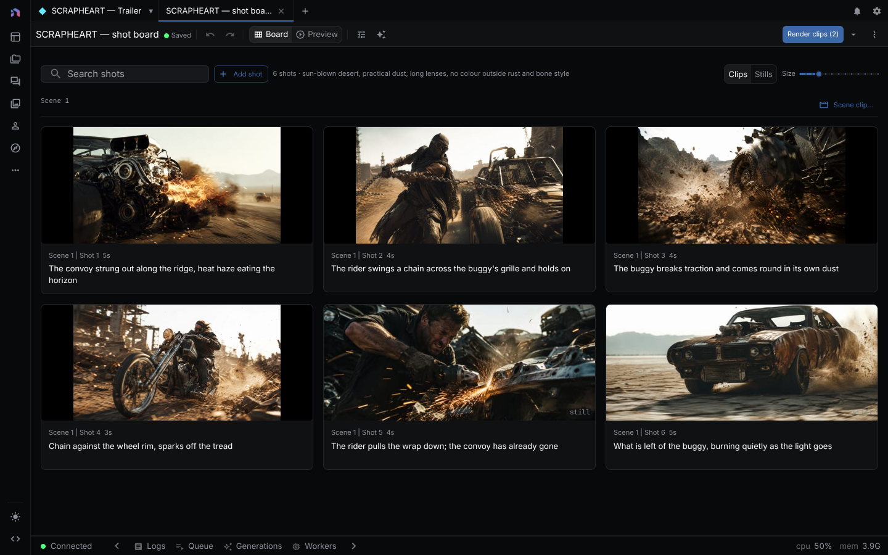

A guided flow plans beats, a storyboard, or a script, you review the plan, and each shot or beat generates one to three takes. A take is a preview. It enters the cut only when you set it as current, choose **Use take**, or approve a draft.

> **Runs:** locally or cloud, depending on the models you pick. **Needs:** a language model, an image model for stills, and a video model for clips, each with its provider key (see [Providers](providers.md) and [Models and providers](models-and-providers.md)). **Costs:** every take on a paid provider is billed at provider rates, and asking for three takes triples the cost of that shot. Stills are billed separately from clips.
{: .callout-note}

Reference-based shots need a video model that accepts references. On-camera performance needs an audio-driven or lip-sync model, prepared speech audio, and source footage of the performer. Add product photos, character images, logos, and style frames to the Asset Explorer first. See [Asset Management](asset-management.md).

## Trace: generate and accept a take

The agent runs the same four steps the buttons do, through tools in `packages/agents/src/capabilities/video-production.specs.ts`.

User prompt in chat:

> Generate two takes of the product close-up in the Northline bottle ad. Show me before you use one.

| Step | Tool call | Effect on the document |
|---|---|---|
| 1 | `prepare_video_production` with `project_id`, `destination` (`document_id`, `target_type: "timeline_clip"`, `target_id`), `review` (`status: "reviewed"`, `plan_fingerprint`), `operation: "initial_generation"`, `visual_treatment: "product_close_up"`, `speech_mode: "none"`, `route: "reference_to_video"`, `provider`, `model`, `prompt`, `reference_asset_ids`, `timing`, `candidate_count: 2` | None. Returns a manifest with two frozen candidate and request ids, before any provider spend. |
| 2 | `submit_video_production` with `prepared` (the manifest, unedited) | Generation starts. Results stay inactive and unaccepted. Existing request ids are recovered, not resubmitted. |
| 3 | `inspect_video_production_candidates` with `candidates` and optionally `preview: { kind: "preview_take", batch_id, document_id, selection }` | None. Refreshes candidate state and builds a preview. It writes no accepted media. |
| 4 | `accept_video_production_candidates` with `action: "use_take"`, `batch_id`, `document_id`, `project_id`, `candidates`, `selection`, `targets` | The chosen take becomes the clip's media. Only that destination changes. |

`provider` and `model` come from `find_model`. `action: "use_draft"` applies one selection per destination as a single atomic manifest.

Rejections the tools return, from `packages/timeline/src/production.ts`:

- "Production take count must be between 1 and 3."
- "Product close-up generation requires a resolved product reference asset."
- "The selected generation route cannot consume the required reference assets."
- "Speech duration Nms exceeds the Nms production slot."
- A destination whose host has no shared adapter is rejected and no media changes.

## Choose where to start

### Video: plan beats and land on the timeline

**Video** organizes a short ad, explainer, or social clip as timed beats.

1. Describe the video in **What's the video?**
2. Open **Creative context (optional)**. Add the product name, audience,
   objective, tone, approved claims, and claims to avoid.
3. Choose **Add product reference**, **Add character reference**, or **Add
   style reference**. After adding an asset, you can change its role to product,
   character, location, or style.
4. Continue to **Review your beats**. Edit the direction, duration, transition,
   and voiceover for each beat.
5. Set the production choices described in
   [Review the production plan](#review-the-production-plan), then continue to
   the look and generation step.

The result opens in the timeline, where each beat remains a separate clip.

### Storyboard: direct each shot before animation

1. Describe the story in **What's your story?** and add creative context and
   references.
2. Review **Your screenplay**. Edit scene headings, action, dialogue, and shot
   duration before rendering.
3. Set the editorial purpose, visual treatment, speech mode, production
   direction, and requested takes for each shot.
4. In **Entities**, assign reusable characters and other references to the
   shots that need them.
5. In **Look**, choose the aspect ratio, art style, still model, and video
   model. **Add your own style** can build a look from one to three reference
   images.
6. Render stills, approve the framing you want, then generate clips.

### Script: write and cast the words first

**Script** starts from dialogue, narration, and voice casting.

1. Write or import the script.
2. In **Production context**, add the product, audience, objective, tone, and
   claim rules. These notes travel with the script without changing its words.
3. Assign speakers and voices, then generate the speech takes you want to use.
4. Create a storyboard from the script when you want visual shots. The linked
   storyboard keeps the script lines, speakers, entities, voices, and selected
   speech takes.
5. Add or confirm visual references in the storyboard before generating clips.

Edit linked words and voices in Script. The storyboard treats them as source
material instead of silently rewriting them.

## Review the production plan

The Video and Storyboard review screens add these choices to each beat or shot:

- **Editorial purpose** identifies the job of the section, such as Hook,
  Demonstration, Proof, or Call to action.
- **Visual treatment** chooses Actor to camera, Product close-up, Lifestyle
  B-roll, or Generated scene.
- **Speech mode** chooses None or Off-camera. On-camera appears in the list but is disabled in the guided editors.
- **Production direction** adds local camera or performance notes.
- **Requested takes** asks for one, two, or three alternatives.

Changing the brief, references, or production choices later requires a new review before media generates.

### Narration and on-camera speech

**Off-camera** is narration or voiceover over a product shot, B-roll, or another scene.

The guided Video and Storyboard editors do not support **On-camera**. They show
it as unavailable and block generation with "On-camera speech is unavailable in
this guided flow" if a shot carries it. Choose Off-camera or None there.

The agent can run an on-camera performance when the visible performer must
match the recorded line. That route (`audio_driven_performance`) needs all of
the following:

- the exact speech take or recorded audio,
- a character entity with a character reference,
- a source face video for the performance,
- an audio-driven or lip-sync model available through a connected provider,
- enough time in the shot for the complete speech take.

An unsupported on-camera request is never turned into narration. It is rejected with the missing requirement, for example "On-camera performance requires recorded speech audio before video generation." or "The selected generation route does not support audio-driven on-camera performance." Use off-camera speech for that shot, or prepare the missing inputs.

Speech must fit inside its beat or shot. On a timing conflict, shorten the line, choose a shorter speech take, or lengthen the section.

## Generate and compare takes

Generation creates the requested one to three options per destination. Options can finish in any order and keep their take numbers.

In Storyboard:

1. Open **View takes** on a shot.
2. Select a **Preview** chip to audition that clip without replacing the
   accepted clip.
3. Choose **Set as current clip** beside the take you want. Stills have the same choice as **Set as current still**.

In the timeline:

1. Select a clip and open **History** in the Inspector.
2. Choose **Preview Candidate** to audition an option in place.
3. Choose **Use take** to make that option active for the selected clip.

The agent can collect one preview per destination into a draft. Ask it to show the draft, then tell it to **Use draft**. The whole draft is validated before it applies, so a failed or outdated choice leaves the timeline unchanged.

Other options remain until you remove them.

## Retry failed generations

A failed option does not discard successful takes from the same run.

- Use **Retry N failed** in the Storyboard toolbar to retry failed shots.
- Use **Retry N failed** above the timeline to retry failed generated clips.
- Retry a single destination when only one take needs attention.

The error appears on the affected shot or clip. Causes include a missing reference, a model without the required video capability, missing performance audio, a missing character or source face video, and speech longer than the target slot.

## Example: a 15-second vertical product ad

This example makes a three-beat social ad for a reusable water bottle.

1. Add a clean product photo, a lifestyle photo of the recurring character,
   and two warm daylight style frames to the Asset Explorer.
2. Start **Video** and choose a 15-second vertical social format. Enter: “A
   quick product ad for the Northline bottle, aimed at commuters who want cold
   water all day.”
3. In **Creative context**, add the product name, audience, tone, the approved
   claim “keeps drinks cold for 24 hours,” and any claim the ad must avoid.
   Attach the product, character, and style references.
4. Review three five-second beats:
   - Hook: Lifestyle B-roll of the character leaving home, with off-camera
     narration.
   - Demonstration: Product close-up showing the cap and condensation.
   - Call to action: Product and character together with the final line.
5. Request two takes for the product close-up and one take for the other beats.
   Choose a reference-capable video model and generate.
6. Preview both close-up options and choose the better one. Retry only the failed beat if a generation fails.
7. Continue in the timeline. Trim the accepted clips, adjust audio, add
   captions, and export the vertical cut.

## Finish the cut

Accepted takes are ordinary timeline media. See the [Video Editor](video-editor.md) for
timeline controls and [AI Timeline Editing](ai-timeline-editing.md) for
generation history and local media edits.
