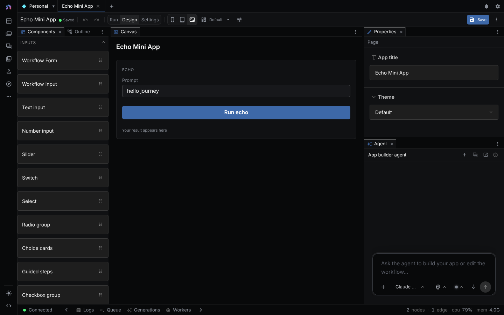
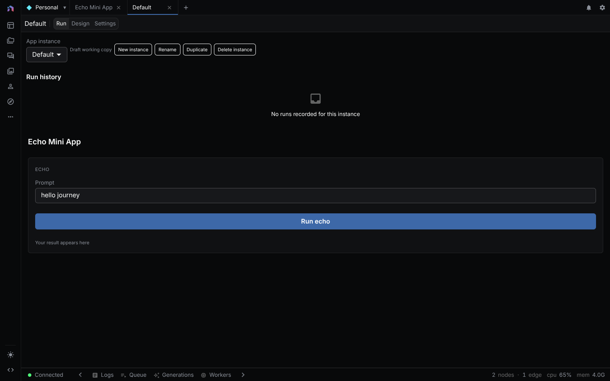
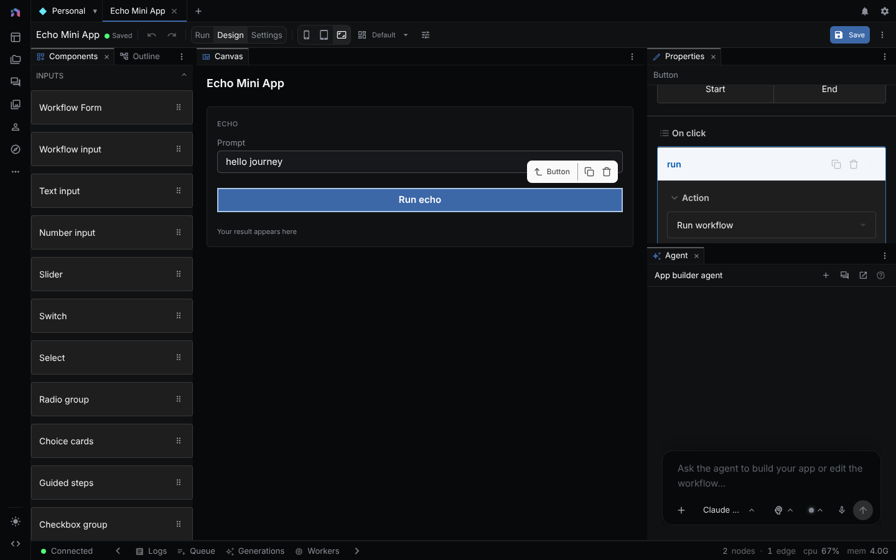
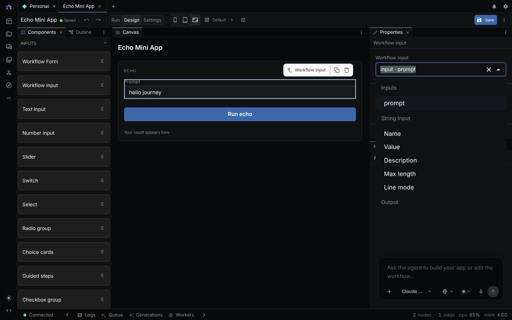

App Builder is the **Design** view of an app tab. You drag widgets onto a canvas, wire them to the inputs and outputs of the workflows the app runs, and save. Concepts are in [Mini Apps](mini-apps.md), recipes in [Building Mini Apps](mini-apps-guide.md), and every widget in the [Reference](mini-apps-reference.md).

> **Runs:** locally or cloud, wherever the app's workflows run. **Needs:** workflows with Input and Output nodes. Provider keys come from those workflows' nodes. The assistant needs a configured chat provider (see [Providers](providers.md)).
{: .callout-note}

The editor previews the screen at phone, tablet, or full width, and publishes a version that locks in the current state of every workflow the app runs.

## Open it

1. Open the **Apps** panel in the left sidebar.
2. Click an app, or create one with **New app** or **Create app from workflow**.
3. On the app tab, pick **Design** in the document bar.

**Run** shows the released version when there is one. **Preview draft** (⋮ menu) runs the unpublished draft. **Settings** holds publishing, versions, the spend budget, the public link, and recent runs. Rename an app from the right-click menu in the Apps panel.

## Build an app

1. Check that each workflow has the Input and Output nodes the app needs. Open one from **Linked workflows** (⋮ menu).
2. Add fields: Text Input, Number Input, Slider, Switch, Select, or a Workflow Form that renders every input of an operation. The palette groups widgets as Inputs, Chat & AI, Actions, Display, and Layout.
3. Wire each field to the matching Input node.
4. Add a Button with the **Run workflow** action, pointing at the workflow to
   run.

   

5. Add result widgets: Text, Markdown, Image, JSON, Progress.
6. Wire each result widget to the matching Output node.
7. Click **Save**. The bar shows **Unsaved changes** until you do. The Design bar also has Undo and Redo, the preview-width toggle, the Layout menu, and the **App data** toggle. The root settings hold the app title and a **Theme** (Default, Centered, or Card).

## Letting the agent do it

The assistant on the right of Design, Run, and Settings reads the app's workflows, adds and wires widgets, declares operations and variables, and edits a graph when the app needs new Input, Output, or Variable nodes. It runs the same check as `nodetool app debug` on the open draft, including unsaved edits, and can run the app once to read the verdict. Example prompt:

> Build a compact app with all inputs on the left, a run button below them, and
> outputs on the right.

## App Data

**App Data** in the Design header opens a panel with three lists. The assistant
edits the same lists.

- **Operations.** Each has a name, a **Runs** choice of Workflow or JS script,
  the workflow or script to run, **While one is running** (Replace running, Queue
  behind, or Run in parallel), and **Timeout (ms)**.
- **Variables.** Each has a name, a type (Any, Text, Number, Integer, True/false,
  List, or Record), a default, a scope (This session or Per user), and
  **Remember between visits**. Only per-user variables can be remembered.
- **Resources.** Each has a name, a kind (Asset, Timeline, Storyboard, or Sketch),
  and either one fixed document or all documents of that kind.

## Wiring

The picker lists what each workflow actually offers. Wiring points at node ids,
so renaming a node doesn't break the app.

| Widget kind | Wires to |
| --- | --- |
| Fields the user edits | A workflow input (`op:<opId>/in:<nodeId>`) or a node setting |
| Result displays | A workflow output (`op:<opId>/out:<nodeId>`) or a variable |
| Toggles and selects | A variable (`var:<variableId>`) |

Wiring that points at nothing is an error in the editor and in `nodetool app debug`. See [Bindings](mini-apps-reference.md#bindings).

## Several workflows in one app

Each workflow the app runs is an **operation**, edited under **Operations**, with its own wiring, overlap rule, and optional time limit. Buttons point at an operation by name, so a two-step app is two operations and two buttons.

## Publish and share

**Publish new version** in Settings saves the draft, then snapshots the screen and every workflow the app runs. The snapshot becomes the released version. Settings also rolls back, sets the spend budget, and creates a public link on servers that offer it. See [Publishing and sharing](mini-apps.md#publishing-and-sharing).

The editor has no export button. Move an app and its workflows as one JSON file
with `nodetool apps export-bundle` and `nodetool apps import-bundle`
([CLI](cli.md#nodetool-apps)).

## Related topics

- [Mini Apps](mini-apps.md)
- [Building Mini Apps](mini-apps-guide.md)
- [Mini App Reference](mini-apps-reference.md)
- [Workflow Editor](workflow-editor.md)
- [Chat & Agents](global-chat-agents.md)
