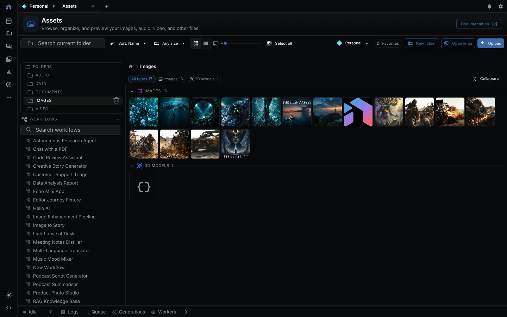
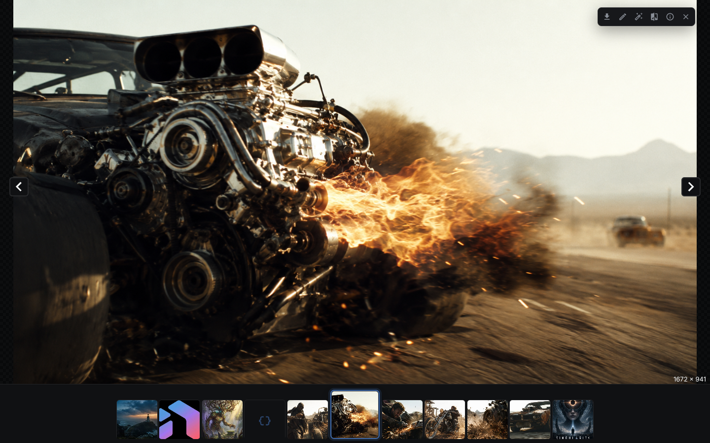
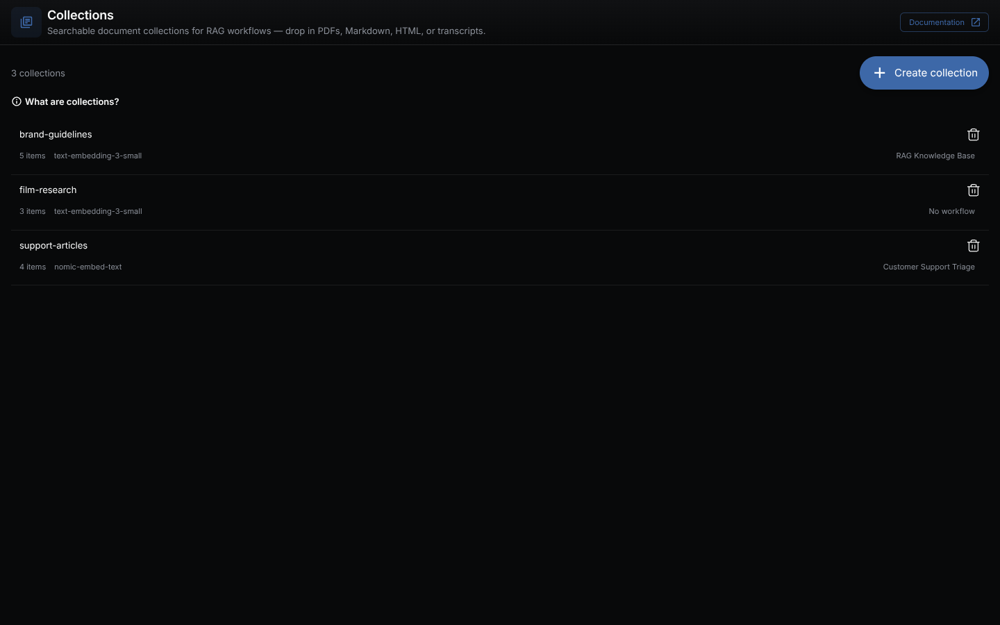

Assets are the files workflows read and write: images, audio, video, PDFs, 3D models, and anything else a node references. The Asset Explorer is the one store that workflows, sketches, and timelines share, so a file produced in one surface is usable in the others. See [Key Concepts → How everything fits together](key-concepts.md#how-everything-fits-together).

---

## Asset Explorer

Open **Assets** from the app menu (a tab at `/assets`) or use the Assets view in the left panel.

### Views

Grid view shows thumbnails. List view shows compact rows with metadata columns. A toggle in the toolbar switches them.

### Toolbar

- Sort by Name, Date, or Size
- File size filter: All, Empty, < 1 MB, 1-10 MB, 10-100 MB, > 100 MB
- Type filter: All, Images, Videos, Audio, 3D Models, Text, Documents, Other
- **Item Size** slider for the grid
- Select all, Deselect, **Create folder**, **Upload files**

The page header shows the total size, folder count, and file count of the current folder.

### Navigation

- The left panel shows the folder tree.
- Search matches file names only, by substring. The input searches the current folder (**Search current folder...**). The toggle next to it switches to **Search all assets...**, which searches every folder and shows each result's folder path. Global search starts at two characters.

### Uploading Files

- Drag files into the Asset Explorer, or use **Upload files**.
- Drop files onto the workflow canvas. NodeTool uploads them and adds a matching constant node.

The server rejects a single upload above `NODETOOL_MAX_UPLOAD_BYTES` (1 GiB by default) with `Upload for key "<key>" exceeds maximum size`.

### Working with Assets in Workflows

Drag any asset from the Asset Explorer onto the workflow canvas. NodeTool adds a constant node for its type, such as `nodetool.constant.Image`, `Video`, `Audio`, `Document`, or `Model3D`. Dragging several selected assets adds one node each. An unsupported type shows an "Unsupported file type" error.

---

## Asset Viewers

| File Type | Viewer Features |
|-----------|----------------|
| **Images** | Zoom up to 16x, pan |
| **Audio** | Waveform with zoom and minimap. To trim or fade, see [Audio Editor](audio-editor.md) |
| **Video** | Browser video controls |
| **PDF** | Previous and next page, zoom in, zoom out, reset zoom |
| **Text** | Markdown rendering, code, CSV, and plain text |
| **3D Models** | Orbit and zoom, grid, axes, wireframe toggle, fullscreen |

Open any asset in its viewer by double-clicking it in the Asset Explorer.

---

## Collections

A collection stores indexed text chunks for semantic search, not asset files. See [Collections](collections.md).

---

## Metadata

- Assets track `size`, `content_type`, and `duration` (audio and video), plus a free-form `metadata` object.
- On the desktop app, an imported video whose longer side is at least `NODETOOL_VIDEO_PROXY_MIN_SIZE_PX` pixels (default 1920) gets a smaller preview proxy built in the background so timeline scrubbing seeks fast. Export reads the original.
- Files at or above `NODETOOL_EXTERNAL_ASSET_THRESHOLD_BYTES` (default 1 GiB) stay at their original path and the asset references them in place. See [External assets](storage.md#external-assets).

---

## Document Indexing

Extract text from binary formats first (for example with `lib.pdf.ExtractText`), index it into a collection with an index node or by dropping text files onto the collection tile, then search it with `vector.QueryText` or `vector.HybridSearch`. See [Indexing](indexing.md).

---

## Storage

Assets are stored under `$XDG_DATA_HOME/nodetool/assets`, falling back to `~/.local/share/nodetool/assets` on macOS and Linux and `%APPDATA%\nodetool\assets` on Windows. `ASSET_FOLDER` or `STORAGE_PATH` moves it. Deployed instances can use S3-compatible storage or Supabase Storage. See [Storage](storage.md).

---

## If it fails

- **`Unsupported file type: <content type>`** when dragging an asset onto the canvas: no constant node exists for that type.
- **Asset shows offline**: an externally referenced file moved or changed. Relink it. See [External assets](storage.md#external-assets).

## Next Steps

- [Indexing](indexing.md)
- [Storage](storage.md)
- [Workflow Editor](workflow-editor.md)
- [Example: Chat with Docs](workflows/chat-with-docs.md)
