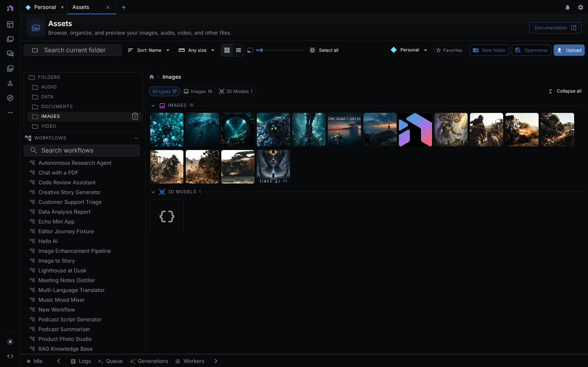
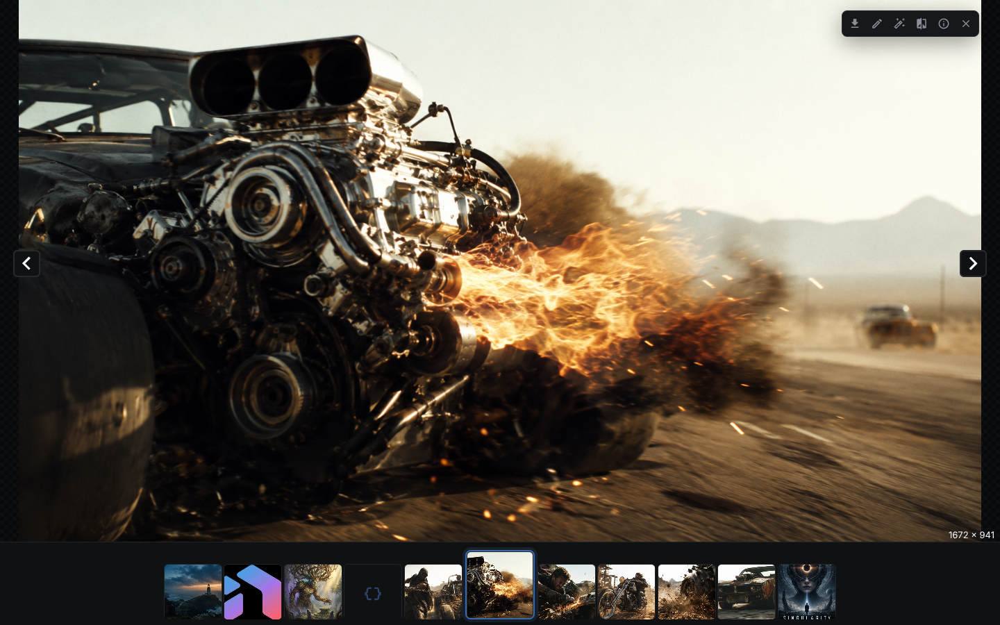
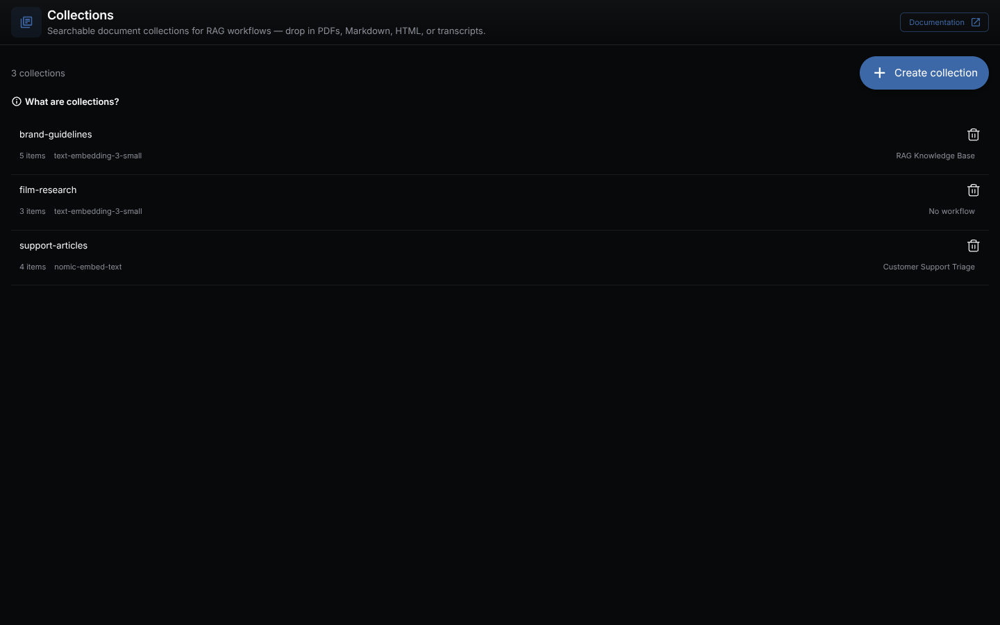

Assets are the files workflows read and write: images, audio, video, PDFs, 3D models, and anything else a node references. The Asset Explorer is the one store that workflows, sketches, and timelines share, so a file produced in one surface is usable in the others. See [Key Concepts → How everything fits together](key-concepts.md#how-everything-fits-together).

---

## Asset Explorer

Open **Assets** from the app menu (a tab at `/assets`) or use the Assets view in the left panel.

### Views

Grid view shows thumbnails. List view shows compact rows with metadata columns. A toggle in the toolbar switches them.

### Toolbar

- Sort by Name, Date, or Size
- File size filter: All, Empty, < 1 MB, 1-10 MB, 10-100 MB, > 100 MB
- Type filter: All, Images, Videos, Audio, 3D Models, Text, Documents, Other
- **Item Size** slider for the grid
- Select all, Deselect, **Create folder**, **Upload files**

The page header shows the total size, folder count, and file count of the current folder.

### Navigation

- The left panel shows the folder tree. Within a project the folders are the directories of the project folder. See [folders in the asset browser](workspaces.md#folders-in-the-asset-browser).
- Search matches file names only, by substring. The input searches the current folder (**Search current folder...**). The toggle next to it switches to **Search all assets...**, which searches every folder and shows each result's folder path. Global search starts at two characters.

### Uploading Files

- Drag files into the Asset Explorer, or use **Upload files**.
- Drop files onto the workflow canvas. NodeTool uploads them and adds a matching constant node.

One upload can be up to 1 GB. A larger file is rejected with `Upload for key "<key>" exceeds maximum size`. A server operator can raise the limit, see [Storage](storage.md).

### Working with Assets in Workflows

Drag any asset from the Asset Explorer onto the workflow canvas. NodeTool adds a constant node of its type: Image, Video, Audio, Document, or 3D Model. Dragging several selected assets adds one node each. An unsupported type shows an "Unsupported file type" error.

---

## Asset Viewers

| File Type | Viewer Features |
|-----------|----------------|
| **Images** | Zoom up to 16x, pan |
| **Audio** | Waveform with zoom and minimap. To trim or fade, see [Audio Editor](audio-editor.md) |
| **Video** | Browser video controls |
| **PDF** | Previous and next page, zoom in, zoom out, reset zoom |
| **Text** | Markdown rendering, code, CSV, and plain text |
| **3D Models** | Orbit and zoom, grid, axes, wireframe toggle, fullscreen |

Open any asset in its viewer by double-clicking it in the Asset Explorer.

---

## Collections

A collection holds the text of your documents for search by meaning. It does not hold asset files. See [Collections](collections.md).

---

## Metadata

- Each asset records its size, its file type, and for audio and video its duration.
- On the desktop app, an imported video 1920 pixels or more on its longer side gets a smaller preview copy, built in the background, so scrubbing it on a timeline stays fast. Export always reads the original.
- On the desktop app, the import dialog offers **Copy** or **Link**. A linked file stays where it is on your disk and the asset uses it in place. Files of 1 GB or more start on Link. **Collect files** on the project card copies linked files into the project folder. See [Link or copy media](projects.md#link-or-copy-media).

---

## Storage

An asset is a file in its project's folder: generated media in `Generated/`, uploads in `Imported/`, and other files where they were saved. See [assets are files in the folder](workspaces.md#assets-are-files-in-the-folder).

Thumbnails, video previews, and assets created before project folders, until they [move into the folder](workspaces.md#upgrading-from-before-project-folders), stay in NodeTool's asset directory: `~/.local/share/nodetool/assets` on macOS and Linux, `%APPDATA%\nodetool\assets` on Windows. A server can keep them in S3 or Supabase Storage instead. See [Storage](storage.md).

---

## If it fails

- **`Unsupported file type: <content type>`** when dragging an asset onto the canvas: no constant node exists for that file type.
- **Asset shows Missing**: a linked file moved or changed, or the asset's file was deleted or moved out of the project folder. **Relink** and **Remove** sit next to the badge. See [When a file goes missing](workspaces.md#when-a-file-goes-missing).

## Next Steps

- [Collections](collections.md)
- [Storage](storage.md)
- [Workflow Editor](workflow-editor.md)
- [Example: Chat with Docs](workflows/chat-with-docs.md)
