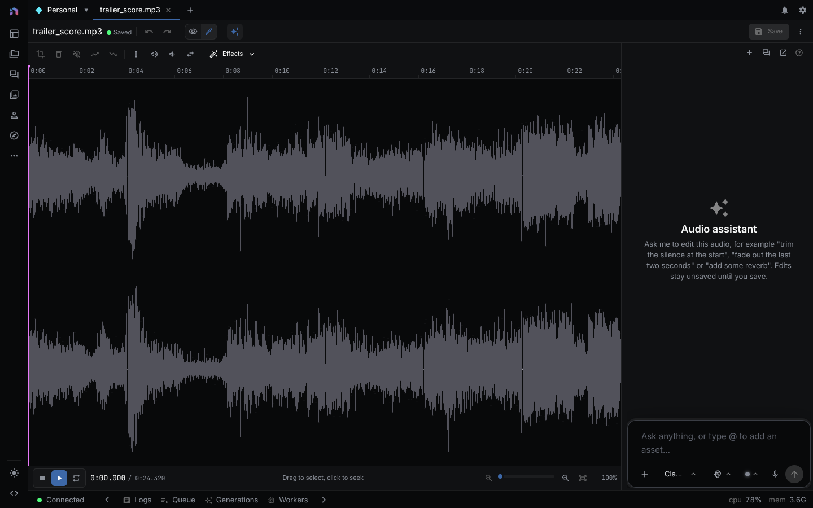

The audio editor decodes an audio asset into samples in your browser, shows the waveform, and edits a selected region or the whole clip. **Save** writes the result back to the asset as WAV.



> **Runs:** locally in the browser (Web Audio). **Needs:** no API key. An LLM provider is needed only for the assistant (see [Providers](providers.md)).
{: .callout-note}

Open an audio asset in a workspace tab and switch the **View / Edit** toggle to **Edit**. Unsaved edits stay in the editor when you switch back to **View** until you close the tab.

| Area | Contents |
|---|---|
| Toolbar | Transport, zoom, selection and level edits, **Effects**, undo and redo, **Save** |
| Waveform | Playhead and selection. Drag selects, click clears the selection and seeks |
| Footer | Selection start, end, and length on the left. Playhead time and total length on the right |
| Assistant | Docked chat beside the editor (desktop only). See [Ask the assistant](#ask-the-assistant) |

The ⋮ menu holds **Transform with workflow…**, which runs the file through one of your workflows. If the asset cannot be fetched or decoded, the editor shows "Could not open audio editor" with the reason.

## Play and zoom

**Play** (becomes **Pause**), **Stop**, and **Loop**. With a selection, Play plays only the selection and Stop returns to its start. With none, Play runs from the playhead to the end and Stop returns to the start. With **Loop** on, the selection repeats. Playback stops when the audio changes, including undo and redo.

Zoom runs from 100 percent (whole clip) to 6400 percent. The buttons change it by a factor of 1.5, and **Fit to window** resets it.

## Edits

Edits change the in-editor copy only. Nothing reaches the asset until you save. All edits apply to every channel.

| Button | Needs selection | What it does |
|---|---|---|
| **Trim to selection** | Yes | Keeps the selection and discards the rest |
| **Delete selection** | Yes | Removes it and joins both sides. The playhead moves to the cut |
| **Silence selection** | Yes | Replaces it with silence and keeps the length |
| **Fade in selection**, **Fade out selection** | Yes | Linear ramp from silence, or to silence |
| **Normalize** | No | Scales the selection or clip so its loudest sample reaches full scale. A silent region is unchanged |
| **Amplify** | No | Multiplies the level by 1.4. Peaks above full scale clip |
| **Quieten** | No | Multiplies the level by 0.7 |
| **Reverse** | No | Reverses the selection or clip |

Trim and Delete clear the selection. The other edits keep it, so you can chain a fade and a normalize on one region. Undo and redo keep the last 50 states, and a new edit after an undo discards the redo branch.

### Effects

**Effects** opens effects in five groups. Most open a dialog with parameters, a **Preview** (the first 15 seconds of the range), **Reset**, and **Apply**. The dialog states whether it applies to the selection or the whole clip. Each effect is one undo step.

| Group | Effects |
|---|---|
| Tone | Equalizer, Low cut, High cut, Remove DC offset |
| Dynamics | Compressor, Limiter, Noise gate |
| Space | Reverb, Echo, Chorus |
| Character | Distortion, Bitcrusher, Tremolo, Invert |
| Time | Change speed (0.25x to 4x, changes the length) |

Reverb and echo tails mix onto the audio after the range. If an effect fails, the editor shows an error and the audio is unchanged.

## Save

**Save** encodes the clip as 16-bit PCM WAV and overwrites the asset. The content type becomes `audio/wav` whatever it was before. Sample rate and channel count are kept. A "Saved edits to audio." notification confirms it. On failure a "Failed to save audio: ..." notification shows the reason and your edits stay in the editor. Workflows that reference the asset use the edited audio from the next run.

## Ask the assistant

The assistant edits the open audio through the `ui_audio_*` tools. Each edit is one undo step, and nothing is saved until the assistant calls `ui_audio_save`, which you can ask for. The tools are `ui_audio_get_state`, `ui_audio_edit`, `ui_audio_list_effects`, `ui_audio_apply_effect`, and `ui_audio_save`.

`ui_audio_get_state` returns the duration, sample rate, channel count, unsaved state, your selection, and a peak level from 0 to 1 per window, which is how the assistant finds silence. `ui_audio_edit` takes `op` (`trim`, `delete`, `silence`, `fade_in`, `fade_out`, `normalize`, `reverse`, `gain` with `gain_db` from -60 to 24) and an optional `start` and `end` in seconds.

A trace from `packages/agents/tests/audio-tool-loop.test.ts` (the `trim-leading-silence` case, on a 5 second recording with 2 seconds of silence first). The audio fixture is the test's, and the call order is its golden transcript.

```text
User: This recording starts with dead air before anyone speaks. Remove the silence at the start and save the audio.
```

```json
[
  { "tool": "ui_audio_get_state", "arguments": {} },
  { "tool": "ui_audio_edit", "arguments": { "op": "delete", "start": 0, "end": 2 } },
  { "tool": "ui_audio_save", "arguments": {} }
]
```

The state call shows peaks of 0 for the first 2 seconds. After the delete, the duration is 3 seconds and the first peaks are above 0.1. After the save, the draft is clean.

### If a call fails

The tool throws and the audio is unchanged. Messages from the same test file:

- `trim` or `delete` without a range: `"trim" needs a range`.
- `start` without `end`: "Pass both `start` and `end`".
- `gain` without `gain_db`: "needs gain_db".
- Unknown effect id: `Unknown effect "nope"`. Unknown or out-of-range parameter: `"reverb" has no parameter "wet"` or `"mix" must be between 0 and 100`.
- If the audio changed while an effect rendered, the result is dropped and the tool asks the assistant to read the state again and retry.

## Related

- [Asset Management](asset-management.md)
- [Workspaces](workspaces.md): tabs and the View / Edit toggle
