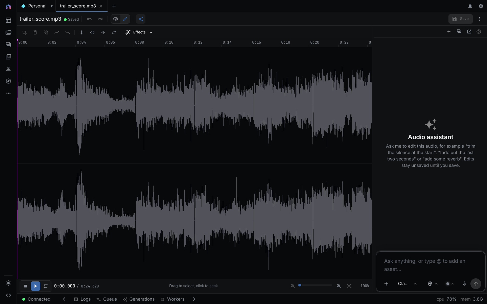

The audio editor opens an audio asset in your browser, shows its waveform, and edits a selected region or the whole clip. **Save** writes the result back to the asset as a WAV file.

> **Runs:** locally in the browser (Web Audio). **Needs:** no API key. An LLM provider is needed only for the assistant (see [Providers](providers.md)).
{: .callout-note}

Open an audio asset in a workspace tab and switch the **View / Edit** toggle to **Edit**. Unsaved edits stay in the editor when you switch back to **View** until you close the tab.

| Area | Contents |
|---|---|
| Toolbar | Transport, zoom, selection and level edits, **Effects**, undo and redo, **Save** |
| Waveform | Playhead and selection. Drag selects, click clears the selection and seeks |
| Footer | Selection start, end, and length on the left. Playhead time and total length on the right |
| Assistant | Docked chat beside the editor (desktop only). See [Ask the assistant](#ask-the-assistant) |

The ⋮ menu holds **Transform with workflow…**, which runs the file through one of your workflows. If the asset cannot be fetched or decoded, the editor shows "Could not open audio editor" with the reason.

## Play and zoom

**Play** (becomes **Pause**), **Stop**, and **Loop**. With a selection, Play plays only the selection and Stop returns to its start. With none, Play runs from the playhead to the end and Stop returns to the start. With **Loop** on, the selection repeats. Playback stops when the audio changes, including undo and redo.

Zoom runs from 100 percent (whole clip) to 6400 percent. The buttons change it by a factor of 1.5, and **Fit to window** resets it.

## Edits

Edits change the in-editor copy only. Nothing reaches the asset until you save. All edits apply to every channel.

| Button | Needs selection | What it does |
|---|---|---|
| **Trim to selection** | Yes | Keeps the selection and discards the rest |
| **Delete selection** | Yes | Removes it and joins both sides. The playhead moves to the cut |
| **Silence selection** | Yes | Replaces it with silence and keeps the length |
| **Fade in selection**, **Fade out selection** | Yes | Linear ramp from silence, or to silence |
| **Normalize** | No | Scales the selection or clip so its loudest point reaches the maximum level without clipping. A silent region is unchanged |
| **Amplify** | No | Multiplies the level by 1.4. Peaks above the maximum level clip (distort) |
| **Quieten** | No | Multiplies the level by 0.7 |
| **Reverse** | No | Reverses the selection or clip |

Trim and Delete clear the selection. The other edits keep it, so you can chain a fade and a normalize on one region. Undo and redo keep the last 50 states, and a new edit after an undo discards the redo branch.

### Effects

**Effects** opens effects in five groups. Most open a dialog with parameters, a **Preview** (the first 15 seconds of the range), **Reset**, and **Apply**. The dialog states whether it applies to the selection or the whole clip. Each effect is one undo step.

| Group | Effects |
|---|---|
| Tone | Equalizer, Low cut, High cut, Remove DC offset |
| Dynamics | Compressor, Limiter, Noise gate |
| Space | Reverb, Echo, Chorus |
| Character | Distortion, Bitcrusher, Tremolo, Invert |
| Time | Change speed (0.25x to 4x, changes the length) |

Reverb and echo tails mix onto the audio after the range. If an effect fails, the editor shows an error and the audio is unchanged.

## Save

**Save** overwrites the asset with a standard WAV file (16-bit), whatever format it was before. Sample rate and channel count are kept. A "Saved edits to audio." notification confirms it. On failure a "Failed to save audio: ..." notification shows the reason and your edits stay in the editor. Workflows that reference the asset use the edited audio from the next run.

## Ask the assistant

The assistant edits the open audio. Each edit is one undo step, and nothing is saved until you ask for it.

- "Remove the silence at the start and save the audio."
- "Normalize the volume, then save."
- "Fade out the last two seconds."
- "Add a light reverb to the whole clip."

Builders driving this from code or MCP: see [Creative Agent Tools](developer/creative-agent-tools.md#audio).

## Related

- [Asset Management](asset-management.md)
- [Workspaces](workspaces.md): tabs and the View / Edit toggle
