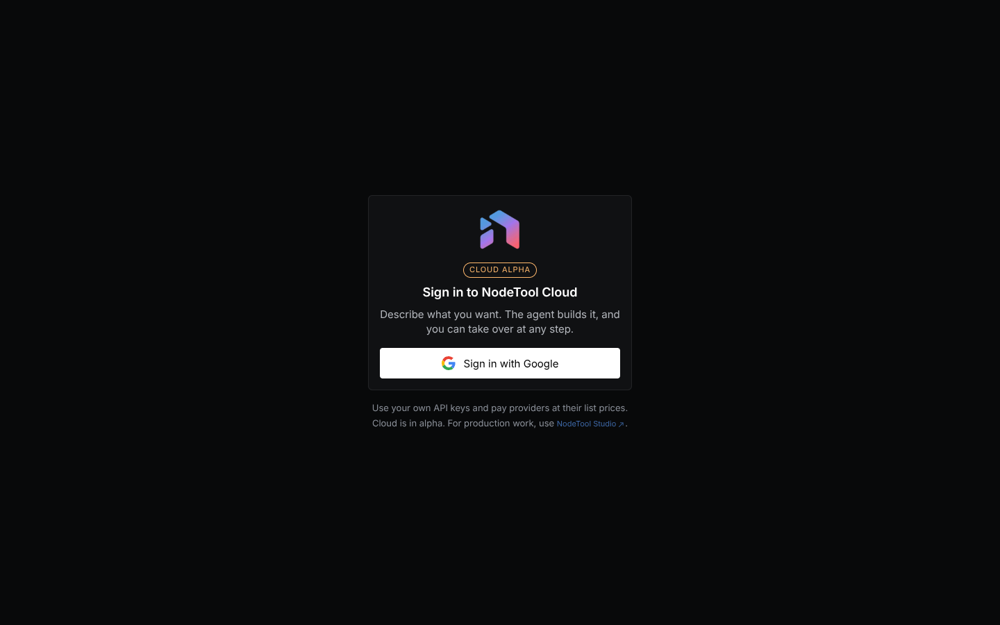

The server picks its auth mode from the environment. Endpoint auth requirements are in the [API Reference](api-reference.md), variable defaults in the [Configuration Guide](configuration.md#environment-variables-index).

## Quick Start

- **Supabase mode**: `SUPABASE_URL` and `SUPABASE_KEY` both set. Auth is enforced on every non-public request.
- **SSO mode**: `OIDC_ISSUER` and `OIDC_CLIENT_ID` both set. Users sign in through your OpenID Connect provider, and auth is enforced the same way.
- **Local mode**: neither pair set. Loopback connections run as user `"1"`. Non-loopback requests get `401` unless they come from a network in `NODETOOL_TRUST_LOCAL_NETWORKS` or carry a valid access token.

The server refuses to start with both Supabase and OIDC configured.

```bash
# Local mode: loopback trusted
nodetool serve

# Supabase mode: auth enforced on every request
export SUPABASE_URL=https://your-project.supabase.co
export SUPABASE_KEY=your-service-role-key
nodetool serve

# SSO mode: sign in through your identity provider
export OIDC_ISSUER=https://idp.example.com/realms/acme
export OIDC_CLIENT_ID=nodetool
export OIDC_CLIENT_SECRET=...
export NODETOOL_PUBLIC_URL=https://nodetool.example.com
nodetool serve
```

---

## Authentication Modes

The mode comes only from the presence of both Supabase variables or both OIDC variables (`packages/websocket/src/server.ts`). The server never reads `AUTH_PROVIDER`. Only the `@nodetool-ai/deploy` tooling writes it into container environments.

- **Supabase mode** validates a Supabase JWT on every non-public request, over HTTP and WebSocket.
- **SSO mode** runs the OpenID Connect sign-in itself and validates its own `nts_` session token. See [Single Sign-On (OIDC)](#single-sign-on-oidc).
- **Local mode** (`LocalAuthProvider`) maps requests to user `"1"`. Loopback bypasses auth, gated by `NODETOOL_TRUST_LOCALHOST`. Other sources get `401` unless a trust rule, a valid access token, or the `SERVER_AUTH_TOKEN` bearer token applies.

In Supabase mode the web UI shows a sign-in screen before anything else loads:



Supabase token verification results are cached in-process for 60 seconds, up to 2000 entries. These are `SupabaseAuthProvider` constructor options, not environment variables.

---

## Sending Credentials

Clients send the credential as `Authorization: Bearer <token>`. For WebSocket connections the server also accepts a `?api_key=<token>` query parameter when the header is absent.

```bash
curl -H "Authorization: Bearer $TOKEN" http://localhost:7777/api/workflows/
```

### Token Types

The server recognizes these credentials. Prefixed tokens are checked before the mode's own rules.

| Token | Prefix | Works on | Notes |
|---|---|---|---|
| Supabase JWT | none | Everything | Supabase mode only. |
| SSO session token | `nts_` | Everything | SSO mode only. Minted by the server after an OIDC sign-in. Expires after `OIDC_SESSION_TTL_SECONDS`. |
| Access token | `ntk_` | Everything, in every mode | Minted by a signed-in person for an agent or MCP client. Revocable. A failed check falls through to the mode's rules. |
| MCP OAuth access token | `nta_` | `/mcp` only | Issued by the MCP OAuth flow. Presented anywhere else, or after the server was rehosted, it is refused with `invalid_token`. See [MCP production](mcp-production.md). |
| App session token | `nda_` | `/ws` only | Issued to a visitor of a deployed mini app. Confined to that one app. A failed check is refused, never retried against other providers. |
| Delegated token | none | Everything, as the linked user | Used by messaging bridges. Enabled only when `NODETOOL_INTEGRATION_TOKEN` is set to 16 or more characters. |

Delegated, app session, and SSO session tokens are signed with keys derived from the master key, so rotating `SECRETS_MASTER_KEY` revokes every outstanding one.

---

## Public Endpoints

These paths skip session auth. They are still covered by the per-IP rate limiter.

- `GET /health`, `GET /ready`, `GET /api/health`
- `GET /api/config`
- `GET /api/nodes/metadata`
- `GET /api/assets/packages` and `/api/assets/packages/*`
- `GET /api/workflows/public`, `/api/workflows/public/:id`, `/api/workflows/examples`, and `/api/workflows/examples/*`
- `GET /api/oauth/hf/callback` and `GET /api/oauth/github/callback`
- `GET /api/auth/oidc/login` and `GET /api/auth/oidc/callback`, the two browser hops of an SSO sign-in (SSO mode only)
- `/api/webhooks/*`, `/api/kie/webhook*`, `POST /api/providers/fal/webhook/:token`, and `POST /api/providers/atlascloud/webhook`. These verify their own secret or signature.
- `/api/integrations/*`. Each handler requires `NODETOOL_INTEGRATION_TOKEN`.
- `GET /api/apps/:token` and `POST /api/apps/:token/session`, the deployed mini app routes (production only).
- `GET /api/shared-workflows/:token`, the read behind a workflow's public share link.
- The MCP OAuth surface: `/.well-known/oauth-protected-resource*`, `/.well-known/oauth-authorization-server*`, `/oauth/authorize`, `/oauth/token`, `/oauth/register`, and `/oauth/revoke`.
- Static web app files, when the server serves the bundled UI. Paths under `/api`, `/ws`, `/v1`, `/trpc`, and `/mcp` still require auth.

Source: `packages/websocket/src/lib/public-routes.ts`.

---

## Error Responses

A rejected HTTP request receives `401` with an `error` field.

**Missing token (Supabase mode):**

```json
{ "error": "Unauthorized" }
```

**Token rejected by Supabase:**

```json
{ "error": "<reason from the auth provider>" }
```

**Non-loopback request in Local mode:**

```json
{ "error": "Remote access requires authentication" }
```

A rejected WebSocket upgrade gets a bare `401 Unauthorized` response with no body. `/mcp` responses also carry a `WWW-Authenticate` challenge when the MCP OAuth flow can complete.

---

## Rate Limiting

Requests are limited per client IP before any token verification runs. Loopback is exempt. Excess requests receive `429`. The limit is 1000 requests per 60 seconds per IP by default, and WebSocket connections have their own cap of 200 messages per second. Variables (`NODETOOL_RATE_LIMIT_*`, `NODETOOL_WS_RATE_LIMIT_*`) are in the [Configuration Guide](configuration.md#environment-variables-index). Source: `packages/websocket/src/lib/http-rate-limit.ts`, `packages/websocket/src/lib/ws-rate-limit.ts`.

---

## Deploy Token Helpers

The `@nodetool-ai/auth` package defines the abstract `AuthProvider` base class (header and WebSocket token extraction, `verifyToken`), plus the `AuthResult` and `TokenType` types.

The `@nodetool-ai/deploy` package ships a separate static-token helper set in `packages/deploy/src/auth.ts`:

```ts
function getServerAuthToken(): string;   // SERVER_AUTH_TOKEN env, then deployment.yaml, then generate and save
function getTokenSource(): "environment" | "config" | "generated";
function generateSecureToken(): string;  // crypto.randomBytes(32).toString("base64url")
function verifyServerToken(auth: string): Promise<"authenticated">;  // timing-safe compare
function loadAuthConfig(): Record<string, unknown>;
function saveAuthConfig(config: Record<string, unknown>): void;  // file mode 0600
```

The token is stored as `server_auth_token` in `~/.config/nodetool/deployment.yaml` (the path is built from the home directory on every platform, including Windows).

**The running server does not call these helpers.** Setting `SERVER_AUTH_TOKEN` or creating `deployment.yaml` does not protect the API. The only gates are Supabase mode, SSO mode, the trust settings below, and `ntk_` access tokens. To protect a self-hosted server, use SSO mode or Supabase mode.

---

## Single Sign-On (OIDC)

SSO mode signs people in through an OpenID Connect provider you already run, such as Keycloak, Authentik, Okta, Microsoft Entra ID, Google Workspace, Auth0, or Dex, with no Supabase project. The server is the OIDC client. It uses the authorization code flow with PKCE and a nonce, verifies the ID token's signature against the provider's published keys (asymmetric algorithms only), and checks its issuer, audience, expiry, nonce, and `azp`. It then mints an `nts_` session token, which the web app sends as its bearer token on HTTP and WebSocket requests.

SAML is not built in. Providers that only speak SAML can sit behind an OIDC bridge such as Keycloak or Dex.

### Setting it up

1. Register NodeTool as a client (an "application") in your identity provider. Use the authorization code grant. Set the redirect URI to `https://<your NodeTool address>/api/auth/oidc/callback`.
2. Set the variables below on the NodeTool server and restart it.
3. Open NodeTool. The login screen shows **Sign in with** followed by `OIDC_PROVIDER_NAME`.

| Variable | Required | Effect |
|---|---|---|
| `OIDC_ISSUER` | yes | Issuer URL. The server reads `<issuer>/.well-known/openid-configuration`, and the `issuer` in that document must match. Must be `https`, except on `localhost`. |
| `OIDC_CLIENT_ID` | yes | Client ID registered with the provider. ID tokens must name it as their audience. |
| `OIDC_CLIENT_SECRET` | no | Client secret for a confidential client. Sent with `client_secret_basic`, or with `client_secret_post` when the provider supports only that. Unset, the server acts as a public client that relies on PKCE. |
| `NODETOOL_PUBLIC_URL` | one of these two | The address users open NodeTool at. The redirect URI is this plus `/api/auth/oidc/callback`, and the browser lands on this address after sign-in. |
| `OIDC_REDIRECT_URL` | one of these two | The full callback URL, when it cannot be derived from `NODETOOL_PUBLIC_URL`. |
| `AUTH_REDIRECT_URL` | no | Where the browser lands after sign-in, when the web app is served from another address than the API, such as the Vite dev server. |
| `OIDC_SCOPES` | no | Space- or comma-separated scopes. Default `openid email profile`. `openid` is always added. |
| `OIDC_PROVIDER_NAME` | no | Label on the sign-in button. Default `SSO`. |
| `OIDC_ALLOWED_DOMAINS` | no | Comma-separated email domains allowed to sign in. Requires an `email` claim whose `email_verified` is not `false`. |
| `OIDC_ALLOWED_GROUPS` | no | Comma-separated groups allowed to sign in. A user needs at least one. |
| `OIDC_GROUPS_CLAIM` | no | Claim holding the groups. Default `groups`. A dotted path reads a nested claim, such as `realm_access.roles` for Keycloak realm roles. Most providers include groups only when asked, through a scope or a client mapper. |
| `OIDC_ADMIN_GROUPS` | no | Comma-separated groups whose members are NodeTool admins. Read from the same claim as `OIDC_ALLOWED_GROUPS`. |
| `OIDC_SESSION_TTL_SECONDS` | no | Session lifetime, from 300 to 2592000. Default 43200 (12 hours). |

A partial or invalid configuration stops the server at boot with a message naming the missing variable, so a server meant to enforce SSO never comes up open.

```bash
# Keycloak realm "acme", only members of the nodetool-users realm role
OIDC_ISSUER=https://keycloak.example.com/realms/acme
OIDC_CLIENT_ID=nodetool
OIDC_CLIENT_SECRET=...
OIDC_PROVIDER_NAME=Acme SSO
OIDC_ALLOWED_GROUPS=nodetool-users
OIDC_GROUPS_CLAIM=realm_access.roles
NODETOOL_PUBLIC_URL=https://nodetool.example.com
```

### Users, sessions, and admins

Each person's NodeTool user ID is the first 32 hexadecimal characters of SHA-256 over the issuer and their `sub` claim. It stays the same across sign-ins and never changes when their email or name does. A different issuer gives the same person a different ID, so changing `OIDC_ISSUER` starts everyone with an empty library.

Each sign-in creates or refreshes the person's row in the user directory (`nodetool_user_accounts`) with their email, name and groups. The server also logs `SSO sign-in` with the user ID and email.

A person is an admin when any of these holds:

- their user ID is in `ADMIN_USER_IDS`, which is how the first admin is set up
- their groups at the last sign-in include one of `OIDC_ADMIN_GROUPS`
- an admin gave them the admin role through the `admin.users.update` API

Access tokens (`ntk_`) and the MCP OAuth flow work in SSO mode as they do in Supabase mode. Google Workspace tools stay off, because an SSO sign-in carries no Google token.

A session is a signed token, not a database row. Signing out in NodeTool drops it from the browser and leaves the identity provider's own session alone, so the next **Sign in** may complete without a prompt.

An admin can disable an account through `admin.users.update`. The server then refuses that user's requests and access tokens with 403 `account_disabled`, closes their open WebSocket connections, and refuses their next sign-in. With several replicas, the others apply the change within 30 seconds. A user removed only from the identity provider keeps access until their session expires, so disable the account as well. Rotating `SECRETS_MASTER_KEY` signs everyone out at once.

### The Admin page

Admins manage people on the **Admin** page. The app menu shows it only to admins in SSO mode. Everything on it is also available through the `admin.*` API, and the directory through [`nodetool deploy accounts-list` and `accounts-set`](cli.md#sso-accounts-on-the-deployment).

The page lists everyone who has signed in at least once. Nobody needs to be added in advance, because the first sign-in creates the account. Search by name, email or user ID, and filter by **Status**. Each row shows the person's groups, role, status, last activity, and what they spent this period against their limits. Its buttons do the following:

| Button | Effect |
|---|---|
| **Make admin** / **Remove admin** | Gives or takes the admin role. A person who is an admin through `ADMIN_USER_IDS` or `OIDC_ADMIN_GROUPS` stays one, whatever the role says |
| **Disable** / **Enable** | Disabling asks first, then signs the person out everywhere and refuses their requests and sign-ins. Their work stays on the server. Enabling restores access |
| **Limits** | Gives the person limits of their own, or puts them back on **Use the server default**. See [Spend limits](#spend-limits) |
| **Permissions** | Allows or blocks single permissions for the person, or leaves each on the default. Not offered for admins. See [Permissions](#permissions) |
| **Sharing** | Lists what the person shares and what others share with them, and takes any of it back. See [Sharing](#sharing) |

Above the list, **Edit default limits** and **Edit default permissions** set what applies to everyone without values of their own.

### Spend limits

An admin can cap what each person spends on the server's own provider keys, on the Admin page or through `admin.quotas.*`. There are two budgets: language-model tokens (input plus output), and media generation (image, video, audio and 3D) in USD. Each applies per UTC day or month. A default applies to everyone. A person given limits of their own uses those instead, and an empty limit there means no limit.

Only work paid with the server's keys counts. Each prediction row records whose key paid (`key_source`): `user` when the person saved that provider's key in Settings, `server` otherwise. Rows written before this column existed count as `server`. A local model with no key counts as `server` too, because it runs on the server.

The limit is checked before a chat turn, a workflow run, or a direct generation starts, using the price estimate for media work. A run already admitted finishes even when it crosses the limit, and the next one is refused with a message that names the budget. Workflow runs are checked by the models their nodes select, so a node that calls a model without selecting one is not checked. With several replicas, a limit change reaches the others within 30 seconds.

### Permissions

An admin can turn off what a person may do, on the Admin page or through `admin.permissions.*`. Every permission is allowed until an admin blocks it. The default applies to everyone, and a person can be given their own value for any single permission, which then replaces the default for that permission only. Admins always hold every permission.

| Permission | What blocking it stops |
|---|---|
| `use_llm` | Chat turns, direct text generation, and workflow runs whose nodes select a language or embedding model |
| `generate_media` | Image, video, audio and 3D generation, in chat, direct calls, and workflows |
| `use_server_keys` | Any of the above that the server's own provider key would pay for. Keys the person saves in Settings, and local models with no key, still work |
| `manage_own_keys` | Saving or deleting provider keys in Settings, and saving custom providers |
| `share_links` | Creating viewer or editor links for workflows and documents |
| `share_public` | Making a workflow public and creating public workflow links |
| `publish_apps` | Publishing, releasing and deploying mini apps |
| `install_packs` | Changing pack trust, turning built-in packs on or off, and reloading packs, which affect every user |

The checks for `use_llm`, `generate_media` and `use_server_keys` run at the same points as the spend limits. A blocked call is refused with a message that names the permission. Links and public workflows created before a permission was blocked stay as they are. With several replicas, a change reaches the others within 30 seconds.

### Sharing

In SSO mode the share dialog of a workflow or document can give a person access by name, without a link. Typing two or more characters searches active accounts by name and email through `people.search`, and **Invite** gives the chosen person viewer or editor access through `workflows.sharing.invite` or `documentSharing.invite`. Inviting someone who already has access sets their role. Searching and inviting need the `share_links` permission, and disabled accounts never appear. The dialog shows each collaborator's name and email instead of their user id.

The **Sharing** button on a person's row on the Admin page lists what that person shares and holds: their active share links, the people they gave access, the documents others gave them access to, and their public workflows. From there an admin can revoke a link, remove one person's access, or make a public workflow private. The same actions are available as `admin.sharing.*`. Moving a document to another owner is not supported yet.

### Sign-in failures

A refused sign-in returns to the login screen with a reason code. The server log holds the detail.

| Code | Meaning |
|---|---|
| `not_allowed` | The user is outside `OIDC_ALLOWED_DOMAINS` or `OIDC_ALLOWED_GROUPS`. |
| `access_denied` | The user or the provider declined the sign-in. |
| `invalid_state` | The sign-in took longer than 10 minutes, or was finished in another browser or tab. Starting over fixes it. |
| `invalid_id_token` | The ID token failed verification: wrong audience, issuer, nonce, or signature. Check `OIDC_CLIENT_ID` and `OIDC_ISSUER`. |
| `token_exchange_failed` | The provider refused the authorization code. Check `OIDC_CLIENT_SECRET` and the registered redirect URI. |
| `provider_unavailable` | The server could not reach the provider's discovery document or token endpoint. |

---

## Localhost Trust and Reverse Proxies

The server bypasses authentication for loopback connections (`127.0.0.1`, `::1`) and runs them as user `1`. Behind a reverse proxy, container network, or SSH tunnel the proxy itself connects from loopback, so a blanket bypass would disable auth in exactly the deployment that needs it. Two settings handle this:

- `NODETOOL_TRUST_LOCALHOST` gates the bypass. It defaults **off** when auth is enforced (Supabase mode) and **on** otherwise. Set `true` or `false` to override.
- `X-Forwarded-For` is trusted only for proxies in `NODETOOL_TRUSTED_PROXIES` (comma-separated IPs/CIDRs). Unset, the header is ignored and the socket peer address identifies the client, so a remote client cannot forge a loopback origin.

```bash
# Behind an nginx reverse proxy on the same host, enforcing Supabase auth:
export SUPABASE_URL=... SUPABASE_KEY=...
export NODETOOL_TRUSTED_PROXIES=127.0.0.1   # trust the local proxy's XFF
# NODETOOL_TRUST_LOCALHOST stays off — clients must present a valid token.
```

### Local mode in Docker

Docker NATs a published-port connection to the bridge gateway (for example `172.17.0.1`). In Local mode the request never arrives from loopback, so the `NODETOOL_TRUST_LOCALHOST` bypass cannot fire. The UI loads (static assets and `/api/config` are public) but every API and WebSocket call returns `401 "Remote access requires authentication"`.

`NODETOOL_TRUST_LOCAL_NETWORKS` (comma-separated source CIDRs) trusts those sources as user `"1"` without a token. It applies **only in Local mode**. Supabase mode ignores it.

> **This bypasses authentication.** Every source IP in `NODETOOL_TRUST_LOCAL_NETWORKS` is trusted as admin user `"1"` with no password, with full access to workflows, files, stored secrets, and API keys. Anyone who can reach the published port from a listed range gets that access.
{: .callout-warning}

- `172.16.0.0/12` is the Docker bridge range on Linux. Every published-port connection arrives from the bridge gateway whoever sent it, so this trusts anything that can reach the port, plus other containers on the host.
- `192.168.65.0/24` is Docker Desktop's VM gateway subnet. Published-port traffic on macOS and Windows arrives from `192.168.65.1`, so the Linux range alone leaves every call `401` there. The bundled Compose file defaults to both and publishes the port on `127.0.0.1` only (`NODETOOL_BIND`), which keeps other machines off it.
- `0.0.0.0/0` trusts every source. Never use it on a public IP. Use it only on a network you control, ideally with the port firewalled.
- For internet or untrusted users, do not widen the list. Enable SSO or Supabase auth so every request needs a login.

```bash
# Docker self-host, single user, no login (safe on a private LAN):
NODETOOL_TRUST_LOCAL_NETWORKS=172.16.0.0/12,192.168.65.0/24   # bridge + Desktop VM gateway
```

### Host check

The loopback and `NODETOOL_TRUST_LOCAL_NETWORKS` bypasses also require the
request's `Host` header to name this machine: `localhost`, a `*.localhost`
name, an IP literal, or a name listed in `NODETOOL_ALLOWED_HOSTS`. Any other
`Host` falls through to token auth. This blocks DNS rebinding, where a website
points its own domain at `127.0.0.1` so the browser treats the local server as
same-origin with the site.

If you reach a Local-mode server by a DNS name (for example
`http://nodetool.lan:17777`), add that name:

```bash
NODETOOL_ALLOWED_HOSTS=nodetool.lan
```

The bypass also checks who sent a browser request. Any website can open
`ws://127.0.0.1:7777/ws` or post to loopback, so a request with an `Origin`
header runs as user `"1"` only when that origin is the server's own, a
localhost dev server, `file://`, a browser extension, or listed in
`NODETOOL_ALLOWED_ORIGINS`. `Origin: null` is refused, because any sandboxed
iframe sends it. The desktop app's `file://` window sends `null` too, so
Electron generates a secret per launch, passes it to the backend as
`NODETOOL_LOCAL_CLIENT_TOKEN`, and adds it to its own windows' requests as the
`X-NodeTool-Local-Client` header. Clients that send no `Origin` (the CLI, MCP
clients, scripts) are unaffected.

## Security Hardening

For production, enable SSO or Supabase mode, terminate TLS in front of all non-public endpoints, keep `NODETOOL_TRUST_LOCALHOST` off behind proxies, and list only real proxies in `NODETOOL_TRUSTED_PROXIES`. Checklists are in [Security Hardening](security-hardening.md).
