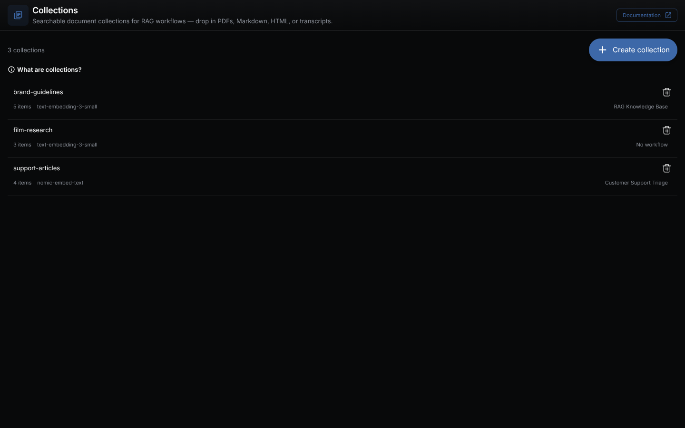
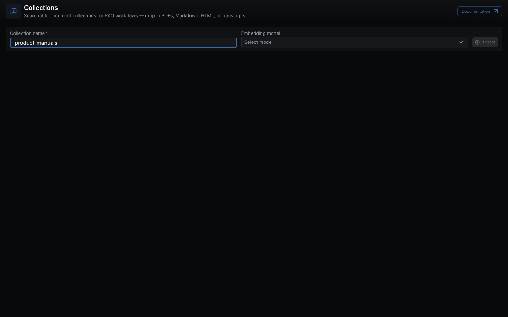

A collection is a named vector index of text chunks. Index files into it from the **Collections** explorer, then query it with `vector.*` nodes or agent tools.

---

## Opening Collections

Open **Collections** from the app menu or go to `/collections`. The explorer lists collections you own and collections with no owner recorded, with each one's document count, embedding model, and linked workflow. Another user's collection does not appear, and asking for it by name answers "not found".

---

## Creating a Collection

1. Enter a name and choose an **Embedding Model**. **Create** stays disabled until both are set.
2. Click **Create**.
3. Drag files onto the collection tile to index them.

A name is unique across the store. It can be at most 128 characters and cannot start or end with whitespace, contain `/` or `\`, or contain control characters.

Dropping a file sends it to `POST /api/collections/:name/index`. The server reads it as UTF-8 text, splits it into chunks of 2000 characters with 1000 of overlap, and stores each as `<file name>#<n>`. Use text formats such as TXT, Markdown, HTML source, CSV, or transcripts. PDF, DOCX, EPUB, and images are not extracted. Extract their text in a workflow first (for example with `lib.pdf.ExtractText`) and index it with an index node. A file over `NODETOOL_MAX_UPLOAD_BYTES` (1 GiB by default) is rejected.

The route does not embed chunks with the collection's embedding model. Use the `vector.Index*` nodes for embeddings. See [Indexing]({{ '/indexing' | relative_url }}).

---

## Managing Documents

From a collection tile:

- Drop files to index them. Progress and per-file errors appear inline.
- Click the workflow name to link a workflow, stored in the collection's `workflow` metadata. The tile shows "No workflow" when none is linked. Dropping files does not run it.
- Delete the collection and everything indexed in it.

---

## Using Collections in Workflows

1. Add an index node (`vector.IndexString`, `vector.IndexTextChunk`, `vector.IndexAggregatedText`, `vector.IndexImage`, `vector.IndexEmbedding`) or a query node (`vector.QueryText`, `vector.QueryImage`, `vector.HybridSearch`) to your workflow.
2. Set its `collection` input to a collection. The `vector.Collection` node gets or creates one by name.
3. Run the workflow. Index nodes write into the collection and query nodes read from it.

See the [Chat with Docs example]({{ '/workflows/chat-with-docs' | relative_url }}) for the full query → format → answer wiring.

---

## Indexing Options

The embedding model is fixed at creation and recorded in the collection's `embedding_model` and `embedding_provider` metadata. Chunking is not a collection setting: the upload route uses the `splitDocument()` defaults of 2000 characters with 1000 of overlap.

---

## Storage

Index data lives in `vectorstore.db` (SQLite with `sqlite-vec`) in the NodeTool data directory, separate from the workflow database. `VECTORSTORE_DB_PATH` moves it. Nothing leaves your machine unless the embedding model is a cloud provider.

For multi-user deployments, set `NODETOOL_VECTOR_PROVIDER=supabase`. See [Vector Storage]({{ '/vector-storage' | relative_url }}) and [Supabase Deployment]({{ '/supabase-deployment' | relative_url }}).

---

## Related Docs

- [Indexing]({{ '/indexing' | relative_url }}) — the upload route, index nodes, and vector store settings
- [Vector Storage]({{ '/vector-storage' | relative_url }}) — backends and filters
- [Chat with Docs example]({{ '/workflows/chat-with-docs' | relative_url }}) — end-to-end RAG workflow
