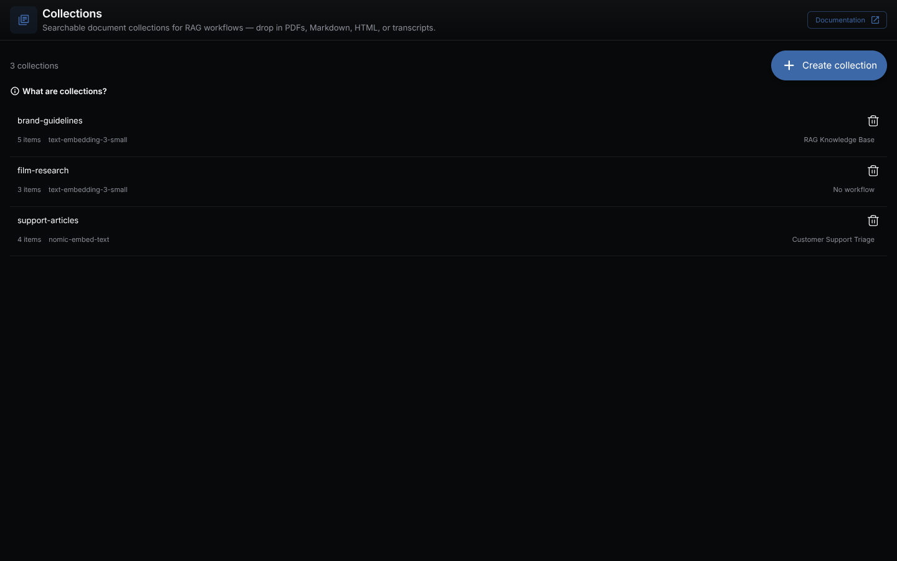
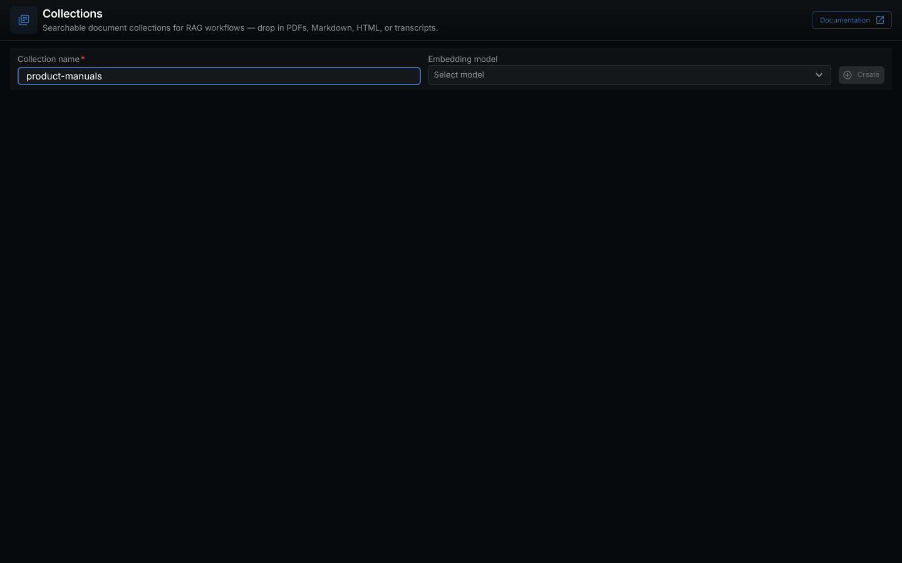

A collection holds the text of your documents, split into short passages, so a workflow or the assistant can find the passages that answer a question. This is how NodeTool answers questions from your own documents (often called RAG, retrieval-augmented generation).

> **Runs:** locally by default. The embedding model you pick decides whether text goes to a cloud provider. **Needs:** an embedding model, local (Ollama) or from a provider with a key.
{: .callout-note}

## Opening Collections

Open **Collections** from the app menu. The page lists your collections with each one's document count, embedding model, and linked workflow. Other users' collections do not appear.

## Creating a Collection

1. Enter a name and choose an **Embedding Model**. **Create** stays disabled until both are set.
2. Click **Create**.
3. Drag text files onto the collection tile.

A name is unique on the server. It can be at most 128 characters and cannot start or end with a space, or contain `/`, `\`, or control characters. The embedding model is fixed once the collection exists.

## Adding Documents

Drop text files on a collection tile: plain text, Markdown, HTML source, CSV, JSON, or transcripts. Each file is split into passages of 2,000 characters that overlap by 1,000, each passage is embedded with the collection's embedding model, and it is stored as `<file name>#<n>`. Progress and per-file errors appear on the tile. A file can be up to 1 GB.

Only text is read. PDF, Office files, EPUB and images are refused. Import a PDF or DOCX as an editable Markdown document first, or index it from a workflow.

From a collection tile you can also link a workflow (click the workflow name, or "No workflow") and delete the collection with everything in it. Dropping files does not run the linked workflow.

## Indexing from a Workflow

Index nodes cover what dropping files does not: images, embeddings you computed yourself, and text a workflow produces. Set each node's **Collection** input. The [Collection](nodes/vector/collection) node gets or creates a collection by name and embedding model.

| Node | Use it to |
|---|---|
| [Index String](nodes/vector/indexstring) | Store one string under a document ID |
| [Index Text Chunk](nodes/vector/indextextchunk) | Store one passage |
| [Index Aggregated Text](nodes/vector/indexaggregatedtext) | Store several passages of one document with one embedding computed by Ollama |
| [Index Image](nodes/vector/indeximage) | Store a list of images |
| [Index Embedding](nodes/vector/indexembedding) | Store one embedding you already computed, with optional metadata |
| [Query Text](nodes/vector/querytext), [Query Image](nodes/vector/queryimage) | Find the passages or images closest to a text or an image |
| [Hybrid Search](nodes/vector/hybridsearch) | Rank by meaning and by keyword match together, so passages that match both rank higher |
| [Count Documents](nodes/vector/countdocuments), [Get Documents](nodes/vector/getdocuments), [Peek](nodes/vector/peek) | Look inside a collection |
| [Remove Overlap](nodes/vector/removeoverlap) | Remove the words consecutive passages share, before you show them |

Index nodes output the collection when they finish, so connect that output to a query node that must wait for indexing.

The [Chat with Docs example](workflows/chat-with-docs) shows the full pattern: query the collection, format the passages, and answer with a language model.

## Asking the Assistant

The assistant can list, create, search and add to your collections. Ask it, for example, "Index the Markdown files in this project into a collection named handbook" or "What does the handbook collection say about refunds?".

## Where Collections Are Stored

On the desktop app, collections live in `vectorstore.db` in the NodeTool data folder, separate from your workflows and assets. Nothing leaves your computer unless the embedding model is a cloud provider. A server can store collections in Supabase instead, see [Vector Storage](vector-storage.md). Scripts can add files over the [API](api-reference.md#indexing-a-file-into-a-collection).

## If it fails

- **Create stays disabled**: enter a name and pick an embedding model.
- **`Only text files can be indexed here`**: the dropped file is a PDF, Office file or image. Import it as a Markdown document first, or index it from a workflow.
- **`Collection has no embedding model`**: the collection was made without one, so nothing in it can be searched. Create a new collection with an embedding model.
- **A dropped file fails with a provider error**: the embedding model's provider needs a key or is not running. Check it in **Settings → Models & providers**.
- **"Not found" for a collection name you typed**: the collection belongs to another user, or the name differs.

## Related

- [Asset Management](asset-management.md)
- [Vector Storage](vector-storage.md)
- [Chat with Docs example](workflows/chat-with-docs)
