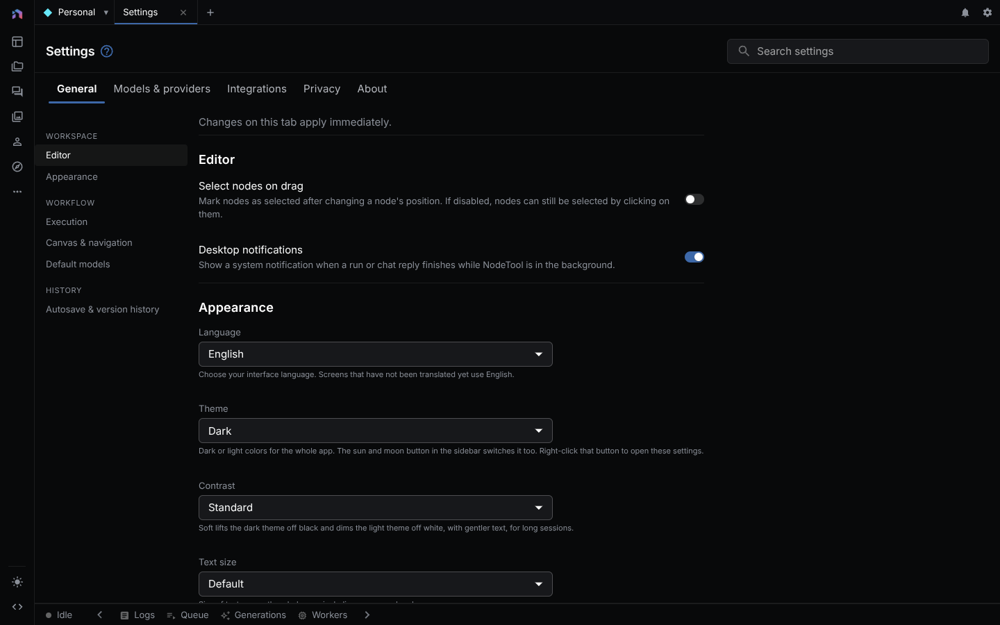
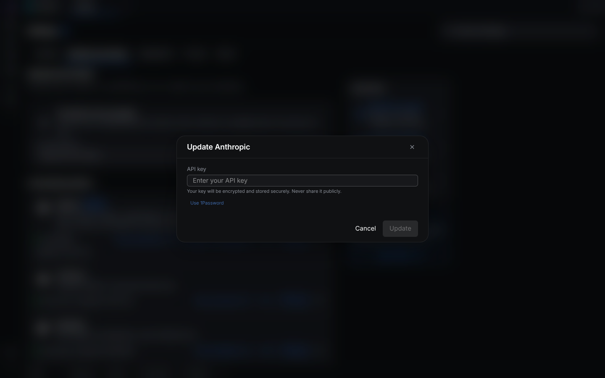

```bash
cp .env.example .env.development.local   # machine-specific overrides, keep out of version control
nodetool secrets store OPENAI_API_KEY    # encrypt a provider key into the secrets database
nodetool settings show                   # print resolved values
```

Configuration helpers live in `@nodetool-ai/config` (`environment.ts`): `loadEnvironment()`, `getEnv()`, and `requireEnv()`. There is no `Environment` class and no `settings.yaml` or `secrets.yaml`.



## Configuration Layers

`loadEnvironment()` loads `.env` files in this order, later files overriding earlier ones. **System environment variables always win** over file values.

1. `.env`
2. `.env.<NODE_ENV>`
3. `.env.<NODE_ENV>.local`

`NODE_ENV` defaults to `development`. `getEnv("KEY")` returns `undefined` when unset. `requireEnv("KEY")` throws a descriptive error. New code that reads configuration uses these helpers, and the variable is added to `.env.example`. In a deployment, pass variables through your orchestrator or the `container.environment` map in `deployment.yaml`.

## Managing Settings & Secrets

**Settings** has four tabs, each with its own sidebar of sections:

| Tab | Covers |
|---------|---------------|
| **General** | Editor, Updates and Vaults (desktop app only), Appearance, Execution, Canvas, Default Models, Autosave |
| **Models & Providers** | Provider API keys, stored as encrypted secrets |
| **Integrations** | Configuration groups (including Folders), Connected Accounts, MCP Servers and Browser Extension (local server only), Nodetool API Token (hosted only) |
| **About** | Application, operating system, features and versions, installation paths (development builds), links |

Stored settings are defined in `setting-catalog.ts` in `@nodetool-ai/config`. A setting read through the server checks the database first, then the environment variable of the same name (`getSetting` in `packages/websocket/src/settings-registry.ts`).



The catalog lists `AUTOSAVE_ENABLED`, `AUTOSAVE_INTERVAL_MINUTES`, `AUTOSAVE_MIN_INTERVAL_SECONDS`, `AUTOSAVE_MAX_VERSIONS_PER_WORKFLOW`, and `AUTOSAVE_KEEP_DAYS`, but no server code reads them. The **Autosave** section of Settings → General writes client-side settings. Setting these variables has no effect.

Commands:

- `nodetool settings show [--json]` prints a fixed set of variables from the process environment (`ENV`, `LOG_LEVEL`, `PORT`, `HOST`, `DB_PATH`, `NODETOOL_API_URL`, the main provider keys, `HF_TOKEN`, `VECTORSTORE_DB_PATH`, `ASSET_BUCKET`, `S3_ENDPOINT_URL`). Names ending in `KEY` or `TOKEN` print as `***`, and unset variables print empty. It does not read `.env` files or stored secrets.
- `nodetool secrets list` lists stored secret keys. Values are never shown.
- `nodetool secrets store <key> [--description <text>]` stores or updates a secret and prompts for the value.
- `nodetool secrets get <key>` prints a stored secret value.

The three `secrets` commands take `--user-id <id>` (default `1`). There is no `nodetool settings edit` command and no `--secrets` option.

## Secret Storage and Master Key

Secrets are encrypted with AES-256-GCM in a local SQLite database. The per-user key derives from the master key through PBKDF2-SHA256 (100,000 iterations). `initMasterKey()` in `@nodetool-ai/security` resolves the master key in this order:

1. `SECRETS_MASTER_KEY` environment variable.
2. Local system keyring (macOS Keychain, Windows Credential Manager, or Secret Service via keytar).
3. A newly generated key, persisted to the keyring.

On a headless host with no keychain and no `SECRETS_MASTER_KEY`, master-key initialization fails and so does startup, because there is nowhere to persist a generated key. Shared deployments must provision the key so every server decrypts the same ciphertext.

### Moving Secrets to a Server

1. Set the same `SECRETS_MASTER_KEY` on every server instance, from your pipeline or secrets manager:

   ```bash
   export SECRETS_MASTER_KEY="<your-base64-master-key>"
   ```

2. Enter the secrets on the server, through Settings or `nodetool secrets store` against that server's database. `nodetool deploy apply` does not copy local secrets, and `POST /admin/secrets/import` answers `501` ("Secrets import not available in standalone mode"). A database copied between machines decrypts only where `SECRETS_MASTER_KEY` has the same value.

`nodetool deploy add` and the deploy config generate a `SECRETS_MASTER_KEY` (32 random bytes, base64) in `container.environment` when none is set.

## 1Password Secret References

A secret's value can be a [1Password secret reference](https://developer.1password.com/docs/cli/secret-reference-syntax/) instead of the key:

```text
op://<vault>/<item>/[<section>/]<field>
```

NodeTool reads the item when the secret is used, so the key is never stored in NodeTool's database or a `.env` file. Store a reference anywhere a key goes:

- In Settings, choose **Use 1Password** in a provider's key dialog. The first time, enter your 1Password account name and approve NodeTool in the 1Password app. Then pick the vault, item and field, or paste a reference such as `op://Dev/OpenAI/credential`. **Test connection** checks the key the reference points to.
- On the command line, run `nodetool secrets store OPENAI_API_KEY` and enter the reference.
- In the environment, set `OPENAI_API_KEY=op://Dev/OpenAI/credential`.

NodeTool ships the [1Password JavaScript SDK](https://developer.1password.com/docs/sdks/). It picks the first backend whose settings are present:

| Backend | Selected when | Authentication |
|---|---|---|
| 1Password Connect server | `OP_CONNECT_HOST` and `OP_CONNECT_TOKEN` are set | The Connect token |
| SDK with a service account | `OP_SERVICE_ACCOUNT_TOKEN` is set | The service account token. Use this for servers and Docker. |
| SDK through the desktop app | An account is connected in Settings, or `NODETOOL_1PASSWORD_ACCOUNT` is set to the account name shown in the 1Password sidebar, or its UUID | The 1Password app asks you to approve NodeTool, and the approval lasts until 10 minutes of inactivity. Turn on the option to integrate with SDKs in the 1Password app settings first. |
| 1Password CLI (`op read`) | None of the above | Whatever `op` is signed in with |

| Variable | Default | Effect |
|---|---|---|
| `NODETOOL_1PASSWORD_ACCOUNT` | unset | The account the desktop app integration signs in to |
| `NODETOOL_1PASSWORD_CLI` | `op` | Path to the `op` binary for the CLI backend |
| `NODETOOL_1PASSWORD_CACHE_TTL_SECONDS` | `300` | How long a read value stays in memory. A rotated item is picked up after this time. |
| `NODETOOL_1PASSWORD_USER_REFERENCES` | `true` on a local install, `false` on a shared deployment | Whether references stored by users in Settings or with `nodetool secrets store` are read |

Every reference is read with the server's 1Password credentials. On a shared deployment (`SUPABASE_URL` and `SUPABASE_KEY` set), a user who stored a reference could read any item the server's service account can see. NodeTool therefore ignores user-stored references there and reads only references in the server's environment. Set `NODETOOL_1PASSWORD_USER_REFERENCES=true` only when every user may read every item the service account can see.

A reference that cannot be read counts as an unset secret. The server log names the reference and the reason, never the value.

References resolve wherever NodeTool reads a secret through `getSecret()` or `Secret.getResolvedValue()` in `@nodetool-ai/models`. Code that reads an environment variable directly, and `SECRETS_MASTER_KEY`, are not covered. To cover them, start the server under [`op run`](https://developer.1password.com/docs/cli/reference/commands/run/), which replaces every reference in the environment first:

```bash
op run --env-file=.env -- npm run dev:server
```

## Storage Backend Selection

`NODETOOL_STORAGE_BACKEND` selects the backend explicitly (`file`, `s3`, or `supabase`, default `file`). Credentials never select it.

- `file` writes assets to the local assets directory.
- `s3` requires `ASSET_BUCKET` (and `TEMP_BUCKET` for the temp store). It reads `S3_REGION` and `S3_ENDPOINT` (or `S3_ENDPOINT_URL`).
- `supabase` requires `SUPABASE_URL`, `SUPABASE_KEY`, and the bucket variable.

A missing variable throws `Missing required env var <name> for NODETOOL_STORAGE_BACKEND=<backend>`. An unknown backend throws `Unknown NODETOOL_STORAGE_BACKEND: "<value>". Expected file|s3|supabase.` The asset store reads `ASSET_BUCKET` and the temp store reads `TEMP_BUCKET` (`storage-config.ts`). Signed URLs last 7 days, the S3 and Supabase maximum.

## Cross-instance resource changes

With PostgreSQL and a valid `NODETOOL_INSTANCE_ID` (or `FLY_MACHINE_ID`), the server distributes resource changes over PostgreSQL LISTEN/NOTIFY. Without an instance id, PostgreSQL stays local. SQLite always uses synchronous in-memory delivery and opens no listener connection.

- Set `DIRECT_URL` to a direct or session-mode connection to the **same database** as `DATABASE_URL`. When absent, the listener uses `DATABASE_URL`.
- When the listener cannot connect through `DIRECT_URL`, the server logs a warning and listens on `DATABASE_URL` unless that uses port 6543. A host without an IPv6 route cannot reach Supabase's direct endpoint, so point `DIRECT_URL` at the session-mode pooler there.
- Startup rejects port 6543, because transaction pooling cannot maintain LISTEN subscriptions. Other transaction poolers need a direct or session-mode endpoint too.
- Budget one dedicated listener connection per replica on top of `DATABASE_POOL_MAX`. Writes and NOTIFY use the normal application pool.
- Run the `resource_change_outbox` migration before starting replicas. A notification larger than 7500 UTF-8 bytes stores its payload in that table and notifies peers with its id. A one-minute timer deletes rows older than a minute. PostgreSQL row-level security exposes no outbox rows through the Data API.

Delivery is best effort, not a durable event log. Each process drops its own notifications. A listener reconnect sends `resource_resync` to local sockets, which invalidate resource queries as they do after a socket reconnect. Draining stops the listener but keeps publishing writes from finishing runs. Shutdown flushes queued publications and stops outbox maintenance.

## Supabase Settings

```bash
NODETOOL_STORAGE_BACKEND=supabase
SUPABASE_URL=https://<ref>.supabase.co
SUPABASE_KEY=<service-role-key>
ASSET_BUCKET=assets
TEMP_BUCKET=assets-temp
```

- Storage uses Supabase buckets only when `NODETOOL_STORAGE_BACKEND=supabase`.
- Auth enters Supabase mode (enforced auth) when **both** `SUPABASE_URL` and `SUPABASE_KEY` are set. Storage and auth are configured independently. See [Authentication](authentication.md#authentication-modes).
- `NODE_SUPABASE_URL`, `NODE_SUPABASE_KEY`, `NODE_SUPABASE_SCHEMA` (default `public`), and `NODE_SUPABASE_TABLE_PREFIX` point user-provided nodes at a separate project, kept distinct from the core credentials and tables.
- `SUPABASE_KEY` is a service role key. Keep it server-side. Public buckets make generated URLs directly accessible. For private buckets, add a signing step.

## Serving the Web UI and TLS

`STATIC_FOLDER` points at the directory holding `index.html`. Unset, or naming a directory that does not exist, no static handler is registered and anything outside the API routes answers `404`.

```bash
STATIC_FOLDER=/app/web/dist nodetool serve
```

Set, the server serves that directory at `/`, sends `index.html` for `/` and `/apps/index.html`, and falls back to `index.html` for any other extension-less `GET` not under `/api`, `/ws`, `/trpc`, `/mcp`, `/health`, `/v1`, `/.well-known/`, or `/oauth` (except `/oauth/consent`, the SPA's MCP consent page), so client-side routing survives a reload. The Docker image and the desktop app set it to their bundled copy.

TLS is on when both a certificate and a key resolve:

```bash
TLS_CERT=/etc/ssl/nodetool/cert.pem \
TLS_KEY=/etc/ssl/nodetool/key.pem \
REDIRECT_PORT=8080 \
nodetool serve --host 0.0.0.0 --port 8443
```

- A variable naming a missing path is ignored. The server then looks for `cert.pem` and `key.pem` by walking up to five directories from its working directory, so a stray pair beside the process turns TLS on with neither variable set.
- With TLS active, logged URLs use `https` / `wss`, and a plain HTTP listener on `REDIRECT_PORT` (default `80`) answers `301` to `https://<request Host>:<server port><path>`.
- Ports below 1024 need elevated privileges. When the bind fails with `EACCES`, the server logs that the redirect listener was skipped and keeps serving HTTPS.

## Python Nodes

Python nodes run in a worker process that NodeTool spawns and talks to over stdio. The server picks the interpreter in this order:

1. `NODETOOL_PYTHON`, an absolute path to the executable. Nothing else is tried, so a wrong path is a hard failure.
2. An active `CONDA_PREFIX` whose environment is named `nodetool` or `conda_env`, or whose path contains `nodetool/conda_env`.
3. The first of these that exists:
   - Windows: the desktop app's `nodetool\conda_env` under `%ALLUSERSPROFILE%` (or `%APPDATA%` when unset), then `envs\nodetool` under `Miniconda3`, `miniconda3`, `Anaconda3`, or `anaconda3` in your home folder, then `C:\ProgramData\nodetool\conda_env`.
   - macOS: `~/nodetool_env`, then `~/miniconda3/envs/nodetool` and `~/anaconda3/envs/nodetool`.
   - Linux: `~/.local/share/nodetool/conda_env`, `/opt/nodetool/conda_env`, then `~/miniconda3/envs/nodetool` and `~/anaconda3/envs/nodetool`.

With none available, the server logs `Python not found — Python nodes will not be available` at startup and runs everything else normally.

```bash
NODETOOL_PYTHON=/opt/conda/envs/nodetool/bin/python nodetool serve
```

The interpreter needs `nodetool-core` and the packs installed from PyPI. See [Python nodes without the desktop app](installation.md#python-nodes-without-the-desktop-app).

- The worker starts with the server. With `NODETOOL_PYTHON_ON_DEMAND=true` it starts when a workflow first needs a Python node, and Python-only providers such as `huggingface-local` and MLX appear in model menus only after that. Settings has no field for it. Set it in the environment, or store it under the same name with the agent's `set_setting` tool. The server reads it at startup.
- Python nodes run on the device PyTorch finds: Apple Metal (MPS), then CUDA, then CPU. `NODETOOL_TORCH_DEVICE` overrides that with `cuda`, `cuda:<N>`, `mps`, or `cpu`. The worker reads it at start. Hardware limits are in [GPU requirements](installation.md#gpu-requirements).
- With `NODETOOL_ENV=production` the bridge refuses to connect, and a workflow reaching a Python node fails with "Python bridge is disabled in production". `NODETOOL_ALLOW_PYTHON_BRIDGE_IN_PRODUCTION=1` overrides that. The published Docker image ships no Python worker, so also derive an image that installs `nodetool-core` and point `NODETOOL_PYTHON` at it. See [Self-hosted deployment](self-hosted-deployment.md#mcp-over-http-and-python-nodes).
- The three `NODETOOL_PYTHON_*_TIMEOUT_MS` variables bound how long the server waits on the worker. Raise `NODETOOL_PYTHON_EXECUTE_TIMEOUT_MS` past its 12-minute default for longer nodes.
- `NODETOOL_WORKER_NAMESPACES` is passed unchanged as `--namespaces <value>` to the worker, which parses it. Unset, the worker loads everything installed.

```bash
NODETOOL_PYTHON_ON_DEMAND=true NODETOOL_WORKER_NAMESPACES=nodetool.image nodetool serve
```

## Protocol Validation

Two settings schema-check messages in flight. Both accept `1`/`true` to force validation on and `0`/`false` to force it off. Unset, both are **on** under `NODE_ENV=test` or Vitest and **off** elsewhere.

- `NODETOOL_VALIDATE_OUTBOUND_WS` parses every server→client WebSocket frame whose `type` matches a known schema before it is sent. Frames with an unrecognized or absent `type` are left alone. A failure throws where the frame was sent.
- `NODETOOL_VALIDATE_BRIDGE_FRAMES` applies the same check to frames from the Python worker. A failing frame is rejected with a structured, non-fatal error instead of being dispatched.

```bash
NODETOOL_VALIDATE_OUTBOUND_WS=1 nodetool serve
```

## JavaScript Sandbox Threading

The QuickJS sandbox behind Code nodes, CodeAct, and JS scripts runs on a worker thread whenever it can. A CPU-bound guest blocks the thread that runs it. On the server's main thread that freezes the event loop, including the WebSocket `stop` frame that would cancel the run. On a worker, cancelling is `terminate()`.

- `NODETOOL_SANDBOX_INPROC=1` runs every guest on the calling thread, with no warning.
- `NODETOOL_SANDBOX_WORKER=require` refuses to fall back. A run that cannot reach a worker fails with `the sandbox worker path is required (NODETOOL_SANDBOX_WORKER=require) but unavailable: <reason>`.

Runs that stream their inputs stay in-process, because the synchronous `stream.open` probe is served from a worker-local mirror seeded with the handle names. Globals that cannot be structured-cloned also keep a run on this thread. Environmental fallbacks warn once per process:

```
sandbox: running in-process (<reason>); a CPU-bound guest will block this thread until its timeout
```

## Video Input on Vision Models

OpenAI-compatible chat APIs have no `video` content part. The runtime samples the clip into stills decoded in process, labels each with its timestamp, and sends them under a header naming the frame count and sample rate. A provider that reads video natively (Gemini) gets the whole clip. The decode needs no binary on `PATH`.

- `NODETOOL_VIDEO_FRAME_FALLBACK=0` turns sampling off and restores the refusal.
- `NODETOOL_VIDEO_FRAME_MAX_FRAMES` is frames per clip (default `16`).
- `NODETOOL_VIDEO_FRAME_MAX_FPS` caps the sample rate (default `1`). A clip too long for the frame budget to reach this rate is sampled more sparsely so the frames span the whole clip.
- `NODETOOL_VIDEO_FRAME_MAX_DIMENSION` is the longest edge of each frame in pixels (default `768`). Frames are never upscaled.

```bash
NODETOOL_VIDEO_FRAME_MAX_FRAMES=8 NODETOOL_VIDEO_FRAME_MAX_FPS=0.5 nodetool serve
```

## Development-Only Settings

- `NODETOOL_ENABLE_TEST_TOPUP=1` lets the credits top-up mutation mint credits with no payment. Without it the mutation is refused. Minted credits unlock spend on platform-owned keys, so leave it unset on anything reachable by someone else.
- `NODETOOL_SEED_DEMO_COSTS=1` seeds about 90 days of spend, plus the demo workflows it references, for the Costs dashboard. A marker row makes the seed idempotent.

```bash
NODETOOL_SEED_DEMO_COSTS=1 nodetool serve
```

## Test Harness Settings

These configure the harnesses, not the server. `nodetool debug --browser` sets the two `NODETOOL_DEBUG_*` variables from its own flags. Set them by hand only when driving the Playwright spec directly.

- `NODETOOL_DEBUG_STAGES`: `1` or `true` captures a canvas screenshot at every stage into `stages/` under the output directory, up to 16 intermediate frames plus the final one. It is what `nodetool debug --stages` turns on.
- `NODETOOL_DEBUG_TIMEOUT`: per-run timeout in milliseconds for the in-page run (`nodetool debug --timeout`). Non-positive-integer values are ignored. The spec waits 30s longer than the value, never less than its 5-minute floor.
- `NODETOOL_E2E_EXAMPLES_DIR`: examples directory the e2e test server serves at `/api/examples`. A missing path is ignored. The server then looks for `packages/base-nodes/nodetool/examples/nodetool-base` and `examples/workflows` under the repo root, and prints the resolved path in its readiness line.
- `NODETOOL_TEST_CHROME`: the Chrome binary the `packages/browser` integration suite drives. Branded Google Chrome ignores `--load-extension`, so the suite needs Chrome for Testing. `test:integration` installs one under `<repo>/chrome`. Point this at an existing binary to skip the download. `CHROME_PATH` is the fallback, and a missing path is ignored.
- `NODETOOL_QA_STATE`: read by the test-suite backend (`screenshot-server.ts`) only. `empty` starts with no workflows, threads, assets, or secrets. `failing-run` adds one workflow that fails until fixed. `other-provider` adds one workflow whose model needs an Anthropic key, so its run fails at the credential check. Any other value seeds the usual demo data. The `agentic-qa` skill uses it.

```bash
cd web
NODETOOL_DEBUG_GRAPH=/tmp/graph.json \
NODETOOL_DEBUG_OUT=/tmp/debug-out \
NODETOOL_DEBUG_STAGES=1 \
NODETOOL_DEBUG_TIMEOUT=120000 \
npm run test:debug-harness
```

The run writes `record.json`, `screenshot.png`, and with stages on, `stages/` and `stages.json` into the output directory. It starts its own hermetic backend on `127.0.0.1:7777`. Stop any server on that port first, because the harness refuses to run against one.

### Hermetic providers

The user-journey suite (`web/tests/journeys`) runs with no API keys and no network. `NODETOOL_FAKE_PROVIDERS=1` puts the suite's backend (`screenshot-server.ts`) in hermetic mode. Every registered LLM provider is re-registered as a deterministic fake, and external or media-generating nodes (fal, Replicate, search, HTTP, image, video, audio) return type-correct placeholder outputs derived from the node's output metadata. Structural and pure-compute nodes still run for real. Every faked LLM call returns `deterministic e2e response`.

`npm run test:journeys` sets the variable itself (`tests/journeys/globalSetup.ts` does `process.env.NODETOOL_FAKE_PROVIDERS ??= "1"`). The screenshot and visual suites leave it off.

- `NODETOOL_FAKE_DEBUG=1` logs each node's REAL/FAKE resolution to stderr.
- `NODETOOL_REAL_PROVIDERS` lists provider ids, comma-separated, that stay real while the rest are faked. Ids are trimmed and empty entries dropped. It has no effect unless `NODETOOL_FAKE_PROVIDERS=1`.
- `NODETOOL_ENABLE_FAKE_PROVIDER=1` registers the separate `fake` provider id as a builtin. Ignored when `NODETOOL_ENV=production`.

```bash
cd web
NODETOOL_FAKE_PROVIDERS=1 NODETOOL_FAKE_DEBUG=1 npm run test:journeys
```

## Chat Turn Replay

A chat or agent turn outlives the WebSocket that started it. Every frame is stamped with an increasing `chat_seq` and appended to a bounded buffer. A reconnecting client sends `{command: "resume_chat", data: {thread_id, last_seq}}` and gets the missed tail replayed.

- `NODETOOL_CHAT_DETACH_GRACE_MS`: a running turn with no attached client is aborted after this long when set to a positive integer. Disabled by default (`0`). Detached agents keep their normal turn budget and deadline.
- `NODETOOL_CHAT_REPLAY_RETENTION_MS`: how long a finished turn is kept (default 5 minutes).
- `NODETOOL_CHAT_REPLAY_BUFFER_EVENTS`: frames buffered per turn (default 2000).

Zero or invalid values use the default. Assistant and tool messages are persisted independently, so an expired or truncated replay loses only unpersisted stream chunks. The client refetches thread history over REST.

## Job Run Replay

A workflow run outlives its WebSocket the same way. Every frame is stamped with an increasing `job_seq` and buffered. A reconnecting client sends `{command: "reconnect_job", data: {job_id, last_seq}}` and gets the missed tail, then live frames if the run is still going.

- `NODETOOL_JOB_DETACH_GRACE_MS`: a running job with no attached client is cancelled after this long (default 10 minutes), so an abandoned client cannot leave a workflow spending provider budget.
- `NODETOOL_JOB_REPLAY_RETENTION_MS`: how long a finished session is kept (default 5 minutes).
- `NODETOOL_JOB_REPLAY_BUFFER_EVENTS`: frames buffered per run (default 2000).

```bash
NODETOOL_JOB_DETACH_GRACE_MS=1800000 nodetool serve
```

A value that is not a positive integer is ignored. Terminal state is persisted to the `jobs` table independently of the buffer, so an expired or truncated replay falls back to `reconnect_job`'s persisted row: the run's status without its events.

These size one process's buffer. Routing a reconnect to the process that holds the run is covered in [Multi-instance deployments](websocket-api.md#multi-instance-deployments).

## Backend Bundle Targeting

These configure the build, not the server. The packaged Electron backend is one bundled `server.mjs` plus a flat `_modules/` directory staged by [`scripts/bundle-backend.mjs`](https://github.com/nodetool-ai/nodetool/blob/main/scripts/bundle-backend.mjs). Staging prunes dependencies that ship prebuilt binaries for every OS and architecture down to one target.

- `NODETOOL_BUNDLE_PLATFORM`: platform to keep prebuilds for. Defaults to `process.platform` (`darwin`, `linux`, `win32`).
- `NODETOOL_BUNDLE_ARCH`: architecture to keep prebuilds for. Defaults to `process.arch` (`x64`, `arm64`).

Set both only when cross-building.

```bash
NODETOOL_BUNDLE_PLATFORM=win32 NODETOOL_BUNDLE_ARCH=x64 node scripts/bundle-backend.mjs
```

[`scripts/verify-backend-bundle.mjs`](https://github.com/nodetool-ai/nodetool/blob/main/scripts/verify-backend-bundle.mjs) reads the same variables and resolves the `@seydx/node-av-<platform>-<arch>` binary it expects (`node-av-win32-<arch>-msvc` on Windows), so verification needs the target the staging run used. When no prebuild matches, staging warns and keeps every prebuild, so a mis-set variable costs size, never a missing binary.

## Environment Variables Index


| Variable | Purpose | Secret | Notes |
|----------|---------|--------|-------|
| `NODE_ENV` | Environment name (`development`, `test`, `production`) | no | Default `development`. Selects which `.env.<NODE_ENV>` files load. Does not switch production behavior (see `NODETOOL_ENV`) |
| `NODETOOL_ENV` | Production mode switch | no | `production` turns off the file browser and local-file previews, the Python bridge, the `/mcp` mount, the `fake` provider, Transformers.js, and unmanaged workspaces. Public app deployment routes exist only in production. It also sets the default bind address to `0.0.0.0`, the default workspace storage to `cloud`, and tightens the node-pack allowlist default. The Docker image sets it. The desktop app does not (it needs the Python bridge and Transformers.js) and sets `NODETOOL_PACKS_REQUIRE_ALLOWLIST=1` instead |
| `PORT` / `HOST` | Port and address the server binds | no | Default `7777`. `HOST` defaults to `127.0.0.1`, or `0.0.0.0` when `NODETOOL_ENV=production`. `nodetool serve --port` and `--host` set both variables, and `--host` defaults to `127.0.0.1` |
| `UV_THREADPOOL_SIZE` | Threads in libuv's pool (file system calls, DNS, crypto, native media work) | no | The server and CLI entries set `128` when unset. The Docker image, desktop app and `npm run dev:server` set it in the backend's environment, because libuv reads it once before the first pool job. A media encode holds a thread while it writes, so a small pool makes other file reads wait. See `packages/config/src/threadpool.ts` |
| `STATIC_FOLDER` | Directory the server serves the built web app from | no | See [Serving the Web UI and TLS](#serving-the-web-ui-and-tls) |
| `TLS_CERT` / `TLS_KEY` | PEM certificate and key paths that put the server on HTTPS/WSS | no | Both must resolve or TLS stays off. See [Serving the Web UI and TLS](#serving-the-web-ui-and-tls) |
| `REDIRECT_PORT` | Port of the plain-HTTP listener that redirects to HTTPS | no | Default `80`. Bound only when TLS is active |
| `NODETOOL_EXTRA_CA_CERTS` | PEM file of extra certificate authorities the desktop app trusts | no | Desktop app only, for a network that re-signs HTTPS traffic with a corporate root. The hardened Electron build strips `NODE_EXTRA_CA_CERTS` before JavaScript starts, so this name carries the file. The main process adds the certificates to the default trust store, and the spawned backend gets the path as `NODE_EXTRA_CA_CERTS`. A file with no PEM certificate stops startup with `NODETOOL_EXTRA_CA_CERTS contains no PEM certificates` (`electron/src/certificateTrust.ts`, `electron/src/config.ts`) |
| `SUPABASE_URL` / `SUPABASE_KEY` | Enable Supabase auth mode (both required) | `SUPABASE_KEY` | The server enforces auth and validates Supabase JWTs. See [Authentication](authentication.md#authentication-modes) |
| `OIDC_ISSUER` / `OIDC_CLIENT_ID` | Enable SSO mode through an OpenID Connect provider (both required) | no | The server enforces auth with its own `nts_` session tokens after an OIDC sign-in. Needs `NODETOOL_PUBLIC_URL` or `OIDC_REDIRECT_URL`. Cannot be combined with Supabase auth. `OIDC_CLIENT_SECRET` (secret), `OIDC_SCOPES`, `OIDC_PROVIDER_NAME`, `OIDC_ALLOWED_DOMAINS`, `OIDC_ALLOWED_GROUPS`, `OIDC_GROUPS_CLAIM`, and `OIDC_SESSION_TTL_SECONDS` tune it. See [Single Sign-On](authentication.md#single-sign-on-oidc) |
| `SUPABASE_ANON_KEY` | Public anon key, handed to the web app by `GET /api/config` | no | Set it to the **anon** key, never `SUPABASE_KEY`, which the endpoint never returns. Required whenever auth is enforced. With `SUPABASE_URL` and `SUPABASE_KEY` set but this unset, `/api/config` answers `200` with `supabaseAnonKey: null`, the web app falls back to a placeholder, and every login `401`s. The server names that case at boot (`describeMissingAnonKey` in `packages/websocket/src/routes/config.ts`) |
| `AUTH_REDIRECT_URL` | URL Supabase sends the user back to after email or OAuth sign-in | no | Returned by `GET /api/config` as `authRedirectUrl`, and wins over the client's own resolution. Unset, the web app uses the build-time `VITE_AUTH_REDIRECT_URL`, then `window.location.origin + "/"`. Set it when the public URL is not the origin the browser sees (proxy, custom domain, Electron shell) and add it to the Supabase project's redirect allow list. See [Self-hosted deployment](self-hosted-deployment.md) |
| `SERVER_AUTH_TOKEN` | Static bearer token for a Local-mode server | no | `nodetool deploy` generates one per deployment. In Local mode, `Authorization: Bearer <token>` (or `?api_key=` on a WebSocket) runs as user `1`. Supabase mode ignores it and logs a warning. It selects no auth mode |
| `USERS_FILE` | JSON registry of API users and hashed bearer tokens | no | Default `~/.config/nodetool/users.json`, or `%APPDATA%\nodetool\users.json` on Windows. The Docker image sets `/workspace/users.json`. In Local mode each user's token is a bearer credential for that user's id. It is the file the admin user routes and `nodetool deploy users-add \| users-list \| users-reset-token \| users-remove` read and write. A missing or unparseable file reads as no users. See [CLI › API users on the deployment](cli.md#nodetool-deploy) |
| `ADMIN_USER_IDS` | User ids allowed to call the admin user-management routes | no | Comma-separated, whitespace trimmed. User `1` (the loopback user in local auth mode) and any API user created with `--role admin` are always admin. Every other caller gets `FORBIDDEN`. A Supabase-mode server refuses to create API users or reset their tokens |
| `NODETOOL_TRUST_LOCALHOST` | Let loopback connections bypass auth as user `1` | no | Default **off** when auth is enforced (Supabase), **on** otherwise. Leave off behind a reverse proxy or SSH tunnel that connects from loopback |
| `NODETOOL_TRUST_LOCAL_NETWORKS` | Warning: source CIDRs trusted as user `1` **without a password** (Local mode only) | no | Comma-separated IPs/CIDRs, ignored in Supabase mode. Needed so Docker's NAT'd bridge traffic is not rejected. Scope to the bridge (`172.16.0.0/12`), **never `0.0.0.0/0`** on a public IP. See [Authentication → Local mode in Docker](authentication.md#local-mode-in-docker) |
| `NODETOOL_ALLOWED_HOSTS` | Extra `Host` names under which the Local-mode trust bypass applies | no | Comma-separated hostnames, ports ignored. Loopback names (`localhost`, `*.localhost`) and IP literals are always accepted. A trusted-source request with any other `Host` must present a token, which blocks DNS rebinding. Add the name you browse to, such as a LAN name for a Compose install. See [Authentication → Host check](authentication.md#host-check) |
| `NODETOOL_LOCAL_CLIENT_TOKEN` | Secret the desktop app adds to its own windows' requests | no | Generated per launch by Electron. Do not set it by hand. A loopback browser request runs as the local user only with this header, no `Origin`, the server's own origin, or an origin in the CORS allow-list |
| `NODETOOL_ALLOW_STDIO_MCP` | Allow stdio external MCP servers when Supabase auth is on | no | `1` to allow. A stdio server runs a command on the server for whoever configures it, so set it only when every account may run commands on the host |
| `NODETOOL_ALLOW_INSECURE_HTTP` | Let `nodetool deploy` send the admin token over plain HTTP to a remote host | no | `1` to allow. Otherwise the token goes only to `https://` or `localhost`. See `server_url` in [Deployment](deployment.md) |
| `NODETOOL_TRUSTED_PROXIES` | Reverse proxies whose `X-Forwarded-For` is trusted | no | Comma-separated IPs/CIDRs. Unset, `X-Forwarded-For` is ignored and the socket peer address is used |
| `NODETOOL_ALLOWED_ORIGINS` | Extra browser origins allowed to make cross-origin requests | no | Comma-separated exact origins, **added to** the built-in list: `localhost`, `127.0.0.1`, and `[::1]` on any port and either scheme, the Electron renderer's `file://`, and `https://nodetool.ai` and its subdomains. A single `*` entry restores allow-all, for a deployment behind its own gateway. A request with no `Origin` is allowed either way. Parsed once and cached, so changes need a restart. Backs the global CORS plugin and the headers on the storage and `/mcp` endpoints (`packages/websocket/src/cors.ts`) |
| `NODETOOL_LOCAL_FILE_ROOTS` | Directories the file browser and local-file previews may read | no | Platform-delimited (`:` on POSIX, `;` on Windows), `~` expands. Default: the user's home directory. Both surfaces are disabled when `NODETOOL_ENV=production`. See [Security hardening](security-hardening.md#local-file-access) |
| `NODETOOL_WORKSPACES_DIR` | Root for the workspace folders NodeTool manages | no | Default `<data dir>/workspaces`. Every user gets a default workspace here on first use. In production it is the **only** readable workspace: a row pointing at another host folder is refused by `listFiles` and the download route. Point it at a mounted volume on a server |
| `NODETOOL_WORKSPACE_STORAGE` | Workspaces as folders on disk or objects in the asset bucket | no | `local` or `cloud`. Default `cloud` when `NODETOOL_ENV=production`, `local` otherwise. A cloud workspace is the key prefix `workspaces/<user>/` in the asset storage, so it survives the machine being replaced. Nodes and agent tools use the same `Workspace` interface either way. Set `local` on a self-hosted server with a mounted volume, or `cloud` on a local install pointed at S3 |
| `OPENAI_API_KEY` / `ANTHROPIC_API_KEY` / `GEMINI_API_KEY` | Provider access | yes | Set only the providers you use |
| `HF_TOKEN` / `FAL_API_KEY` / `REPLICATE_API_TOKEN` | HuggingFace, fal and Replicate providers | yes | Optional per workflow |
| `HF_API_TOKEN` / `HUGGING_FACE_HUB_TOKEN` | Alternate spellings of `HF_TOKEN` for Hub requests | yes | The Hub client takes the first non-empty of `HF_TOKEN`, `HF_API_TOKEN`, `HUGGING_FACE_HUB_TOKEN`, trimmed, so an environment configured for `huggingface_hub` works unchanged. The resolved token is cached in-process, so changing it needs a restart |
| `HF_TOKEN_PATH` | Token file read when none of the three variables is set | yes | `~` expands. Default `<HF_HOME>/token`, which with `HF_HOME` unset is `$XDG_CACHE_HOME/huggingface/token`, then `~/.cache/huggingface/token` (the file `huggingface-cli login` writes). A missing or unreadable file reads as no token, so a typo gives an anonymous Hub request |
| `HUGGINGFACE_API_KEY` | Key the `huggingface` **inference** nodes send | yes | Resolution order: stored secret `HF_TOKEN`, stored secret `HUGGINGFACE_API_KEY`, then the same two names from the environment. The token needs the *Inference Providers* permission, which a Hub read token lacks. With none of the four set, the node throws `HF_TOKEN is not configured`. The Hub client never reads this name |
| `HF_HUB_CACHE` | Directory holding the `models--*` folders of the HuggingFace cache | no | Used verbatim, `~` expands. Unset, NodeTool tries `HUGGINGFACE_HUB_CACHE`, then `$HF_HOME/hub`, then `$XDG_CACHE_HOME/huggingface/hub`, then `~/.cache/huggingface/hub`, the order the Python `huggingface_hub` library uses, so the server and the worker see one cache. The server uses it for Model Manager downloads, the installed list, `nodetool models hf-cache` and `download-hf`, node-llama-cpp, and whisper.cpp. The desktop app sets `HF_HOME` for server and worker: your `HF_HOME`, else `$XDG_CACHE_HOME/huggingface`, else `~/.cache/huggingface`. When `XDG_CACHE_HOME` is set (Flatpak does) but `~/.cache/huggingface/hub` already holds models, the app keeps `~/.cache/huggingface` so an update does not hide them |
| `NODETOOL_HF_DOWNLOAD_CONCURRENCY` | Files of one HuggingFace repo downloaded at once | no | Default `8`. A positive integer, anything else falls back. The server and the Python worker read it. Lower it (`=2`) when a repo with many shards draws HTTP 429 from the Hub |
| `OLLAMA_API_URL` | Ollama base URL | no | Default `http://127.0.0.1:11434`. Set it in **Settings → Integrations → Local Model Servers** or the environment, and a stored value wins. Ollama must be running, NodeTool does not start it |
| `OLLAMA_CONTEXT_LENGTH` | Context window in tokens, sent to Ollama as `num_ctx` with every chat request | no | Unset, NodeTool uses the model's Modelfile `num_ctx`, else the model's trained length capped at `32768`. Ollama's own default is a few thousand tokens and drops the oldest part of a long prompt |
| `OLLAMA_KEEP_ALIVE` | How long Ollama keeps a model loaded after a request | no | Default `10m`. Ollama's duration syntax: `30m`, `-1` to keep forever, `0` to unload immediately. See [Models & Providers](models-and-providers.md) |
| `LMSTUDIO_API_URL` | Base URL of LM Studio's local server | no | Default `http://127.0.0.1:1234`, trailing slashes stripped. A value stored in **Settings → Integrations → Local Model Servers** wins. See [Providers › LM Studio](providers.md) |
| `LMSTUDIO_API_KEY` | Bearer key sent to the LM Studio server | yes | Default `lm-studio`. Set only when the server requires authentication |
| `VLLM_BASE_URL` | Base URL of a self-hosted, OpenAI-compatible vLLM server | no | **Required** for the provider, with no default. Constructing it without one throws `VLLM_BASE_URL is required (options.baseURL, secret, or env)`. Trailing slashes stripped. Models come from the server's `/v1/models`. See [Providers › vLLM](providers.md) |
| `DASHSCOPE_BASE_URL` | Region endpoint for Alibaba Cloud Model Studio (Qwen) | no | Default `https://dashscope-intl.aliyuncs.com/compatible-mode/v1` (international, Singapore). Keys are region-scoped, so set your region's `/compatible-mode/v1` endpoint when the key was created elsewhere. A stored setting of the same name wins, and key verification probes whichever endpoint resolves. See [Providers › Alibaba Cloud](providers.md) |
| `DATA_FOR_SEO_LOGIN` / `DATA_FOR_SEO_PASSWORD` | DataForSEO credentials behind the `web_search` capability | `DATA_FOR_SEO_PASSWORD` | Both required, read from the stored secret first, then the environment. `web_search` runs the first *configured* backend of `serpapi`, `dataforseo`, `openai`, `gemini` unless the call pins one with `provider`, so these take effect when `SERPAPI_API_KEY` is unset. DataForSEO serves web, news and image search at `https://api.dataforseo.com`, defaulting to location code `2840` (United States) and language `en`. Once a backend runs, its failure is the call's failure and nothing falls through |
| `GOOGLE_MAIL_USER` / `GOOGLE_APP_PASSWORD` | Gmail account the `email` capability reads over IMAP | `GOOGLE_APP_PASSWORD` | Both required, stored secret first, then environment. The password is a Google [app password](https://support.google.com/accounts/answer/185833), which needs 2-step verification. Connects to `imap.gmail.com:993` over TLS and backs `search_email`, `archive_email`, and `add_label_to_email`. Separate from `GOOGLE_CLIENT_ID`/`GOOGLE_CLIENT_SECRET` |
| `KIE_WEBHOOK_URL` | Public base URL kie.ai calls back when a task finishes | no | Unset, kie tasks are polled. Set, a submission carries `callBackUrl: <value>/api/kie/webhook` and the run waits for that request, so kie.ai must be able to reach it from the internet. Trailing slashes stripped |
| `GITHUB_CLIENT_ID` / `GITHUB_CLIENT_SECRET` | OAuth App credentials for the GitHub sign-in flow at `/api/oauth/github/*` | `GITHUB_CLIENT_SECRET` | Without the id, `/api/oauth/github/start` answers `500` naming it. The redirect URI is built from the request's `Host`: `http://<host>/api/oauth/github/callback` for `localhost`, `https://…` otherwise. Register exactly that. Read from the process environment, not the secret store, so a value entered only in **Settings** never reaches it |
| `GOOGLE_CLIENT_ID` / `GOOGLE_CLIENT_SECRET` | OAuth client the server refreshes an expired Google access token with | `GOOGLE_CLIENT_SECRET` | The pair configured for the Google provider in the Supabase dashboard. Supabase does not refresh provider tokens, so without them a Google credential stops working an hour after sign-in and the server logs `Google token expired but GOOGLE_CLIENT_ID/GOOGLE_CLIENT_SECRET are unset`. Set them wherever `NODETOOL_GOOGLE_WORKSPACE` is on |
| `NODE_LLAMA_CPP_MODELS_DIR` | Directory the `node_llama_cpp` provider loads GGUF models from | no | Unset, the llama.cpp cache (`LLAMA_CACHE`). A secret of the same name wins |
| `MODEL_FOLDERS` | Extra folders the `node_llama_cpp` and `stable_diffusion_cpp` providers search, subfolders included | no | Separate with `;` or newlines. Fits a ComfyUI `models` folder. llama.cpp lists GGUF language models, stable-diffusion.cpp lists `.safetensors` checkpoints that include their VAE and text encoders. See [Providers](providers.md) |
| `LLAMA_CPP_CONTEXT_LENGTH` | Context size in tokens `llama-server` was started with (`-c`) | no | The server does not report it, so the `llama_cpp` provider budgets prompts with this value. Unset, the model's published context window |
| `WAN2GP_MCP_URL` | MCP endpoint of a Wan2GP server you run, for the `lib.wan2gp` nodes and the `wangp` provider | no | Empty uses the Wan2GP installed in the Package Manager, then `http://127.0.0.1:7866/mcp`. A node's non-blank `server_url` wins. A changed value applies to the next call. See [Wan2GP](wan2gp.md) |
| `WAN2GP_MCP_TOKEN` | Bearer token for a Wan2GP server behind an authenticating proxy | yes | Sent on every request when set. See [Wan2GP](wan2gp.md) |
| `NODETOOL_TORCH_DEVICE` | Device Python nodes run PyTorch on | no | `cuda`, `cuda:<N>`, `mps`, or `cpu`. Unset: MPS, then CUDA, then CPU. See [Python Nodes](#python-nodes) |
| `WHISPER_CPP_MODELS_DIR` | Extra directory for whisper.cpp GGML and VAD models | no | The Hugging Face hub cache is always scanned |
| `WHISPER_CPP_GPU_BACKEND` | whisper.cpp backend: `auto`, `metal`, `cuda`, `vulkan`, or `cpu` | no | `auto` uses Metal on macOS. On Windows and Linux it tries the CUDA build, then Vulkan, then CPU. Restart after changing |
| `WHISPER_CPP_SERVER_URL` | Base URL of a user-run whisper-server | no | Required for `whisper_cpp_server` |
| `NODE_LLAMA_CPP_GPU_BACKEND` | GPU backend node-llama-cpp runs against | no | `auto`, `metal`, `cuda`, `vulkan`, or `cpu`, case-insensitive. Any other value is ignored and the library chooses. A secret of the same name wins |
| `LLAMA_CACHE` | Cache root checked for GGUF files a separate `llama.cpp` already downloaded | no | The variable `llama.cpp` reads. Default `~/Library/Caches/llama.cpp` on macOS, `%LOCALAPPDATA%\llama.cpp` on Windows, `$XDG_CACHE_HOME/llama.cpp` or `~/.cache/llama.cpp` on Linux. Consulted only when the file is not in the HuggingFace cache. On Linux with `XDG_CACHE_HOME` set and `LLAMA_CACHE` unset, the desktop app sets it to `~/.cache/llama.cpp` while only that directory holds files, so models downloaded before a Flatpak update stay visible. Replaces `LLAMA_CPP_CACHE_DIR`, which is no longer read |
| `TRANSFORMERS_JS_CACHE_DIR` | Cache directory for the Transformers.js runtime | no | Default `<data dir>/transformers-js-cache`. Set it in **Settings → Integrations → Local Model Servers** or the environment. It sits outside `~/.cache/huggingface` because Transformers.js uses a flat `{cacheDir}/{repo_id}/{file_path}` layout the Python `huggingface_hub` cache cannot share |
| `NODETOOL_INTEGRATION_TOKEN` | Service token for messaging-bridge integrations (Telegram bot) | yes | At least 16 characters. Enables `/api/integrations/:provider/*` (account linking, delegated tokens). Unset, those routes do not exist. Set the same value on the bridge process. See [telegram-bot-design.md](telegram-bot-design.md) §5 |
| `NODETOOL_PUBLIC_URL` | HTTPS base URL reachable by browsers and hosted provider callbacks | no | Trailing slashes stripped. Used for integration link URLs, FAL callbacks at `/api/providers/fal/webhook/:token`, and AtlasCloud callbacks at `/api/providers/atlascloud/webhook`. Provider callbacks are sent only when this is a valid `https` URL on a public host. An http, loopback, or private address is ignored. Unset, local FAL requests poll the queue. AtlasCloud predictions are polled either way, every 15s while one is outstanding. Integration links fall back to the request's `Host`, which helps when a bridge reaches the server at an address the browser cannot, such as `http://nodetool:7777` in a compose network. See [telegram-bot-design.md](telegram-bot-design.md) §5 |
| `NODETOOL_WEB_URL` | Origin of the web app when this server does not serve it | no | MCP OAuth: `/oauth/authorize` sends the browser to `<NODETOOL_WEB_URL>/oauth/consent`. Must be `https`, or `http` on loopback. Any other value is ignored. Unset, consent opens on this server. See [Connect claude.ai](mcp-production.md#connect-claudeai) |
| `TELEGRAM_BOT_USERNAME` | Bot username for the Telegram link deep link | no | Without the `@`. Set, Settings → Integrations renders `t.me/<username>?start=<code>` links. Unset, the UI shows the bare code for manual `/start` entry |
| `NODETOOL_API_URL` | Server the CLI and the Telegram bridge talk to | no | Default for `--api-url` on the read commands (`workflows`, `jobs`, `assets`, `models list/ollama/huggingface`), which otherwise read the local database. An explicit `--api-url` wins. The Telegram bridge defaults to `http://127.0.0.1:7777`. See [CLI](cli.md) |
| `TELEGRAM_BOT_TOKEN` | Bot token from @BotFather | yes | Read by the `nodetool telegram` bridge, not the server. Unset, `nodetool telegram serve` refuses to start and names the field. See [CLI › `nodetool telegram`](cli.md#nodetool-telegram) |
| `TELEGRAM_WEBHOOK_URL` | Absolute `https://` URL Telegram delivers updates to | no | Unset means `getUpdates` long polling, the only mode implemented. Setting it makes `nodetool telegram serve` **refuse to start** |
| `TELEGRAM_WEBHOOK_SECRET` | Verified against the `X-Telegram-Bot-Api-Secret-Token` header | yes | Required whenever `TELEGRAM_WEBHOOK_URL` is set. Config validation rejects the pair otherwise |
| `NODETOOL_GOOGLE_WORKSPACE` | Force the Google Workspace integration (Drive, Gmail, Docs, Sheets, Calendar) on or off | no | `1`/`true` on, `0`/`false` off. Unset follows Supabase auth mode, because the `google` capability signs in with the token a Google login returns. Set `1` on a local server pointed at a hosted Supabase project |
| `NODETOOL_SYSTEM_STATS` | Force the `system_stats` WebSocket broadcast (the editor's CPU/RAM readout) on or off | no | `1`/`true` on, `0`/`false` off. Unset follows Supabase auth mode: a shared server sends nothing, because the figures describe a container the user does not own. Set `1` on a local server pointed at a hosted Supabase project. `NODE_ENV` is not consulted |
| `DB_PATH` / `DATABASE_URL` | Database connection | no | Set only one. `DB_PATH` configures SQLite. `DATABASE_URL` takes PostgreSQL (`postgres://`, `postgresql://`) or SQLite (`file:`, `sqlite:`) |
| `DATABASE_POOL_MAX` | Maximum PostgreSQL connections one server process opens | no | Default 10. A Supabase session-mode pooler (port 5432 on `pooler.supabase.com`) holds one server connection per client and rejects new clients with `EMAXCONNSESSION` at its pool size, so this value times the number of server processes must stay below that size. A transaction-mode URL (port 6543) shares connections, and the server turns off prepared statements for it |
| `DIRECT_URL` | PostgreSQL URL for migration commands and the release-phase migration runner | no | Resolution order: `--direct-url`, `--database-url`, `DIRECT_URL`, `DATABASE_URL`. With none, the command fails naming all four. On Supabase use the project's **direct** connection URL, so migrations do not exhaust the pooler's session limit. See [CLI › Database Migrations](cli.md#database-migrations) |
| `NODETOOL_STORAGE_AUTO_CLEANUP` | Expire database history on a schedule | no | `1` or `true` (trimmed, case-insensitive). Unset, `0`, or anything else keeps the sweep manual. It sets only the **default** for the per-user `storage.retention.automaticCleanup` setting, and a value saved from the UI wins. On, the server sweeps at startup and every 6 hours, and a sweep does work only if the last finished more than 24 hours ago. It removes workflow autosaves past 10 per workflow or 7 days, manual versions past 90 days, terminal jobs past 30 days, run events past 30 days, and the `parameters`/`metadata`/`logs` columns of predictions past 400 days (prediction rows are billing records and survive). Current workflows, assets, messages, memories, and authored documents are never candidates. Each window is overridable per user under `storage.retention.*`. The startup sweep runs for user `1` only |
| `NODETOOL_ERROR_TRACES` | Server-side error trace capture | no | On by default. `0`, `false` or `off` stops it. See [Error Tracing](error-tracing.md) |
| `NODETOOL_ERROR_TRACE_RETENTION_DAYS` | Days an error trace is kept | no | Default 30. Pruned at startup and daily |
| `NODETOOL_ERROR_TRACE_SYNC_URL` / `NODETOOL_ERROR_TRACE_SYNC_TOKEN` | Push redacted error traces to another NodeTool server | yes | Both required, or sync stays off. The URL must be `https` except for localhost. The token is an access token for that server |
| `NODETOOL_STORAGE_BACKEND` | Storage backend (`file`, `s3`, `supabase`) | no | Default `file`. See [Storage Backend Selection](#storage-backend-selection) |
| `ASSET_FOLDER` / `STORAGE_PATH` | Directory for assets on the local filesystem | no | `ASSET_FOLDER` wins, then `STORAGE_PATH`, then `<data dir>/assets` (`~/.local/share/nodetool/assets`, or `%APPDATA%\nodetool\assets` on Windows). Used verbatim, so a relative path resolves against the working directory. It is the `file` backend's root and also what the CLI harnesses (`nodetool run`, `debug`, `node run`, `eval`) read and write directly, whatever the backend. In Docker, point it at the mounted volume or job containers cannot reach the assets. See [Storage](storage.md) |
| `S3_*` | S3-compatible storage settings | yes | Access keys, region, endpoint |
| `ASSET_BUCKET` / `TEMP_BUCKET` | Asset and temp buckets (s3 / supabase backends) | no | Use signed URLs for private buckets |
| `NODETOOL_VECTOR_PROVIDER` / `VECTORSTORE_DB_PATH` | Vector store backend and SQLite path | no | Default SQLite-vec. `pinecone` and `supabase` are remote. See [Indexing](indexing.md) |
| `NODETOOL_VECTOR_SCHEMA` | PostgreSQL schema the `supabase` vector provider reads and writes | no | Default `public`. Read only when `NODETOOL_VECTOR_PROVIDER=supabase`. Set it when `packages/vectorstore/sql/supabase-migration.sql` was installed into another schema. See [Vector storage](vector-storage.md) |
| `NODE_SUPABASE_URL` / `NODE_SUPABASE_KEY` / `NODE_SUPABASE_SCHEMA` / `NODE_SUPABASE_TABLE_PREFIX` | User/node Supabase project | `NODE_SUPABASE_KEY` | Kept separate from core Supabase credentials and tables |
| `NODETOOL_RATE_LIMIT_DISABLED` | Disable per-IP HTTP rate limiting | no | On by default. Localhost is always exempt |
| `NODETOOL_RATE_LIMIT_MAX` | Max HTTP requests per window per IP | no | Default `1000` |
| `NODETOOL_RATE_LIMIT_WINDOW_MS` | Rate-limit window length | no | Default `60000` |
| `NODETOOL_RATE_LIMIT_TRUST_PROXY` | Key the limiter by `X-Forwarded-For` (`req.ip`) instead of the socket address | no | Enable **only** behind a trusted proxy that sets the header |
| `NODETOOL_WS_RATE_LIMIT_DISABLED` | Disable the per-connection WebSocket inbound message cap | no | On by default |
| `NODETOOL_WS_RATE_LIMIT_MAX` | Max inbound WS messages per window per connection | no | Default `200`. Over-cap clients are closed with code `1008` |
| `NODETOOL_WS_RATE_LIMIT_WINDOW_MS` | WebSocket rate-limit window length | no | Default `1000` |
| `NODETOOL_WS_HEALTH_DISABLED` | Disable the per-connection ping and idle-timeout watchdog | no | On by default. It terminates half-open peers that never sent a close frame |
| `NODETOOL_WS_PING_INTERVAL_MS` | How often each WebSocket peer is pinged | no | Default `20000` |
| `NODETOOL_WS_IDLE_TIMEOUT_MS` | Peer silence before the connection is terminated | no | Default `70000`. Keep above the client's own 45s liveness threshold |
| `NODETOOL_WS_MAX_BUFFERED_BYTES` | Outbound buffer per connection before sends wait for drain | no | Default `8388608` (8 MiB) |
| `NODETOOL_WS_DRAIN_TIMEOUT_MS` | How long a send waits for a slow reader before it is dropped | no | Default `30000`. The drop uses code `1001` so clients reconnect |
| `NODETOOL_WS_MAX_QUEUED_FRAMES` | Undelivered inbound frames per connection before it is closed | no | Default `2000`. Closes with code `1008` |
| `NODETOOL_WS_MAX_MESSAGE_BYTES` | Largest inbound WebSocket frame accepted before deserializing | no | Default `268435456` (256 MiB). MsgPack can expand a small frame into a huge structure, so the raw length is checked first. A non-numeric or non-positive value falls back to the default |
| `NODETOOL_MAX_UPLOAD_BYTES` | Largest payload a single storage upload may write | no | Default `1073741824` (1 GiB) for cloud and in-memory storage, `2147483648` (2 GiB) for local file storage reads and writes, including media staging. An explicit value applies to both. Same strict parsing as the frame cap |
| `NODETOOL_DISABLE_TRIGGERS` | Skip trigger ingestion on this process (no dispatcher, scheduler, file watcher, or webhook route) | no | On by default. Set `1` when a second server shares one database, or for an embedded server that must not start background work |
| `NODETOOL_DISABLE_SDK_LIFECYCLE_V1` | Turn off `/api/sdk/v1/capabilities`, `/preflight`, and `/assets/temporary` | no | `1` only. Disabled, each answers `503` with `{"code": "SDK_LIFECYCLE_DISABLED"}`. `/api/sdk/v1/models` and the model-download routes stay available. See [API Reference › What This Server Supports](api-reference.md#what-this-server-supports) |
| `NODETOOL_DISABLE_SDK_WORKFLOW_INTERFACE_V1` | Turn off `GET /api/sdk/v1/workflows/:id/interface`, `POST /api/sdk/v1/workflow-interfaces`, `GET /api/sdk/v1/workflows`, and `GET /api/sdk/v1/node-types` | no | `1` only. Disabled, they answer `503` with `{"code": "SDK_WORKFLOW_INTERFACE_DISABLED"}`, except `node-types`, which reports `SDK_NODE_TYPE_INVENTORY_DISABLED` |
| `NODETOOL_REQUIRE_SDK_AUTH_V1` | Require a token on the SDK **discovery** routes even when the server does not enforce auth | no | `1` only. `capabilities`, `models`, and `node-types` are otherwise auth-exempt in local trust mode. Set it when a local-mode server is reachable beyond loopback. Routes that read a workflow library always need session auth, and an auth-enforcing server requires the token regardless |
| `NODETOOL_EXTENSION_DIST` | Directory holding the built Chrome extension served by `/api/extension/download` | no | The desktop app sets it to its bundled copy. Unset, or pointing at a directory with no `manifest.json`, the server walks up from its own directory and the working directory looking for `chrome-extension/dist`. See [Chrome Extension](chrome-extension.md#downloading-a-prebuilt-copy) |
| `NODETOOL_BROWSER_TRANSPORT` | Which browser the `browser_*` capabilities drive | no | `extension` drives the user's signed-in Chrome through the native host's socket. Anything else or unset launches a headless Chrome in the process (`local`). A `browser_restart` call pins the transport for the process and wins. See [Chrome Extension](chrome-extension.md) |
| `NODETOOL_BROWSER_BRIDGE_SOCKET` | Socket of the native host to use | no | Default: the newest `<pid>.sock` in `<tmp>/nodetool-browser-bridge-<user>/`. The host also listens here when set in its environment. Set it to pin one extension when several browsers run the host |
| `NODETOOL_ENABLE_MCP` | Keep the `/mcp` streamable-HTTP mount when `NODETOOL_ENV=production` | no | Off in production unless exactly `1`, on elsewhere. The mount inherits the server's auth mode and binds the user the auth hook resolved, so an unauthenticated request gets `401` at initialize. A session id belongs to the user who opened it: another user presenting it gets `404`. Disabled, the server logs that at startup and does not register the route. Agents authenticate with a token minted in **Settings → MCP → Connect an agent remotely**. See [MCP on a production server](mcp-production.md) |
| `NODETOOL_DISABLE_MCP_OAUTH` | Turn off the MCP OAuth 2.1 authorization-server surface | no | `1` only. Disabled, `/mcp` sends no `WWW-Authenticate` challenge, `/.well-known/oauth-*`, `/oauth/authorize`, `/oauth/token`, `/oauth/register`, and `/oauth/revoke` return 404, and outstanding `nta_` access tokens are refused immediately. Pasting an `ntk_` token stays the only way to connect. The flow has no enable flag: it activates wherever `/mcp` is mounted once `NODETOOL_PUBLIC_URL` is an HTTPS or loopback URL. See [MCP OAuth design](mcp-oauth-design.md) |
| `NODETOOL_MCP_URL` | `/mcp` endpoint the `.mcpb` bundle's stdio bridge connects to | no | Read by the bridge ([`scripts/mcpb/bridge.mjs`](https://github.com/nodetool-ai/nodetool/blob/main/scripts/mcpb/bridge.mjs)), not the server. Default `http://127.0.0.1:7777/mcp`. Claude Desktop writes it from the bundle's **NodeTool server URL** field. For a deployed server, pair it with a token. See [MCP on a production server](mcp-production.md) |
| `NODETOOL_MCP_TOKEN` | Bearer token the `.mcpb` bridge sends with every forwarded request | yes | From the bundle's **Auth token (optional)** field. Unset, no `Authorization` header is sent, which a loopback server in local auth mode expects. A remote server needs an `ntk_` token minted in **Settings → MCP → Connect an agent remotely** |
| `NODETOOL_MCP_RETRY_MS` | How often the `.mcpb` bridge retries while the server is unreachable | no | Default `5000`. No config field, so set it in the client's own environment. The bridge starts with nothing to connect to, serves a single `nodetool_status` tool, and attaches with `list_changed` notifications once the server appears |
| `NODETOOL_APP_BUILD_PROVIDER` / `NODETOOL_APP_BUILD_MODEL` | Provider and model `POST /api/applications/build` falls back to | no | Read only when the request body omits `provider` / `model`, and the body wins. With neither the body nor both variables set, the build is refused with `invalid_input` naming them. The judge model is `NODETOOL_APP_JUDGE_MODEL`, see [CLI › `nodetool app`](cli.md#nodetool-app) |
| `NODETOOL_DESKTOP_USER_DATA` | The desktop app's `userData` directory, the data root when `NODETOOL_HOST=desktop` | no | Electron sets it with `NODETOOL_HOST=desktop`, and a value already set wins. Runtime-install directories (`optional-node`, `uv-tools`, `micromamba`) resolve under it. With `NODETOOL_HOST=desktop` and no value, runtime-location lookup throws `The desktop host must supply its userData directory`. Other hosts ignore it. See [Runtime install design](runtime-install-design.md#51-hosts) |
| `NODETOOL_HOST_BINARY_CONCURRENCY` | Host binaries (`yt-dlp`) the media capabilities may run at once | no | Default `2`, the rest queue. Read per spawn as a whole number ≥ 1, anything else keeps the default |
| `NODETOOL_APIFY_MODE` | Which Apify actors the `apify` capabilities may search and run | no | `disabled`, `allowlist`, `discovery` (default), or `unrestricted`. An unrecognized value falls back to `discovery`. `discovery` searches the whole store, runs allowlisted actors directly, and sends anything else through the permission gate. `allowlist` refuses store search and runs only allowlisted actors. `unrestricted` runs any actor. See [Apify integration](apify-integration.md) |
| `NODETOOL_APIFY_ALLOWED_ACTORS` | Actor ids added to the allowlist | no | Comma-separated, canonicalized, blanks dropped. **Added to** the shipped catalog, never replacing it. Applies in `allowlist` mode, and in `discovery` mode decides which actors run without asking |
| `NODETOOL_APIFY_MAX_RUNS` | Actor runs one session may start | no | Default `10`. A value that is not a positive number falls back to the default, as for the four below |
| `NODETOOL_APIFY_MAX_ITEMS` | Result items one actor run may return | no | Default `1000` |
| `NODETOOL_APIFY_MAX_RUN_SECONDS` | Seconds one actor run may take | no | Default `300` |
| `NODETOOL_APIFY_MAX_MEMORY_MB` | Memory in MB one actor run may be given | no | Default `4096` |
| `NODETOOL_APIFY_MAX_COST_USD` | Total Apify spend one session may incur, in USD | no | Default `5` |
| `APIFY_API_TOKEN` | Apify API token for the `apify` capabilities and Apify-backed web search | yes | From `console.apify.com/account/integrations`. `APIFY_API_KEY` is a deprecated alias still read as a fallback. See [Apify integration](apify-integration.md) |
| `SERP_PROVIDER` | Search provider behind web search | no | `serpapi` (default), `dataforseo`, `brave`, `apify`, `openai`, or `gemini`. Stored secret first, then environment. See [SerpAPI integration](serpapi-integration.md) |
| `BRAVE_API_KEY` | Brave Search API key | yes | Required when `SERP_PROVIDER` is `brave`. From `api-dashboard.search.brave.com` |
| `BLENDER_PATH` | Blender executable for the `nodetool.blender` nodes and 3D renders | no | Checked first. Unset, NodeTool looks for `blender` on `PATH`, then the usual install locations for macOS, Linux, and Windows. Blender 5.2 or newer is required. See [Blender](blender.md) |
| `NODETOOL_CREDIT_MODELS` | Managed models hosted credits may be spent on | no | Separated by commas, whitespace, or newlines. Unset means the whole `nodetool` provider catalog. A model not listed is refused before a platform key is used. See [Costs and credits](costs-and-credits.md) |
| `NODETOOL_SIGNUP_CREDITS` | One-time credits granted to a user seen for the first time | no | Default `500`. Fractions round down. `0`, a negative number, or a non-number grants nothing |
| `NODETOOL_PLATFORM_FAL_KEY` / `NODETOOL_PLATFORM_ANTHROPIC_KEY` | Platform-owned fal and Anthropic keys the `nodetool` provider runs managed models on | yes | A managed model is offered only when its delegate provider's key is set. Cloud only. See [Costs and credits](costs-and-credits.md) |
| `NODETOOL_SUPERVISOR_PROVIDER` / `NODETOOL_SUPERVISOR_MODEL` | Provider and model that supervise a run when nothing nearer names one | no | Consulted only for a run that asked to be supervised. On the server the order is the request, the connection's defaults, then these, which exist for hosts with no per-connection defaults, such as the trigger dispatcher. A supervised run that resolves neither logs that and runs unsupervised. The CLI reads `NODETOOL_SUPERVISOR_MODEL` alone as one `provider/model` string behind `--supervisor-model`, default `anthropic/claude-sonnet-4-6`. See [CLI › Supervised runs](cli.md#supervised-runs) |
| `NODETOOL_CHAT_COMPACTION_TOKENS` | Prompt size at which a chat turn summarizes the earlier thread | no | Unset, 90% of the model's input window. The window comes from the provider's Models API (Anthropic `max_input_tokens`, with beta headers), then [models.dev](https://models.dev), then a 128000-token fallback that logs a warning. On a small window the threshold drops so the summarizer call still fits. Prompt size is the larger of the provider-reported size of the last call and a local estimate. A provider that holds the conversation itself (a resumed session, the Claude Agent SDK) compacts only when it reports the transcript no longer fits |
| `NODETOOL_CHAT_COMPACTION_KEEP_TURNS` | User turns a compaction leaves verbatim | no | Default `4`. Earlier turns become the summary, and the cut lands on a user message so a tool call is never separated from its result |
| `NODETOOL_COMPACTION_MODEL` | Model that writes the compaction summary | no | `provider/model`, or a bare model id on the turn's provider. Unset, the turn's own model. A failed summarizer leaves the thread uncompacted and the turn runs against the full history |
| `NODETOOL_INSTANCE_ID` | Which server instance this process is, for multi-instance routing | no | Overrides `FLY_MACHINE_ID`, which the proxy's `fly-replay: instance=<id>` header also addresses, so one string stamps a job row and routes a handshake back to the instance that owns the run. Letters, digits, `_` and `-` only, because it is written into a response header. Anything else is refused with a one-time warning. Unset or refused means single-machine and every feature keyed off it is inert |
| `NODETOOL_JOB_CANCEL_POLL_MS` | How often an instance re-reads its running jobs to notice a remote cancel | no | Default `15000`, `0` disables. Unparseable or negative keeps the default. Matters only with `NODETOOL_INSTANCE_ID` / `FLY_MACHINE_ID`. A cancel at the instance holding the run is immediate |
| `NODETOOL_SHUTDOWN_GRACE_MS` | How long SIGTERM waits for aborted turns and runs to settle before exit | no | Default `240000`, under Fly's 300 s cap. Unparseable or negative keeps the default. It bounds only the fallback path, since a deploy drains with SIGUSR2 first and waits on `/health` with no deadline. Turns still running at expiry are logged and dropped, leaving transcripts incomplete. See [WebSocket API › Draining](websocket-api.md#draining) |
| `NODETOOL_VIDEO_FRAME_FALLBACK` / `_MAX_FRAMES` / `_MAX_FPS` / `_MAX_DIMENSION` | Frame sampling for video sent to providers with no video content part | no | Prefix each with `NODETOOL_VIDEO_FRAME`. See [Video Input on Vision Models](#video-input-on-vision-models) |
| `NODETOOL_SHIPPED_PACKS_DIR` | Roots the sandbox packs shipped with NodeTool are read from | no | Comma-, semicolon-, or `PATH`-separator-delimited, like `NODETOOL_PACK_SEARCH_PATHS`. Missing paths are dropped, so a bad path yields no packs rather than an error. Unset, the loader looks for `_sandbox/` beside the bundled `server.mjs` (desktop app, Docker image), then `packages/sandbox-packs` (a checkout). See [Sandbox package design](sandbox-package-design.md) |
| `NODETOOL_SYSTEM_SKILLS_DIR` | Root the shipped system skills are read from | no | One path. Unset, the loader looks for `_skills/` beside the bundled `server.mjs`, then `packages/system-skills` (a checkout). A missing path means no system skills, not an error. Each skill is a `SKILL.md` under a directory that names it, and a frontmatter `name` that disagrees with the directory, or an unparseable file, is skipped. Read once per process. See [Agent Architecture › Skills](https://github.com/nodetool-ai/nodetool/blob/main/docs/AGENTS.md#skills) |
| `NODETOOL_SANDBOX_INPROC` / `NODETOOL_SANDBOX_WORKER` | Sandbox threading: `1` runs guests in-process, `require` refuses in-process fallback | no | See [JavaScript sandbox threading](#javascript-sandbox-threading) |
| `NODETOOL_GPU_VALIDATE` | Escape hatch for the WGSL linearity validator | no | `off` disables it. The validator rejects at module load a shader whose WGSL contradicts its declared premultiplied-alpha contract. Use it for a hotfix while the shader is corrected. Read once per process |
| `NODETOOL_GPU_DEBUG` | Comma-separated GPU debug passes | no | `premul` scans every premultiplied output texture after dispatch and logs texels that break the invariant (`rgb ≤ a`, `rgb ≥ 0`, no NaN). Zero cost when off, because the pass is never encoded. Read once per process |
| `NODETOOL_CACHE_DIR` | Per-user cache root for derived artifacts NodeTool can rebuild | no | Safe to delete, and separate from the data directory. Unset: `%LOCALAPPDATA%\nodetool\cache` on Windows, `$XDG_CACHE_HOME/nodetool` or `~/.cache/nodetool` elsewhere. Compiled sandbox guest modules live in `sandbox-modules/` under it, cached by content digest. See [Sandbox package design](sandbox-package-design.md) |
| `NODETOOL_PACKAGE_ASSETS_DIR` | Directory `package://<pkg>/<file>` refs resolve from on disk | no | The server sets it at startup to the first package-assets root it finds, so in-process execution reads bytes directly instead of calling its own `/api/assets/packages/…` route. Set it yourself only when embedding the runtime with no server. Refs are confined to the root, and a path escaping it is refused |
| `NODETOOL_BASE_EXAMPLES_DIR` | Directory the shipped example workflows are read from | no | Overrides detection when it exists. A missing path is ignored. Unset, the server looks beside its entry point (packaged), then `packages/base-nodes/nodetool/examples/nodetool-base` (monorepo). With none found it logs `Examples directory not found` and template workflows are unavailable. The resolved path is logged at startup |
| `NODETOOL_EXAMPLE_COMPOSITIONS_DIR` | Directory the shipped timeline compositions are read from | no | A path that does not exist is **not** ignored: no shipped compositions load and `list_compositions` returns only the user's own. Unset, the loader looks for `examples/compositions` beside the bundled `server.mjs`, then `packages/base-nodes/nodetool/examples/compositions` (a checkout) |
| `NODETOOL_EXAMPLE_GAMES_DIR` | Directory the shipped example games (`*.game.json`) are read from | no | A missing path yields no example games, with no fallback to detection. Unset, the loader walks up to eight directories from the module for `examples/games`, then `packages/base-nodes/nodetool/examples/games` |
| `NODETOOL_EXAMPLE_TIMELINES_DIR` | Directory the shipped example timelines (`*.timeline.json`) are read from | no | Same resolution as `NODETOOL_EXAMPLE_GAMES_DIR`, searching `examples/timelines` and then `packages/base-nodes/nodetool/examples/timelines` |
| `NODETOOL_DISABLE_DURABLE_GENERATIONS` | `1` turns off durable queue tracking for fal.ai generations started in a chat session | no | Other values keep it on. By default a fal.ai generation is recorded in the database when accepted, so a restart can recover it. Other providers never use it. The code reserves this for an ephemeral test or local host. See [Media generation tracking](media-generation-tracking-design.md) |
| `NODETOOL_PYTHON` / `NODETOOL_PYTHON_ON_DEMAND` / `NODETOOL_WORKER_NAMESPACES` | Python interpreter, lazy worker start, namespace filter | no | `NODETOOL_PYTHON_ON_DEMAND` is `true` or `false` (default `false`), a stored value wins, and it is read at startup. See [Python Nodes](#python-nodes) |
| `NODETOOL_ALLOW_PRIVATE_MEDIA_FETCH` | Let a media ref be fetched from a private address or over plain http | no | Exactly `1`. Media refs are otherwise fetched under the default egress policy: https, public host, every redirect hop re-checked. For a self-hosted install that serves media off its LAN. Affects media-ref fetches only. See [URL egress inventory](url-egress-inventory.md) |
| `NODETOOL_ALLOW_PYTHON_BRIDGE_IN_PRODUCTION` | Let the Python bridge connect when `NODETOOL_ENV=production` | no | Exactly `1`. Otherwise a production server refuses to spawn the worker |
| `NODETOOL_PYTHON_EXECUTE_TIMEOUT_MS` | How long one Python node invocation may run | no | Default `720000` (12 minutes) |
| `NODETOOL_PYTHON_STATUS_TIMEOUT_MS` | How long a worker status request waits | no | Default `30000` |
| `NODETOOL_PYTHON_DOWNLOAD_IDLE_TIMEOUT_MS` | Silence from a worker-side model download before it is abandoned | no | Default `300000` (5 minutes). Idle time, not total, so a slow download that keeps reporting progress is not cut off |
| `NODETOOL_VALIDATE_OUTBOUND_WS` / `NODETOOL_VALIDATE_BRIDGE_FRAMES` | Schema-check outbound WebSocket frames, and frames from the Python worker | no | `1`/`true` on, `0`/`false` off. Unset: on under `NODE_ENV=test`/Vitest, off elsewhere. See [Protocol validation](#protocol-validation) |
| `NODETOOL_ENABLE_TEST_TOPUP` / `NODETOOL_SEED_DEMO_COSTS` | Credits top-up without payment, and demo spend for the Costs dashboard | no | `1` only. Development servers only. See [Development-only settings](#development-only-settings) |
| `NODETOOL_DEBUG_STAGES` / `NODETOOL_DEBUG_TIMEOUT` / `NODETOOL_E2E_EXAMPLES_DIR` / `NODETOOL_TEST_CHROME` / `NODETOOL_QA_STATE` | Test harness inputs | no | See [Test harness settings](#test-harness-settings) |
| `NODETOOL_FAKE_PROVIDERS` / `NODETOOL_FAKE_DEBUG` / `NODETOOL_REAL_PROVIDERS` / `NODETOOL_ENABLE_FAKE_PROVIDER` | Hermetic fake providers for the user-journey backend | no | See [Hermetic providers](#hermetic-providers) |
| `NODETOOL_PACK_SEARCH_PATHS` | Extra `node_modules` directories to load node packs from | no | Comma-, semicolon-, or `PATH`-separator-delimited (`:` is not a separator on Windows, so drive letters survive). Missing paths are dropped. Searched before the walk up from the working directory. See [Node Packs](node-packs.md) |
| `NODETOOL_OPTIONAL_NODE_MODULES` | A single extra `node_modules` directory for pack loading | no | The one-path form of `NODETOOL_PACK_SEARCH_PATHS`, and both are read. The desktop app points the loader at its bundled install root with it |
| `NODETOOL_PACKS_REQUIRE_ALLOWLIST` | Default `allowUnlisted` to false without production mode | no | `1` only. The trust default `NODETOOL_ENV=production` gives, without turning off the local-only features. The packaged desktop app sets it, because its optional-node directory holds user-installed code but it needs the Python bridge and file browser. An explicit `allowUnlisted` in `packs.json` wins |
| `NODETOOL_PACKS_ALLOWLIST` | Node packs trusted to load, comma-separated names | no | Whitespace trimmed, empty entries dropped. The environment layer of the allowlist `packs.json` holds under `allow`, and it wins over the file. It is an ephemeral override (`NODETOOL_PACKS_ALLOWLIST=nodetool-base,my-pack nodetool serve`), and a partial trust update written back to disk ignores it. Unset, the file's `allow` applies, then an empty list. It decides which *listed* packs are trusted. Whether unlisted packs load is `NODETOOL_PACKS_REQUIRE_ALLOWLIST` and `NODETOOL_ENV`. See [Node Packs](node-packs.md) |
| `NODETOOL_PACKS_CONFIG` | Path to the node-pack trust file | no | Default `~/.config/nodetool/packs.json` on every platform, anchored at the OS home directory. JSON with optional keys `allow` (pack names), `allowUnlisted` (boolean), `enabledBuiltins` and `disabledBuiltins` (arrays). A missing or unparseable file reads as no configuration |
| `NODETOOL_CHAT_DETACH_GRACE_MS` / `_REPLAY_RETENTION_MS` / `_REPLAY_BUFFER_EVENTS` | Chat turn replay: abort-after-detach, finished-turn retention, frames buffered | no | Prefix each with `NODETOOL_CHAT`. Defaults `0` (disabled), `300000`, `2000`. See [Chat turn replay](#chat-turn-replay) |
| `NODETOOL_JOB_DETACH_GRACE_MS` / `_REPLAY_RETENTION_MS` / `_REPLAY_BUFFER_EVENTS` | Job run replay: cancel-after-detach, finished-run retention, frames buffered | no | Prefix each with `NODETOOL_JOB`. Defaults `600000`, `300000`, `2000`. See [Job run replay](#job-run-replay) |
| `LOG_LEVEL` / `NODETOOL_LOG_LEVEL` | Logging level | no | Default `info`. `NODETOOL_LOG_LEVEL` takes precedence |
| `NODETOOL_LOG_FILE` | File logs are appended to instead of stderr | no | Opened once in append mode. A path that cannot be opened falls back to stderr silently. `nodetool-chat` sets it to `~/.nodetool/chat.log` (and the level to `error`) when unset, so the TUI's rendering is not interleaved with log lines |
| `NODETOOL_TRACE_FILE` | Append every workflow, agent and LLM span as JSONL to this path | no | One `TraceRecord` JSON span per line, the shape the stdout sink emits. Parent directories are created. Equivalent to `--trace-file` in [CLI › Global Options](cli.md#global-options), which wins. With no sink configured, telemetry is skipped and no SDK is loaded |
| `NODETOOL_TRACE_STDOUT` | Write the same spans to stdout | no | `pretty` for a tree, `json` for JSONL. `1` and `true` mean `pretty`, any other value is off. `--trace-stdout` sets it per run and `--no-trace-stdout` overrides it. Distinct from `OTEL_TRACES_EXPORTER=console` |
| `OTEL_EXPORTER_OTLP_ENDPOINT` | OTLP backend spans are exported to | no | A base URL, with `/v1/traces` appended (Jaeger or a local collector: `http://localhost:4318`). Sends OTLP/HTTP JSON. Spans carry `gen_ai.usage.input_tokens`, `output_tokens`, and `cost_usd` |
| `OTEL_EXPORTER_OTLP_TRACES_ENDPOINT` | Full OTLP traces URL | no | Used as given. Wins over `OTEL_EXPORTER_OTLP_ENDPOINT` |
| `TRACELOOP_API_KEY` | Export the same spans to Traceloop cloud | yes | Sent as `Authorization: Bearer <key>` to `https://api.traceloop.com/v1/traces`. `OTEL_EXPORTER_OTLP_ENDPOINT` wins over the Traceloop URL when both are set, and the key is still sent as the header |
| `OTEL_SERVICE_NAME` | `service.name` tag on every exported span | no | Default `nodetool` |
| `OTEL_TRACES_EXPORTER` | Print spans through the OTel SDK's console exporter | no | `console` exactly, other values ignored. Independent of the sinks above and coarser than `NODETOOL_TRACE_STDOUT=pretty` |
| `TRACELOOP_DISABLE_BATCH` | Flush each span as it ends instead of batching | no | `true` exactly. OTLP exporter only. A short-lived CLI run can otherwise exit before spans are sent |
| `SECRETS_MASTER_KEY` | Master key for secret encryption | yes | See [Secret Storage and Master Key](#secret-storage-and-master-key) |
| `AWS_SECRETS_MASTER_KEY_NAME` | Removed. Setting it makes secret resolution throw at startup | no | AWS Secrets Manager sourcing of the master key is gone. The variable is still checked so an upgrade fails loudly instead of generating a fresh key that would orphan every secret encrypted under the old one. Read the key out of AWS Secrets Manager, set it as `SECRETS_MASTER_KEY`, and unset this |
| `RUNPOD_API_KEY` | RunPod deployments | yes | Used by the CLI and providers |
| `NODETOOL_CONTAINER_RUNTIME` | Container runtime the self-hosted deploy tooling drives | no | `docker` or `podman`, any other value ignored. Unset, a local target probes for `docker` then `podman` and falls back to `docker`, and a remote target resolves the same way in its shell. Set `podman` on a host with both. See [Deployment](deployment.md) |
| `NODETOOL_WORKER_URL` | WebSocket URL of a running Python worker to attach to | no | A `ws://` or `wss://` address (e.g. `ws://127.0.0.1:7777`) makes workflows with Python nodes attach to that worker, the only transport allowed in production. Unset or blank, NodeTool spawns `python -m nodetool.worker` locally, gated to non-production. `nodetool worker create --attach` prints the `export` line. See [Worker deployment](worker-deployment.md) |
| `NODETOOL_WORKER_TOKEN` | Worker bearer token for admin endpoints | yes | Rotate regularly. Also sent by the WebSocket bridge as `Authorization: Bearer <token>` on connect and every reconnect. Unset or empty, no header is sent. Read only when `NODETOOL_WORKER_URL` selects the remote transport. Print one with `nodetool worker token <instance-id>` |
| `NODETOOL_ADMIN_TOKEN` | Admin bearer token the `nodetool deploy` user and database subcommands send to a remote deployment | yes | Equivalent to `--token`, which wins. With neither, an interactive shell prompts and a non-interactive one exits `1`. See [Deployment](deployment.md) |
| `NODETOOL_TIMELINE_RENDERER` | Skip headless Chromium when `RenderTimeline` renders a timeline | no | `node` (case-insensitive) renders with the Node compositor, which decodes and encodes with libav in process and needs a WebGPU adapter. Anything else tries Chromium first. A host with no Chromium or no adapter falls back to the Node compositor, then to a rough cut. `metadata.render_mode` on the output reports `browser`, `composited` or `rough_cut`. The `packages/video-nodes` test config sets it to `node` |
| `NODETOOL_TSC_VERSION` | Compiler used by the shared TypeScript launcher | no | Build-time only. `7` (native TypeScript 7 CLI) by default. `6` selects the TypeScript 6 JavaScript compiler for a rollback or to compare diagnostics. Other values fail before compilation. Compiler-API consumers keep importing the pinned TypeScript 6 package either way |
| `NODETOOL_TSC_HEAP_MB` | V8 heap (MiB) for the TypeScript 6 compiler child process | no | Build-time only. Default `8192`, passed as `--max-old-space-size` only when `NODETOOL_TSC_VERSION=6`. Digits only, otherwise the default. Ignored when `NODE_OPTIONS` already carries `--max-old-space-size` |
| `NODETOOL_BUNDLE_PLATFORM` / `NODETOOL_BUNDLE_ARCH` | Target the backend-bundle scripts prune prebuilt binaries to | no | Build-time only. Default `process.platform` / `process.arch`. Set both only when cross-building. See [Backend Bundle Targeting](#backend-bundle-targeting) |
| `NODETOOL_FETCH_ALL_NODE_RUNTIMES` | Download Node binaries for every packaging target | no | Build-time only. `1` exactly. Makes `electron/scripts/fetch-node-runtime.mjs` fetch all four (`darwin-arm64`, `darwin-x64`, `win32-x64`, `linux-x64`) instead of the host's. A target named on the command line wins. Cached binaries are skipped |
| `NODETOOL_PROBE_OPENAI_MODEL` / `NODETOOL_PROBE_GEMINI_MODEL` | Model the live provider contract probe sends | no | Read only by `npm run probe:providers`. Defaults `gpt-5.4-mini` and `gemini-3-flash`. The budget is charged at the manifest's declared estimate, not the override's actual cost. See [Provider contract probes](provider-contract-probes.md#probing-a-different-model) |

`nodetool settings show` prints a fixed subset of resolved values.

## Related Documentation

- [Storage Guide](storage.md) for how asset storage backends are selected.
- [Deployment Guide](deployment.md) for passing environment variables in `deployment.yaml`.
- [CLI Reference](cli.md) for settings-related commands.
