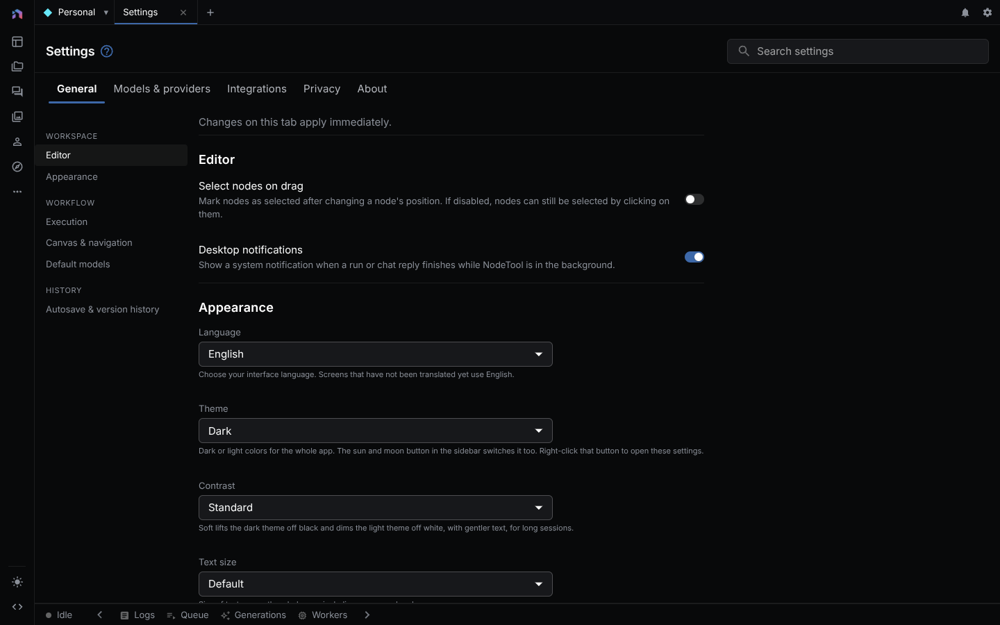
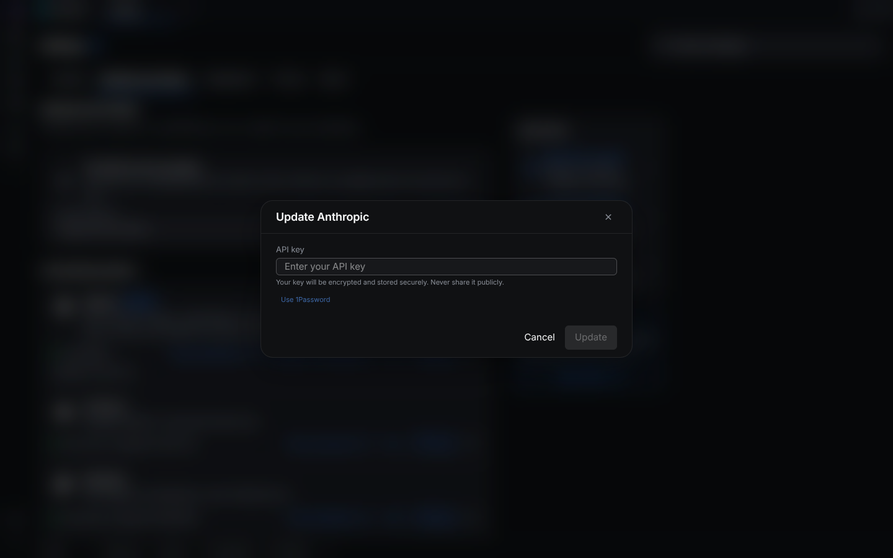

Open **Settings** from the app menu or with `Ctrl + ,` (`⌘ + ,` on macOS). It opens as a workspace tab with a search box that finds a setting across every tab.



## Settings Tabs

| Tab | What you set there |
|---------|---------------|
| **General** | Editor, Updates and Vaults (desktop app), Appearance, Execution, Canvas & navigation, Default models, and **Autosave & version history** |
| **Models & providers** | API keys for cloud providers, local model servers, and custom providers. See [Models & Providers](models-and-providers.md) |
| **Permissions** | Which assistant tools run without asking. A tool set to **Ask** shows a prompt in the chat before it runs |
| **Integrations** | Server settings in groups such as Local model servers and Data & storage, Folders, and Connected accounts. A local install adds **MCP integration** and **Browser extension**. A remote server adds **Signed-in devices**, and **Nodetool API** when you are signed in |
| **Privacy** | Product analytics, what is collected, diagnostics, and recent events |
| **About** | Version, operating system, features, and links |

## API Keys and Secrets

API keys you paste in **Settings → Models & providers** are stored encrypted in NodeTool's database. The encryption key lives in your operating system's keychain (macOS Keychain, Windows Credential Manager, or Linux Secret Service). Keys are never written to a plain-text file.



A key set as an environment variable, such as `OPENAI_API_KEY`, works too. A key stored in Settings wins over the variable.

Back up the keychain entry with the database. A database restored on another computer cannot decrypt its keys, and you enter them again. See [Privacy and Data](privacy.md).

### 1Password Secret References

Instead of the key itself, a secret can hold a [1Password secret reference](https://developer.1password.com/docs/cli/secret-reference-syntax/):

```text
op://<vault>/<item>/[<section>/]<field>
```

NodeTool reads the item each time the key is used, so the key is never stored in NodeTool.

1. In the 1Password app settings, turn on the option to integrate with SDKs.
2. In **Settings → Models & providers**, open a provider's key dialog and choose **Use 1Password**.
3. The first time, enter your 1Password account name as it appears at the top of the app's sidebar, and approve NodeTool when 1Password asks.
4. Pick the vault, item and field, or paste a reference such as `op://Dev/OpenAI/credential`. **Test connection** checks the key the reference points to.

The approval lasts until 10 minutes of inactivity in 1Password. A reference that cannot be read counts as a missing key. On a shared server, references are read with the server's own 1Password account. See [1Password on a Server](server-configuration.md#1password-on-a-server).

## Version History and Cleanup

NodeTool keeps workflow versions, run history and generation records in its database. **Settings → General → Autosave & version history** sets how long each is kept, shows the database size, and has **Clean** and **Compact database** buttons.

| Setting | Default |
|---------|---------|
| Autosaves per workflow | 10 |
| Autosave retention (days) | 7 |
| Manual version retention (days) | 90 |
| Completed run retention (days) | 30 |
| Run event retention (days) | 30 |
| Run trace retention (days) | 30 |
| Generation retention (days) | 400 |
| Automatic cleanup | Off |

With **Automatic cleanup** on, expired history is removed at most once every 24 hours. Without it, nothing is removed until you click **Clean**.

## Environment Variables

The desktop app needs no environment variables. When you run NodeTool from a terminal or a source checkout, it reads variables from the environment and from `.env` files:

```bash
cp .env.example .env.development.local   # your own overrides, kept out of version control
```

Files load in the order `.env`, `.env.<NODE_ENV>`, `.env.<NODE_ENV>.local`, and a variable already set in your shell wins over all of them. Every variable is listed in [Environment Variables](environment-variables.md). Running a server for other people is covered in [Server Configuration](server-configuration.md).

From the terminal:

```bash
printf %s "$OPENAI_API_KEY" | nodetool secrets set OPENAI_API_KEY   # store a key, read from stdin
nodetool secrets list      # names only, never values
nodetool settings show     # print a fixed set of environment values, keys masked
```

Without a server token, `nodetool secrets set` writes to the local store and needs `SECRETS_MASTER_KEY`. See the [CLI Reference](cli.md#nodetool-secrets).

## If it fails

- **A provider says its key is missing although you set one**: a key stored in Settings wins over the environment variable. Check the provider card in **Settings → Models & providers**.
- **Stored keys stopped working after moving to a new computer**: the keychain entry did not move with the database. Enter the keys again.
- **A 1Password key reads as missing**: 1Password is locked, the approval expired after 10 minutes of inactivity, or the reference names a field that does not exist. **Test connection** shows the reason.
- **`Pipe the secret value on stdin`**: `nodetool secrets set` reads the value from standard input, not from a prompt. Use the `printf` form above.

## Related

- [Models & Providers](models-and-providers.md)
- [Environment Variables](environment-variables.md)
- [Server Configuration](server-configuration.md)
- [CLI Reference](cli.md)
