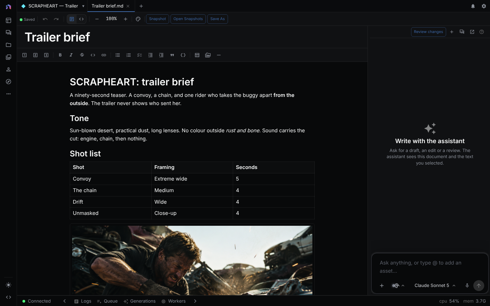
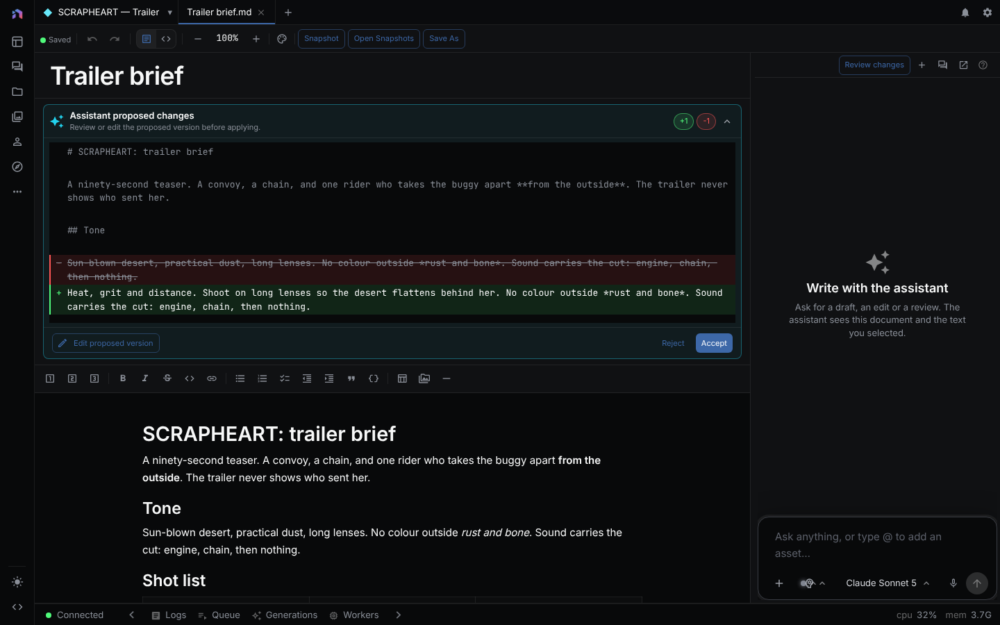
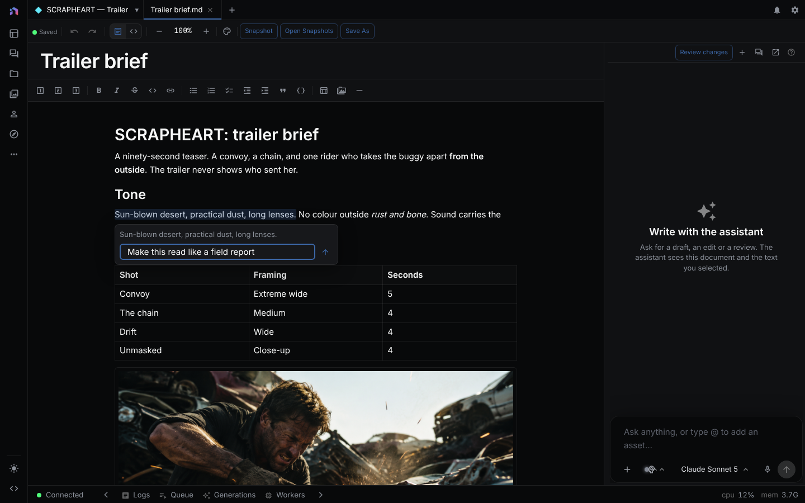
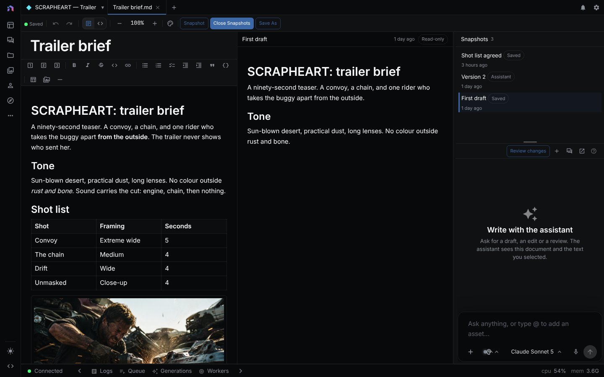

A document is a Markdown file in a project folder. The document editor shows it formatted, saves as you type, and lets the docked assistant propose edits that you accept, change or reject. Use it for a trailer brief, a treatment, a shot list with the shots embedded, or release notes a workflow updates on every run.

> **Runs:** locally in the browser. Saves go to the project folder, local or cloud. **Needs:** no API key to write. The assistant and the selection prompt need an LLM provider (see [Providers](providers.md)). Importing from or saving to Google Docs needs a Google sign-in (see [Google Workspace](google-workspace.md)).
{: .callout-note}



---

## Create or open a document

| Route | What it does |
|---|---|
| **+ New → New document** | Creates `Untitled.md` in the open project and opens it with the caret in the page. |
| Files panel, right-click a folder → **New document** | Creates the file inside that folder and opens it. |
| **+ New → Import document…** | Picks a `.docx`, `.pdf`, `.html`, `.htm` or `.txt` file and makes a Markdown document from it. |
| **+ New → Import Google Doc…** | Takes a Google Doc link and imports it. |
| Right-click a file → **Import as document** | In the Files panel or the asset library. Makes a new document beside the file and leaves the file unchanged. |
| Open any `.md` file | Every Markdown file in a project opens in this editor. `.txt`, JSON, YAML and CSV files keep their editors (see [Text and SVG Documents](text-and-svg-documents.md)). |
| Chat or an agent | `create_document` makes a document. See [Agent tools](#agent-tools). |

DOCX import keeps headings, lists, tables, links and emphasis. PDF import keeps the text only.

The large title above the toolbar is the file name. Click it to rename the file. A title cannot contain path separators or reserved file name characters.

---

## Write and format

Type Markdown and it formats as you go: `# ` starts a heading, `- ` a bulleted list, `1. ` a numbered list, `[ ] ` a task, `> ` a quote, three backticks a code block, `---` a divider, and `**bold**`, `*italic*`, `~~strikethrough~~` and `` `code` `` format inline. The toolbar and shortcuts cover the same set.

| Format | Shortcut |
|---|---|
| Heading 1, 2, 3 | Ctrl+Alt+1, 2, 3 |
| Back to paragraph | Ctrl+Alt+0 |
| Bold, italic | Ctrl+B, Ctrl+I |
| Strikethrough | Ctrl+Shift+X |
| Inline code | Ctrl+E |
| Link | Ctrl+K |
| Bulleted, numbered, task list | Ctrl+Shift+8, 7, 9 |
| Indent, outdent a list item | Tab, Shift+Tab |
| Snapshot | Ctrl+S |

On macOS use Cmd for Ctrl. The toolbar also inserts quotes, code blocks, tables, dividers and media.

The **Markdown** switch in the document bar shows the same file as source in a code editor. Edits in either view change the same draft, and switching back keeps undo history and change marks on the formatted page.

Blocks the formatted view has no control for, such as front matter, raw HTML, link definitions and indented code, show as Markdown source on the page and are saved unchanged.

### Saving

There is no Save button. The editor saves a moment after you stop typing, and closing the tab saves what is left. The document bar shows the save state and a retry when a save fails. A block you did not edit is written back with its exact original bytes, so a diff of the file shows only what you changed.

If something else writes the file while you have unsaved edits, such as an agent or a workflow run, your edits win block by block, and a conflict banner offers the other version for each block it refused.

### Display

Zoom (75% to 200%) and the paper theme (**App theme**, **White paper**, **Gray paper**) change how the page looks on your screen only. The file, exports and other viewers are unaffected. Both are hidden on phone-width screens, along with the assistant and snapshots.

---

## Embed shots, media, timelines and scripts

The **Insert media** button opens a dialog with these tabs:

| Tab | Embeds | Shows on the page |
|---|---|---|
| **Media** | An image, video, audio clip or 3D model from the project, an upload, or a path or URL | The media itself |
| **Storyboard shot** | One shot of a storyboard | The shot's latest clip, or its keyframe until it has a clip, with **Open storyboard** |
| **Timeline** | A timeline | A player that follows later edits, with **Open timeline** |
| **Voice script** | A voice script | Each line with its speaker, direction and current take, with **Open script** |

You can also drop or paste files from your computer, which saves them to `assets/` beside the document. Assets from the asset panel, files from the Files panel, shots from a timeline's storyboard panel and timelines from the timeline list embed where you drop them.

Every embed is saved as Markdown image syntax, so the file still reads in any other Markdown editor:

```markdown


```

A project file is written as a path relative to the document, and any other asset as its `asset://` locator.

---

## Edit with the assistant

The assistant is docked on the right. It sees the document and the text you selected, and the editor saves your draft before each message, so the assistant never edits an older copy. Selected text stays highlighted while you type in the chat box.

The button in the assistant's header picks how its edits land:

| Mode | What happens |
|---|---|
| **Review changes** (default) | The edit opens as a proposal above the page with a diff. **Accept** writes it, **Reject** drops it, and **Edit proposed version** lets you change it before accepting. |
| **Direct apply** | The edit writes at once. Each block it changed is marked **Changed**, **Added** or **Removed**, with **Revert**, **Remove** or **Restore**, until you edit the block or dismiss the mark. |



If you edited the document after the proposal arrived, the panel says so. Edits in other sections merge, and the button reads **Accept & merge**. Edits that overlap the proposal ask **Overwrite newer edits?** before accepting. The content from before an accepted proposal is kept as a snapshot.

### Ask about a selection

Select text and an icon appears beside it. Click it, type what should change, and send. The answer comes back as a proposed replacement you can edit in place, then **Replace** or **Discard**. A replacement is one undo step. An answer that is not a replacement shows as a note and leaves the text alone. The prompt uses the model picked in the chat.



---

## Snapshots

A snapshot is a full copy of the document. The editor keeps one:

- when you click **Snapshot** or press Ctrl+S
- before the first edit of each assistant turn or agent turn, including agents in chat with no editor open
- before each workflow run that writes the document
- every 10 minutes while you edit (the newest 20 of these are kept)
- before a restore

**Open Snapshots** adds a read-only copy of the selected snapshot beside the page, with the snapshot list above the assistant. Drag the divider between the list and the assistant to resize them. Copy text from the snapshot and paste it into the document. Right-click a snapshot to **Rename**, **Restore** or **Delete** it. Restore and Delete ask first. A restore makes the snapshot the current text and keeps your previous text as another snapshot.



---

## Save As

**Save As** writes a copy in another format into a folder you pick in the project:

| Format | Notes |
|---|---|
| Markdown (`.md`) | |
| Plain text (`.txt`) | |
| PDF (`.pdf`) | |
| HTML (`.html`) | |
| Google Doc | A new doc in your Drive. Needs a Google sign-in. |

A file name that exists gets a numbered copy. The document itself stays where it is.

---

## Use a document in a workflow

A workflow reads and writes the document file, so the editor, the agent and the run all work on one file. See [Workflow Editor](workflow-editor.md).

| Node | Use |
|---|---|
| [Document](nodes/nodetool/constant/document.md) | Pick a project document. The `text` output carries its Markdown as a string. A run started from the app saves open drafts first. |
| [Save Document](nodes/nodetool/document/savedocument.md) | Set **target** to a project document and **mode** to `replace` or `append`. Each run keeps the content before it as one snapshot. Without a target it writes a new file. |

To move the text of a String node into a document, right-click the node and choose **Convert to document**. The node becomes a Document node that references the new file, and its `text` output takes over the String node's connections.

---

## Agent tools

These tools work on a document whether or not it is open. An open editor shows each change without reloading.

| Tool | Does |
|---|---|
| `create_document` | Create a document from Markdown. A name that exists gets a numbered copy. |
| `read_document` | Return the Markdown with name, path and `updated_at`. |
| `edit_document` | Apply exact-text replacements, replace the whole content, or append. |
| `list_document_versions`, `create_document_version`, `rename_document_version`, `delete_document_version`, `restore_document_version` | Manage snapshots. Delete always asks you first. |
| `import_document`, `export_document` | Import a file, or write `.md`, `.txt`, `.pdf` or `.html`. |
| `import_google_doc`, `export_google_doc` | Google Docs in and out. |

`write_file` and `edit_file` on a document path keep the same pre-turn snapshot as `edit_document`.

```text
User: Tighten the Tone section of Trailer brief.md.
```

The agent calls `read_document`, then `edit_document` with an `edits` list. Opening **Snapshots** afterwards shows the brief as it was before the turn.

---

## If it fails

| What you see | Cause and fix |
|---|---|
| "The document could not be loaded." | The file is missing or unreadable. Check it in the Files panel. |
| A save error in the document bar | Click retry. Your text stays in the editor until a save succeeds. |
| "Pick a model in the chat first." | The selection prompt has no model. Pick one in the assistant's model menu. |
| "The document changed before the proposal was applied." | You edited during the accept. Review the updated diff and accept again. |
| Google import or export fails | Sign in with Google. See [Google Workspace](google-workspace.md). |

---

## Related

- [Text and SVG Documents](text-and-svg-documents.md) for the other text files and the **+ New** menu
- [Storyboard Editor](storyboard-editor.md), [Video Editor](video-editor.md) and [Script Editor](script-editor.md) for what you embed
- [Workspaces](workspaces.md) for project folders and tabs
