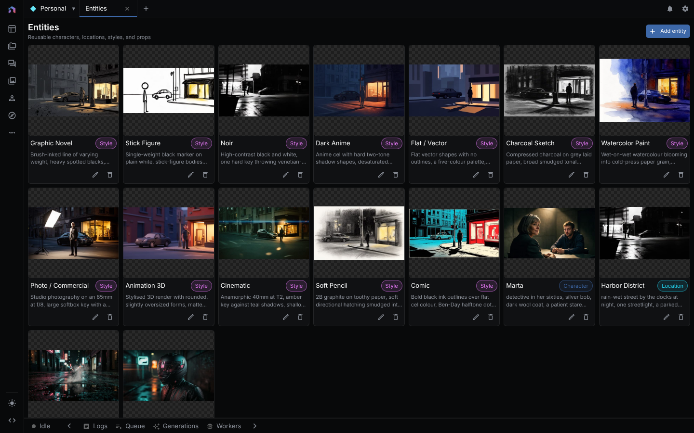

Save a character, location, style, or prop once so it stays consistent across shots. An entity is a reference image with a kind, a name, and a descriptor. When a prompt uses the entity, NodeTool adds the descriptor to the prompt and passes the image as a reference to models that accept one.

```
Consistency references:
- Nova: A young astronaut with cropped black hair and a worn orange flight suit
```

> **Runs:** locally. Creating, editing, and applying an entity makes no model call. **Needs:** no API key, except to generate a reference image with a hosted image model. **Costs:** only that optional image generation.
{: .callout-note}

Entities feed storyboards and the Creative Agent. See [Creative Agent](creative-agent.md#entities-reusable-ingredients).

## Entity kinds

| Kind | Use it for |
|------|-----------|
| Character | A person or creature that stays recognizable |
| Location | A place with a consistent setting and atmosphere |
| Style | A visual language to apply across generations |
| Prop | A product or object that should keep its appearance |

Only a character has the optional **Voice id** field, which holds a provider-specific voice id for text-to-speech.

## Open the library



- **Sidebar panel.** Open **Entities** in the left sidebar. It lists the entities for the active project as a grid of cards. The **Open in full page** button in the panel header opens the full library as a workspace tab.
- **Full-page library.** The page titled **Entities** shows every entity and has an **Add entity** button. With none it shows "No entities yet".

Each card shows the reference image, the name, a kind chip, and the first two lines of the descriptor. Two buttons sit on the card: **Edit entity** and **Remove entity**.

## Create an entity

### From the full-page library

**Add entity** opens a three-step flow. **Back to entities** returns to the grid.

1. **Details.** Pick the **Entity type**, enter a **Name**, a **Descriptor**, and optional **Tags** (comma-separated). Name and descriptor are required. Describe only stable visual traits, for example "A young astronaut with cropped black hair and a worn orange flight suit". The step also offers **Start with a blank reference**, which makes a plain white canvas the reference image and jumps to the review step. It fills the name with "Untitled entity" and the descriptor with "A reusable visual entity." only where you left them empty.
2. **Reference.** Choose the reference image. **Choose from assets** picks an existing image from your assets. **Generate with AI** opens **Generate a reference image**, where you pick a view, edit the prompt, and choose an image model. The views depend on the kind. A character offers Full body, Portrait, and Character sheet. A location offers Establishing view, Detail view, and Location sheet. A style offers Style sample, Style sheet, and Texture detail. A prop offers Product view, Detail view, and Turnaround sheet. An image that is already an entity cannot be picked again.
3. **Review.** Check the image, name, kind, descriptor, and tags, then choose **Create entity**.

An unfinished flow is kept as a draft.

### From an existing image

In the sidebar panel, the **New entity** button (+) opens **Pick a reference image**. Choose an image and the **New entity** dialog opens with the image, **Kind**, **Name**, **Descriptor**, **Voice id (optional)** for characters, and **Tags (comma-separated)**. **Create** stays disabled until name and descriptor are filled.

If you have no images, the picker says "No images". Generate or upload one first.

## Edit or remove an entity

**Edit entity** opens the **Edit entity** dialog with the same fields. **Change image** swaps the reference image. Storyboards and scripts that already use the entity stay linked when you swap the image. Choose **Save** to apply the change.

**Remove entity** removes the entity but leaves the image in your assets. Script speakers linked to a removed entity stay linked to something that no longer exists until you clear the speaker's entity.

## Reference images

The first reference image is the primary one. An entity lives on its image asset, so it appears wherever your assets do.

## How entities are used in generation

The rule for which entities apply is the same on every surface.

- With explicit entities selected, exactly those apply.
- With none selected, an entity applies when its name appears in the prompt text, ignoring case.
- With an empty prompt, every entity applies.
- An entity with an empty descriptor is skipped.

Where this happens:

| Surface | What it does |
|---------|--------------|
| Storyboard | The **Entities** field under **Board settings** pins a cast to the board. Styles and locations season every shot. Characters and props apply to shots that name them. Each shot's **Edit** view shows the cast as chips you can include or exclude for that shot. See [Creative Agent](creative-agent.md#entities-reusable-ingredients). |
| `@` mentions | The mention picker in the chat composer and the Prompt node lists entities first. A picked entity carries its descriptor and reference image into the generation. |
| Prompt boxes | Type `@` in a storyboard shot's **Description**, **Motion**, or **End** field, in the Sketch Editor's prompt boxes, and in the timeline's image and video prompts. These pickers list entities only. In a shot, the entity joins **In this shot**. In the timeline's **Generate** dialog for video, it joins the clip's reference entities. Elsewhere the picked entity is expanded into its descriptor and reference image when the prompt is sent. |
| Workflow nodes | `nodetool.creative.ApplyEntities` injects descriptors into a prompt and outputs `prompt` and `reference_images`. `LoadEntity`, `ListEntities`, and `CreateEntity` read and write the library. See [the node table in Creative Agent](creative-agent.md). |
| Entity picker | Entity properties on workflow nodes open a picker titled **Pick an entity**. It has a search box ("Search entities by name, kind, or tag") and filters for All, Characters, Locations, Styles, and Props. |

## Ask the assistant

- "Save this render as a character called Nova with a descriptor of a young astronaut in an orange flight suit."
- "List my location entities."
- "Rewrite this prompt so it includes Nova and the Harbor location: Nova opens the airlock."
- "Change the descriptor of Nova to say she now wears a blue suit."

Builders driving this from code or MCP: see [Creative Agent Tools](developer/creative-agent-tools.md#entities).
