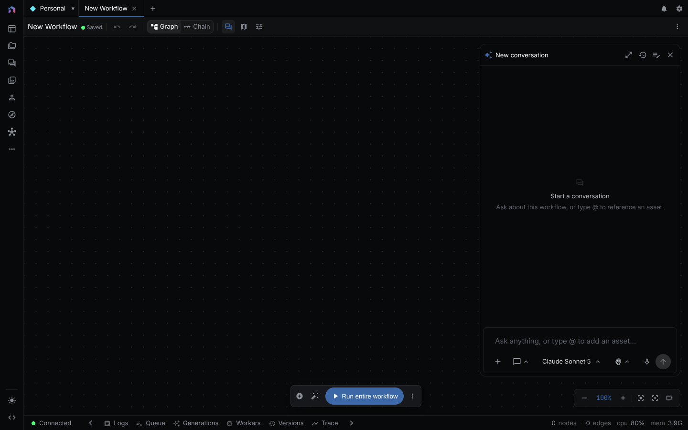
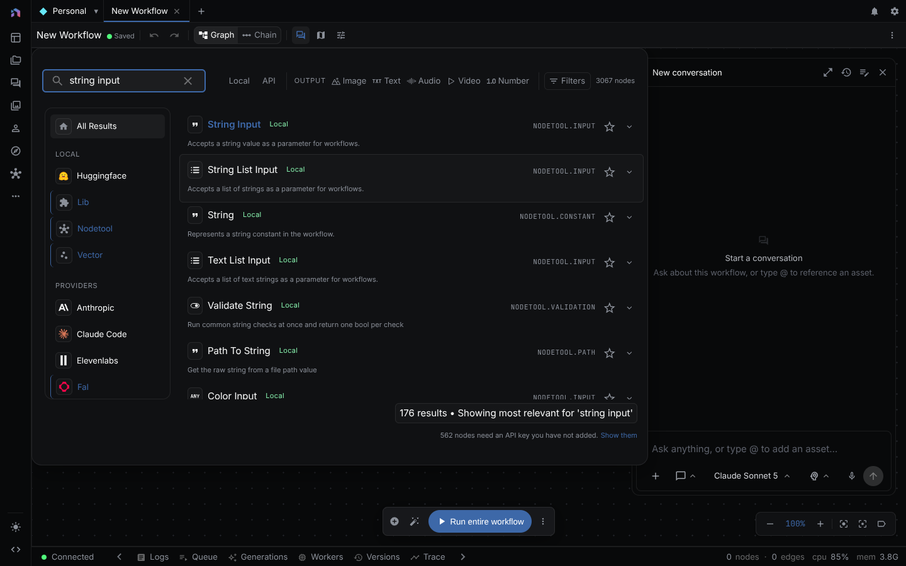
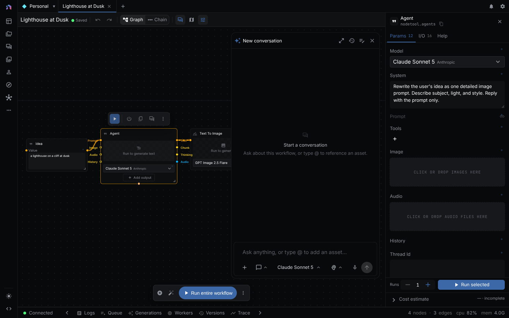
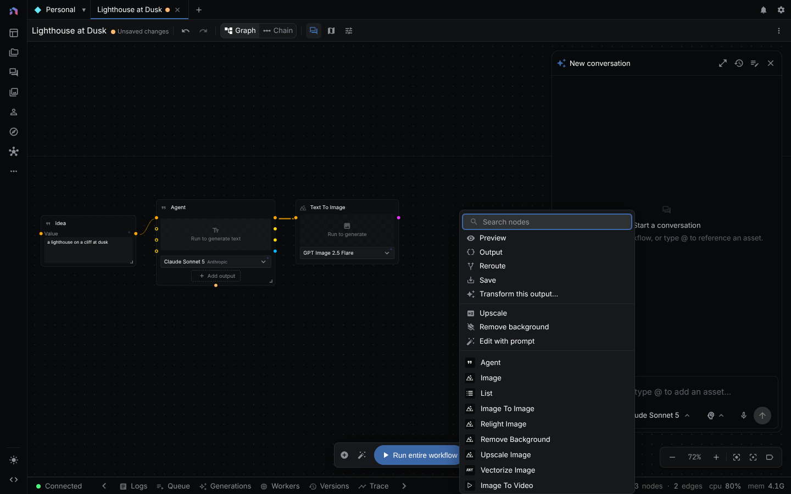
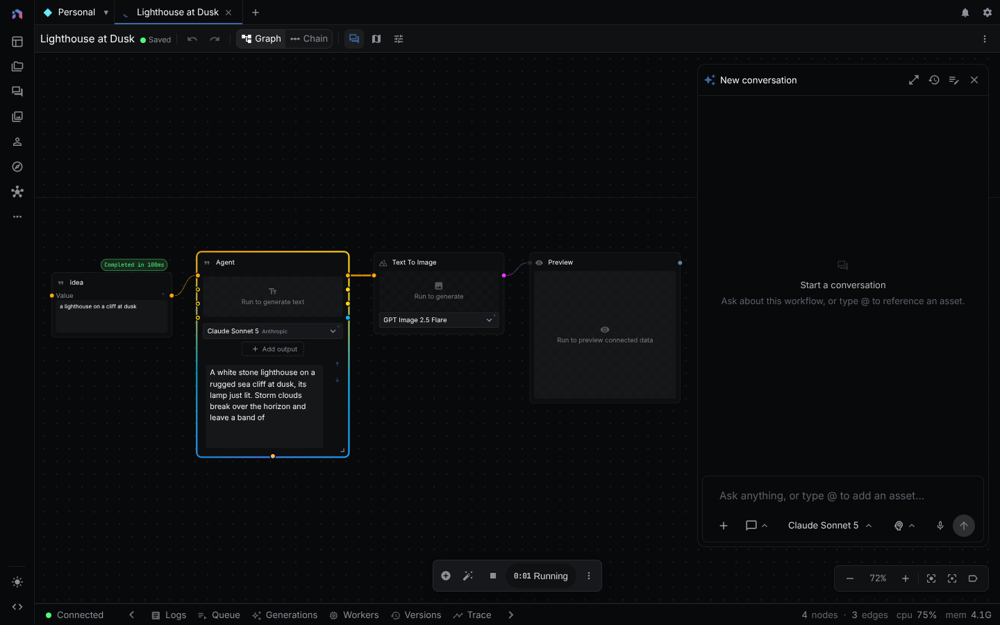
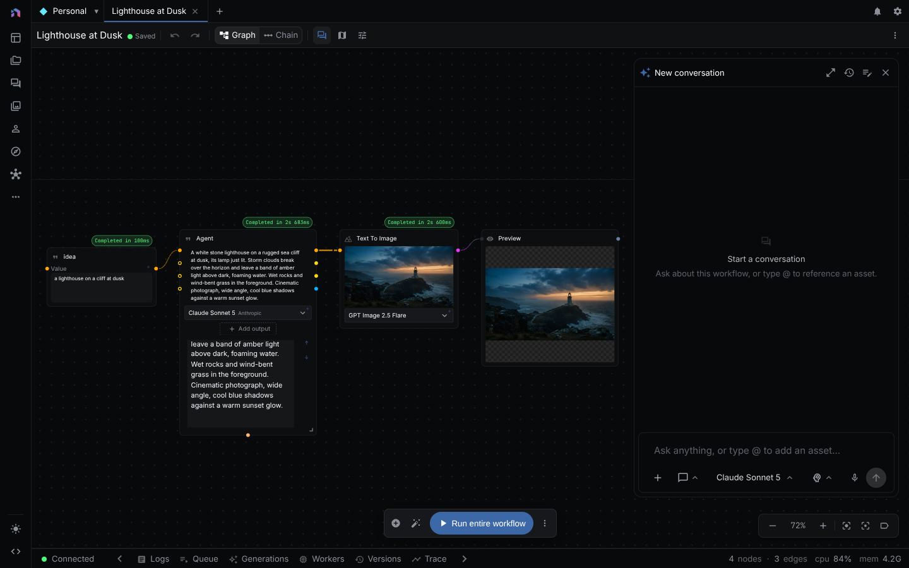
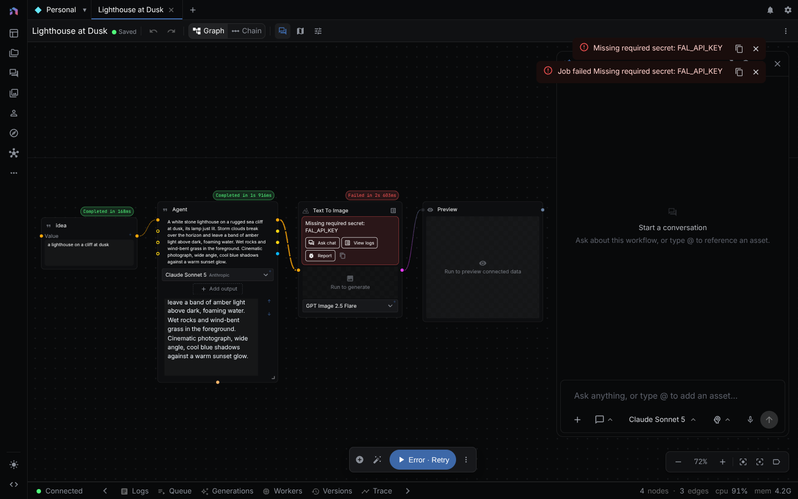

Build a four-node workflow on an empty canvas that turns one short idea into an image: String Input → Agent → Text To Image → Preview.

> **Runs:** cloud. **Needs:** a language provider for the Agent and an image provider for Text To Image. The image is billed at the provider's rate.
{: .callout-note}

| Node | Does |
|---|---|
| **String Input** | Holds your idea as text |
| **Agent** | Rewrites the idea as a detailed image prompt |
| **Text To Image** | Generates the picture |
| **Preview** | Shows the picture on the canvas |

## Before you begin

Connect providers as in [Quick Start](getting-started.md#1-install-and-connect). Text To Image defaults to **FLUX.1 Schnell** on FAL, so a FAL key covers the image model. Other providers are in the [capability matrix](providers.md#capability-matrix).

## 1. Create an empty workflow

Use **+ New → New workflow**, or press `Ctrl/⌘ + K` and pick **New Workflow**.

## 2. Add the String Input node

Press `Space` on the canvas (or double-click empty space), type `string input` in **Search for nodes...**, and click **String Input**.

Type your idea into the node's **Value** field, for example:

> a lighthouse on a cliff at dusk

Select the node and set **Name** to `idea` in the Inspector. An input node shows **Name required** until it has a name, and the workflow cannot run without one. The name becomes the node's title and labels the value when the workflow runs as an app or over the API.

## 3. Add the Agent node

Press `Space`, search for `agent`, and click **Agent**. Place it right of String Input. Select it to open the **Inspector** (tabs **Params**, **I/O**, **Help**).

On the **Params** tab:

1. Press **Select Model** and choose a language model.
2. Replace **System** (default "You are a friendly assistant") with: `Rewrite the user's idea as one detailed image prompt. Describe subject, light, and style. Reply with the prompt only.`

Leave **Prompt** empty. The next step fills it by connection.

## 4. Connect String Input to Agent

1. Drag from the output circle on the right of **String Input**.
2. Release on the **Prompt** input circle on the left of **Agent**.

A line appears. Connections accept matching types only, and each input takes one connection. The **I/O** tab lists a node's inputs and outputs.

## 5. Add the Text To Image node

Press `Space`, search for `text to image`, and click **Text To Image**. Place it right of Agent. Its **Params**:

| Property | Default | Use |
|---|---|---|
| **Model** | FLUX.1 Schnell (FAL) | |
| **Prompt** | A cat holding a sign that says hello world | Replaced by the connection below |
| **Negative Prompt** | empty | What to avoid |
| **Aspect Ratio** | 1:1 | |
| **Resolution** | 1K | Short edge of the image |

Connect **Agent**'s **text** output to **Text To Image**'s **Prompt** input.

## 6. Add a Preview node

Drag from Text To Image's **output** circle, release on empty space, and pick **Preview** in the connection menu.

NodeTool adds a connected **Preview** node. Preview has one input, **Value**, and shows whatever reaches it. Connect the Agent's **text** output to a second Preview to see the written prompt next to the picture.

## 7. Save and run

Press `Ctrl/⌘ + S` to save. Then click **Run entire workflow** in the bottom
toolbar, or press `Ctrl/⌘ + Enter`.

If a model is not selected, NodeTool stops the run and marks the unset model field in the Inspector.

While it runs, a moving colored ring marks the working node, the Agent streams its text, the run control reads **Starting**, **Queued**, or **Running**, and **Completed in** badges show per-node time.

The picture appears in **Text To Image** and **Preview**, and is saved as an asset.

A failed node gets a red **Failed in** badge and shows the error inside the node. **View logs** opens the run's logs in the bottom panel. See [Workflow Debugging](workflow-debugging.md) and
[Troubleshooting](troubleshooting.md).

## 8. Change something and run again

Edit the **Value** in String Input and run again. The Agent writes a new prompt and the image updates.

Other changes:

- Pick a different **Aspect Ratio**, or fill **Negative Prompt**.
- Change the Agent's **System** text to ask for an art style.
- Select a node and press `B` to disable it. A disabled node and its connections are left out of the run.

**Cost estimate** under the Inspector prices one run.

---

## Related

[Nodes](key-concepts.md#nodes), [Data Types and Connections]({{ '/data-types' | relative_url }}), [Agent nodes](key-concepts.md#agent-nodes), [Workflow Editor](workflow-editor.md), [Asset Management](asset-management.md).

---

## Troubleshooting

See [Troubleshooting]({{ '/troubleshooting' | relative_url }}) or ask on [Discord](https://discord.gg/WmQTWZRcYE).

---

## Next steps

  <a class="doc-card" href="{{ '/workflow-editor' | relative_url }}"><strong>Workflow Editor</strong>Selecting, grouping, shortcuts, and the rest of the canvas.</a>
  <a class="doc-card" href="{{ '/templates-gallery' | relative_url }}"><strong>Templates Gallery</strong>Start from a shipped workflow instead of an empty canvas.</a>
  <a class="doc-card" href="{{ '/mini-apps' | relative_url }}"><strong>Mini Apps</strong>Turn this workflow into a screen others can run.</a>
  <a class="doc-card" href="{{ '/models-and-providers' | relative_url }}"><strong>Models &amp; Providers</strong>Choose models or run them locally.</a>

