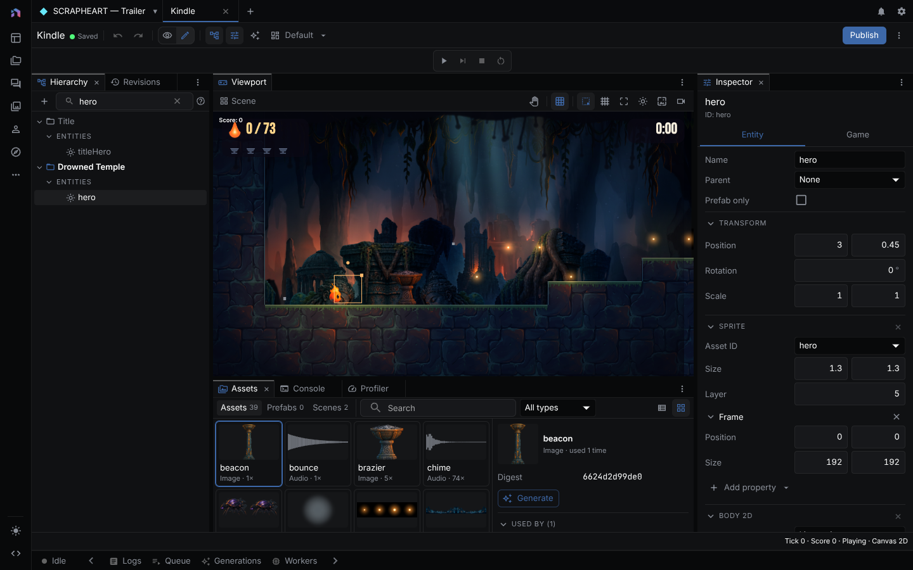

A game is one JSON document the built-in engine simulates, renders, and exports as a standalone web player. It is either 2D or 3D for its whole life. This page covers the editor. For engine features, document examples, and runtime limits, see the [Native Game Engine guide](/game-engine/).



> **Runs:** locally in the browser. Asset generation uses the provider you pick (see [Providers](providers.md)). The desktop executable build needs Rust and a platform toolchain. **Needs:** no key to edit or play. WebGL2 for 3D games.
{: .callout-note}

The document holds scenes (one entry scene), entities with a transform and optional components, behaviors and JavaScript scripts, named asset slots, and input actions. The draft autosaves about half a second after each change. **Publish** turns it into an immutable revision.

| | 2D | 3D |
|---|---|---|
| Space | Top-down or side-view, world units | Meters, Y up, forward is -Z |
| Starter | A top-down room with a player, a gem, and four walls | A level with a capsule player, ramp, moving platform, crate, door, checkpoint, and goal |
| Rendering | Canvas 2D, or WebGPU for GPU effects | WebGL2 |

---

## Start a game

There is no blank game. Every new game starts from a playable starter.

- **+ New** in the tab bar, then **Game** under **Guided flows**. This creates a 2D game named "Untitled game" in the selected project.
- New-project screen: choose **More formats**, then the **Game** card. **Game card starts as** picks **2D game** or **3D exploration**. The prompt text only names the game ("New game" if empty). It is not sent to the agent.
- Examples page (logo menu), **Games** tab: **Play** opens an example. **Install game** copies it with its media into the current project. Kindle, Lumen, and Neon Drift are 2D. AETHER // Skybound, BLACKSITE, and Signal Forge are 3D.
- Agent: `create_native_game` with a project, a name, and a dimension. For 3D it can pass `template: "exploration"`.

The server reads examples from `*.game.json` files. `NODETOOL_EXAMPLE_GAMES_DIR` points it at another folder, and a missing folder yields no examples. See [Configuration](configuration.md).

---

## Editor layout

Resize docks by dragging their edges. They share the dock module with the timeline editor.

| Area | Contents |
|---|---|
| Document bar | Title, save status (**Saved**, **Saving…**, **Unsaved changes**, **Not saved**), Undo and Redo, View and Edit, panel toggles, Layout menu, **Publish**, and the ⋮ menu |
| Play controls | **Play**, **Step**, **Stop**, **Restart** |
| Scene tree (left) | Scenes and entities |
| Viewport (center) | The game canvas |
| Inspector (right) | Selected entity, scene, or game |
| Assistant (right) | Agent chat for this game |
| Script pane (bottom) | Code editor, open while you edit a script |
| Status bar | Tick, score, win state, renderer |

The ⋮ menu holds the export builds, **Save play state**, **Load play state**, **Play in new tab**, and **Commands**. Under the play controls the editor can show a **Changes** list of agent edits (see [Ask the agent](#ask-the-agent)), a **Retained construction** section (see [Rebuild a generated game](#rebuild-a-generated-game)), and a conflict banner when the draft changed elsewhere, where you accept or discard each conflicting unit. On a narrow screen the 2D editor stacks the tree and inspector under the viewport and opens the assistant as a bottom sheet.

### 2D editing

- **Scene tree.** Entities are in **Entities**. **Prefabs** appears when entities are marked prefab-only. Drag to nest or reorder (Alt+arrows from the keyboard). The **+** beside a scene adds **Sprite**, **Static wall**, **Collectible**, **Trigger**, **Camera**, or **Empty**. **Sprite** is disabled until the game has an image asset.
- **Viewport.** Click or box-select, drag to move, use handles to scale and rotate (Shift constrains). Alt-click cycles overlapping sprites. Overlay buttons toggle **Selection**, **Grid**, **Snap**, **Colliders**, **Lights**, **Backgrounds**, and **Camera**.
- **Inspector.** The **Entity** tab has **Add component** (Sprite, Tilemap, Camera 2D, Body 2D, Collider 2D, Animator, Visual animation, Audio source, Light 2D) and **Add behavior** (Movement, Patrol, Collectible, Health, Trigger, Spawn, Scene transition, Win when collected, Lifetime, Script). The **Game** tab edits pixels per unit, entry scene, input actions, collision layer names, render effects (bloom, LUT, brightness and contrast), and asset bindings. Validation errors show beside the field, and the tree marks entities with validation or script errors in red.

| Key | Action |
|---|---|
| Space+drag, middle or right drag | Pan |
| Wheel | Zoom |
| Home, F | Reset camera, frame selection |
| Arrows, Shift+arrows | Nudge 0.25 units, 2.5 units |
| G | Toggle snap |
| Ctrl/Cmd + C, V, D, Z | Copy, paste, duplicate, undo (add Shift for redo) |

**Revisions** in the scene tree lists the 10 most recent revisions. **Restore to draft** loads one into the draft without changing published history. If the saved draft source is unavailable, the editor offers published revisions for recovery. If the tab still has a local draft, **Export local draft** saves its document, pending edits, and undo history as JSON before restoring is enabled. Keep the tab open until the download finishes, because confirming **Restore to draft** replaces the local draft and clears its undo history.

### 3D editing

- **Scene tree.** A **Scene** selector, then a flat list. **Add box**, **Add sphere**, and **Add light** create a primitive with a static body and matching collider, or a point light.
- **Model assets.** In the collapsed section, enter an owned model asset ID and a slot name, then choose **Prepare and install model**. **Edit model** opens the model in the [3D Editor](3d-editor.md). After saving model changes, prepare and install again, because the engine does not pick up edits on its own.
- **Viewport.** The toolbar has **Transform mode** (**Move**, **Rotate**, **Scale**), **Local space**, **Snap**, **Gizmo settings**, **Align to ground**, **Overlays**, **Fly camera**, and **Frame selection**. A multi-selection shares one gizmo, and each drag or **Align to ground** is one undo step.
- **Gizmo settings.** Pivot is **Selection centre**, **Active entity**, or **Individual origins**. Snap defaults are 0.25 m, 15 degrees, and 0.25 scale. **Surface snap** rests drags on the surface under the pointer. **Orbit around selection** recenters the orbit. These are browser preferences, not part of the game.
- **Inspector.** Position (meters), Rotation (degrees), Scale, components, and a **Behaviors** list with **Add script**, **Edit script**, and **Remove**.

| Key | Action |
|---|---|
| Drag, Shift-drag, scroll | Orbit, pan, zoom |
| Fly camera on, then W A S D, R F | Move, rise and descend. Drag looks |
| F, X, . | Frame, toggle local space, next pivot mode |
| End | Align to ground |
| Numpad 1, 3, 7 (Ctrl/Cmd for opposite), 5 | Front, right, top views (back, left, bottom), orthographic |

The 3D editor has no copy and paste, keyboard nudge, tree search, nesting by drag, prefab group, **Revisions** list, or **Run 10 s**. Use the agent or document operations for those.

---

## Script entities

A script is a behavior on an entity. In the inspector choose **Add behavior**, then **Script** in 2D, or **Add script** in 3D. Choose **Edit script** to open the script pane. The pane is a code editor with type hints for the engine's script API, and each edit goes into the draft.

A script is a function expression that receives the current tick, input, events, and its own entity, and returns `{ state, commands }`.

```js
/** @type {GameScript} */
({ state }) => ({ state, commands: [] })
```

Rules that apply in both dimensions:

- Keep values you need later in returned `state`. The engine reuses a sandbox only for expressions proven to read their input without retaining hidden state. Other sources run in a fresh context on every call. Input mutations never reach another call.
- Commands change the world. Shared commands include `emit`, `hud`, `playAnimation`, `despawn`, `spawn`, and `sceneTransition`.
- Physics ray and shape query results arrive on the next tick. The global `world` API reads the current tick's starting state immediately.
- Events a script receives come from the previous tick.
- The engine runs at a fixed 60 ticks per second and seeds `random`, so a replay gives the same result.

| | 2D | 3D |
|---|---|---|
| Position input | `entity.x`, `entity.y`, `touching` sides | XYZ `entity.position`, `velocity`, `grounded`, and axes and look input |
| Movement commands | `setVelocity`, `setPosition`, `setVisual` | `characterIntent`, `setKinematicPose`, `impulse`, `setVelocity`, `teleport`, `setVisual` |
| Spatial queries | `world.get` and `world.query` | `world.get` and `world.query`, plus ray and shape commands with a `queryId` |
| Camera | The camera entity | Perspective or orthographic, fixed or follow |

### Read the world during a script call

`world.get(id)` returns an entity record or `undefined`. `world.query({ source?, tag?, near?, radius?, limit? })` returns matching IDs in runtime entity order. Both read one immutable tick-start snapshot of active entities, so they do not show changes from earlier scripts in the same tick. Returned values are copies.

- A 2D record has `id`, `source`, `x`, `y`, `velocityX`, `velocityY`, `grounded`. A 3D record has `id`, `source`, `position`, `velocity`, `grounded`, with `{ x, y, z }` vectors.
- `near: { x, y, z? }` needs a nonnegative `radius`. Distance uses entity centers and includes the boundary. Omitted `z` is 0.
- `source` matches the original entity ID, not a 3D prefab asset ID. `tag` matches the entity's `tags`, and legacy 2D documents have none, so a `tag` filter returns an empty array there.
- `limit` defaults to 1024 and accepts 0 to 1024. A call allows 64 combined `get` and `query` attempts, and exceeding that fails the call even if the script catches the exception. Query arguments are limited to 4096 JSON characters, `get` IDs to 1024 characters, and responses to 64 KiB. Queries are unavailable while the source initializes.
- The legacy `input.world` array is unchanged. In 2D it holds active entities with a collider or camera, while `world` queries cover every active entity.

```js
/** @type {GameScript} */
(input) => ({
  state: world.query({ near: { x: input.entity.x, y: input.entity.y }, radius: 120, limit: 8 }),
  commands: []
})
```

The pane footer shows source length against the 16,384 character limit, **maxCommands**, and **maxTickMs**. In 2D both limits are editable on the script behavior, defaulting to 16 commands and 8 ms, with ranges 1 to 64 and 1 to 50 ms. On Linux and in the browser **maxTickMs** counts wall time, including waits for a processor or a blocking host callback. Other server and CLI hosts use thread CPU time when available.

When a script throws during play, the 2D pane shows the tick and message. **Replay to tick N** reruns to the tick before the failure. **Ask the assistant** drafts a message with scene, entity, behavior index, tick, and error. 2D also has **Run 10 s**, a headless ten-second run that reports script calls, total script time, and a per-entity breakdown. The 3D editor shows **Replay before error**. Agents and JS scripts can build a whole document with the `@nodetool-ai/sandbox-game` pack.

---

## Ask the agent

**Show assistant** opens a chat beside the viewport. The agent knows the open game, your selected entities, and the script you are editing. It follows the `native-game` skill and edits the draft through these tools:

| Tool | Use |
|---|---|
| `get_native_game` | Read an outline, one entity, or the whole document |
| `edit_native_game` | Apply ordered operations. The whole edit is validated before it is written |
| `capture_native_game_frame` | Render frames to look at the result |
| `playtest_native_game` | Run recorded inputs and check assertions |
| `autoplay_native_game` | Steer a 2D player toward a target or win. 3D is not supported, so give a route |
| `generate_game_asset`, `install_native_game_asset` | Generate or import an asset and bind it to a slot, or install a staged candidate |
| `publish_native_game` | Publish, only when you ask |
| `build_native_game` | Write a standalone web build or a Tauri or Expo project |
| `list_example_games`, `get_example_game`, `install_example_game` | Study or copy a shipped game |

For a new game or an art overhaul the agent also loads `game-direction`, which fixes a player promise, style string, layer plan, feel parameters, and pacing sheet before asset prompts.

### Trace: adding a HUD label

From `packages/agents/tests/capabilities-game.test.ts`. The prompt is illustrative.

```text
User: Show the score in the top right.
```

```json
{
  "tool": "edit_native_game",
  "arguments": {
    "game_id": "<game id>",
    "ops": [{
      "op": "set_ui",
      "ui": { "nodes": [
        { "kind": "panel", "id": "scorePanel", "anchor": { "x": 1, "y": 0 }, "width": 120, "height": 32 },
        { "kind": "text", "id": "score", "parent": "scorePanel", "text": "Score 0" }
      ] }
    }]
  }
}
```

The result carries the updated `document`, and `document.ui` equals the tree sent. A tree whose `parent` names a node that is not an earlier node is rejected whole:

```json
{ "error": "Game edit rejected",
  "issues": [{ "op_index": 0,
    "message": "HUD node orphan names parent missing, which is not an earlier node of this tree" }] }
```

The draft is unchanged after a rejection. `{ "op": "set_ui", "ui": null }` removes the HUD.

Agent edits land in your draft. The **Changes** list groups them by chat message. **View in chat** jumps to the message and **Undo** reverts that group. Your later edits are merged, and overlapping ones show as conflicts.

---

## Play

| Button | What it does |
|---|---|
| **Play** | Starts a session from the current draft. Reads **Pause** while playing |
| **Pause** | Stops the clock. **Runtime state** shows the selected entity |
| **Step** | Advances one tick, while paused |
| **Stop** | Ends the session |
| **Save play state**, **Load play state** | Snapshot and restore the running session. Stored in this browser, keyed by game ID |
| **Play in new tab** | Opens the player page |

Click the canvas to focus it. In 2D, arrow keys and W A S D map to `left`, `right`, `up`, `down`, Space maps to `space`, and other keys map to their lowercase name. A key counts only if the game lists it under input actions. In 3D, W A S D or arrows move, Space jumps, and the right mouse button looks.

A session plays the document as it was when you pressed **Play**. Edits during play show **The draft changed. Stop and play again to apply it.** In 2D, changing only asset bindings needs no restart. If a game uses a required GPU effect and the browser has no WebGPU, play fails with an error. An optional effect is dropped and the toolbar reports **Canvas 2D**.

---

## Publish

Choose **Publish** (disabled while the draft saves). The 2D dialog lists changes since the last revision and validates the game first, showing errors instead of publishing. The 3D dialog creates an immutable revision from the draft. **Revision message** is optional, up to 500 characters. The draft stays editable and starts from the published content. Publishing does not make the game public.

If another session published first, you get **Game was modified concurrently**. Reload, merge your edits, and publish again.

**Play in new tab** opens `/game/<game ID>`, which loads the **saved draft** (not the last revision) through your own account, so only the owner can open it. The button is disabled until the draft is saved. To give someone a game that runs without NodeTool, [build a standalone web player](#build-a-standalone-web-build) or a [desktop app](#build-a-desktop-app).

---

## Build a standalone web build

A folder of static files for one published revision that plays without a NodeTool server.

- Editor: ⋮ menu, **Web player**. The zip holds the last published revision, not the draft.
- Agent: `build_native_game` for an owned revision. It writes the folder under the project workspace and returns the path.
- CLI: `nodetool game build game.json --out game-build`. See [`nodetool game`](cli.md#nodetool-game), which also covers `validate`, `simulate`, and `capture`.

The folder holds `index.html`, `game.json`, a player script, and `assets/` with media named by digest. A 2D build adds a stylesheet and script runtime. A 3D build adds `manifest.json`, models, colliders, and pinned runtime files.

- Serve a 3D build over static HTTP. The first 3D release targets desktop web and Electron.
- Installed media must exist, match its recorded digest, and use a supported format, or the build fails.
- On touch screens the 2D player adds a floating stick for `left`, `right`, `up`, `down` and one button per other input action.

---

## Build a desktop app

A [Tauri](https://tauri.app) project that wraps the web player and compiles to a native Windows, macOS, or Linux app that plays the published revision offline.

- Editor: ⋮ menu, **Desktop app**. The zip holds a `desktop/` folder.
- Agent: `build_native_game` with `target: "tauri"`.
- CLI: `nodetool game build game.json --out game-desktop --target tauri --name "Cave Run"`. Add `--compile` to build the executable right away.

The project holds `dist/` (web player), `src-tauri/` (native shell, icons, `tauri.conf.json`), `package.json`, and a README. The identifier defaults to `ai.nodetool.game.<name>`.

### Build the executable in the editor

The desktop app and a local server can compile in the editor. Choose **Desktop executable** in the ⋮ menu. Cargo output streams into the **Console** panel. When it finishes, the status row shows the executable path and the desktop app offers **Show in folder**. The executable lands in `bin/` inside the build's project folder under the project workspace. **Cancel** stops cargo. A hosted server refuses the build.

Cargo comes from the **Rust** package in the Package Manager or a [rustup](https://rustup.rs) install, and the editor offers to install Rust if neither is found. The first build compiles Tauri and takes several minutes. The compiler also needs the Visual Studio C++ Build Tools on Windows, the Xcode Command Line Tools on macOS, or the WebKitGTK development packages on Linux.

For installers, install the [Tauri prerequisites](https://v2.tauri.app/start/prerequisites/) and run `npm install && npm run build` in the project. Output lands in `src-tauri/target/release/bundle/`. Each platform builds its own installers. `cargo build --release` in `src-tauri/` makes the executable alone.

WebGPU effects depend on the system web view. Where it has none, as in WebKitGTK on Linux, the 2D player skips them and says so in its status line.

---

## Build a mobile app

An [Expo](https://expo.dev) project for iOS and Android that shows the published revision full screen in a WebView, offline.

- Editor: ⋮ menu, **Mobile app**. The zip holds a `mobile/` folder.
- Agent: `build_native_game` with `target: "expo"`.
- CLI: `nodetool game build game.json --out game-mobile --target expo --name "Cave Run"`.

The project holds `App.js`, `app.json` (name, identifier, version, orientation), `assets/`, `package.json`, `eas.json`, and a README. The identifier defaults to `ai.nodetool.game.<name>` with letters and digits only. A 3D game locks the screen to its presentation aspect ratio. A 2D game follows the device and asks for a turn when the shape is wrong.

The game is one page, `assets/game/game.html`, carrying the player, document, script runtime, and every asset. The app loads it under the fixed origin `https://game.invalid/`, which never resolves and gives the player the secure origin it needs for asset digests, WebAssembly, and saved games. A build carries at most 128 MB of game files.

Run `npm install && npx expo start` and scan the QR code with Expo Go. For installable apps run `eas build --platform android --profile preview` (APK) or `eas build --platform ios` (needs an Apple Developer account). `npx expo run:android` and `npx expo run:ios` build locally. Leaving the app pauses the game.

---

## Generate assets

Games bind art and sound by slot name, so you can replace placeholders without touching entities. Ask the agent to generate an asset for a slot and it generates, prepares, installs, and binds it. Image preparation can trim alpha, resize, set a pivot, slice a sprite sheet, build a 16-variant terrain tileset, or make a color lookup table for a **LUT** effect. In a workflow, **Load Game Template**, **Slot Prompt**, and **Stage Game Assets** do the same job. Staged media is a candidate until installed.

2D fonts, music, lighting, backgrounds, effects, and visual animation need schema version 2. The editor disables the matching **Add** buttons for a version 1 game.

---

## Rebuild a generated game

A game made from a construction program keeps that program in the document. **Retained construction** shows its source and inputs. **Preview rebuild** shows changed entities and dependencies, **Highlight changes** selects them in the viewport, and **Apply rebuild** writes them into the draft. A rebuild is blocked while it has conflicts or the draft is stale. If local edits conflict, a dialog lets you keep an entity detached or discard those edits.

---

## Limits

- A game is 2D or 3D. It cannot change dimension, and mixed 2D and 3D scenes are not supported.
- Multiplayer, terrain streaming, navigation meshes, vehicles, ragdolls, retargeting, and root motion are outside this release.
- A failed script tick stops the session. Reset it or load a state from before the failure.
- Per game, the schema allows up to 8 render effects, 32 collision layer names, and 32 lights and backgrounds per scene. A sprite has up to 5 visual animation tracks.
- The runtime limits events and spawned instances. Exceeding a limit stops the session.
- A 3D game needs WebGL2. Playtest captures in 3D need Chromium.
- 3D triangle-mesh colliders require static bodies. Physics hierarchies reject scale and competing pose owners.

---

## Related

- [Sketch Editor](sketch-editor.md) for the images you bind as sprites and backgrounds
- [3D Editor](3d-editor.md) for the glTF models a 3D game binds
- [Asset Management](asset-management.md) for the media in your project
- [Workspaces](workspaces.md) for where game files and builds are stored
- [CLI Reference](cli.md#nodetool-game) for `nodetool game validate`, `simulate`, `capture`, and `build`
- [Configuration](configuration.md) for `NODETOOL_EXAMPLE_GAMES_DIR`
