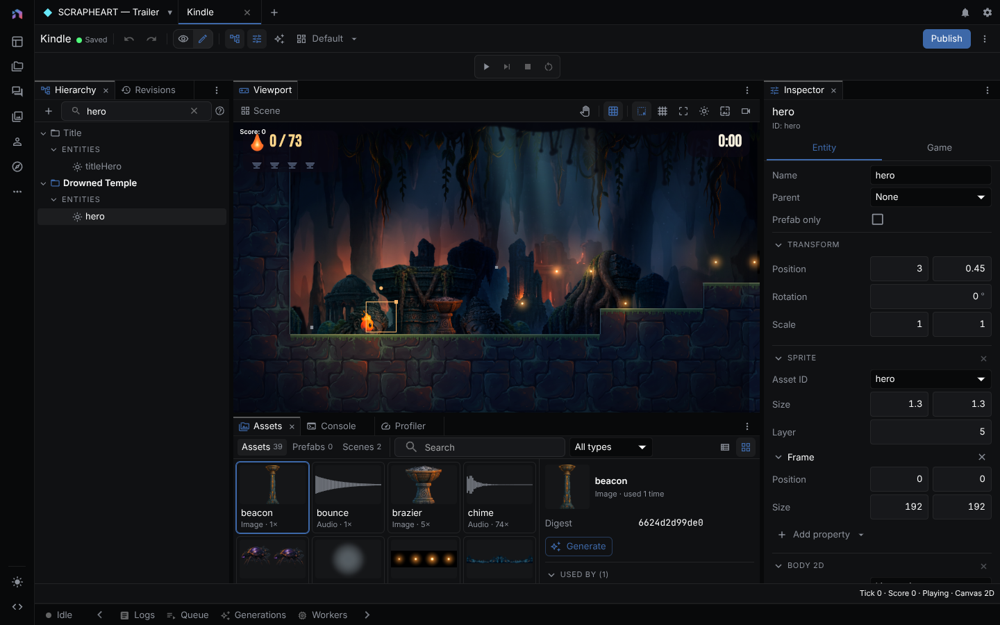

A game in NodeTool is either 2D or 3D for its whole life. The editor builds it, plays it, and exports it as a web player, desktop app, or mobile app. For engine features and runtime limits, see the [Native Game Engine guide](/game-engine/).

> **Runs:** locally in the browser. Asset generation uses the provider you pick (see [Providers](providers.md)). The desktop executable build needs Rust and a platform toolchain. **Needs:** no key to edit or play. A browser with WebGL2 for 3D games.
{: .callout-note}

A game holds scenes (one of them is the entry scene), entities with optional components and behaviors, named asset slots for art and sound, and input actions. The draft saves automatically about half a second after each change. **Publish** turns it into a published version.

| | 2D | 3D |
|---|---|---|
| Space | Top-down or side-view, world units | Meters, Y up, forward is -Z |
| Starter | A top-down room with a player, a gem, and four walls | A level with a capsule player, ramp, moving platform, crate, door, checkpoint, and goal |
| Rendering | Canvas 2D, or WebGPU for GPU effects | WebGL2 |

---

## Start a game

There is no blank game. Every new game starts from a playable starter.

- **+ New** in the tab bar, then **Game** under **Guided flows**. This creates a 2D game named "Untitled game" in the selected project.
- New-project screen: choose **More formats**, then the **Game** card. **Game card starts as** picks **2D game** or **3D exploration**. The prompt text only names the game ("New game" if empty). It is not sent to the assistant.
- Examples page (logo menu), **Games** tab: **Play** opens an example. **Install game** copies it with its media into the current project. Kindle, Lumen, and Neon Drift are 2D. AETHER // Skybound, BLACKSITE, and Signal Forge are 3D.
- Assistant: ask it to create a 2D or 3D game in a project. See [Ask the assistant](#ask-the-assistant).

---

## Editor layout

Resize panels by dragging their edges.

| Area | Contents |
|---|---|
| Document bar | Title, save status (**Saved**, **Saving…**, **Unsaved changes**, **Not saved**), Undo and Redo, View and Edit, panel toggles, Layout menu, **Publish**, and the ⋮ menu |
| Play controls | **Play**, **Step**, **Stop**, **Restart** |
| Scene tree (left) | Scenes and entities |
| Viewport (center) | The game canvas |
| Inspector (right) | Selected entity, scene, or game |
| Assistant (right) | Chat for this game |
| Script pane (bottom) | Code editor, open while you edit a script |
| Status bar | Tick, score, win state, renderer |

The ⋮ menu holds the export builds, **Save play state**, **Load play state**, **Play in new tab**, and **Commands**. Under the play controls the editor can show a **Changes** list of agent edits (see [Ask the assistant](#ask-the-assistant)), a **Retained construction** section (see [Rebuild a generated game](#rebuild-a-generated-game)), and a conflict banner when the draft changed somewhere else while you had unsaved edits. For each item that changed in both places, **Accept** takes the outside change and **Discard** keeps yours. On a narrow screen the 2D editor stacks the tree and inspector under the viewport and opens the assistant as a bottom sheet.

### 2D editing

- **Scene tree.** Entities are in **Entities**. **Prefabs** appears when entities are marked prefab-only. Drag to nest or reorder (Alt+arrows from the keyboard). The **+** beside a scene adds **Sprite**, **Static wall**, **Collectible**, **Trigger**, **Camera**, or **Empty**. **Sprite** is disabled until the game has an image asset.
- **Viewport.** Click or box-select, drag to move, use handles to scale and rotate (Shift constrains). Alt-click cycles overlapping sprites. Overlay buttons toggle **Selection**, **Grid**, **Snap**, **Colliders**, **Lights**, **Backgrounds**, and **Camera**.
- **Inspector.** The **Entity** tab has **Add component** (Sprite, Tilemap, Camera 2D, Body 2D, Collider 2D, Animator, Visual animation, Audio source, Light 2D) and **Add behavior** (Movement, Patrol, Collectible, Health, Trigger, Spawn, Scene transition, Win when collected, Lifetime, Script). The **Game** tab edits pixels per unit, entry scene, input actions, collision layer names, render effects (bloom, LUT, brightness and contrast), and asset bindings. Validation errors show beside the field, and the tree marks entities with validation or script errors in red.

| Key | Action |
|---|---|
| Space+drag, middle or right drag | Pan |
| Wheel | Zoom |
| Home, F | Reset camera, frame selection |
| Arrows, Shift+arrows | Nudge 0.25 units, 2.5 units |
| G | Toggle snap |
| Ctrl/Cmd + C, V, D, Z | Copy, paste, duplicate, undo (add Shift for redo) |

**Revisions** in the scene tree lists the 10 most recent published versions. **Restore to draft** loads one into the draft without changing published history. If the saved draft is unavailable, the editor offers published versions for recovery. If the tab still has a local draft, **Export local draft** saves its contents, pending edits, and undo history as a file before restoring is enabled. Keep the tab open until the download finishes, because confirming **Restore to draft** replaces the local draft and clears its undo history.

### 3D editing

- **Scene tree.** A **Scene** selector, then a flat list. **Add box**, **Add sphere**, and **Add light** create a primitive with a static body and matching collider, or a point light.
- **Model assets.** In the collapsed section, enter an owned model asset ID and a slot name, then choose **Prepare and install model**. **Edit model** opens the model in the [3D Editor](3d-editor.md). After saving model changes, prepare and install again, because the engine does not pick up edits on its own.
- **Viewport.** The toolbar has **Transform mode** (**Move**, **Rotate**, **Scale**), **Local space**, **Snap**, **Gizmo settings**, **Align to ground**, **Overlays**, **Fly camera**, and **Frame selection**. A multi-selection shares one gizmo, and each drag or **Align to ground** is one undo step.
- **Gizmo settings.** Pivot is **Selection centre**, **Active entity**, or **Individual origins**. Snap defaults are 0.25 m, 15 degrees, and 0.25 scale. **Surface snap** rests drags on the surface under the pointer. **Orbit around selection** recenters the orbit. These are browser preferences, not part of the game.
- **Inspector.** Position (meters), Rotation (degrees), Scale, components, and a **Behaviors** list with **Add script**, **Edit script**, and **Remove**.

| Key | Action |
|---|---|
| Drag, Shift-drag, scroll | Orbit, pan, zoom |
| Fly camera on, then W A S D, R F | Move, rise and descend. Drag looks |
| F, X, . | Frame, toggle local space, next pivot mode |
| End | Align to ground |
| Numpad 1, 3, 7 (Ctrl/Cmd for opposite), 5 | Front, right, top views (back, left, bottom), orthographic |

The 3D editor has no copy and paste, keyboard nudge, tree search, nesting by drag, prefab group, **Revisions** list, or **Run 10 s**. Ask the assistant for those.

---

## Scripts

A script is a behavior on an entity. In the inspector choose **Add behavior**, then **Script** in 2D, or **Add script** in 3D. Choose **Edit script** to open the script pane, a code editor with hints for the engine's script functions. Each edit goes into the draft. The script language and what scripts can do are in [Scripts](game-engine/scripts.md).

The pane footer shows the script's length against its 16,384 character limit, plus **maxCommands** and **maxTickMs**. In 2D both limits are editable on the script behavior, defaulting to 16 commands and 8 ms per tick.

When a script throws during play, the 2D pane shows the tick and message. **Replay to tick N** reruns to the tick before the failure. **Ask the assistant** drafts a message with the scene, entity, behavior, tick, and error. 2D also has **Run 10 s**, a headless ten-second run that reports script calls, total script time, and a per-entity breakdown. The 3D editor shows **Replay before error**.

---

## Ask the assistant

**Show assistant** opens a chat beside the viewport. The assistant knows the open game, your selected entities, and the script you are editing, and edits the draft directly.

- "Make a 2D game where I collect five gems in a small room, then win."
- "Show the score in the top right."
- "Generate a pixel-art sprite for the player and use it."
- "Playtest the game and tell me whether the player can reach the goal."
- "Make the jump feel floatier and add a double jump."

Agent edits land in your draft. The **Changes** list groups them by chat message. **View in chat** jumps to the message and **Undo** reverts that group. Your later edits are merged, and overlapping ones show as conflicts. The assistant publishes only when you ask.

For the tool reference, see [Creative Agent Tools](/developer/creative-agent-tools#games).

---

## Play

| Button | What it does |
|---|---|
| **Play** | Starts a session from the current draft. Reads **Pause** while playing |
| **Pause** | Stops the clock. **Runtime state** shows the selected entity |
| **Step** | Advances one tick, while paused |
| **Stop** | Ends the session |
| **Save play state**, **Load play state** | Snapshot and restore the running session. Stored in this browser, keyed by game ID |
| **Play in new tab** | Opens the player page |

Click the canvas to focus it. In 2D, arrow keys and W A S D map to `left`, `right`, `up`, `down`, Space maps to `space`, and other keys map to their lowercase name. A key counts only if the game lists it under input actions. In 3D, W A S D or arrows move, Space jumps, and the right mouse button looks.

A session plays the document as it was when you pressed **Play**. Edits during play show **The draft changed. Stop and play again to apply it.** In 2D, changing only asset bindings needs no restart. If a game uses a required GPU effect and the browser has no WebGPU, play fails with an error. An optional effect is dropped and the toolbar reports **Canvas 2D**.

---

## Publish

Choose **Publish** (disabled while the draft saves). The 2D dialog lists changes since the last published version and validates the game first, showing errors instead of publishing. The 3D dialog creates a published version from the draft. **Revision message** is optional, up to 500 characters. The draft stays editable and starts from the published content. Publishing does not make the game public.

If another session published first, you get **Game was modified concurrently**. Reload, merge your edits, and publish again.

**Play in new tab** opens `/game/<game ID>`, which loads the **saved draft** (not the last published version) through your own account, so only the owner can open it. The button is disabled until the draft is saved. To give someone a game that runs without NodeTool, [build a standalone web player](#build-a-standalone-web-build) or a [desktop app](#build-a-desktop-app).

---

## Build a standalone web build

A folder of static files for one published version that plays without a NodeTool server.

- Editor: ⋮ menu, **Web player**. The zip holds the last published version, not the draft.
- Command line: `nodetool game build game.json --out game-build`. See [`nodetool game`](cli.md#nodetool-game).

- Serve a 3D build over static HTTP. The first 3D release targets desktop web and Electron.
- Installed media must exist and use a supported format, or the build fails.
- On touch screens the 2D player adds a floating stick for `left`, `right`, `up`, `down` and one button per other input action.

---

## Build a desktop app

A [Tauri](https://tauri.app) project that wraps the web player and compiles to a native Windows, macOS, or Linux app that plays the published version offline.

- Editor: ⋮ menu, **Desktop app**. The zip holds a `desktop/` folder with a README.
- Command line: `nodetool game build game.json --out game-desktop --target tauri --name "Cave Run"`. Add `--compile` to build the executable right away.

### Build the executable in the editor

The desktop app and a local server can compile in the editor. Choose **Desktop executable** in the ⋮ menu. Cargo output streams into the **Console** panel. When it finishes, the status row shows the executable path and the desktop app offers **Show in folder**. The executable lands in the `bin/` folder of the build's project folder. **Cancel** stops cargo. A hosted server refuses the build.

Cargo comes from the **Rust** package in the Package Manager or a [rustup](https://rustup.rs) install, and the editor offers to install Rust if neither is found. The first build compiles Tauri and takes several minutes. The compiler also needs the Visual Studio C++ Build Tools on Windows, the Xcode Command Line Tools on macOS, or the WebKitGTK development packages on Linux.

For installers, install the [Tauri prerequisites](https://v2.tauri.app/start/prerequisites/) and run `npm install && npm run build` in the project. Each platform builds its own installers.

WebGPU effects depend on the system web view. Where it has none, as in WebKitGTK on Linux, the 2D player skips them and says so in its status line.

---

## Build a mobile app

An [Expo](https://expo.dev) project for iOS and Android that shows the published version full screen, offline.

- Editor: ⋮ menu, **Mobile app**. The zip holds a `mobile/` folder with a README.
- Command line: `nodetool game build game.json --out game-mobile --target expo --name "Cave Run"`.

A 3D game locks the screen to its presentation aspect ratio. A 2D game follows the device and asks for a turn when the shape is wrong. A build carries at most 128 MB of game files.

Run `npm install && npx expo start` and scan the QR code with Expo Go. For installable apps run `eas build --platform android --profile preview` (APK) or `eas build --platform ios` (needs an Apple Developer account). `npx expo run:android` and `npx expo run:ios` build locally. Leaving the app pauses the game.

---

## Generate assets

Games bind art and sound by slot name, so you can replace placeholders without touching entities. Ask the assistant to generate an asset for a slot and it generates, prepares, installs, and binds it. Image preparation can trim transparent edges, resize, set a pivot, slice a sprite sheet, build a 16-variant terrain tileset, or make a color lookup table for a **LUT** effect. In a workflow, **Load Game Template**, **Slot Prompt**, and **Stage Game Assets** do the same job. Staged media is a candidate until you install it.

2D fonts, music, lighting, backgrounds, effects, and visual animation are unavailable in games created before these features existed. The editor disables the matching **Add** buttons for those games.

---

## Rebuild a generated game

A game made by a generating script keeps that script and its inputs, so you can change an input and regenerate the game without losing edits you made by hand. **Retained construction** shows the script and inputs. See [Rebuilding Generated Games](game-engine/construction.md). **Preview rebuild** shows changed entities and dependencies, **Highlight changes** selects them in the viewport, and **Apply rebuild** writes them into the draft. A rebuild is blocked while it has conflicts or the draft is out of date. If your hand edits conflict with the rebuild, a dialog lets you keep that entity as it is, detached from the script, or discard those edits.

---

## Limits

- A game is 2D or 3D. It cannot change dimension, and mixed 2D and 3D scenes are not supported.
- Multiplayer, terrain streaming, navigation meshes, vehicles, ragdolls, retargeting, and root motion are outside this release.
- A script error stops the session. Restart it or load a play state saved before the error.
- A game allows up to 8 render effects, 32 collision layer names, and 32 lights and backgrounds per scene. A sprite has up to 5 visual animation tracks.
- The engine limits events and spawned instances. Exceeding a limit stops the session.
- A 3D game needs WebGL2. Playtest captures in 3D need Chromium.

---

## Related

- [Sketch Editor](sketch-editor.md) for the images you bind as sprites and backgrounds
- [3D Editor](3d-editor.md) for the glTF models a 3D game binds
- [Asset Management](asset-management.md) for the media in your project
- [Workspaces](workspaces.md) for where game files and builds are stored
- [CLI Reference](cli.md#nodetool-game) for `nodetool game validate`, `simulate`, `capture`, and `build`

