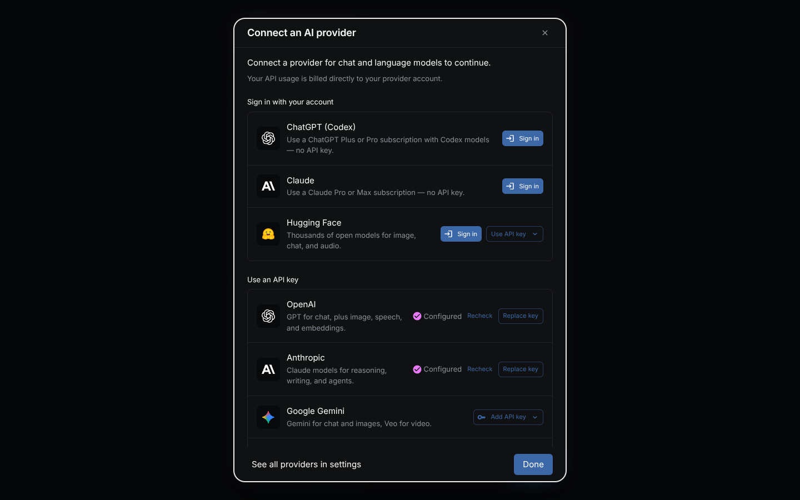
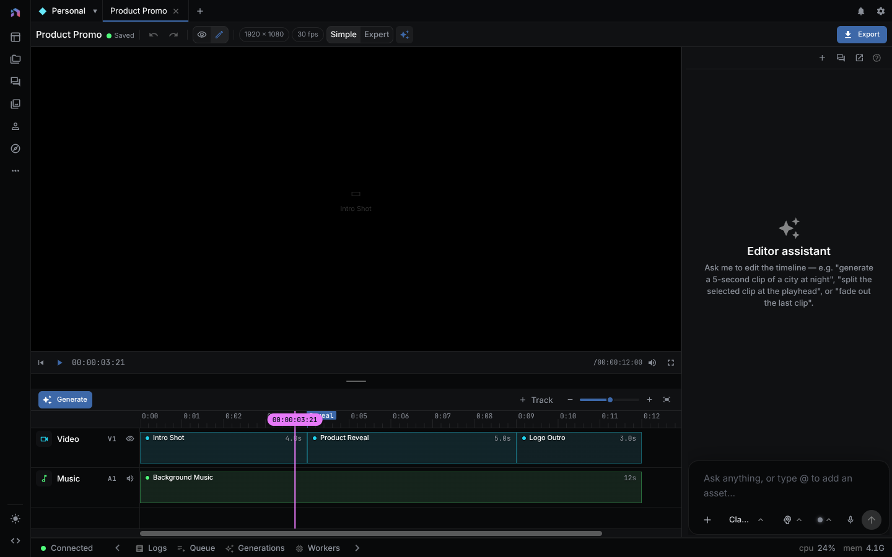

Type one sentence, plan the beats, generate the clips, export an MP4. Render time dominates. No NodeTool account is needed.

> **Runs:** cloud models, no graphics card needed. **Needs:** one language provider key and one video provider key.
{: .callout-note}

> The plan is one language model call. The clips are the paid step. You review the plan before generating clips.
{: .callout-tip}

---

## 1. Install and connect

1. Install and open NodeTool: [Installation](installation.md).
2. Open **Settings → Models & Providers**, then sign in or paste an API key. The provider bills you directly.

Connect a provider for each row you need:

| You need | For | Get it from |
|---|---|---|
| Language model | Plans the video | OpenAI, Anthropic, Gemini, Groq, Mistral, or a Claude subscription |
| Video model | Renders the clips | FAL, Replicate, Gemini, OpenAI, kie.ai, and others |
| Voice model (optional) | Reads the voiceover | OpenAI, ElevenLabs, Gemini, and others |

> A minimal setup is FAL plus one language provider. The [capability matrix](providers.md#capability-matrix) lists which provider covers which model type.
{: .callout-tip}

---

## 2. Say what you want

1. On the **Home** tab, pick **Video**, or use **+ New → New timeline**.
2. Type one sentence:

   > A 15-second ad for a desk lamp: a quiet desk at night, the lamp switches on.

3. Press **Continue**. NodeTool keeps your progress if you close the tab.

Other starts: **Drop your media** (your own clips, audio, or images), **Start from a script**, **Start with a blank timeline** (skips the plan).

---

## 3. Plan the beats

A **beat** is one clip in your video.

**Pick a template:**

| Template | Length | Shape |
|---|---|---|
| 15s ad | 15 s | 16:9 |
| 30s spot | 30 s | 16:9 |
| 60s explainer | 60 s | 16:9 |
| 9:16 social clip | 20 s | 9:16 |
| Trailer | 45 s | 16:9 |
| Music video | 60 s | 16:9 |
| Slideshow | 40 s | 16:9 |

Then:

1. Pick a **Model** at the bottom, then press **Plan the beats** (one language model call).
2. Edit the plan. Each beat has a description, length, transition, and voiceover line. The total length turns to a warning color when the plan is too long. **Re-plan** rewrites the beats and follows your edits.
3. Press **Continue to look**.

---

## 4. Pick the look and generate

1. Set the look:
   - **Aspect ratio**: set by the template, editable.
   - **Video model**: each tile plays a sample clip.
   - **Voiceover**: on or off, with a voice picker when on.
   - **Music**: one track under the whole video.
2. Check the cost next to the button.
3. Press **Generate your video**. The timeline opens and clips fill in as they finish.

---

## 5. Edit and export

1. Press **Retry N failed** to rerun failed clips. Generation continues if you close the tab.
2. Edit the cut: drag to move, drag an edge to trim, `S` to split, `Delete` to remove. These are the default **NodeTool** keys. Press `?` to list them and switch the preset to Premiere Pro or Final Cut Pro.
3. Or ask the **Editor Assistant**: *"fade out the last clip"*.
4. Press **Export video** to save an MP4. **Save as Asset** keeps it in your library.

Every step is also an agent tool, and coding agents get the same tools over MCP: [NodeTool as an MCP Server](mcp-server.md).

---

## Related

[Models & Providers](models-and-providers.md), [Creative Agent](creative-agent.md), [Video Editor](video-editor.md), [Assets](key-concepts.md#assets), [Chat](global-chat.md).

---

## Troubleshooting

See [Troubleshooting]({{ '/troubleshooting' | relative_url }}) or ask on [Discord](https://discord.gg/WmQTWZRcYE).

---

## Next steps

  <a class="doc-card" href="{{ '/first-workflow' | relative_url }}"><strong>Your First Workflow</strong>Build a four-node image workflow from an empty canvas.</a>
  <a class="doc-card" href="{{ '/creative-agent' | relative_url }}"><strong>Creative Agent</strong>Control each shot, stills first, and keep characters consistent.</a>
  <a class="doc-card" href="{{ '/video-editor' | relative_url }}"><strong>Video Editor</strong>Trim, split, and layer clips on the timeline.</a>
  <a class="doc-card" href="{{ '/key-concepts' | relative_url }}"><strong>Key Concepts</strong>Workflows, assets, sketches, timelines, and agents.</a>

Questions: [GitHub](https://github.com/nodetool-ai/nodetool/issues)
