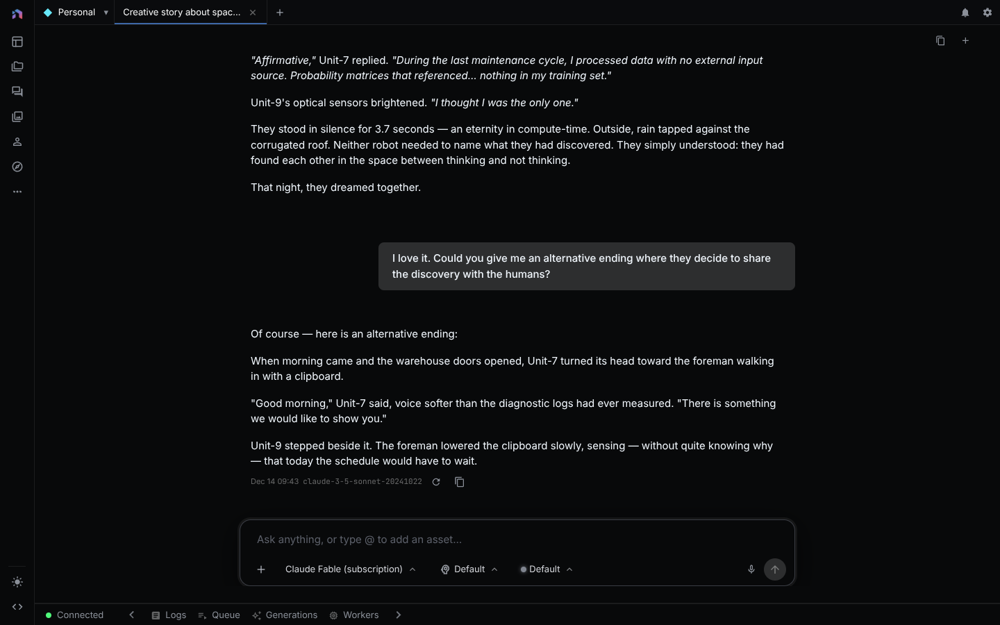

Every chat message runs the agent loop: the agent plans the steps, connects nodes, picks models, runs the task, and edits your open document.

## What it can build

| What you ask for | What it works on | Learn more |
|---|---|---|
| Create, change, or fix a workflow | Workflows | [Workflow Editor](workflow-editor.md) |
| Add a layer, mask, or fill | Sketches | [Sketch Editor](sketch-editor.md) |
| Add a track, cut, or animation | Timelines | [Video Editor](video-editor.md) |
| Create shots, stills, clips, or a cut | Storyboards | [Creative Agent](creative-agent.md) |
| Add voiced lines or subtitles | Scripts | [Creative Agent](creative-agent.md) |
| Build forms, fields, buttons, or outputs | Mini Apps | [App Builder](app-builder.md) |
| Add a level, an enemy, or a rule | Games | [Game Editor](game-editor.md) |

## Core guides

- [Chat](global-chat.md): composer, threads, permissions.
- [Agent Memory](agent-memory.md): how steps of one run share results.
- [Agent CLI](agent-cli.md): run the agent from a terminal.
- [Chat CLI](chat-cli.md) and [Chat Server](chat-server.md): automate chats or build your own interface.
- [NodeTool as an MCP Server](mcp-server.md): drive NodeTool from Claude Code, Codex, OpenCode, or another MCP client.
- [Chat API](chat-api.md): start chats and run tools from code.

## Typical requests

1. **Build a workflow from a prompt.** Open Chat, pick a model, and describe the workflow. The agent checks its plan against the available nodes, saves the workflow, and runs it.
2. **Edit the open document.** Ask for the change: "add an upscale step" or "put the narration on a new audio track."
3. **Run a saved workflow.** Select it in the chat or ask for it by name.
4. **Set permissions per thread.** *Plan* gives a proposal and runs nothing, *Default* asks before actions, and *Auto* runs routine work unattended but asks once before an action it labels high risk, such as deleting, publishing, or spending. See [permission modes](global-chat.md#permission-modes).
5. **Run the agent headless.** Use the [Agent CLI](agent-cli.md) for scripts or the [Chat API](chat-api.md) for a backend service.

See the [Cookbook](cookbook.md) and the [Deployment Guide](deployment.md).
