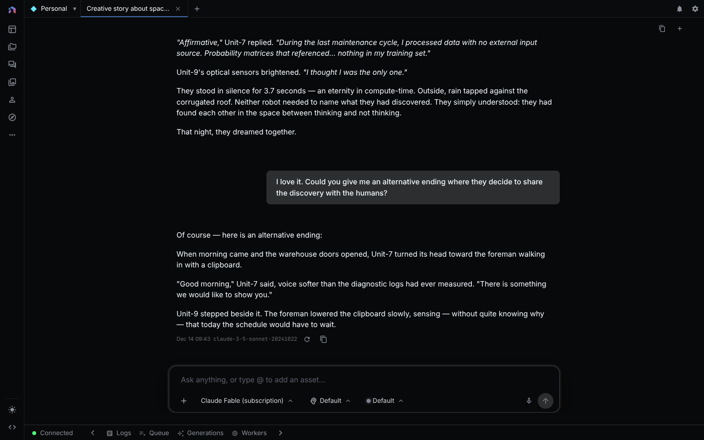
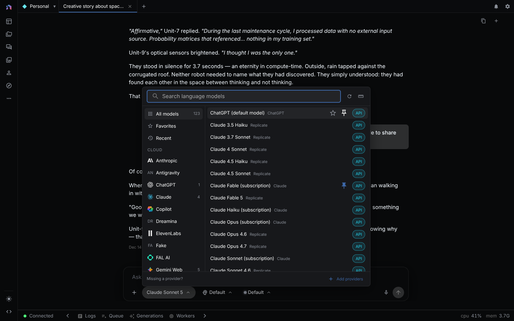
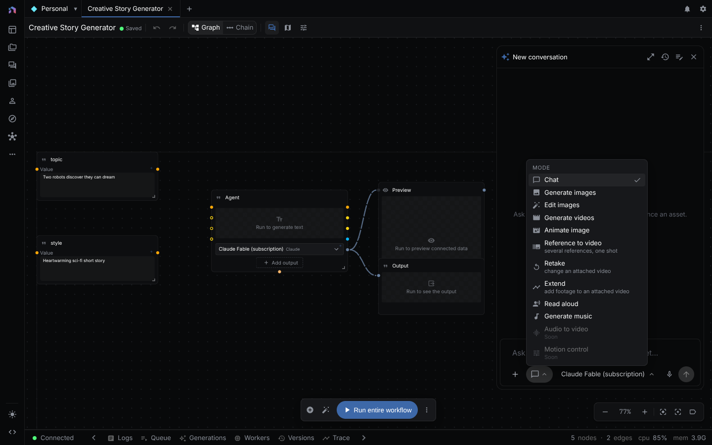
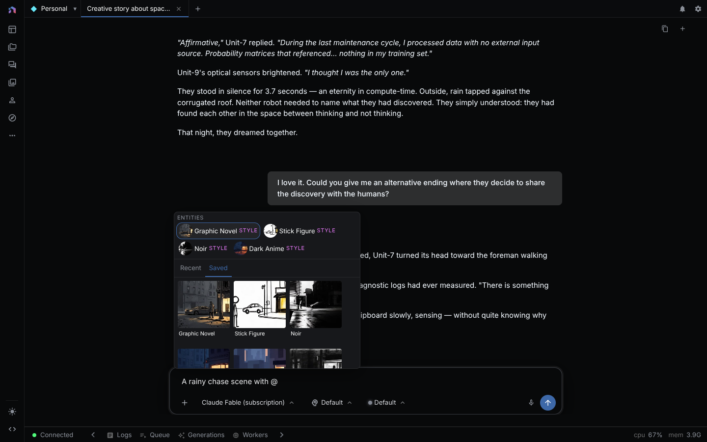
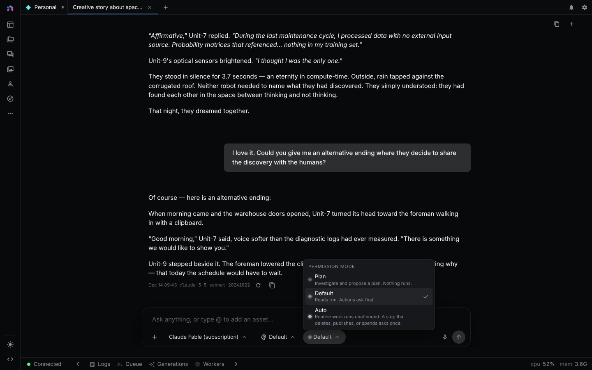
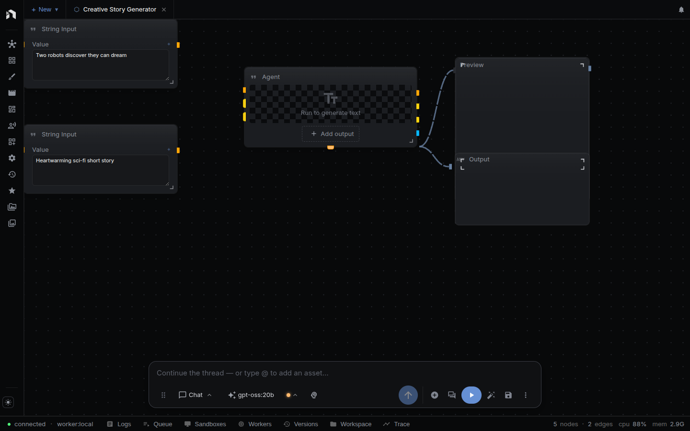

Chat is the composer and agent loop: the agent plans, calls tools, builds and edits the document you have open, generates media, and runs saved workflows. Type a request and send it.

> **Runs:** locally or cloud, depending on the model you pick. **Needs:** at least one configured provider (see [Providers](providers.md)). Permission modes (Plan, Default, Auto) set what the agent may do without asking.
{: .callout-note}

## Getting Started

### Opening Chat

- **From the App**: Click the **Chats** icon in the left rail, then pick a thread or start a new one
- **Standalone Window**: Click the NodeTool system tray icon and select **Chat** for a dedicated, focused window
- **Chrome Side Panel**: Install the [Chrome extension](chrome-extension.md#chat-in-the-side-panel) and click **Open chat** in its popup. The panel is chat only, but it reads and writes the same threads, and the agent can act on the tab you have open

### Choosing a Model

Click the model chip in the composer. The list shows models from your configured providers: cloud models need API keys, local models (Ollama, LM Studio) need the local server. Configure providers in **Settings → Models & Providers**. See [Models & Providers](models-and-providers.md).

---

## Composer Modes

A message sent from the chat page is always a chat turn. To generate media, start a Create tab from **Image**, **Video**, or **Audio** on the home screen. A picture or clip in a chat reply has **Open in Create**, which opens a Create tab with the reply's prompt and media as references.

The chat panel in the workflow editor keeps a mode chip. Click it to switch:

| Mode | What it does |
|------|--------------|
| **Chat** | Talk to the model, run tools, and drive agents |
| **Generate images** | Text-to-image with your chosen image model |
| **Edit images** | Image-to-image edits on a dropped image |
| **Generate videos** | Text-to-video |
| **Animate image** | Turn a still image into a clip |
| **Reference to video** | One clip from several attached images and videos — a character plus a garment, a product plus a location, a clip whose motion the new shot follows |
| **Retake** | Change an attached video |
| **Extend** | Add footage to an attached video |
| **Read aloud** | Text-to-speech with a voice picker |
| **Generate music** | Text-to-music with your chosen music model and a duration |

**Audio to video** and **Motion control** are listed as **Soon** and cannot be picked yet.

Each mode adds its own controls (resolution, aspect ratio, duration, voice) and attaches them to the message so the server routes to the right provider call.

Reference to Video takes every image and video on the message, plus the
reference image of any `@`-mentioned entity, so the prompt describes the action
and the camera rather than the subjects. Its audio chip chooses between what the
model scores and the first reference video's own track; only some models accept
the second, and one that does not rejects the request.

---

## Mentions: @ for assets and entities

Type `@` in the composer to reference things by name instead of hunting for
them:

- **Entities** — characters, locations, styles, and props from your entity
  library appear first. Picking one inlines its name into the message and
  attaches its reference image, so generations stay consistent with the
  entity's canonical look.
- **Assets** — recent and saved library files. Picking one attaches it to the
  message like a drag from the asset library.

The same picker works inside the workflow editor's Prompt node, where a picked
entity becomes a chip that expands to its descriptor and reference image at
generation time.

---

## Slash commands: / for skills

Type `/` at the start of a word in the composer to open a list of your skills and the skills NodeTool ships. Picking one inserts `/<skill name> ` into the message so the agent loads that skill for the request. The list filters by skill name and description as you type. See [Skills](skills.md) for how to write one and for the full catalog.

---

## Conversation Threads

**New Chat** starts a thread. Pick one from the **Chats** panel in the left rail to open it as a workspace tab. Each thread keeps its own model, permission mode, and history.

---

## Agents {#agent-mode}

### The Agent Loop

Every turn runs the agent loop. Per request, the assistant decides whether to break a task into steps and run a plan or answer directly.

1. **Planning** -- The agent analyzes your request and, when the task warrants it, creates a plan with ordered steps
2. **Tool selection** -- For each step, the agent chooses from the available tools
3. **Execution** -- Steps run in sequence, with results feeding the next step
4. **Adaptation** -- The agent adjusts its plan based on intermediate results
5. **Reporting** -- Progress, tool calls, and reasoning stream in real time

### Permission Modes

The permission chip sets how far the agent may act on its own, per thread:

| Mode | Behavior |
|------|----------|
| **Plan** | Read and propose only. No actions taken. |
| **Default** | Reads run automatically; actions ask first. |
| **Auto** | Routine work runs unattended; the agent asks once before an action it declares risky. |

In Plan mode a request that needs several steps is decomposed by the task
planner rather than described in prose: the agent calls `create_plan`, and the
plan arrives as a DAG of tasks and steps with the independent ones marked, so
you can see what would run concurrently. Nothing in it executes. A question
that needs no plan still gets a plain answer.

Switch to Default or Auto and say to run it, and the agent calls `execute_plan`
with that same plan — not a fresh one derived from the conversation. You are
asked once, for the plan as a whole, and then tasks stream in as they finish,
independent ones together. Ask for a change first ("run it without the last
task") and the amended plan is what runs.

In Auto the agent labels every code action it writes `low` or `high` risk. A `low` action — reading, computing, work you asked for and can undo — runs with no prompt. A `high` one — deleting or overwriting something, publishing or sending anything outside the account, spending real money — asks you first, once, showing the program it wants to run. Unlabeled counts as high. "Allow for this chat" stops the asking for the rest of the thread.

### Watching an Agent Work

As the agent runs, the thread shows the task plan, each step's status as it starts, completes, or fails, the tools it calls and their results, and — on models that support it — its reasoning.

---

## Building and Editing From Chat

### Building a workflow

The agent plans the graph, validates it against the node library, saves it as a workflow, runs it, and debugs what failed. The result is a normal workflow in your library.

### Editing what you have open

The agent reads the open document and edits it with the same actions the interface offers.

The same holds on every other surface:

| Open document | Ask for |
|---|---|
| Workflow | "Add an upscale step after the image node and preview both." |
| Sketch | "Add a shadow layer at 40% opacity, multiply blend." |
| Timeline | "Put the narration on a new audio track and fade the last clip out." |
| Storyboard | "Render stills for every shot, then clips for the ones I picked." |
| Script | "Voice every draft line with the cast voices and send it to a timeline." |
| Mini app | "Add a tone dropdown and show the result underneath the button." |

Each editor tool names the document it acts on, so a request that targets
something you don't have open comes back saying which documents are.

### Running a saved workflow

Choose a workflow in the composer, or ask for it by name. The agent calls it with your inputs and streams results into the thread. Save the workflow in the [workflow editor](workflow-editor.md) first.

---

## Available Tools

Chat agents have access to these tools:

| Tool Category | What It Does |
|--------------|--------------|
| **Browser** | Navigate web pages, extract content, take screenshots |
| **Search** | Web search via multiple search providers |
| **Filesystem** | Read/write files, list directories, manage workspace |
| **Code** | Execute JavaScript in a sandboxed environment, including calculations |
| **HTTP** | Make HTTP requests to external APIs |
| **PDF** | Extract text and data from PDF documents |
| **Email** | Read and process email messages |
| **Assets** | Upload, organize, and manage NodeTool assets |
| **Vectors** | Query and manage vector database collections |
| **Google** | Interact with Google APIs (search, drive, etc.) |

### MCP Tools (Model Context Protocol)

Add external MCP servers in **Settings → MCP Servers → External servers** (local app only). Click **Add server** and give the server an id (lowercase letters, digits, and `_`, up to 32 characters), a name, and one of two transports:

- **stdio**: a command, arguments (one per line), environment variables, and an optional working directory. Stdio servers are unavailable on some hosted deployments.
- **http**: an `http` or `https` URL and optional request headers.

Environment and header values can reference stored secrets as `${SECRET_NAME}`. A server's tools join the agent's toolbelt on the next message, named `mcp_<id>_<tool>`. **Test** connects to a server and checks it. **Disable** turns a server off without deleting it. See the [MCP documentation](https://modelcontextprotocol.io/) for available MCP servers.

To use NodeTool from another agent instead, see [NodeTool as an MCP Server](mcp-server.md).

---

## Standalone Chat Window

Click the NodeTool system tray icon and select **Chat** to open chat in its own window. It shares threads with the main app.

---

## Related

- [Chat & Agents](global-chat-agents.md)
- [Chat API](chat-api.md)
- [Chat CLI](chat-cli.md)
- [Agent CLI](agent-cli.md)
- [Models & Providers](models-and-providers.md)
- [Cookbook](cookbook.md)
