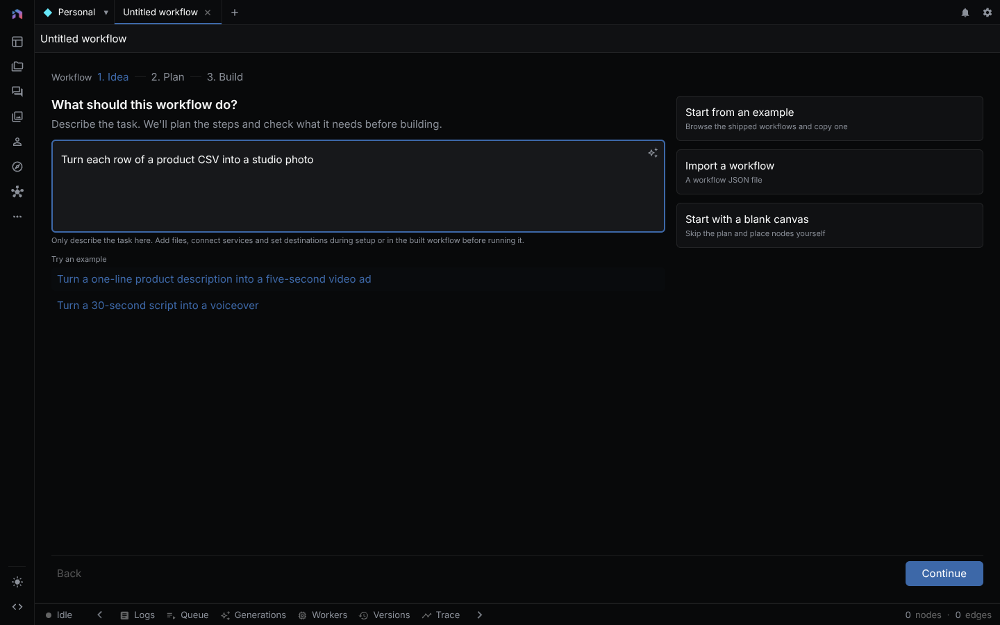

A guided flow is a short sequence of steps that ends in a document you keep editing. You describe what you want, review the proposal, and only then does the flow call paid models. Progress is saved on the document the flow creates, so a reload or a second window resumes at the same step. The **Image** and **Read aloud** cards are not guided flows. They open a new Create tab. For the Storyboard, Video, and Script flows, see [AI Video Production](ai-video-production.md). For reusable characters, places, styles, and props, see [References](entities.md).

> **Runs:** locally or cloud, depending on the models you pick. **Needs:** a connected language model, plus an image model for Reference and Storyboard. Hosted models need their provider key (see [Providers](providers.md)). **Costs:** the render or build step calls the chosen model at provider rates. The footer shows an estimate when it can be measured. The App build is capped at $2.00.
{: .callout-note}

| Flow | What it makes | Steps |
|------|---------------|-------|
| [Workflow](#workflow) | A graph, checked and run once | Idea, Plan, Build |
| [App](#app) | A mini app with the workflow behind its button, test-run | Idea, Design, Build |
| [Reference](#reference) | A reusable character, location, style, or prop | Details, Reference, Review |
| [Storyboard](#storyboard-video-and-script) | A rendered board of shots | See [AI Video Production](ai-video-production.md) |
| [Video](#storyboard-video-and-script) | A cut on the timeline, no board | See [AI Video Production](ai-video-production.md) |
| [Script](#storyboard-video-and-script) | Voiced lines ready to place | See [AI Video Production](ai-video-production.md) |
| [Game](#game) | A playable game in the built-in engine | See [Game Editor](game-editor.md) |

## Start a flow

**From the new-project screen.** The flow cards are **Create video**, **Create storyboard**, **Create app**, and **Create workflow**. **Explore all creation types** adds **Script**, **Game**, and **Reference**. **Create image**, and **Read aloud** under **Explore all creation types**, open a Create tab instead. Text typed in the prompt box is not sent to a flow unless you click its card.

**From the tab bar.** The **+ New** menu lists flows under **Guided flows**. Each choice creates an untitled document in the selected project and opens it as a tab, except **App**, which opens its flow and creates the app only when the build succeeds. A failed start shows the notification "Could not start the guided flow".

**From the Games examples.** The **Games** tab under the flows has **Make a game**, which starts the Game flow.

**From the References page.** **Add reference** runs the Reference flow in place.

When a step's primary button is disabled, a line beside it says why, for example when a required field is empty. Where a step spends money, the cost estimate sits beside the button. Step 1 of the Workflow and Reference flows has **Other ways to start**, which skips the flow. Flows opened from the new-project screen also show **Change flow** on step 1, which asks for confirmation before it discards the draft.

## Workflow

Planning places nothing and runs nothing. The build step then creates the graph, validates it, and runs it once with sample inputs. See [Workflow Editor](workflow-editor.md).

### Step 1: Idea

Describe only the task in the **The task** box, for example "Summarize a PDF and email it". Three example tasks sit below it.

**Other ways to start**:

- **Start from an example** opens a searchable browser of shipped workflows. Picking one copies it and opens it in the editor.
- **Import a workflow** reads a JSON file or a TypeScript workflow file.
- **Start with a blank canvas** skips the plan.

### Step 2: Plan

The category changes which nodes the plan uses and which run mode step 3 starts on. A wrong choice costs a re-plan, not a graph.

| Category | Description | Starts as |
|----------|-------------|-----------|
| Content pipeline | Text in, drafted and formatted text out | Run by hand |
| Media batch | The same render over a list of inputs | Run by hand |
| Data extraction | Pull structured fields out of documents or pages | App with a form |
| Research agent | An agent that searches, reads and reports back | App with a form |
| Automation on a trigger | Runs on a schedule or a webhook, with no one watching | On a trigger |
| Chat app | A conversation with your data behind it | App with a form |

Pick the text model in the footer, then **Plan the steps**. A shipped example brief can use a stored plan with no model call. If the plan already matches your brief and category, the button reads **Continue to your plan**.

The plan is a numbered list of inputs, steps, and outputs. You can edit titles and descriptions, reorder or remove steps, and use **Add a step**. Two markers can block **Continue to setup**:

- A red marker, "No node for this step", means the step names a node type that does not exist. Pick a real node type in the field beside it.
- An amber marker, "No ... provider connected", means the step needs a model type (text, image, or voice) that no connected provider covers. **Connect** opens provider setup in place.

Every step needs a title and every output needs a name. **Re-plan** asks the model again.

### Step 3: Build

Pick a model for each model type the plan needs, then choose how the workflow starts:

| Run mode | After the test run |
|----------|--------------------|
| Run by hand | You open it and press run |
| App with a form | You put a shareable form over the inputs |
| On a trigger | A schedule or a webhook starts it |

Edit **Sample inputs** to change the test-run values. **Build your workflow** builds, checks, then runs the workflow once. Cost is unknown until the run returns.

### The landing checklist

When the build finishes, the canvas opens with a checklist: **Graph built** (with the node count), **Validated**, and **Test run**. A failed line says what needs a fix. The next-step button depends on the run mode:

- **Continue on canvas** for Run by hand
- **Create Mini App** for App with a form. See [Mini Apps](mini-apps.md)
- **Add a trigger** for On a trigger. It opens the trigger-node picker. See [Triggers](triggers.md)

## Reference

The reference image keeps the reference consistent across prompts. See [References](entities.md).

### Step 1: Details

1. Choose the reference type: **Character**, **Location**, **Style**, or **Prop**.
2. Enter a **Name**. The placeholder is "Nova".
3. Enter a **Descriptor**. This text is added to every prompt that uses the reference, so describe only stable visual traits.
4. Optionally enter **Tags (optional)** as a comma-separated list.

The name and descriptor are required. **Start with a blank reference** under **Other ways to start** makes a plain white 1024 x 1024 image, fills an empty name with "Untitled reference" and an empty descriptor with "A reusable visual reference.", and jumps to the review. Otherwise continue with **Choose a reference**.

### Step 2: Reference

- **Choose from assets** opens the asset picker. After a pick the button reads **Change reference**. Images that are already references are not offered.
- **Generate with AI** opens **Generate a reference image**. Choose a view for the reference type, edit the **Prompt**, pick an **Image model**, and choose **Generate reference**. The image is made at 1K resolution and selected for you.

Continue with **Review reference**.

### Step 3: Review

**Create reference** saves it. If you leave before this step, the draft is kept and restored when you return.

## Storyboard, Video, and Script

[AI Video Production](ai-video-production.md) documents all three, with their steps and review screens.

- **Storyboard** takes a sentence to a rendered board in four steps. You review the screenplay, assign references, choose the look, then render stills and clips.
- **Video** takes a sentence to a cut on the timeline with no board. Each beat stays a separate clip. Start it from **Create video** on the new-project screen or the Studio home. **Video** in the **+ New** menu opens a Create tab instead.
- **Script** takes a topic to voiced lines. You write or import the script, add production context, assign speakers and voices, and can create a linked storyboard from it.

## App

Nothing is added to your project until the build passes its tests.

### Step 1: Idea

Describe what someone types or picks, what the button does, and what they get back, for example "A page where I type a product name, press a button, and get a short description back". **Model** in the footer picks the language model that writes the design and builds the app. **Start with a blank app** under **Other ways to start** creates an empty app and opens it in the App Builder. Otherwise continue with **Write the design**.

### Step 2: Design

Every field is editable.

- **The app** holds the title.
- **What it runs** has one card per workflow behind the screen. **What it does** says what that workflow does, and the line under it names what it takes and gives back.
- **On the screen** lists the label of each input, button and output, in the order they are placed.
- **How it is tested** lists the tests the build runs, in words. An app that fails one is not installed.

**Re-design** writes a new design from the same idea. Going back and changing the idea also writes a new design. Going back without changing it keeps your edits. Choose **Continue to the build**.

### Step 3: Build

**App name** starts as the design's title. **Build your app** plans the workflows, places the screen and test-runs it, with spending capped at $2.00. The step's list marks each part done, under way, or pending, including a repair round after a failed test. A build that passes is installed in the selected project and opens in the App Builder on its run view, with its workflows listed under **Linked workflows**. A failed build shows the reason on the step and installs nothing. The [mini app build harness](mini-app-build-harness-design.md) describes the stages.

If you leave the tab before the build, the design is kept and restored when you return to it.

## Game

**+ New** creates a 2D top-down room game named "Untitled game". On the new-project screen, **Game card starts as** picks **2D game** or **3D exploration**. See [Game Editor](game-editor.md).
