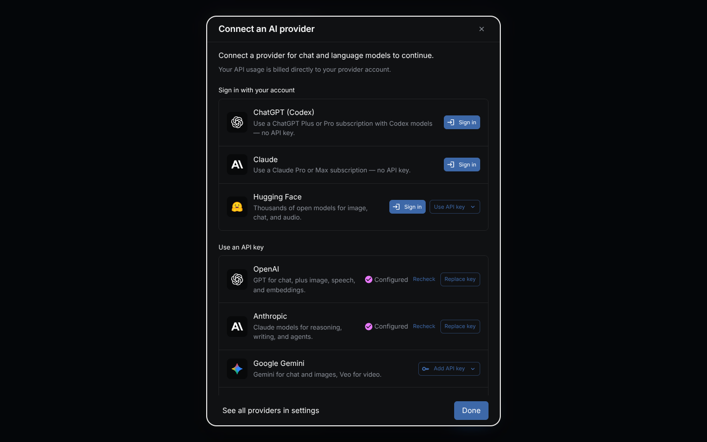

Download the installer from [nodetool.ai](https://nodetool.ai) (`.dmg` on macOS, `.exe` on Windows, AppImage on Linux), open NodeTool, then [connect a provider](#connect-an-ai-provider). Expected result: NodeTool opens, and the model dropdown in a node or chat lists at least one connected provider.

---

## macOS

1. Download the `.dmg` from [nodetool.ai](https://nodetool.ai). Builds exist for Apple Silicon (arm64) and Intel (x64). Check your Mac under Apple menu → About This Mac.
2. Open the file and drag Nodetool into Applications.
3. Open it from Applications. Released builds are signed and notarized, so macOS does not block the first launch.
4. When a workflow records audio or video, macOS asks once for microphone or camera permission. Approve it or those nodes fail.

On Apple Silicon Macs with macOS 14 or newer, local models can run on Apple's
[MLX framework](models.md#mlx-framework-apple-silicon). MLX is an optional
Python pack: install **MLX** from **Tools → Package Manager → Python nodes**,
which sets up Python first if it is missing. Intel Macs and Macs on macOS 13
or older cannot run MLX or the HuggingFace pack. They run cloud providers,
Ollama, and llama.cpp.

---

## Windows

1. Download `Nodetool-Setup-<version>.exe` (64-bit x64) from [nodetool.ai](https://nodetool.ai).
2. Run it and choose an install location. It adds a desktop shortcut and opens NodeTool when it finishes.
3. Approve the Windows firewall prompt. NodeTool runs a local server on port 7777 that the app window talks to.

The installer and the app are code-signed.

---

## Linux

1. Download the AppImage from [nodetool.ai](https://nodetool.ai). It is the only Linux package NodeTool ships.
2. Mark it executable and run it:
   ```bash
   chmod +x Nodetool-*.AppImage
   ./Nodetool-*.AppImage
   ```

---

## Connect an AI provider

Agents, chat, image, video, and speech nodes fail with a missing-provider error until one provider is connected.

**Cloud provider.** Open **Settings → Models & Providers**. Some providers sign in without a key: a Claude subscription (desktop app only), a ChatGPT account (Codex), and Hugging Face. For the rest, paste an API key created on the provider's site.

- [OpenAI](https://platform.openai.com): chat, images, video, speech, transcription, embeddings.
- [Anthropic](https://www.anthropic.com): Claude chat models. Text only.
- [Google Gemini](https://ai.google.dev): chat, images, Veo video, speech, transcription, embeddings.
- [FAL](https://fal.ai) or [Replicate](https://replicate.com): image, video, and audio generation across many models.

> NodeTool does not mark up provider prices. The provider bills you directly.
{: .callout-note}

API keys are stored encrypted on your computer, with the encryption key in your system keychain.

Where a missing provider blocks you (a model dropdown, a node warning, the getting-started checklist), NodeTool opens the connect dialog in place.



Press **Test** next to a connected provider to confirm the key works.

Every provider, what it generates, and its key name are in [Providers](providers.md).

---

## Optional: run models on your computer {#what-downloads-later}

Cloud providers need nothing else. To run models on your own machine, the quickest start is [Ollama](https://ollama.com): install it and run `ollama pull <model>`, and the model appears in NodeTool automatically. That covers chat and embeddings. Image and video generation on your machine need a graphics card and the model downloads below.

NodeTool starts without a Python environment. These pieces install when you need them:

- **Python.** Required by Python nodes. Install from **Tools → Package Manager → Engines & tools**, or accept the **Install required runtimes** prompt that appears when a workflow contains nodes that need a runtime. A workflow with no Python nodes never needs Python. Allow several GB of disk space.
- **Python node packs.** HuggingFace and MLX nodes install from **Tools → Package Manager → Python nodes**, which sets up Python first if it is missing. The HuggingFace pack downloads a PyTorch build for your graphics card (several GB). See [Node Packs](node-packs.md#engines--tools-built-in-nodes-python-nodes-and-community-nodes).
- **llama.cpp and whisper.cpp.** Built-in runners for language and speech models. Install them from **Tools → Package Manager → Engines & tools**.
- **Ollama** is a separate program from [ollama.com](https://ollama.com). NodeTool does not ship or start it.
- **Model weights.** Several GB each. Download from **Tools → Model Manager**.

Without a graphics card or disk space, use a cloud provider ([Providers](providers.md), [Models & Providers](models-and-providers.md)).

### What different tasks need

| Your hardware | What runs the model | Good for |
|----------|--------|----------|
| NVIDIA graphics card | HuggingFace pack, llama.cpp, Ollama | Making images and video, running language models |
| AMD graphics card (Linux) | HuggingFace pack, llama.cpp, Ollama | Same as NVIDIA |
| Apple Silicon Mac | MLX pack, HuggingFace pack, llama.cpp, Ollama | Language models, image understanding, Flux |
| No graphics card, CPU only | llama.cpp, Transformers.js, Ollama | Works, but slowly |
| Anything, using an online service | The provider's servers | Every kind of task, nothing to download |

[Supported Models](models.md) compares all of them.

### How much memory a local model needs

Memory to run a model comfortably (VRAM, or unified memory on a Mac), from the
curated list in the Model Manager's **Get Started** tab. The figures are
approximate.

| Model | Engine | Download | Memory |
|---|---|---|---|
| Qwen3.5 2B | Ollama | 2.7 GB | 4 GB |
| Qwen3.5 9B | Ollama | 6.6 GB | 8 GB |
| GPT-OSS 20B | Ollama | 14 GB | 16 GB |
| Qwen3.6 35B A3B | Ollama | 24 GB | 28 GB |
| Stable Diffusion XL | Hugging Face | 6.9 GB | 8 GB |
| FLUX.1 schnell | Hugging Face | 23 GB | 24 GB |
| Whisper Large v3 Turbo | Hugging Face | 1.6 GB | 3 GB |
| Kokoro 82M | Hugging Face | 0.4 GB | 2 GB |

The **Get Started** tab compares these figures with your machine's memory.
Which graphics cards and drivers the HuggingFace pack supports is in
[GPU requirements](advanced-install.md#gpu-requirements).

---

## If installing goes wrong

For problems after NodeTool is running, see [Troubleshooting](troubleshooting.md).

**A node says no provider is configured.** Nothing is connected, or the key is for a provider that cannot do what the node asks (Anthropic makes no images, FAL runs no chat). Connect one in **Settings → Models & Providers** and press **Test**. The [Providers page](providers.md#capability-matrix) lists what each provider can make.

**The Python install fails.** It needs an internet connection and free disk space. Retry from **Tools → Package Manager**.

**NodeTool does not see my graphics card.** Check your card and driver against [GPU requirements](advanced-install.md#gpu-requirements). On a card PyTorch cannot use, Ollama and llama.cpp still run on the GPU, or use a cloud provider.

**A model download stalls or fails.** Usually disk space or network. See [Model Download Troubleshooting](troubleshooting.md#a-model-download-fails-or-stalls).

**The app cannot reach its own server.** Approve the firewall prompt for the local server on port 7777. For Docker, see [Deployment Troubleshooting](troubleshooting.md#a-deployment-fails-or-the-service-wont-start).

**Still stuck.** Ask on [Discord](https://discord.gg/WmQTWZRcYE) or open a [GitHub Issue](https://github.com/nodetool-ai/nodetool/issues) with your operating system and NodeTool version (Help → System Information).

---

## Uninstalling

- **Windows** — Settings → Apps → Nodetool → Uninstall.
- **macOS** — drag Nodetool from Applications to the Trash.
- **Linux** — delete the AppImage file.

Your settings live in `~/.config/nodetool/settings.yaml` (macOS and Linux) or
`%APPDATA%\nodetool\settings.yaml` (Windows). Delete that folder too if you want
to start completely fresh.

---

## Advanced and self-hosted installs

The command-line install, Docker, a source checkout, Python nodes in your own environment, and graphics card requirements are in [Advanced and Self-Hosted Installs](advanced-install.md).

---

## Next steps

<div class="card-grid">
  <a class="doc-card" href="{{ '/getting-started' | relative_url }}"><strong>Quick Start</strong><span>Generate a video from one sentence.</span></a>
  <a class="doc-card" href="{{ '/first-workflow' | relative_url }}"><strong>Your First Workflow</strong><span>Build a four-node image workflow from an empty canvas.</span></a>
  <a class="doc-card" href="{{ '/providers' | relative_url }}"><strong>Providers</strong><span>What each provider can generate and which key it needs.</span></a>
  <a class="doc-card" href="{{ '/models-and-providers' | relative_url }}"><strong>Models &amp; Providers</strong><span>Choose models or run them locally.</span></a>
</div>
