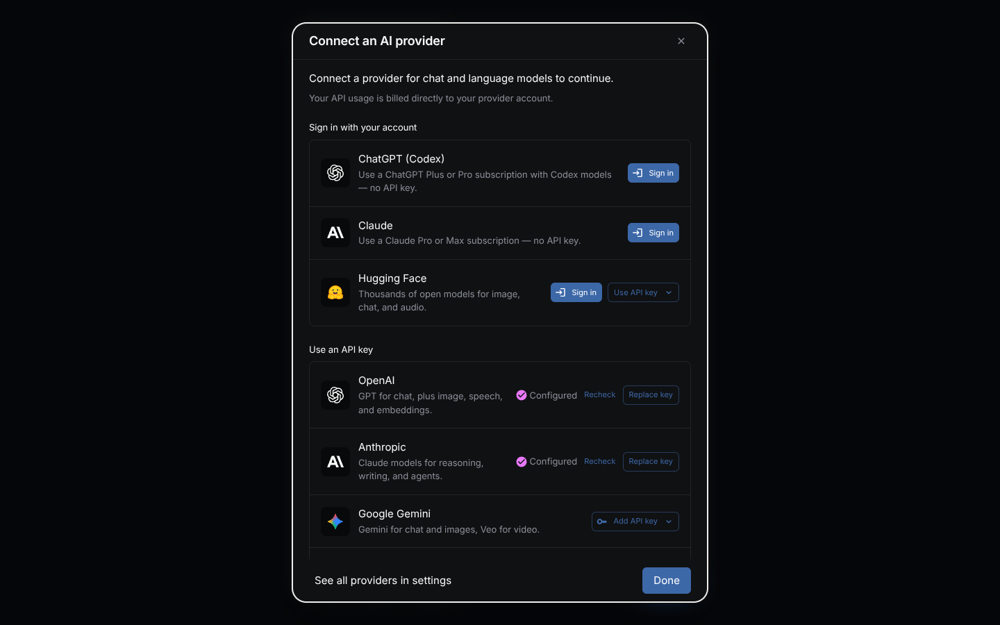

Download the installer from [nodetool.ai](https://nodetool.ai) (`.dmg` on macOS, `.exe` on Windows, AppImage on Linux), open NodeTool, then connect a provider.

## The short version

1. Download NodeTool from [nodetool.ai](https://nodetool.ai).
2. Run the installer: [macOS](#macos), [Windows](#windows), [Linux](#linux).
3. Open NodeTool.
4. [Connect an AI provider](#connect-an-ai-provider).

Expected result: NodeTool opens, and the model dropdown in a node or chat lists at least one connected provider.

---

## macOS

1. Download the `.dmg` from [nodetool.ai](https://nodetool.ai). Builds exist for Apple Silicon (arm64) and Intel (x64). Check your Mac under Apple menu → About This Mac.
2. Open the file and drag Nodetool into Applications.
3. Open it from Applications. Released builds are signed and notarized, so macOS does not block the first launch.
4. When a workflow records audio or video, macOS asks once for microphone or camera permission. Approve it or those nodes fail.

On Apple Silicon Macs with macOS 14 or newer, local models can run on Apple's
[MLX framework](models.md#mlx-framework-apple-silicon). MLX is an optional
Python pack: install **MLX** from **Tools → Package Manager → Python nodes**,
which sets up Python first if it is missing. Intel Macs and Macs on macOS 13
or older cannot run MLX or the HuggingFace pack. They run cloud providers,
Ollama, and llama.cpp.

---

## Windows

1. Download `Nodetool-Setup-<version>.exe` (64-bit x64) from [nodetool.ai](https://nodetool.ai).
2. Run it and choose an install location. It adds a desktop shortcut and opens NodeTool when it finishes.
3. Approve the Windows firewall prompt. NodeTool runs a local server on port 7777 that the app window talks to.

The installer and the app are code-signed. For local models on a graphics card, see [GPU requirements](#gpu-requirements).

---

## Linux

1. Download the AppImage from [nodetool.ai](https://nodetool.ai). It is the only Linux package NodeTool ships.
2. Mark it executable and run it:
   ```bash
   chmod +x Nodetool-*.AppImage
   ./Nodetool-*.AppImage
   ```

Unsigned Flatpak builds are produced from every change: see [Flatpak CI Builds](https://github.com/nodetool-ai/nodetool/actions/workflows/flatpak-ci.yml). They are not on Flathub.

---

## Connect an AI provider

Agents, chat, image, video, and speech nodes call a model. Without a connected provider they fail with a missing-provider error. Connect one before your first workflow, from the cloud, locally, or both.

**Cloud provider.** Open **Settings → Models & Providers**. Some providers sign in without a key: a Claude subscription (desktop app only), a ChatGPT account (Codex), and Hugging Face. For the rest, paste an API key created on the provider's site.

- [OpenAI](https://platform.openai.com): chat, images, video, speech, transcription, embeddings.
- [Anthropic](https://www.anthropic.com): Claude chat models. Text only.
- [Google Gemini](https://ai.google.dev): chat, images, Veo video, speech, transcription, embeddings.
- [FAL](https://fal.ai) or [Replicate](https://replicate.com): image, video, and audio generation across many models.

> NodeTool does not mark up provider prices. The provider bills you directly.
{: .callout-note}

Keys are stored encrypted (AES-256-GCM) in a local database. The encryption key lives in the operating system keychain (macOS Keychain, Windows Credential Manager, or Linux Secret Service). The `SECRETS_MASTER_KEY` environment variable overrides it.

**Local models.** Install [Ollama](https://ollama.com) and run `ollama pull <model>`. The model appears in NodeTool automatically. This covers chat and embeddings. Image and video generation need a cloud provider or a graphics card plus the model downloads below.

Where a missing provider blocks you (a model dropdown, a node warning, the getting-started checklist), NodeTool opens the connect dialog in place.



Each connected provider has a **Test** button that calls the provider to confirm the key works. From the terminal:

```bash
nodetool secrets store OPENAI_API_KEY   # prompts for the value, stores it encrypted
nodetool secrets list                   # list stored keys (values are never shown)
nodetool secrets get OPENAI_API_KEY     # print one stored value
```

Every provider, what it generates, and its key name are in [Providers](providers.md).

---

## What downloads later

NodeTool starts without a Python environment. These pieces install on demand:

- **Python and Conda.** Required by Python nodes. Install from **Tools → Package Manager → Engines & tools**, or accept the **Install required runtimes** prompt that appears when a workflow contains nodes that need a runtime. A workflow with no Python nodes never needs Python. Allow several GB of disk space.
- **Python node packs.** HuggingFace and MLX nodes install from **Tools → Package Manager → Python nodes**, which sets up Python first if it is missing. The HuggingFace pack downloads a PyTorch build for your graphics card (several GB). See [Node Packs](node-packs.md#engines--tools-built-in-nodes-python-nodes-and-community-nodes).
- **In-process model runners.** llama.cpp (the `llama.cpp local` provider) and whisper.cpp install from **Package Manager → Engines & tools**.
- **Ollama** is a separate program from [ollama.com](https://ollama.com). NodeTool does not ship or start it. A `llama-server` you run yourself connects through `LLAMA_CPP_URL`. See [Providers](providers.md).
- **Model weights.** Several GB each. Download from **Tools → Model Manager**.

Without a graphics card or disk space, use a cloud provider: [Connect an AI provider](#connect-an-ai-provider), [Providers](providers.md), [Models & Providers](models-and-providers.md).

### What different tasks need

| Your hardware | What runs the model | Good for |
|----------|--------|----------|
| NVIDIA graphics card | HuggingFace pack (PyTorch), llama.cpp/GGUF, Ollama | Making images and video, running compressed language models |
| AMD graphics card (Linux) | HuggingFace pack (PyTorch ROCm build), llama.cpp, Ollama | Same as NVIDIA |
| Apple Silicon Mac | MLX pack, HuggingFace pack, llama.cpp, Ollama | Language models, image understanding, Flux |
| No graphics card, CPU only | llama.cpp, Transformers.js, Ollama | Works, but slowly |
| Anything, using an online service | The provider's servers | Every kind of task, nothing to download |

[Supported Models](models.md) compares all of them.

### GPU requirements

Python nodes run on PyTorch 2.14. Which PyTorch build you get, and so which
cards and drivers work, depends on how you installed Python nodes. Rows marked
*inferred* follow from PyTorch's published platform support and have not been
tested on every card.

**Desktop app.** Before it installs the HuggingFace or MLX pack, the app
detects your GPU and picks the matching PyTorch build:

| Hardware | Build the app installs |
|---|---|
| NVIDIA Turing (RTX 20xx, GTX 16xx) or newer | CUDA 12.8, which needs driver 570 or newer |
| NVIDIA Maxwell, Pascal (GTX 10xx) or Volta | CUDA 12.6 (*inferred*) |
| NVIDIA Kepler and older | CPU. The app logs that the card is too old |
| AMD on Linux, RDNA 2 or newer (RX 6000 and later) | ROCm 7.2 (*inferred*) |
| AMD on Linux, older cards (Polaris, Vega, RDNA 1) | CPU, with a warning |
| AMD on Windows | CPU, with a warning. PyTorch reaches these cards only through DirectML, which has no 2.14 build. llama.cpp still uses the card through Vulkan |
| Intel Arc and Intel integrated graphics (Windows, Linux) | Intel XPU (*inferred*) |
| Apple Silicon, macOS 14 or newer | The PyPI build, which uses Metal (MPS) |
| Intel Mac, or a Mac on macOS 13 or older | None. The HuggingFace and MLX packs are hidden, because PyTorch 2.14 and MLX publish no build for them |

If PyTorch publishes no 2.14 build for the chosen GPU index, the app installs
the CPU build instead and logs a warning. Python nodes then run on the CPU.
After a driver update, install the pack again to retry the GPU build.
Detection runs on every install.

**install.sh.** On Linux, [install.sh](#python-nodes-without-the-desktop-app)
lets uv pick the CUDA, ROCm or Intel XPU build from the installed driver
(`--torch-backend auto`). On macOS it installs the PyPI build, which needs
Apple Silicon and macOS 14 or newer.

**Manual `pip install torch`.** The PyPI build on Linux uses CUDA 13.0, which
needs driver 580 or newer and a Turing or newer card. On a GTX 10xx or with an
older driver, Python nodes fail with a CUDA error. Install a CUDA 12.6 or 12.8
build from [pytorch.org](https://pytorch.org/get-started/locally/) instead, or
set `NODETOOL_TORCH_DEVICE` to `cpu`. PyPI ships only a CPU build for Windows,
so a GPU build on Windows always comes from pytorch.org.

**Docker worker image.** The worker image installs PyPI's CUDA 13.0 build, so
the GPU host needs NVIDIA driver 580 or newer. See
[Worker deployment](worker-deployment.md#worker-images).

llama.cpp and Ollama do not use PyTorch, so these limits do not apply to them.
On a card PyTorch cannot use, they still run on the GPU.

Memory to run a model comfortably (VRAM, or unified memory on a Mac), from the
curated list behind the Model Manager's **Get Started** tab
(`web/src/components/hugging_face/onboarding/onboardingCatalog.ts`). The
figures are approximate.

| Model | Engine | Download | Memory |
|---|---|---|---|
| Qwen3.5 2B | Ollama | 2.7 GB | 4 GB |
| Qwen3.5 9B | Ollama | 6.6 GB | 8 GB |
| GPT-OSS 20B | Ollama | 14 GB | 16 GB |
| Qwen3.6 35B A3B | Ollama | 24 GB | 28 GB |
| Stable Diffusion XL | Hugging Face | 6.9 GB | 8 GB |
| FLUX.1 schnell | Hugging Face | 23 GB | 24 GB |
| Whisper Large v3 Turbo | Hugging Face | 1.6 GB | 3 GB |
| Kokoro 82M | Hugging Face | 0.4 GB | 2 GB |

The **Get Started** tab compares these figures with your machine's memory. To pick
which GPU Python nodes use, set **NODETOOL_TORCH_DEVICE** in Settings to
`cuda`, `cuda:1` (a second card), `mps`, or `cpu`. See
[Configuration](configuration.md#python-nodes).

---

## Other ways to install

**Command line only.** Install the `nodetool` command with npm (Node.js 22 or newer):

```bash
npm install -g @nodetool-ai/cli
nodetool serve   # API on 127.0.0.1:7777; use --host and --port to change
```

This runs every TypeScript node. Python nodes need a Python environment you set up yourself: see [Python nodes without the desktop app](#python-nodes-without-the-desktop-app) and the [CLI Reference](cli.md).

**Docker.** Run the backend on your machine or a remote host:

```bash
cp .env.example .env
docker compose up -d
```

See [Self-Hosted Deployment](self-hosted-deployment.md) and the [Deployment Guide](deployment.md).

**From source.**

```bash
nvm use
npm install
npm run build:packages
npm run dev
```

Needs the Node.js version in `.nvmrc`. For Python nodes, set up a Python environment as described next.

### Python nodes without the desktop app

The desktop app manages Python. With the npm CLI or a source checkout, you create the environment yourself. The server runs `python -m nodetool.worker --stdio`, so `nodetool-core` and every pack you want must be installed in the interpreter it picks.

On Linux and macOS, [install.sh](https://github.com/nodetool-ai/nodetool/blob/main/install.sh) does steps 1 to 3 below. It creates a Python 3.11 environment with ffmpeg in `~/.local/share/nodetool/conda_env` and installs `nodetool-core` plus the packs you name with `--pack` (`huggingface` or `mlx`):

```bash
curl -fsSL https://raw.githubusercontent.com/nodetool-ai/nodetool/main/install.sh | bash -s -- -y --pack huggingface
```

It prints the `nodetool serve` command to run. On Linux the server finds that environment by itself. On macOS it does not search there, so start the server with `NODETOOL_PYTHON` set as the script shows.

To set up the environment by hand:

1. Create an environment named `nodetool` with Python 3.11 or newer:

   ```bash
   conda create -n nodetool python=3.11 ffmpeg -c conda-forge
   conda activate nodetool
   ```

   A plain `python -m venv` works too. Install `ffmpeg` separately then.
2. Install PyTorch for your hardware before any pack that needs it. On Linux
   and macOS, `pip install torch` gets the CUDA 13.0 build or the Apple
   Silicon build. On Windows, or for a ROCm or other CUDA build, use the
   command from [pytorch.org/get-started](https://pytorch.org/get-started/locally/)
   for PyTorch 2.14. Check [GPU requirements](#gpu-requirements) first.
3. Install `nodetool-core` and the packs from PyPI in one command, so pip
   resolves their shared dependencies together:

   ```bash
   pip install nodetool-core nodetool-huggingface   # add nodetool-mlx on Apple Silicon
   ```

4. Start the server so it finds that interpreter:

   ```bash
   NODETOOL_PYTHON="$CONDA_PREFIX/bin/python" nodetool serve
   ```

   On Windows, `NODETOOL_PYTHON` is `%CONDA_PREFIX%\python.exe`. In a venv,
   use `NODETOOL_PYTHON="$VIRTUAL_ENV/bin/python"`, or
   `%VIRTUAL_ENV%\Scripts\python.exe` on Windows. With the conda environment
   named `nodetool` active, the server finds it without the variable.

The server tries `NODETOOL_PYTHON` first. Without it, it uses the active conda
environment when that environment is named `nodetool` or `conda_env`, then the
desktop app's environment and `nodetool` environments under `miniconda3` or
`anaconda3`. The full order is in [Configuration](configuration.md#python-nodes).
To check the environment, run `python -c "import nodetool.worker"` in it. With
no match, the server log says `Python not found — Python nodes will not be
available`. When the worker fails to start, the error names the interpreter it
tried.

---

## If installing goes wrong

For problems after NodeTool is running, see [Troubleshooting](troubleshooting.md).

**A node says no provider is configured.** Nothing is connected, or the key is for a provider that cannot do what the node asks (Anthropic makes no images, FAL runs no chat). Connect one in **Settings → Models & Providers** and press **Test**. The [capability matrix](providers.md#capability-matrix) lists which provider covers which modality.

**The Python install fails.** It needs an internet connection and free disk space. Retry from **Tools → Package Manager**.

**NodeTool does not see my graphics card.** On NVIDIA, run `nvidia-smi`, the same check NodeTool runs for Help → System Information. Compare the driver version with [GPU requirements](#gpu-requirements). On an unsupported card, set `NODETOOL_TORCH_DEVICE` to `cpu` or use a cloud provider.

**A model download stalls or fails.** Usually disk space or network. See [Model Download Troubleshooting](troubleshooting.md#a-model-download-fails-or-stalls).

**The app cannot reach its own server.** Approve the firewall prompt for the local server on port 7777. For Docker, see [Deployment Troubleshooting](troubleshooting.md#a-deployment-fails-or-the-service-wont-start).

**Still stuck.** Ask on [Discord](https://discord.gg/WmQTWZRcYE) or open a [GitHub Issue](https://github.com/nodetool-ai/nodetool/issues) with your operating system and NodeTool version (Help → System Information).

---

## Uninstalling

- **Windows** — Settings → Apps → Nodetool → Uninstall.
- **macOS** — drag Nodetool from Applications to the Trash.
- **Linux** — delete the AppImage file.

Your settings live in `~/.config/nodetool/settings.yaml` (macOS and Linux) or
`%APPDATA%\nodetool\settings.yaml` (Windows). Delete that folder too if you want
to start completely fresh.

---

## Next steps

<div class="card-grid">
  <a class="doc-card" href="{{ '/getting-started' | relative_url }}"><strong>Quick Start</strong><span>Generate a video from one sentence.</span></a>
  <a class="doc-card" href="{{ '/first-workflow' | relative_url }}"><strong>Your First Workflow</strong><span>Build a four-node image workflow from an empty canvas.</span></a>
  <a class="doc-card" href="{{ '/providers' | relative_url }}"><strong>Providers</strong><span>What each provider can generate and which key it needs.</span></a>
  <a class="doc-card" href="{{ '/models-and-providers' | relative_url }}"><strong>Models &amp; Providers</strong><span>Choose models or run them locally.</span></a>
</div>
