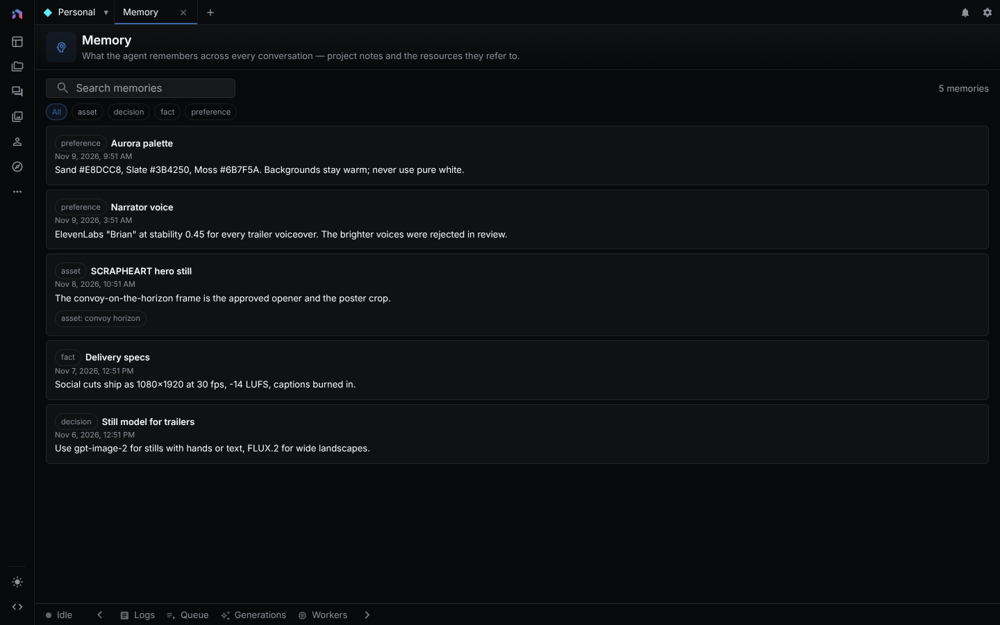

Memory is a set of short notes the agent saves while it works and can read in later conversations.

> **Quick Access:** Open the app menu in the sidebar and choose **Memory** to see everything the agent has saved.

---

## What the agent remembers

The agent saves things it should not have to ask you again:

- A decision, such as "Use the teal and off-white palette for all brand assets."
- A fact about a project, such as the audience or the launch date.
- A preference, such as "Keep captions under two lines."
- An asset it generated and should reuse, such as the approved logo.

Memories belong to your account, not to one conversation. A memory saved in one chat is readable from every other chat of yours. Other accounts never see it.

## The Memory page

The page opens as a tab titled Memory.

- **List.** Each memory is a card with its kind, title, creation time, and content. Image assets show as thumbnails. Other things the note refers to, such as a workflow, show as small chips. The page loads up to 200 memories.
- **Search.** Type in **Search memories**. Every word you type must appear in the memory.
- **Filter.** When the list holds more than one kind of memory, chips appear above it. Select a kind to narrow the list, or **All** to show everything again.
- **Open the source conversation.** Hover over a card and click the conversation icon (**Open the conversation this came from**).
- **Delete.** Hover over a card, click the delete icon, and confirm in the **Delete memory** dialog. Deleting cannot be undone.

An empty page reads "Nothing remembered yet." Memories appear as the agent saves them.

## Ask the agent

The page cannot edit a memory. The agent can. Type a request in any chat:

- "Remember that the launch is on 14 March."
- "What do you remember about the launch?"
- "Forget the old palette."
- "Update the note about the logo palette to use the new teal."

## When memories are deleted

Deleting a chat thread also deletes the memories saved in it. Memories saved outside a chat are not affected.

## Run memory

The steps of one agent run share results in a separate store. It is cleared when the run ends and is not shown on this page. See [Agent Memory](agent-memory.md) for developer detail.

## Related

- [Developer reference: Memory Tools](developer/memory-tools.md)
- [Chat & Agents](global-chat-agents.md)
- [Skills](skills.md)
