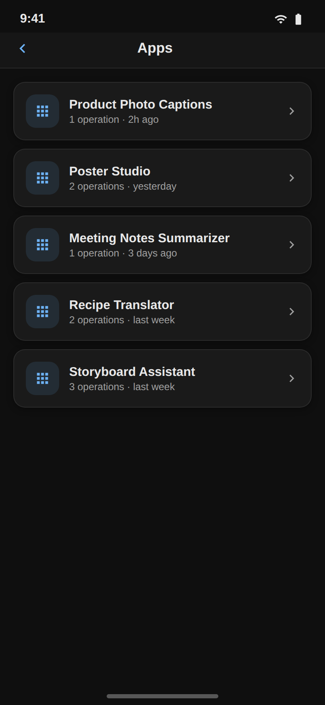
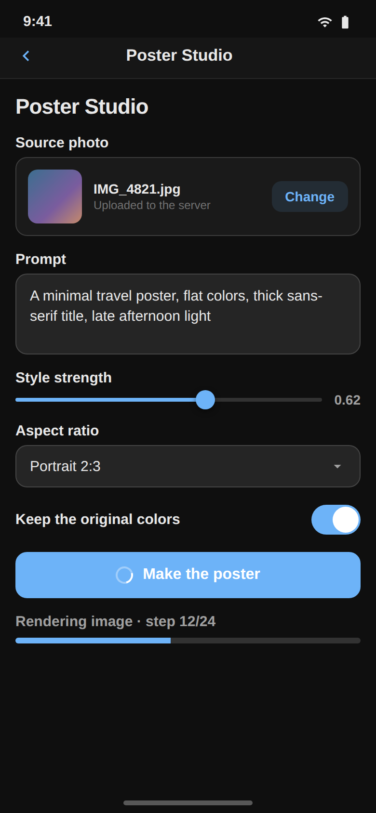
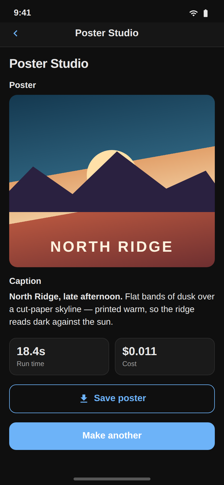
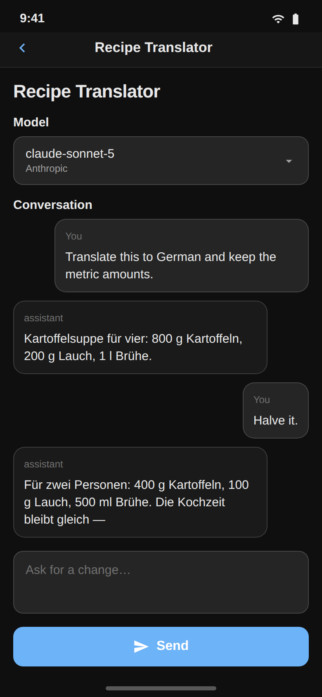

The mobile app lists the apps on your NodeTool server, renders each document with native controls, and runs its workflow on the server. It does not edit apps. Authoring stays in the desktop [App Builder](app-builder.md).

> **Runs:** on the NodeTool server the app is connected to, never on the phone. **Needs:** a server URL set in Settings (see [Mobile App](mobile-app.md)) and an app built in the desktop or web app.
{: .callout-note}

## Finding your apps

The **Apps** browser lists every app on the server you are connected to, newest
first. It is the home screen after you sign in, and the deep link
`nodetool://apps` opens it.

Each row shows the app's name, how many operations it declares, and when it last
changed. Pull down to refresh. Tapping a row pushes the app onto its own screen;
`nodetool://app/<application-id>` opens one directly, which is what a
notification or a shared link points at.

An empty list reads "No apps yet". Every app on the server is listed, published or not. A new one appears on the next refresh.

## Running an app

An app screen renders the released snapshot if the app is published, and the draft document otherwise.

Inputs, Run, and progress behave as on the web. While a run is going the button shows a spinner, and the Progress widget shows the node's activity label in place of the author's static label. A failed run puts its error in a banner above the app. The next run replaces it. Outputs fill in as the run streams them.

## Widgets

The document decides layout and behavior. Only the controls differ:

| Widget | On the phone |
| --- | --- |
| **Columns** | Stacks vertically. |
| **ImageInput / AudioInput / VideoInput / DocumentInput** | Opens the system photo or file picker. The pick is uploaded to the server so the workflow gets a URL it can fetch; if the upload fails the local file is used, which still previews on the device. |
| **Sketch Pad** | An image picker. The app bundles no drawing surface, so the pad offers the camera and photo library for the same binding and says drawing needs the desktop app. |
| **Audio Recorder / Camera Capture** | Records for real: the microphone through a record/stop control with elapsed time and playback, the camera through the system camera sheet. Both upload the take, so the workflow reads the same `{type, uri, asset_id}` an upload writes. A denied permission says so and leaves the file picker as the way through. |
| **Workflow Form** | One row per workflow input, in graph order. |
| **Gallery** | Tapping a tile opens the pager; when the app wired a `selectionBinding`, tapping picks and a long press previews. |
| **Image Compare** | Two labelled panes, before above after, with no wipe handle. |
| **ResourcePicker / ResourceGallery** | A list of rows rather than a grid of tiles. Tapping one opens that document in the screen its kind already has — a storyboard in the storyboard editor, a sketch in the sketch viewer, an asset in the asset viewer. |
| **ChatThread / ChatComposer / ModelSelect** | Native bubbles, a multiline composer, and a two-step provider-then-model picker. |

A widget with no mobile renderer shows "<widget name> opens in the NodeTool desktop or web app." in its place. This covers catalog widgets without a renderer and widget types from a newer builder than the installed app. The Chat Composer has no image attachments on mobile.

## What the phone does differently

- **One workflow per screen.** The screen holds the workflow the app's first operation binds. Other operations over that workflow run normally. An operation bound to a different workflow refuses to run and says so.
- **Every run is a server run.** Mobile has no browser worker, so a `run` action always executes the whole workflow on the server. The web runtime's reactive-subgraph path does not exist here.
- **Runs are matched by job id.** A streaming message for any other job is dropped.
- **Persistent variables survive closing the app.** A variable with `scope: user` and `persist: true` is stored on the device, keyed by app, and restored before the document's defaults apply. Instance-scoped variables are lost with the screen.

## Requirements and limits

Server URL, devices, emulators, and firewalls are covered in [Mobile App](mobile-app.md).

- No editing.
- Apps are listed per server. Switching servers in Settings switches the list.
- A Timeline widget shows a summary card (duration, track and clip counts), not the timeline. A Sketch widget renders the composited image, and falls back to a size and layer summary when it cannot load the document.

## Related

- [Mini Apps](mini-apps.md)
- [Building Mini Apps](mini-apps-guide.md)
- [Mini App Reference](mini-apps-reference.md)
- [Mobile App](mobile-app.md)
