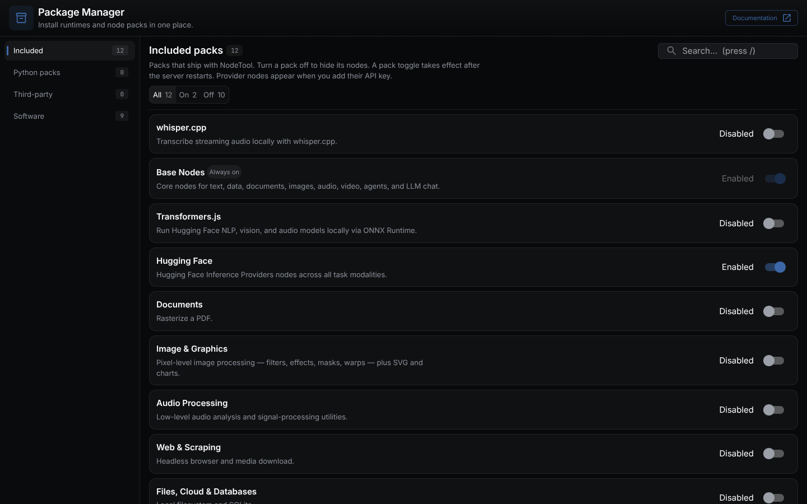

NodeTool packages bundle reusable nodes, assets, and example workflows. The package registry discovers and registers node classes so workflows can reference them at runtime.

For the list of first-party workspace packages, see the [Package catalogue](#package-catalogue).

## Manage packs in the app

The **Package Manager** (**Tools > Package Manager** in the desktop app, or `/packages` in the web UI) has four lists:

- **Engines & tools** manages programs that run on this computer: local AI engines such as llama.cpp and stable-diffusion.cpp, media tools such as FFmpeg, and languages such as Python.
- **Built-in nodes** shows the packs that ship with NodeTool. Each has an Enabled/Disabled switch, except the core pack, which is always on. Provider packs that need an API key are not listed here. Their nodes appear once you set the matching key.
- **Python nodes** lists the Python node packs that NodeTool offers, with Install, Update, and Uninstall buttons. They install from PyPI at their newest stable release, resolved together with the packs already installed. See [Node Packs](node-packs.md#engines--tools-built-in-nodes-python-nodes-and-community-nodes).
- **Community nodes** installs an npm package by name and lists the packs the app has installed. See [Node Packs](node-packs.md).

Installing and removing run only in the desktop app. The web UI shows status.



Toggling a pack takes effect after the NodeTool server restarts. The choices are saved in `~/.config/nodetool/packs.json` (`enabledBuiltins` and `disabledBuiltins`).

## Package catalogue

Every workspace package under `packages/` with a `package.json`. "Internal" packages set `private: true` and are not published to npm.

### Protocol, SDK and shared libraries

| Directory | npm name | Purpose | Status |
|---|---|---|---|
| `protocol` | `@nodetool-ai/protocol` | Shared message types and protocol definitions | Published |
| `sdk` | `@nodetool-ai/sdk` | Typed tRPC client and chat WebSocket for the server | Published |
| `node-sdk` | `@nodetool-ai/node-sdk` | BaseNode, @prop decorator, NodeRegistry | Published |
| `node-catalog` | `@nodetool-ai/node-catalog` | Generated node metadata and pack ownership | Published |
| `nodes-utils` | `@nodetool-ai/nodes-utils` | Platform tags and lazy Node-only module loaders | Published |
| `dsl` | `@nodetool-ai/dsl` | Type-safe TypeScript DSL for defining workflows | Published |
| `config` | `@nodetool-ai/config` | Settings, paths, logging, environment loading | Published |
| `security` | `@nodetool-ai/security` | Master-key management, secret encryption, startup checks | Published |
| `auth` | `@nodetool-ai/auth` | Pluggable auth providers: local, static token, Supabase | Published |
| `storage` | `@nodetool-ai/storage` | Uniform storage over files, memory, S3, Supabase | Published |
| `models` | `@nodetool-ai/models` | Drizzle ORM data models for SQLite and PostgreSQL | Published |
| `vectorstore` | `@nodetool-ai/vectorstore` | SQLite-vec vector store and semantic search | Published |
| `gpu` | `@nodetool-ai/gpu` | Blend-mode catalog and shared WGSL blend functions | Published |

### Runtime and execution

| Directory | npm name | Purpose | Status |
|---|---|---|---|
| `kernel` | `@nodetool-ai/kernel` | Graph model, NodeInbox, and actor runtime | Published |
| `execution` | `@nodetool-ai/execution` | ExecutionSession facade that constructs WorkflowRunner | Published |
| `runtime` | `@nodetool-ai/runtime` | Processing context, LLM providers, message queue, memory | Published |
| `workflow-runner` | `@nodetool-ai/workflow-runner` | Turns a graph and registry into a Request-to-Response handler | Published |
| `agents` | `@nodetool-ai/agents` | Planning and execution agents for multi-step LLM tasks | Published |
| `chat` | `@nodetool-ai/chat` | Tool-call orchestration, streaming, and token counting | Published |
| `websocket` | `@nodetool-ai/websocket` | Fastify HTTP and WebSocket API server | Published |
| `server` | `@nodetool-ai/server` | Private entry point that starts the server with all packs | Internal |
| `cli` | `@nodetool-ai/cli` | The nodetool command line: chat, workflows, harnesses | Published |
| `browser` | `@nodetool-ai/browser` | Drives one Chrome page over CDP | Published |
| `compute` | `@nodetool-ai/compute` | Provisions and reaps RunPod and Vast.ai GPU workers | Published |
| `deploy` | `@nodetool-ai/deploy` | Docker builds, SSH and compose provisioning | Published |
| `telegram` | `@nodetool-ai/telegram` | Telegram bridge onto the unified agent loop | Published |
| `huggingface` | `@nodetool-ai/huggingface` | Cache scanning, model discovery, and downloads | Published |
| `whisper-cpp` | `@nodetool-ai/whisper-cpp` | Local whisper.cpp speech recognition providers | Published |
| `transformers-js-provider` | `@nodetool-ai/transformers-js-provider` | Local-model provider using transformers.js and kokoro-js | Published |
| `sandbox-compiler` | `@nodetool-ai/sandbox-compiler` | Compiles npm dependencies into QuickJS guest modules | Published |
| `model-pricing` | `@nodetool-ai/model-pricing` | Unit-price lookup for model selections | Published |

### Node packs

| Directory | npm name | Purpose | Status |
|---|---|---|---|
| `base-nodes` | `@nodetool-ai/base-nodes` | Compatibility shell re-exporting the domain node packages | Published |
| `core-nodes` | `@nodetool-ai/core-nodes` | Logic, control flow, constants, list, input, subgraph | Published |
| `text-nodes` | `@nodetool-ai/text-nodes` | Text manipulation, NLP, markdown, HTML parsing, SVG | Published |
| `llm-nodes` | `@nodetool-ai/llm-nodes` | LLM provider and agent nodes | Published |
| `data-nodes` | `@nodetool-ai/data-nodes` | Dataframes, RSS feeds, and charts | Published |
| `document-nodes` | `@nodetool-ai/document-nodes` | PDF text extraction, rasterization, document I/O | Published |
| `image-nodes` | `@nodetool-ai/image-nodes` | Sharp-based and WebGPU image processing | Published |
| `audio-nodes` | `@nodetool-ai/audio-nodes` | Audio I/O, DSP, and effects | Published |
| `video-nodes` | `@nodetool-ai/video-nodes` | Video and 3D-model nodes | Published |
| `code-nodes` | `@nodetool-ai/code-nodes` | JavaScript execution in a QuickJS sandbox | Published |
| `automation-nodes` | `@nodetool-ai/automation-nodes` | Browser control, OS, workspace filesystem, triggers | Published |
| `integration-nodes` | `@nodetool-ai/integration-nodes` | Google Workspace, mail, secrets, messaging, ComfyUI | Published |
| `blender-nodes` | `@nodetool-ai/blender-nodes` | Headless Blender render and mesh preparation | Published |
| `manimgx-nodes` | `@nodetool-ai/manimgx-nodes` | ManimGX math and 3D animation rendering | Published |
| `game-nodes` | `@nodetool-ai/game-nodes` | Native game asset generation and staging | Published |
| `fal-nodes` | `@nodetool-ai/fal-nodes` | FAL AI model nodes | Published |
| `kie-nodes` | `@nodetool-ai/kie-nodes` | Kie.ai model nodes | Published |
| `replicate-nodes` | `@nodetool-ai/replicate-nodes` | Replicate model nodes | Published |
| `elevenlabs-nodes` | `@nodetool-ai/elevenlabs-nodes` | ElevenLabs AI nodes | Published |
| `huggingface-nodes` | `@nodetool-ai/huggingface-nodes` | Hugging Face Inference Providers nodes | Published |
| `transformers-js-nodes` | `@nodetool-ai/transformers-js-nodes` | Local NLP, vision, and audio models via transformers.js | Published |
| `atlascloud-nodes` | `@nodetool-ai/atlascloud-nodes` | AtlasCloud.ai image and video generation nodes | Published |
| `higgsfield-nodes` | `@nodetool-ai/higgsfield-nodes` | Curated Higgsfield image and video nodes | Published |
| `minimax-nodes` | `@nodetool-ai/minimax-nodes` | MiniMax AI nodes | Published |
| `reve-nodes` | `@nodetool-ai/reve-nodes` | Reve image generation, editing, and remix nodes | Published |
| `together-nodes` | `@nodetool-ai/together-nodes` | Together AI image and video nodes | Published |
| `topaz-nodes` | `@nodetool-ai/topaz-nodes` | Topaz Labs image and video enhancement nodes | Published |

### App and document packages

| Directory | npm name | Purpose | Status |
|---|---|---|---|
| `app-runtime` | `@nodetool-ai/app-runtime` | Framework-independent runtime core for mini apps | Published |
| `app-export` | `@nodetool-ai/app-export` | Exports a mini app as a standalone JavaScript project | Published |
| `model3d` | `@nodetool-ai/model3d` | 3D scene document: glTF read/write, operations, validation | Published |
| `image-editor` | `@nodetool-ai/image-editor` | Image-editor types, paint core, layer templates | Published |
| `timeline` | `@nodetool-ai/timeline` | Core timeline types and status models | Published |
| `storyboard` | `@nodetool-ai/storyboard` | Storyboard recasting and shot render planning | Published |
| `game-runtime` | `@nodetool-ai/game-runtime` | Deterministic built-in game simulation | Published |
| `game-renderer` | `@nodetool-ai/game-renderer` | Native 2D and 3D rendering, capture, web export | Published |

### Tooling

| Directory | npm name | Purpose | Status |
|---|---|---|---|
| `fal-codegen` | `@nodetool-ai/fal-codegen` | Generates FAL node manifest from OpenAPI schemas | Internal |
| `kie-codegen` | `@nodetool-ai/kie-codegen` | Generates Kie.ai node configs and manifest | Internal |
| `replicate-codegen` | `@nodetool-ai/replicate-codegen` | Generates Replicate node manifest from OpenAPI schemas | Internal |
| `mutator` | `@nodetool-ai/mutator` | Mutation testing for TypeScript | Internal |

## Package Anatomy

A first-party package is an npm workspace package under `packages/` that exports node classes and a registration function:

- `package.json` -- declares the package name, dependencies, and build scripts.
- `src/nodes/` -- node implementations, one file per domain (e.g. `list.ts`, `audio.ts`).
- `src/index.ts` -- exports all node classes and a `register*Nodes()` function.
- `tsconfig.json` -- extends the workspace base config.
- `examples/` -- optional workflow examples.
- `assets/` -- optional static assets used by nodes.

A third-party pack has the same layout plus a `nodetool` field in `package.json`. See the [Custom Nodes Guide](developer/custom-nodes-guide.md).

### Example `package.json`

This is the shape of `packages/text-nodes/package.json`, trimmed:

```json
{
  "name": "@nodetool-ai/text-nodes",
  "type": "module",
  "version": "0.8.3",
  "main": "dist/index.js",
  "types": "dist/index.d.ts",
  "scripts": {
    "build": "node ../../scripts/build-typescript-workspace.mjs",
    "test": "node ../../scripts/run-vitest.mjs run",
    "lint": "node ../../scripts/run-tsc.mjs --noEmit"
  },
  "dependencies": {
    "@nodetool-ai/node-sdk": "*",
    "@nodetool-ai/protocol": "*",
    "@nodetool-ai/runtime": "*"
  }
}
```

Every node package depends on **`@nodetool-ai/node-sdk`**, which provides `BaseNode`, the `@prop` decorator, and the `NodeRegistry` type. The `lint` script is a type check, not ESLint.

### Example `tsconfig.json`

```json
{
  "extends": "../../tsconfig.base.json",
  "compilerOptions": {
    "outDir": "dist",
    "rootDir": "src"
  },
  "include": ["src"],
  "references": [{ "path": "../node-sdk" }]
}
```

## Node Registration

A node package exports its node classes and a registration function that takes a `NodeRegistry`. A minimal one looks like this:

```ts
import type { NodeRegistry } from "@nodetool-ai/node-sdk";
import { ReverseTextNode } from "./nodes/reverse.js";

export function register(registry: NodeRegistry): void {
  registry.register(ReverseTextNode);
}
```

`@nodetool-ai/base-nodes` is the compatibility shell for the built-in domain packages (`core-nodes`, `text-nodes`, `llm-nodes`, and others). Its `registerBaseNodes(registry)` calls each domain package's `register*Nodes` function into a scratch registry, then registers every class in `ALL_BASE_NODES` into the real one.

At startup the server (`bootstrapNodeRegistry` in `packages/websocket/src/node-registry-setup.ts`) creates one `NodeRegistry` and fills it in this order:

1. `loadPythonMetadata` reads `nodetool/package_metadata/` JSON files for Python packs.
2. `registerBuiltInNodes` calls the registration function of each first-party pack that is enabled. The catalog is `BUILTIN_NODE_PACKS` in `packages/protocol/src/builtin-packs.ts`: `whisper-cpp`, `base` (required, always on), `elevenlabs`, `minimax`, `transformers-js`, `fal`, `kie`, `topaz`, `reve`, `atlascloud`, `higgsfield`, `together`, `replicate`, and `huggingface`. Only packs marked `defaultEnabled` (`fal`, `kie`, `replicate`, `huggingface`) and the required `base` pack load on a fresh install.
3. `loadInstalledPacks` scans `node_modules` directories for packages with a `nodetool` field and calls the export it names (`register` by default). Trust rules apply. See [Custom Nodes Guide](developer/custom-nodes-guide.md#4-trust-model-and-governance).
4. Once the Python worker is running, `mergePythonBridgeMetadata` adds metadata for any node type the registry does not know yet. Metadata from a package file or a registered class stays authoritative.

### Allowlist

Installed packs run in-process with full server privileges, so `loadInstalledPacks` gates them. A pack loads when its name (or `*`) is on the allowlist, or when `allowUnlisted` is true. The allowlist comes from `NODETOOL_PACKS_ALLOWLIST` (comma-separated), then the `allow` field of `~/.config/nodetool/packs.json` (`NODETOOL_PACKS_CONFIG` overrides the path). `allowUnlisted` defaults to true in development and false when `NODETOOL_ENV=production` or `NODETOOL_PACKS_REQUIRE_ALLOWLIST=1` is set, so a production server loads only packs on the allowlist.

The loader also skips a pack whose `nodetool.apiVersion` is higher than the supported version (`1`), rejects node types under first-party namespaces such as `nodetool.`, `lib.`, or provider names, and will not let a pack replace an already registered node type.

Workflows referencing `nodetool.text.Concat` or `mypack.math.AddOffset` resolve through the registry without manual imports.

## Managing Packages via CLI

### List Packages

```bash
nodetool package list
nodetool package list --available    # Python packs the app offers (-a)
```

Without `--available`, it lists packages whose metadata it finds under a `nodetool/package_metadata/` directory in the current workspace. With `--available`, it prints the name, `repo_id`, and description of each Python pack in `PYTHON_NODE_PACKS` (`packages/protocol/src/python-packs.ts`). Add `--json` for machine-readable output.

### Initialize a Package

```bash
nodetool package init
```

Prompts for a name, description, and author, then writes `package.json`, `tsconfig.json`, `src/index.ts`, and empty `nodetool/package_metadata/`, `examples/`, and `assets/` directories. It asks before overwriting an existing `package.json`.

The scaffold's `package.json` carries the `nodetool` field (`"apiVersion": 1, "register": "register"`) and `src/index.ts` exports an empty `register` function for you to fill in. Two things need fixing before it builds outside this repository. Its `build` script runs `../../scripts/run-tsc.mjs`, which exists only in this monorepo, so replace it with `tsc`. Its `tsconfig.json` lacks `experimentalDecorators`, which `@prop` needs. See [Custom Nodes Guide](developer/custom-nodes-guide.md#5-tsconfigjson).

### Generate Documentation

```bash
nodetool package docs                     # single index.md in ./docs
nodetool package docs --output-dir docs   # custom directory (-o, default: docs)
nodetool package docs --compact           # shorter summaries for LLM prompts (-c)
```

`package docs` reads `nodetool/package_metadata/` in the current directory and writes a single `index.md` overview. It fails when that directory is missing. For per-node Markdown pages, use `node-docs`:

```bash
nodetool package node-docs                          # one page per node (default: docs/nodes)
nodetool package node-docs --package-name mypack    # only nodes whose namespace starts with mypack
nodetool package workflow-docs --examples-dir examples   # docs for workflow JSON files (default output: docs/workflows)
```

`workflow-docs` requires `--examples-dir` and accepts `--package-name` to filter on the `package_name` field of each workflow.

The full set of `package` subcommands is: `list`, `init`, `docs`, `node-docs`, and `workflow-docs`. (Note: `nodetool mcp install` / `nodetool mcp uninstall` configure the MCP server, not node packages.)

## Building Packages

Run these from the repository root against one workspace, or from inside the package directory:

```bash
npm run build --workspace=packages/<name>   # compile
npm run lint --workspace=packages/<name>    # type check, no emit
npm run test --workspace=packages/<name>    # Vitest
```

`npm run build:packages` builds every backend package in dependency order.

## Publishing Packages

1. Implement nodes under `src/nodes/` extending `BaseNode` with `@prop` decorators.
2. Export all node classes and a registration function from `src/index.ts`.
3. Run `npm run build` to compile.
4. Add example workflows in `examples/` and assets in `assets/` if relevant.
5. Publish to npm or provide a Git URL.

To offer a Python pack in the Package Manager, publish it to PyPI and add it to `PYTHON_NODE_PACKS` in `packages/protocol/src/python-packs.ts`.

## Workflow Integration

Enabled and trusted packs register nodes with the runtime at startup:

- Node metadata is merged during startup so workflows referencing `package.namespace.Node` resolve without manual imports.
- Run `npm run codegen --workspace=packages/dsl` to regenerate typed factory functions from node metadata.

## Related Documentation

- [CLI Reference](cli.md) -- package subcommands.
- [Configuration Guide](configuration.md) -- where package metadata is cached.
- [Custom Nodes Guide](developer/custom-nodes-guide.md) -- step-by-step node implementation.
- [TypeScript DSL Guide](developer/ts-dsl-guide.md) -- type-safe workflow definitions with `@nodetool-ai/dsl`.
