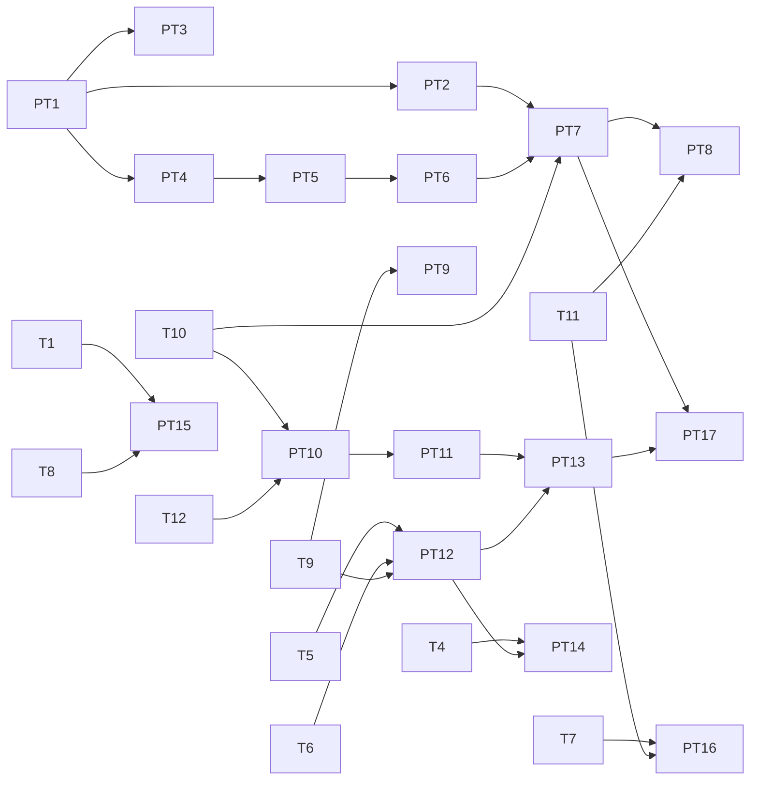

# Graph runner performance tasks

This page plans the fixes for the performance findings and the bundle size
plan in [graph-runner-quickjs-review.md](graph-runner-quickjs-review.md). It
uses the same format and rules as the
[stability tasks](graph-runner-stability-tasks.md). Task IDs start with `PT`.
A dependency on a stability task uses its `T` ID.

The review numbers are estimates. PT1 measures them first, and each later
task records its number before and after.

## Tasks

| ID | Finding | Task | Owns | Depends on | Model |
|---|---|---|---|---|---|
| PT1 | P0 | Time each load phase (read, bytecode read, evaluate, first node). Write the esbuild metafile. Add a `--bench-load` flag that prints the times and the resident size as JSON. Log the callers of `Function.prototype.toString` | `src/main.cpp` (flag), `src/graph_runner.cpp` (timing only), `guest/build.mjs` (metafile only), new `parity/bench-load.mjs` | – | Sonnet |
| PT2 | P1, F4 | Read the bundle with one sized `read()`. Pass a span, not a copy. Free the bundle after load | `src/graph_runner.cpp` (bundle load, lines 196-220), `src/kernel/guest.cpp` (line 216 only) | PT1 | Sonnet |
| PT3 | P2 | Write bytecode with `JS_WRITE_OBJ_STRIP_SOURCE`. Check that stack traces keep file and line | `src/js/quickjs_engine.cpp` (lines 177 and 202 only) | PT1 | Haiku |
| PT4 | P7 | Turn on esbuild `minifySyntax`, `minifyWhitespace` and `legalComments: "none"` | `guest/build.mjs` (esbuild options) | PT1 | Haiku |
| PT5 | P3 | Leave out node modules with no type that the profile admits | `guest/build.mjs` (lines 71-74), `guest/module-contract.mjs` if a module needs a new class | PT4 | Sonnet |
| PT6 | P4 | Move the timeline font, the tiktoken ranks, the legacy encoding tables and the Rapier wasm out of the JS. Load each one from a host file on first use | `guest/build.mjs` (aliases and copies), `guest/host/runtime.mjs` (asset loader) | PT5 | Sonnet |
| PT7 | P5 | Evaluate a node module on first use. Make a type-to-module map at build time. Keep eager load for the modules that register side effects | `guest/build.mjs` (generated entry), `src/kernel/guest.cpp` (module load) | PT2, PT6, T10 | Opus |
| PT8 | P6 | Keep a warm spare context, so a discarded context is replaced at once | `src/graph_runner.cpp` (context lifetime) | PT7, T11 | Opus |
| PT9 | F3 | Use one watchdog for each wasm `State`, armed by an atomic deadline. Cache the function type of each export. Cache compiled modules by content hash in `sandbox_wasm.cpp` | `src/host/webassembly.cpp`, `src/host/sandbox_wasm.cpp` | T9 | Sonnet |
| PT10 | F5, part 1 | Add `std::move` at `src/kernel/guest.cpp:52` and `:82`. Use the reviver only when the text contains `"__bytes__"` | `src/kernel/guest.cpp` (lines 52 and 82 only), `guest/values.mjs` | T10, T12 | Haiku |
| PT11 | F5, part 2 | Move or share large values in `node_update`, `output_update` and fan-out edges | `src/kernel/actor.cpp`, `src/kernel/runner.cpp` | PT10 | Sonnet |
| PT12 | F8 | Add `Engine::viewBytes`. Return host outputs with `adoptBytes`. Move decode, OCR and readback to the CPU lane, so a cancel can stop them | `src/js/engine.h`, `src/js/quickjs_engine.cpp` (byte API), `src/host/image_jobs.cpp`, `src/host/canvas.cpp`, `src/host/gpu_compute.cpp`, `src/host/gpu.cpp`, `src/host/sandbox_ocr.cpp` | T5, T6, T9 | Opus |
| PT13 | F5, part 3 | Keep bytes out of JSON with a C++ blob table and `adoptBytes` | `src/kernel/guest.cpp` (value path), `guest/values.mjs` | PT11, PT12 | Opus |
| PT14 | F9 | Return up to N frames or about 1 s of audio for each `next`. Reserve for each stream kind and stop the zero fill. Make s16 in the filter graph (`aformat=s16`) for `convertAudioToWav`. Hold the PCM once in `decodeAudioToPcm`. Start the next read before the current frame is processed in `concatSegments` | `src/host/media.cpp` (`next`, lines 1319-1375), `guest/host/media-native.mjs` | T4, PT12 | Sonnet |
| PT15 | F11 | Use the native `toBase64` and `fromBase64` at `src/host/sandbox_session.cpp:179` and `:187`. Serialize each bridge call once | `src/host/sandbox_session.cpp` | T1, T8 | Haiku |
| PT16 | F12 | Call a guest abort hook once from `onCancel`. Remove the 10 ms poll | `guest/host/context-services.mjs` (abort path), `src/graph_runner.cpp` (lines 440-448) | T7, T11 | Sonnet |
| PT17 | P8 | Split into a core bundle and one bytecode chunk for each package. Start only if PT1 shows that PT7 left the load above 0.5 s | `guest/build.mjs`, `src/kernel/guest.cpp` | PT7, PT13 | Opus |
| PT18 | all | Run the bench and the example suite. Record the before and after numbers in the review page. Update `native/graph-runner/README.md` | `native/graph-runner/README.md`, `docs/plans/graph-runner-quickjs-review.md` | all others | Haiku |

P9 (snapshots) has no task. QuickJS-ng has no snapshot support.

## Waves

To run the plan at a low token cost, use the agent grouping in
[graph-runner-execution.md](graph-runner-execution.md). It replaces this wave
table.

The performance waves run beside the stability waves. Each row lists the
stability tasks and the performance tasks that run at the same time. No two
tasks in one row own the same part of a file.

| Wave | Stability tasks | Performance tasks | Subagents |
|---|---|---|---|
| 1 | T1, T2, T3, T4, T12 | PT1 (Sonnet) | 6 |
| 2 | T5, T6, T7, T8 | PT2 (Sonnet), PT3 (Haiku), PT4 (Haiku) | 7 |
| 3 | T9, T10 | PT5 (Sonnet), PT15 (Haiku) | 4 |
| 4 | T11 | PT6 (Sonnet), PT9 (Sonnet), PT10 (Haiku), PT12 (Opus) | 5 |
| 5 | T13 | PT7 (Opus), PT11 (Sonnet), PT14 (Sonnet), PT16 (Sonnet) | 5 |
| 6 | T14 | PT8 (Opus), PT13 (Opus) | 3 |
| 7 | – | PT17 (Opus, only when needed), then PT18 (Haiku) | 1 |

Wave 2 shares two files with stability tasks. PT2 and T5 both touch
`src/graph_runner.cpp`, and PT3, T5 and T6 all touch
`src/js/quickjs_engine.cpp`. Each task owns only its listed lines. The
orchestrator merges them in the order T5, T6, PT2, PT3.

The sanitizer run (T13) in wave 5 covers the code from waves 1 to 4. Run it
again after wave 6, because PT7, PT12 and PT13 change memory ownership.

## Why each model

- **Opus** does the tasks that change memory ownership or load order: lazy
  module evaluation (PT7), the warm spare context (PT8), borrowed bytes and
  the CPU lane (PT12), the blob table (PT13) and the bundle split (PT17).
- **Sonnet** does the bounded C++ and build changes with a clear benchmark:
  PT1, PT2, PT5, PT6, PT9, PT11, PT14 and PT16.
- **Haiku** does the edits of a few lines with an exact site list: the strip
  flag (PT3), the minify options (PT4), `std::move` and the reviver gate
  (PT10), native base64 (PT15) and the final record (PT18).

## Verification for each task

Each task runs `parity/bench-load.mjs` or its own micro benchmark before and
after, and puts both numbers in its report. The gate between waves is the
same as in the [stability plan](graph-runner-stability-tasks.md#rules-for-the-parallel-work),
plus the load bench.

| Task | Check |
|---|---|
| PT1 | The bench prints each phase and the resident size. Two runs agree within 10% |
| PT2 | Peak and idle resident size drop. The example suite has no new failures |
| PT3 | `guest.bin` gets smaller. An error from a guest node still names the file and line |
| PT4, PT5, PT6 | `guest.js` gets smaller. The example suite has no new failures |
| PT7 | Load time and idle heap drop. Each example still finds its node types |
| PT8 | A run after a discarded context starts without a load pause |
| PT9 | A loop of 10000 wasm calls runs faster. The deadline still stops a guest that does not end |
| PT10, PT11, PT13 | A node output of 1.5 million numbers and an output of 50 MB of bytes cross a fan-out edge faster, with fewer copies |
| PT12 | A 50 MB image decode copies once. A cancel during OCR ends the call |
| PT14 | Ten minutes of 48 kHz audio decode with fewer `next` calls. `convertAudioToWav` output is bit-equal to the old output |
| PT15 | A 5 MB buffer crosses the Code-node bridge in less than 100 ms |
| PT16 | A cancel reaches the guest without a poll. An idle run with an abort listener uses no CPU |
