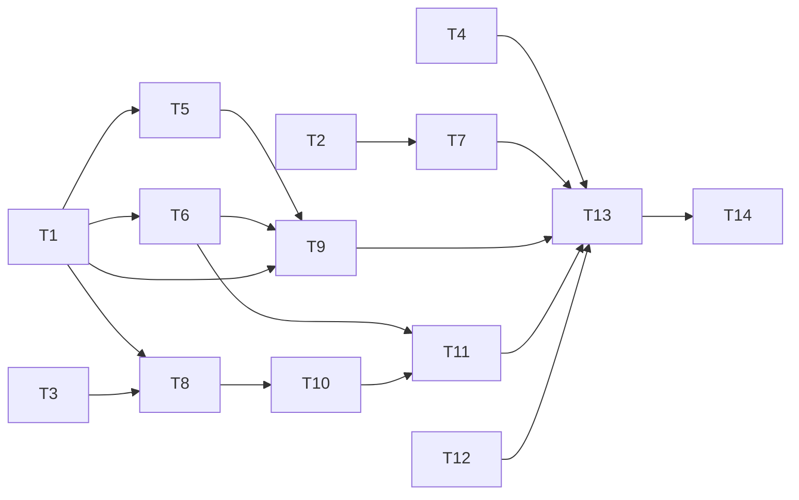

# Graph runner stability tasks

This page plans the fixes for the stability findings in
[graph-runner-quickjs-review.md](graph-runner-quickjs-review.md). Each task
names its finding, the files it owns, the tasks it depends on, the model that
does it, and how it is verified. The tasks run in waves. The tasks in one wave
can run at the same time in separate subagents.

All tasks follow [native/AGENTS.md](../../native/AGENTS.md): ownership,
thread and lifetime rules, and a sanitizer-clean build. Each task reproduces
its finding with a test that fails first, then fixes it
([Harness-First rules](../HARNESS_FIRST.md#the-rules)).

## Tasks

| ID | Finding | Task | Owns | Depends on | Model |
|---|---|---|---|---|---|
| T1 | F1, S1 | Give the worker an explicit stack of 16 to 32 MiB with pthread attributes. Set the JS limit below it. Give the nested runtime `min(requested, remaining)` and call `JS_UpdateStackTop` on each entry. Take the wasm stack from the same budget. Give lane threads an explicit stack | `src/graph_runner.cpp` (thread start), `src/js/quickjs_engine.cpp` (lines 54-56 only), `src/host/sandbox_session.cpp`, `src/host/webassembly.cpp` (stack only), `src/host/sandbox_wasm.cpp`, `src/kernel/host_lanes.cpp` | – | Opus |
| T2 | F2 | Add a message host function outside `ContextCallRules`, with its own byte cap. Pass message text through unparsed when it has no GPU texture reference | `src/host/context.cpp`, `src/host/context.h`, `include/nodetool/context_options.h`, `guest/host/context-services.mjs` (send path) | – | Sonnet |
| T3 | S5 | Add the QuickJS version and a bundle hash to the bytecode header. Refuse a mismatch with a clear error | `src/kernel/guest.cpp` (magic and header), `src/main.cpp` (`compile`) | – | Sonnet |
| T4 | F13, part 1 | Validate guest numbers before the integer casts in `media.cpp` and `sqlite.cpp`. Use the `textureArg` pattern from `gpu.cpp` | `src/host/media.cpp`, `src/host/sqlite.cpp` | – | Haiku |
| T5 | F6 | Add `Engine::collectGarbage()`. Call it once and retry before a JS-ledger refusal. Add a configurable `JS_SetMemoryLimit` with a default | `src/js/engine.h`, `src/js/quickjs_engine.cpp` (engine setup and new function), `native/jobs/src/admission.cpp`, `include/nodetool/graph_runner.h` | T1 | Opus |
| T6 | F10 | Throw host errors with `JS_NewError` and `JS_NewStringLen`, with an optional `name`. Rethrow the original exception for a `JsError` | `src/js/quickjs_engine.cpp` (throw site only), `src/js/engine.h` (error type) | T1 | Sonnet |
| T7 | F7 | Stop keeping posted messages in `_messages`, or cap the list | `guest/host/context-services.mjs`, `guest/host/context.mjs` | T2 | Haiku |
| T8 | F13, part 2 | Validate guest numbers before the integer casts in `guest.cpp` and `sandbox_session.cpp` | `src/kernel/guest.cpp`, `src/host/sandbox_session.cpp` | T1, T3 | Haiku |
| T9 | F14 | Make `depth++` in `webassembly.cpp` exception-safe with an RAII guard. Release wasm import callbacks and external buffer roots when their owner goes. Add a timer count quota | `src/host/webassembly.cpp`, `src/js/quickjs_engine.cpp` (buffer roots), `src/host/timers.cpp`, `src/kernel/task.h` | T1, T5, T6 | Sonnet |
| T10 | S3 | Add an "abandoned" flag to the coroutine state, or clear `st->handle` when the awaiter is destroyed. Add a test that drains the job queue after `abandon()` | `src/kernel/guest.cpp` (coroutine state) | T8 | Opus |
| T11 | S4 | Trace interrupt and teardown order. Keep the interrupt uncatchable in re-entrant host calls. Read `interrupted` after the `Runner` destructor runs | `src/graph_runner.cpp` (run end), `src/js/quickjs_engine.cpp` (interrupt path) | T6, T10 | Opus |
| T12 | S2 | Decide how typed arrays other than `Uint8Array` cross the value boundary, and add a round-trip test | `guest/values.mjs` | – | Sonnet |
| T13 | all | Run the ASan, UBSan and TSan builds over the graph runner tests and the node editor run tests. Fix or report each finding | build directories only | T1 to T12 | Sonnet |
| T14 | all | Update `native/graph-runner/README.md` for the new limits, flags and header. Remove fixed items from the review page | `native/graph-runner/README.md`, `docs/plans/graph-runner-quickjs-review.md` | T13 | Haiku |

## Waves

To run the plan at a low token cost, use the agent grouping in
[graph-runner-execution.md](graph-runner-execution.md). It replaces this wave
table.

| Wave | Tasks | Runs at the same time |
|---|---|---|
| 1 | T1 (Opus), T2 (Sonnet), T3 (Sonnet), T4 (Haiku), T12 (Sonnet) | 5 subagents |
| 2 | T5 (Opus), T6 (Sonnet), T7 (Haiku), T8 (Haiku) | 4 subagents |
| 3 | T9 (Sonnet), T10 (Opus) | 2 subagents |
| 4 | T11 (Opus) | 1 subagent |
| 5 | T13 (Sonnet), then T14 (Haiku) | 1 subagent at a time |

## Why each model

- **Opus** does the tasks where a mistake is a crash or a race: stack and
  thread setup (T1), GC and the admission ledger (T5), coroutine lifetime
  (T10) and interrupt order (T11). These need a full trace of a code path
  across threads.
- **Sonnet** does well-specified C++ and guest changes with clear tests: the
  message host function (T2), the bytecode header (T3), error objects (T6),
  quotas (T9), typed arrays (T12) and the sanitizer runs (T13).
- **Haiku** does mechanical changes with an exact list of sites and a pattern
  to copy: the integer casts (T4, T8), the message list (T7) and the docs
  (T14). Give Haiku the file:line list, the `textureArg` pattern and the test
  to add, so it does not need to search.

The orchestrator (Opus) writes each brief, reviews each diff before the next
wave starts, and merges the work.

## Rules for the parallel work

1. **File ownership.** A task edits only the files in its "Owns" column. When
   two tasks of one wave would touch the same file, the later task waits for
   the next wave. `src/js/quickjs_engine.cpp` is shared by T1, T5, T6, T9 and
   T11, so each of them owns a named part of it, and they run in different
   waves.
2. **One build directory for each wave.** Separate build directories filled
   the disk in an earlier session. Each subagent edits only, and the
   orchestrator builds once in `native/graph-runner/build` at the end of the
   wave. A subagent that must build to test uses that directory alone, after
   it checks `df -h /` and finds at least 5 GB free.
3. **Worktrees only when files overlap.** If the waves are changed so that two
   tasks share a file, give each its own worktree (`isolation: "worktree"`)
   and merge in wave order.
4. **Brief contents.** Each brief names the finding with file:line, the owned
   files, the files the task must not touch, the failing test to write first,
   and the verification commands. Agents do not commit.
5. **Gate between waves.** Before the next wave, the orchestrator runs:
   - `cmake --build native/graph-runner/build -j8`
   - `ctest --test-dir native/graph-runner/build` with `TMPDIR` set to the real
     path of `/tmp`, because macOS `/var` is a symlink that the host refuses
   - `node native/graph-runner/parity/examples.mjs --runner native/graph-runner/build/nodetool-graph-runner --jobs 3`,
     with no new failures against the last run
   - `npm run test:affected:native` for the node editor tests that link the
     runner

## Verification for each task

| Task | Test that fails first |
|---|---|
| T1 | A Code node with `function f(){f()} f()` and a guest with deep recursion end with a `RangeError` and a failed node, not a signal |
| T2 | A run that posts 20000 messages and a message larger than 1 MiB both complete |
| T3 | A `guest.bin` with a changed header or a wrong hash is refused with a named error |
| T4, T8 | NaN, Infinity and out-of-range numbers at each listed site throw a `RangeError`. The UBSan build reports nothing |
| T5 | A guest that drops cyclic objects holding adopted frames can charge new frames after the GC. A runaway allocation raises an out-of-memory error, and the process stays up |
| T6 | A host error message of 1000 bytes arrives whole. An abort from a synchronous host function arrives as an `AbortError` |
| T7 | A run that posts many messages has a flat guest heap |
| T9 | A throw from `set_fuel` leaves later wasm calls working. Instances made and dropped in a loop do not reach the instance limit |
| T10 | A job-queue drain after `abandon()` does not resume a destroyed frame, under ASan |
| T11 | An interrupt during `Runner` teardown discards the context |
| T12 | A `Float32Array` and an `ArrayBuffer` keep their type across a node edge |

## Known test failures before this work

`gr_media_native_render_media_tests` and `gr_media_native_public_tests` fail on
the current HEAD without these changes. Do not count them against a task.
