# Agent features and app agents: implementation plan

Cross-plan references use `AA-`, for example `AA-A4`. Local IDs stay unchanged.

- **Mini Apps are the standard host for an agent session.** Creators use the Agent widget and existing app deployment flow. External applications use the same session interface and authorization, without a separate agent document or release system.
- **A turn is an existing chat-app run.** The chat widgets keep the conversation in an instance-scoped app variable, and each message runs an app operation whose workflow contains an Agent node (D1).
- **Two authorities, both existing.** An owner session acts as the signed-in user. A visitor session is the existing deployed-app session, pinned to the release and bounded by a finite budget (D2).
- **One new security boundary.** The run's visitor tool policy allows only explicitly published tools and resource scopes. Unknown capabilities are denied. Owner memory, files, library, connected services, and thread persistence remain unavailable. Visitor turns add no command to the session allowlist.
- **Settings live in existing places.** The agent's workflow holds model, instructions, and tools. The app document holds layout and conversation policy. The settings editor is a form over both, and a release freezes both.
- **Features are optional modules.** Voice, guided paths, presentation, perception, and scene control each depend on the agent binding or the Agent node. With all of them off, an app agent is an ordinary chat app.
- **Guided paths are optional conversation policy.** A pure reducer in the agent module tracks mode and step using existing app state. Each mode runs its own operation, so its tool scope is pinned in the release (D18).
- **Delivery starts small.** A1 proves reuse with existing fixtures, A2 ships a text agent for its owner, and A5 publishes text agents to visitors before the voice and guided kiosk pilot.

## Recommendation

Let creators place a configured agent inside a Mini App and give it optional features: voice, guided conversations, presentation, perception, and scene control. A creator who wants others to talk to an agent publishes the app that contains it, through the existing app deployment flow. Personal assistants and museum guides are two configurations of the same implementation.

Build on the Mini App chat apps that already exist. Their chat widgets keep the conversation in an app variable, and each message runs an app operation whose workflow contains an Agent node. Reuse that path together with workflow execution, capabilities, jobs, provider access, knowledge collections, and app deployment. Add only a settings editor over that Agent node, conversation policy, a visitor tool policy, and presentation integration. Integrate an established WebRTC transport and speech services through replaceable adapters. This work does not require implementing codecs, a media server, speech recognition models, or photorealistic avatar generation.

The [reactive sessions and workflow events plan](reactive-sessions-events.md) provides a small operation invocation/completion adapter over the existing app hosts. Background actions that an agent turn requests reuse it. This plan adds no workflow executor or job scheduler. **Harness** refers only to NodeTool's headless testing and debugging surfaces.

This is an implementation proposal, not a shipped feature. Repository findings follow the [evidence rules](https://github.com/nodetool-ai/nodetool/blob/main/docs/plans/feature-interplay/README.md#evidence-and-interpretation). The separate [Pipecat and integration research](../research/realtime-agent-runtime.md) pins its external sources. No live provider benchmarks or venue tests were run. Recheck SDK compatibility during implementation. Pipecat is a reference, not a production dependency.

A1 proves reuse with the existing chat-app, Mini App, and tool fixtures. A2 delivers a text agent in an app that its owner uses. A3 adds voice and A4 adds guided authoring, independently of each other. A5 publishes app agents to visitors, first as text and then as a browser/kiosk pilot. The [delivery plan](#delivery-plan-and-gates) defines order and exit evidence.

## Agents, features, and authority

### Two authorities

Who an agent acts for decides what it may reach. NodeTool already has both authorities, and this plan adds no third.

| | Owner session | Visitor session |
| --- | --- | --- |
| Where it runs | The built-in agent in workspace chat and editor panels, or an app agent in an app its owner opens | An app agent in a published app, reached through its public link, embed, or kiosk |
| Acts as | The signed-in user | The app owner's account, confined to the app's published release |
| Permissions | The user's own permissions. Workspace chat asks for approval, and app runs use the tools the creator selected | Only the tools frozen into the release, filtered by the visitor tool policy. No approval prompts reach the owner |
| Memory and data | The user's memory, assets, and collections, as the profile allows | No owner memory or library. Only the release's bound knowledge |
| Spend | The user's providers and budgets | The owner's providers within the app's required finite budget |
| Identity of the person talking | The user | Not recorded |

Authority depends on how the app is opened, not on its template. The owner opening their own app gets an owner session. Anyone using the public link, embed, or kiosk gets a visitor session.

The visitor session is the existing deployed-app session. Its `nda_` token authenticates as the owner, [`app-session-scope.ts`](https://github.com/nodetool-ai/nodetool/blob/main/packages/websocket/src/lib/app-session-scope.ts) allowlists the commands a visitor may send, and `confineRunRequest` replaces any client-supplied graph with the release's pinned graph. [App deployment](https://github.com/nodetool-ai/nodetool/blob/main/packages/websocket/src/lib/app-deployment-service.ts) refuses a public link without a finite budget and blocks releases that bind the owner's asset library. An app agent turn is an ordinary run of a published operation, so it is confined the same way. The model, instructions, and tools are part of the pinned graph. The client supplies only operation inputs such as the message, the conversation so far, and the current conversation state, and none of those grants authority.

The pinned graph does not confine the Agent node's own tools, which run as the owner today (F11). Visitor sessions therefore add the [default-deny visitor tool policy](#visitor-tool-policy) on the run's permission gate. A1.7 adds an early publish warning for this existing exposure. Enforced confinement gates visitor delivery in A5.

A signed-in person using someone else's agent with their own data has no precedent in either authority and is out of scope. If it becomes necessary, follow the linked-account pattern of the Telegram integration, where that person acts as themselves.

### Features

Features are optional on any app agent and independent of authority. The built-in workspace agent is unchanged by this plan.

| Feature | What it adds |
| --- | --- |
| Voice | Streaming speech input and output, turn-taking, and interruption |
| Guided paths | Modes, topic paths, steps, and guarded transitions |
| Presentation | Captions, an abstract avatar, a rigged character, or a video avatar |
| Perception | Image questions and sampled detection with expiring observations |
| Scene | Observing and directing a running 3D scene or game through semantic commands |

Each feature lives in its own module and depends on the agent binding or the Agent node, never the reverse. Heavy media dependencies stay optional, so the lean CLI and execution server keep their [dependency separation](https://github.com/nodetool-ai/nodetool/blob/main/packages/AGENTS.md#package-dependency-order). With every feature disabled, an app agent is an ordinary chat app and behaves exactly as one does today.

### Terms

| Concept | Product copy | Code identifier |
| --- | --- | --- |
| The built-in agent | "the agent" | Existing names (`createChatCodeActSession`, `chat-turn.ts`) |
| Agent settings view | "agent" in App Builder, with its settings | `AgentProfile`, a typed view over the Agent node's settings and the app document, with no separate saved document |
| Role starting point | Personal Assistant, Museum Guide | `AgentTemplate` |
| An agent placed in an app | "Agent" widget | `AppAgentBinding` |
| One conversation with an app agent | "conversation" | `AppAgentSession` |
| One exchange | "message" and "reply" | A run of the agent's app operation |
| What visitors cannot reach | "Visitors can't use your memory, files, or library" | Visitor tool policy on the run's permission gate |
| Published version and link | Existing app copy: "published revision", "public link" | Existing app release and deployment |
| Optional add-ons | "features" | `agent-features/<name>` modules |
| Conversation structure | mode, path, step | `AgentMode`, `TopicPath`, `TopicStep` |

Creators do not publish an agent. They publish the app that contains it. The publish screen adds one sentence for apps with an agent: "Visitors talk to this agent on your providers, within this app's budget."

The editor chats bound to one surface keep their `ChatSource` values in [api-types.ts](https://github.com/nodetool-ai/nodetool/blob/main/packages/protocol/src/api-types.ts), such as `game_assistant` and `sketch_assistant`. They are workspace uses of the built-in agent, not app agents.

## Product model

An agent profile is the settings view over the Agent node's workflow and the app document. It has no separate persistence or release identity. An agent session coordinates one conversation across turns and operation runs. Mini Apps provide its standard authoring and presentation, while an external JS or C# application can host the same configured behavior. Both use instance-scoped app state for history and conversation state, and each turn runs the agent's app operation. A tool is an allowed action inside that workflow or a separate app operation for background work. A mode selects an operation and conversation behavior. A topic path guides progress within a mode.

The default experience is configuration and preview. Guided paths and modes are optional. Conversation graphs edit policy, while action workflows open in the ordinary workflow editor.

### Building blocks and customization levels

An app agent is a defined feature built from modular parts. Its session coordinates turn-taking, interruption, history, permission enforcement, and background-result delivery so creators do not assemble those themselves.

| Level | Creator-facing building blocks | Contract |
| --- | --- | --- |
| Profile configuration | Personality, models, knowledge, tools, features, modes, topic paths | A working agent with defaults. The settings form and the workflow editor change the same saved settings |
| Reusable workflows | Retrieval, perception, research, generation, answer checking, scene actions | Ordinary nodes and execution semantics, with declared inputs, outputs, permissions, and cancellation behavior |
| Advanced behavior | Custom context selection, conversation policy, result presentation | One policy interface with explicit inputs, proposed state/actions, and failure behavior. Use an ordinary workflow for computation where its execution semantics fit. Keep speech and transport adapters internal until a concrete replacement needs exposure |

Extract a smaller building block when it enables a demonstrated reuse or replacement. Separating retrieval from answering lets a creator change search behavior and reuse the retrieval workflow elsewhere. Exposing every internal speech event as a freely wired node would require creators to reconstruct ordering and cancellation rules, so that coordination stays inside the session module.

Custom policy may propose context, actions, transitions, or result presentation. The session validates proposals and coordinates response identity, revisions, interruption, and cleanup. Existing execution gates enforce permissions and budgets independently of client policy. The default policy and a custom policy implement the same interface, with one active policy owner. Async policy work has a deadline and cancellation signal. On failure or timeout, apply no proposed state or actions and report a recoverable error. Late proposals cannot cross a response or session reset. An ordinary workflow used as a tool need not understand speech timing or manage conversation history.

The session interface accepts input and domain events, exposes outcomes, and supports interrupt and reset. It hides coordinated model cancellation, playback flush, stale-output rejection, and history repair. Hosts supply input and presentation adapters without copying that coordination. An arbitrary workflow graph alone does not supply a complete agent session.

### Ownership across features

| Feature | Responsibility | How app agents use it |
| --- | --- | --- |
| [Reactive sessions plan](reactive-sessions-events.md#smallest-first-implementation) | Owns the shared finite-operation adapter (RS-A1–RS-A4) | Reuses request/result correlation and observer cleanup. App state retains value ownership |
| Agent node | Provider calls, tool calls through connected nodes, streamed output, per-run cost cap and timeout | Runs each turn with the profile's model, instructions, and tools |
| Mini Apps | Layout, typed bindings, instance state, chat widgets, and operation presentation | Hold the conversation and host Try and published layouts through the agent binding |
| App deployment | Releases, public links, visitor session tokens, command allowlist, budget requirement | Publishes app agents to visitors without a new command. Supplies the visitor authority |
| Existing workflow execution | Run nodes, stream inputs/results, cancel runs, manage execution resources | Executes perception, retrieval, generation, research, and other actions |
| Existing capabilities and app operations | Authorized invocation, declared arguments, operation identity, budgets and run policy | The same approved action can be used from an agent or its existing surface |
| [Shared variables plan](shared-variables-input-bindings.md#delivery-plan) | Typed values, bindings, snapshot reads, checked publication, and app-variable revisions in SV-A5 | Supplies tool settings and bound controls. A4 depends on SV-A5's app revisions |
| Control-flow regions proposal | Selected branches, sequential iteration, explicit completion and shared budgets | Composes work inside action workflows, such as conditional retrieval or bounded research |
| Conversation policy | Context selection, modes, topic progress, proposed transitions and result presentation | Proposes what happens next within server-enforced permissions and budgets |
| Media and presentation adapters | Speech turns, capture, playback, avatar timing, observation sampling | Turn user input into events and present authorized results through voice, text, or a scene |
| Existing jobs and artifacts | Execution status, outputs, usage, result history | Hold tool work and generated results. Agent records correlate these resources rather than replacing them |

Keep **values, events, and streams** distinct. A language setting is a value. “Start the tour” is an event. Microphone audio is a stream. A value edit becomes an action only when an explicit trigger policy says so. Instant Update remains an opt-in editing behavior, not a trigger for agent tools.

### Shared reactive session integration

The [reactive sessions plan](reactive-sessions-events.md) extracts common invocation/observation mechanics from the existing app hosts and validates them with a Mini App and an agent-free game fixture. This plan owns conversation state and the agent binding. Sending a message is the existing chat composer run. Interrupt-response and conversation state belong to the agent binding, not to the shared finite-operation adapter. A turn that requests background work hands it to the shared adapter as a separate operation run.

### External clients and RTVI

Use [RTVI](https://docs.pipecat.ai/api-reference/server/rtvi/introduction) as the
reference for external agent interactions and event coverage. Reuse its concepts
and message shapes where their semantics fit: readiness and capabilities,
transcripts, speaking state, tool activity, errors, and metrics. This is an
RTVI-informed design, not a commitment to full protocol support or Pipecat's
pipeline architecture.

Keep the session interface independent of React and App Builder so a custom JS
or C# application can submit input and domain events, observe results, interrupt,
and reset. External clients call NodeTool's hosted session interface, with the
same coordinator and policy implementation behind both client paths. Separate
incoming command validation from outgoing event translation,
following RTVI's processor/observer separation. Adapt existing agent-session and
app-operation behavior, with the RS adapter handling finite background work.
Media stays in its transport and workflow control keeps its MsgPack protocol.

NodeTool retains execution, permissions, budgets, and result-delivery ownership.
Disconnect ends observation unless an explicit host policy requests cancellation.
Response interruption, visitor reset, and independent task cancellation remain
distinct. Synthesis completion does not imply playback completion. Client-side
actions require published capabilities, request/session identity, and validated
results. An external message grants no authority or unrestricted workflow access.
Where an RTVI message would change these meanings, document the difference rather
than silently treating it as equivalent. Protocol support does not itself provide
custom conversation-policy plugins.

Claim compatibility only for tested protocol/client versions, message coverage,
and matching transports. The proof uses an external client without App Builder:
connect, exchange text and voice, complete one client-side action, and interrupt
speech while an independent workflow continues. Reset rejects old results and
denied actions stay denied. Record unsupported interactions explicitly. This
proof gates compatibility claims, not A2 or the first voice release. Full RTVI
coverage and additional client SDKs remain outside the initial scope.

### Conversation policy across hosts

The default conversation policy uses a pure reducer in the agent module, shared across hosts. It accepts validated events, such as a chosen option or a turn's structured output, and proposes the next conversation state plus requested actions. State remains in instance-scoped app variables. The session validates proposals, commits state through its existing owner, and dispatches authorized app operations through the host. Results return as events. The reducer owns no model loop, workflow scheduling, provider credentials, or job persistence. Generic state, admission, and folding stay in dependency-free [`app-runtime`](https://github.com/nodetool-ai/nodetool/blob/main/packages/app-runtime/README.md). Conversation history, topic progress, endpointing, and speech interruption stay in the agent module.

Conversation state guides behavior and grants no authority. Visitors can edit client-held progress, so every published operation must be safe to invoke regardless of asserted mode or step. Action prerequisites and permissions are checked server-side independently of that progress. Enforced conversation sequencing and server-owned progression are deferred.

Use concrete adapters for actual variation: text versus voice input, browser versus scene presentation, and owner versus visitor session. Do not build a universal plugin framework, new scheduler, global reactive variable bus, or new state-machine library before a demonstrated requirement.

### Example: a museum guide

A creator starts a new app from the Museum Guide template, describes the guide's tone, adds an exhibit collection, and enables an exhibit-lookup operation. The default conversation already works in Try. They add a Guided tour mode with Welcome, Choose exhibit, Explore, and Finish steps. Quiz is another optional mode with a narrower tool set and different hints.

During a visit, selecting an exhibit sends an event. The policy validates the selection and commits the visitor's session state. An admitted lookup captures the exhibit and language as inputs. Its workflow uses ordinary nodes and, once available, control-flow regions to choose the applicable content branch. Results return with sources, and speech and avatar adapters present the answer. An optional image-generation operation creates an ordinary background job while conversation continues.

If the visitor switches to Quiz, the session changes policy without restarting unrelated generation. A completed image becomes a result card only if current policy permits it. Editing the draft app does not change the visitor's active session or a running action's snapshot. Publishing a new revision applies to new sessions.

## Two starting points

| Configuration | Personal Assistant | Museum Guide |
| --- | --- | --- |
| Authority | Owner session | Visitor session through a published app |
| Continuity | Optional explicitly retained preferences and tasks | Isolated session per visit |
| Knowledge | Authorized personal sources and selected web research | Published curator content, optionally bounded external research |
| Conversation policy | Open goals, clarification, task updates | Guided route with open questions and return points |
| Tools and effects | User-authorized connected services, generation, research | Exhibit lookup, media generation, approved installation actions |
| Perception | Explicitly enabled camera, images, screen, or other sensors | Selected exhibit, kiosk location, opt-in camera or object detection |
| Presentation | Voice, text, result cards, generated artifacts | Voice, captions, character/avatar, exhibit display |
| Background lifetime | A retained task may outlive the current connection | Work normally ends with the visitor session |

Both are data and policies over one runtime. A template references allowed capabilities, knowledge revisions, memory policy, input sources, conversation policy, presentation bindings, and resource limits. Creating one must not require copying the engine or writing a new agent loop.

## Creating and configuring an agent

This is a proposed product flow. Follow the [UX guidelines](https://github.com/nodetool-ai/nodetool/blob/main/docs/UX_GUIDELINES.md), [design system](https://github.com/nodetool-ai/nodetool/blob/main/docs/DESIGN.md), and [UI primitives strategy](https://github.com/nodetool-ai/nodetool/blob/main/web/src/components/ui_primitives/STRATEGY.md) when implementing it.

The flow describes the target across milestones. A2 exposes identity, a conversation model, knowledge/tools, boundaries, and text Try. Guided controls arrive in A4, publishing to visitors in A5, and other features in their milestones. Hide unavailable controls rather than making the complete editor a prerequisite for a text agent.

There are two entry points. **New app** offers Personal Assistant, Museum Guide, and Start from scratch, each creating an app with an Agent widget, the workflow its turns run, and editable settings. In an existing app, **Add widget → Agent** adds the same widget and workflow. An existing chat app keeps working unchanged and gains the settings editor when its Agent node is selected. Each template states what it does and which provider connections or content it needs. Templates supply editable defaults, not a separate agent type.

```text
Choose a starting point → Describe the agent → Try the draft
                                             ↕
                         Refine settings, knowledge, and tools
                                             ↓
                                  Publish the app when ready
```

Creation asks for a name and a short purpose, with an optional audience. For example: “A friendly museum guide that helps families explore ancient pottery.” Create and autosave a draft immediately. Everything else can be configured in the editor. Do not require completing a long wizard before trying a conversation.

### Editor layout

Selecting the Agent widget opens the agent settings with **Configure**, **Try**, and **Publish** visible. Publish opens the app's existing publish flow. Configure has five labeled sections. On a wide screen, Try remains beside the settings. In a small window, it becomes a labeled tab with the draft and conversation preserved. A saved-state indicator distinguishes saving, saved, and failed to save.

| Section | Main controls | Optional detail |
| --- | --- | --- |
| **Identity** | Purpose, audience, tone, response length, language | Opening message, personality notes, example exchanges |
| **Knowledge & goals** | Add sources, desired outcomes, topic paths | Source priority, path branching, completion rules |
| **Tools** | Add capabilities, inspect enabled tools | Per-tool settings, permissions, workflow bindings |
| **Boundaries** | No-go topics/actions, unknown-answer behavior, limits | Memory, retention, tool approval rules, deployment constraints |
| **Features** | Conversation model, voice/text mode, voice, avatar or scene | Speech models, perception models, transport and rendering configuration |

Show a compact summary above these sections: purpose, conversation model, enabled tools and features, who the agent will act for, and readiness issues. Defaults make a text conversation possible when a compatible provider is connected. Voice, camera, scenes, and extra tools are optional.

### Identity and personality

Use a few understandable choices: tone such as Warm, Neutral, or Playful, response length such as Brief or Detailed, and an optional free-text personality note. Show example phrasing, not numerical personality sliders. Keep the purpose editable in plain language.

A creator can specify “Curious and patient. Ask one question at a time. Avoid baby talk.” They can add preferred and unwanted example responses. Personality influences wording, but cannot expand permissions or override a boundary. Expose the generated instructions for inspection under Advanced, with extra instructions stored separately from structured settings.

### Models without repeated setup

Show the selected conversation model by name and provider. Use the connected Settings default when compatible. If none is available, offer Connect a provider at the point of testing. Never silently substitute an unavailable model.

Voice mode reveals a voice preview and the selected speech setup. Advanced reveals recognition, synthesis, and turn-detection choices. Image generation and vision models belong to their tool settings. Each picker inherits a compatible default and offers an explicit override, and displays whether a value follows the workspace default or is customized. Publishing resolves model choices into the release so a later default change does not silently change a published agent.

Filter choices by capability and explain incompatibilities beside the setting. Changing a model preserves other settings and shows any resulting issues. Fallback models are explicit, ordered, and capability-checked. A creator should not need to understand pipeline topology to choose a voice.

### Knowledge, goals, and topic paths

Separate factual sources from desired outcomes. A goal might be “Help the visitor understand how this vase was made.” It is not a requirement to force the visitor through a script. Goals can be agent-wide or attached to a path, with an optional completion condition such as a confirmed visitor choice, a completed scene interaction, or a model-assessed learning outcome. Label inferred completion as an assessment rather than a verified event.

Offer three conversation styles: **Open conversation**, **Guided paths**, and **Guided paths with open questions**. The museum template selects the third. Paths appear as cards with a title, purpose, and ordered steps. The starting view is a list, with a graph available under Advanced.

| Example path | Steps | Completion |
| --- | --- | --- |
| How it was made | Select exhibit → Explain materials → Play demonstration → Invite questions | Demonstration completed and visitor chooses to continue |
| Look more closely | Choose a detail → Highlight it → Ask what the visitor notices → Explain | Visitor finishes or skips the observation activity |
| Compare cultures | Choose comparison → Retrieve evidence → Show similarities and differences | Sourced comparison presented |

Each step initially needs only a title and an instruction. Expand it to configure supporting knowledge, allowed tools, an optional scene action, a question, and what happens next. Branches use readable conditions such as “Visitor chooses another exhibit” or “Lookup returns no evidence.” Support skip, back, pause, resume, and exit. A required prerequisite applies to the dependent action, not to the visitor's ability to leave.

The creator chooses how paths start: visitor selection, a relevant request, or an approved scene event. Specify whether switching is offered or automatic. Keep one active path by default, with a return point after a question or digression. Show what happens on silence, off-topic questions, tool failure, and unknown answers. Advanced can define additional states and guarded transitions without losing the list view of supported steps.

### Tools and their settings

Present tools as capability cards: **Search Knowledge**, **Research the Web**, **Create Images**, **Understand Images**, and **Interact with a Scene**. Adding a card opens its settings and a Test tool action. An enabled card shows a one-line scope summary, connection status, and any missing setup. Disable a card without deleting its configuration.

| Tool | Settings shown first | Advanced settings |
| --- | --- | --- |
| Search Knowledge | Collections, source display, behavior when no answer is found | Retrieval limits, filters, ranking and timeout |
| Research the Web | Quick or thorough by default, allowed sources, background delivery | Time/source budgets, research workflow, cancellation policy |
| Create Images | Model, style, result destination | Workflow binding, parameters, concurrency and spend limit |
| Understand Images | Uploaded images or opt-in camera, when to analyze | Sampling, regions, detection workflow and observation expiry |
| Interact with a Scene | Scene and allowed actions | Event bindings, semantic command mapping and revision policy |

Give tools three distinct questions: **When may it run?**, **What may it access or change?**, and **How should results arrive?** Defaults come from the template. Optional controls choose request-only versus automatic use, confirmation for effects, and silent display versus announcement at a pause. “Automatic” never grants access to additional sources or actions.

Allow **Add a workflow as a tool**. A foreground tool becomes a node that the Agent node calls inside the turn's workflow. A background tool becomes a separate app operation that the turn requests and the app host runs. Either way, publishing pins it like any other graph. The creator supplies a name and a short “Use when” description, selects exposed inputs and outputs, and marks the invocation as foreground or background. Parameter controls come from the workflow schema. Each input is a fixed setting, an explicitly bound value, or an argument the agent may supply. Resolve required inputs before invocation. Credentials and permission settings remain server-bound and cannot be supplied by the model. Validate compatibility and show a sample invocation before enabling it.

### Boundaries, constraints, and no-gos

Keep behavioral directions and enforced restrictions visibly distinct. “Avoid speculation about provenance” is model guidance that needs evaluation. “Use only these collections” and “Never edit the saved scene” are permissions enforced outside the model. A free-text no-go does not become a security guarantee because it appears in this section.

| Boundary | Creator-facing configuration | Runtime behavior |
| --- | --- | --- |
| Topics | Allowed focus, no-go topics, suggested redirect | Guide the response and test representative cases |
| Evidence | Use approved knowledge, cite sources, say when uncertain | Restrict retrieval scope and apply the configured answer policy |
| Actions | Allowed actions and when confirmation is required | Validate capability calls before execution |
| Resources | Session duration, task budget, concurrency | Enforce limits and return an understandable stopped/partial outcome |
| Memory | This conversation only, or explicitly retained personal context in owner sessions | Apply ownership, retention, and reset policy. Visitor sessions never load owner memory |

Show conflicting settings before publishing, such as a path requiring web research while that tool is disabled. Apply the inheritance rules in [Effective policy and transitions](#effective-policy-and-transitions).

### Try, diagnose, and publish

Try runs as the owner, with effectful tools simulated by default and live execution selected explicitly. **Try as a visitor** applies the visitor tool policy, so the creator sees what visitors can reach before publishing. Tests that spend money or affect connected services show that before running. Try supports text first, then voice and a connected scene when configured. An optional activity panel shows the current path and step, tool calls, task status, sources, and boundary decisions. It shows observable events and configuration reasons, not private model reasoning. A setting change applies on the next fresh preview session, with a Restart with changes action and a clear indication when the current test uses older settings.

Creators can save a test conversation as a reusable scenario. Include tests for a normal request, a no-go request, switching paths, interrupting speech, a slow background task, and a missing source.

Publishing uses the app's existing flow and destinations: public link, embed, or kiosk presentation. For an app with an agent, the publish screen adds provider requirements, enabled tools and scopes, memory policy, the visitor-authority sentence, and blocking issues. The release freezes the app document and its operation graphs, including the settings shown in the profile view. Active sessions keep their release. Editing continues in the draft, with rollback and explicit republish. Missing credentials or an optional tool leave the draft editable and identify the blocked setting.

### Advanced modularity without a second product

Each section has its own Advanced disclosure, and **Open workflow** shows the agent's workflow in the ordinary workflow editor. Do not make the first experience a node graph.

An agent's settings live in two existing places. The agent's workflow holds what a turn runs: the model, instructions, and tools are Agent node settings and connected tool nodes. The app document holds layout and conversation policy. A release freezes both, so no separate profile document or version reference exists. The settings editor is a form over these two places, and forms, templates, workflow edits, and API authoring use one validation path. Fields distinguish inherited defaults from overrides and provide Reset to default. Tool definitions supply their configuration schemas. Structured settings compile into runtime configuration and model instructions with source attribution, so a creator can inspect where a setting came from.

Advanced constructs that the simple editor cannot represent remain intact and appear as a labeled Custom configuration block. Never silently flatten a custom graph or discard unknown configuration on save. Template updates are explicit changes to review, not automatic rewrites of an existing app.

### Authoring acceptance criteria

| Criterion | Evidence required |
| --- | --- |
| Simple start | A creator reaches a working text preview from a template without opening Advanced or choosing each model separately |
| Relevant controls | Voice, camera, and scene fields appear only when enabled, while their settings survive temporary disabling |
| Editable paths | A creator adds two paths, branches one step, and tests a switch and return without graph editing |
| Clear permissions | A tool card explains its scope and result delivery, and a denied action stays denied despite conflicting model instructions |
| Clear authority | The summary and publish screen state who the agent acts for, and Try as a visitor denies the same tools a visitor session denies |
| Round-trip preservation | Form, advanced, and API edits retain each other's supported settings and custom extensions |
| Work preservation | Refresh, navigation, missing credentials, and failed publishing preserve the draft |
| Preview fidelity | The tested revision, model choices, effective permissions, and release are inspectable |

Treat this flow as a design hypothesis to validate with creators. Implement its entry points and forms with the repository's existing primitives and verify keyboard access and navigation at small laptop sizes.

## Multimodal inputs, tools, and background work

The conversational model is one consumer of session state. It does not need to inspect every camera frame or coordinate each detector invocation itself. Scheduled perception, explicit tool requests, and background completions enter the runtime through distinct typed events.

| Execution class | Examples | Scheduling and result behavior |
| --- | --- | --- |
| Continuous or sampled perception | VAD, object detection, presence, selected camera frames | Run at a bounded rate, coalesce observations, publish meaningful changes without creating an LLM turn for every frame |
| On-demand perception | Describe an image, OCR a label, identify a pointed-at object | Bind the request to a specific frame or region and return evidence with capture time and source identity |
| Foreground tools | Exhibit retrieval, quick lookup needed to answer | Run within a reply deadline, then answer or report that the lookup is still pending |
| Background tasks | Generate an image, compare sources, short or long web research | Acknowledge accepted work, return a task handle, continue conversation, deliver progress and artifacts asynchronously |
| Presentation actions | Show an image, update a result card, point an avatar at an exhibit | Validate against allowed UI actions and the current audience before rendering |

These scheduling semantics are proposed, not existing. Reuse NodeTool's [capability contracts](https://github.com/nodetool-ai/nodetool/blob/main/packages/agents/src/capabilities/types.ts) and [job inspection/cancellation tools](https://github.com/nodetool-ai/nodetool/blob/main/packages/agents/src/capabilities/jobs.specs.ts) where they fit. Audit ownership, persistence, and event delivery before treating an existing workflow job as a durable agent task. Do not build a second general-purpose workflow scheduler.

### Observation contracts

Each observation carries source identity, capture time, expiry, session scope, and a typed payload. A detection may include object class, bounding box, track identity, and model-specific confidence. A vision description includes the image reference and relevant region. Preserve provenance and uncertainty. A detector label is evidence, not an established fact or permission to act.

Maintain a bounded current-scene summary and retain selected evidence only under the profile's policy. Debounce repeated detections and expire absent objects. Resolve phrases such as “this one” against the scene at the visitor's utterance, asking for clarification when several objects fit. A delayed analysis of an old frame must not silently describe the current scene.

### Background task contracts

A task binding records its existing job or app-run ID, owner, originating session and turn, accepted brief revision, input snapshot, authorization scope, and delivery policy. Execution status, progress, usage, and artifacts remain authoritative in the existing run record. Store agent-specific states such as awaiting clarification separately, rather than introducing a second job state machine. Cancellation can be requested without being confirmed by the provider. Record that distinction and ignore late results for presentation when the task is no longer eligible.

Speech interruption cancels the current response by default, not every accepted task. “Stop talking” and “cancel the image” have different effects. “Make it blue instead” may revise or supersede a task only after resolving which task it refers to. Attach revisions to the accepted brief and prevent a superseded result from replacing the newer one.

Short and long research use the same task contract with different depth, time, and source budgets. Return a sourced answer and, for longer work, a retained report. Describe progress from actual job events. Retrieved web content must not expand tool permissions or change the task brief. Deadline expiry returns a clearly partial result when useful rather than pretending research finished.

Visitor work follows the [explicit reset policy](#cancellation-reconnect-and-retained-work) and never appears for the next visitor. Personal tasks may survive disconnect only when their settings and authorization permit it. Persist task identity and reconcile completion without replaying side effects. Cross-session notification or external delivery is a separate authorized capability.

### Result delivery policy

Tool completion emits a result event. It does not automatically trigger speech. A session-owned policy checks ownership, freshness, task revision, relevance, and whether the person is speaking. It may update a card silently, queue a brief spoken announcement at the next pause, request clarification, or discard a stale presentation event while retaining the authorized artifact.

Use one conversational speaker even when several tools run concurrently. Coalesce progress updates and prevent research/image jobs from monopolizing it. Keep model concurrency, media processing, and tool budgets separate so expensive background work cannot starve microphone or playback processing.

## Game and 3D scene interaction

A scene can be an input source, a tool target, and an output surface for an agent. The agent may inhabit a character, guide a visitor around an exhibit, explain selected objects, or manipulate a demonstration while speaking. A visible avatar is optional.

Existing foundations include [3D scene operations](https://github.com/nodetool-ai/nodetool/blob/main/packages/model3d/README.md), [model tools](https://github.com/nodetool-ai/nodetool/blob/main/packages/agents/src/capabilities/model3d.specs.ts), [game authoring and playtest tools](https://github.com/nodetool-ai/nodetool/blob/main/packages/agents/src/capabilities/game.specs.ts), and the [game simulation lifecycle](https://github.com/nodetool-ai/nodetool/blob/main/packages/game-runtime/README.md). Simulation runs in process through `createGameSession(...).step(input)`, and the game editor's agent panel is an authoring chat (`chatSource: "game_assistant"`). No channel exists for an app agent to issue scoped commands to a running visitor scene. That live-session adapter is proposed work.

| Capability | Example | Boundary |
| --- | --- | --- |
| Observe scene state | Read selected exhibit, visible objects, available interactions, or puzzle progress | Prefer structured engine state to image recognition when the engine owns the scene |
| Receive scene events | Visitor selects an object, enters a region, or finishes an interaction | Subscribe to relevant changes and coalesce repeated events |
| Direct presentation | Highlight an object, focus a camera, display a generated image on a surface | Apply bounded session-local changes, respect visitor camera control and reduced-motion settings |
| Act within the simulation | Open an allowed door, trigger a demonstration, direct a character to a destination | Issue approved semantic commands through engine rules, preserving physics and script ownership |
| Author persistent content | Create an object, edit a scene, install a generated asset | Separate permission and revision checks from temporary visitor interactions. Never available in visitor sessions |

Expose semantic actions such as “focus exhibit” or “start demonstration,” with stable target IDs and validated arguments. The model selects an action and goal. The engine handles animation, movement, navigation, collision, and frame updates. Do not put an LLM in the per-frame control loop or let arbitrary model-generated code execute in the renderer. Existing sandbox rules apply to authored scripts.

Bind tools to an authorized scene instance, document revision, and session. Commands carry an operation ID and, where needed, an expected state version. Return accepted, completed, rejected, or cancelled results, plus relevant observed state. Acknowledging a movement request does not mean the character arrived. Reject stale targets after scene replacement and prevent a retried request from applying twice.

Keep temporary focus, highlights, visitor progress, and character actions separate from saved document edits. The engine is authoritative for simulation state. An agent must not independently overwrite a physics-owned transform. A stop request can cancel a camera move or demonstration without deleting an authored asset or cancelling unrelated research. Generated textures, images, and models pass through existing asset validation before a scene references them.

The simple configuration is **Interact with a Scene → choose scene → choose allowed actions**. Advanced creators can bind semantic actions and events to existing scene/game workflows. The agent works with a text result card when no live scene renderer is connected.

## Scope and experience

| Surface | Required behavior |
| --- | --- |
| Website | Start explicitly, grant microphone access, talk or type, interrupt, see captions and sources, end the session |
| Museum kiosk | Start by touch, choose language or tour, ask about the current exhibit, return to the tour after a question, reset fully for the next visitor |
| Animated character | React to listening, thinking, speaking, and errors, optionally synchronize mouth shapes with speech |
| Video avatar, later | Render a live generated character with synchronized audio and interruption support |
| Optional visitor camera | Explicit opt-in, bounded visual context capture, no camera requirement for voice or avatar output |

Assume one active conversation per kiosk for the first release. Groups can listen together, but simultaneous speaker identification and separate personal conversations are later work. A physical installation can use a fullscreen browser or Electron client. It does not require robotics.

## Existing NodeTool capabilities

The inspected files establish useful components, not a complete app agent product. No live provider calls, audio benchmarks, or venue tests were run.

### Media and retrieval

| Finding | Evidence | Implication |
| --- | --- | --- |
| F1. Microphone streaming exists | [useRealtimeAudioStream](https://github.com/nodetool-ai/nodetool/blob/main/web/src/hooks/useRealtimeAudioStream.ts) captures PCM16 and sends base64 chunks through workflow inputs. [RealtimeAudioInputNode](https://github.com/nodetool-ai/nodetool/blob/main/packages/core-nodes/src/nodes/input.ts) exposes a streaming input | Reuse the integration knowledge. Capture uses a 4096-sample ScriptProcessor buffer, about 171 ms at its default 24 kHz before other latency. Evaluate AudioWorklet or WebRTC capture |
| F2. Streaming speech services exist | [ElevenLabs STT](https://github.com/nodetool-ai/nodetool/blob/main/packages/elevenlabs-nodes/src/nodes/realtime-stt.ts) and [TTS](https://github.com/nodetool-ai/nodetool/blob/main/packages/elevenlabs-nodes/src/nodes/realtime-tts.ts) connect to provider WebSockets | Extract reusable service adapters where practical. Workflow-node interfaces alone do not define per-turn interruption and playout acknowledgment |
| F3. A realtime conversational node exists | [RealtimeAgentNode](https://github.com/nodetool-ai/nodetool/blob/main/packages/llm-nodes/src/nodes/openai.ts) configures server VAD and forwards audio/text. It uses the `gpt-4o-realtime-preview` and `gpt-4o-mini-realtime-preview` model identifiers and the `OpenAI-Beta: realtime=v1` header | Audit provider compatibility before reuse. Tools, guided transitions, explicit playback truncation, and visitor lifecycle are not implemented in this class |
| F4. Playback avoids React on its fast path | The [realtime chunk bus](https://github.com/nodetool-ai/nodetool/blob/main/web/src/lib/audio/realtimeAudioChunkBus.ts) is a publish/subscribe channel. The [playback hook](https://github.com/nodetool-ai/nodetool/blob/main/web/src/hooks/browser/useRealtimeAudioPlayback.ts) feeds the `nodetool-chunk-player` AudioWorklet and records `RealtimeAudioStats` on `window.__nodetoolRealtimeAudio` | Preserve this separation. Add session/utterance identity, interruption flushing, and acknowledged playout progress |
| F5. Retrieval and access checks exist | [Vector store](https://github.com/nodetool-ai/nodetool/blob/main/packages/vectorstore/README.md) provides collections and embedding adapters. [Collection capabilities](https://github.com/nodetool-ai/nodetool/blob/main/packages/agents/src/capabilities/collections.ts) check `canAccessCollection` before a named query | Add deployment-specific collection scopes and stable source references. The named-query response is `{ id, document, score }`. Indexing already accepts metadata, so citations need the query to return it |
| F6. Streaming execution and cancellation exist | [Execution IO](https://github.com/nodetool-ai/nodetool/blob/main/packages/execution-core/src/io.ts) exposes a run cancellation signal. [Audio nodes](https://github.com/nodetool-ai/nodetool/blob/main/packages/audio-nodes/src/nodes/realtime-audio.ts) process streaming chunks | Distinguish cancelling one spoken response from cancelling a whole workflow or session |

### Agent, app, and authority

| Finding | Evidence | Implication |
| --- | --- | --- |
| F7. Agent execution is composed in two hosts | The [web chat host](https://github.com/nodetool-ai/nodetool/blob/main/packages/websocket/src/session/chat-turn.ts) builds a [CodeAct session](https://github.com/nodetool-ai/nodetool/blob/main/packages/agents/src/codeact/chat-codeact.ts) with `createChatCodeActSession` and runs `provider.generateLoop`. The CLI host uses `processChat` from the [chat processor](https://github.com/nodetool-ai/nodetool/blob/main/packages/chat/src/message-processor.ts) | These hosts serve the built-in agent. App agents do not use them: chat is excluded from visitor sessions by design, and their threads, approvals, and memory assume a signed-in user |
| F8. Mini Apps already run chat apps | In the [chat widgets](https://github.com/nodetool-ai/nodetool/blob/main/web/src/components/appbuilder/puck/ChatWidgets.tsx), ChatComposer appends the message to an instance-scoped conversation variable and runs the operation. ChatThread streams the reply from the operation's output and folds it into the conversation when the run settles. [AgentActivityWidget](https://github.com/nodetool-ai/nodetool/blob/main/web/src/components/appbuilder/puck/AgentActivityWidget.tsx) shows an agent run's tool work. The [widget catalog](https://github.com/nodetool-ai/nodetool/blob/main/packages/app-runtime/src/widgets.ts) also has ChoiceCards and Approval, and the [app debug harness tests](https://github.com/nodetool-ai/nodetool/blob/main/packages/cli-apps/tests/app-debug-harness.test.ts) cover a chat app. [Actions](https://github.com/nodetool-ai/nodetool/blob/main/packages/app-runtime/src/actions.ts) are `run`, `cancel`, `setVariable`, `toggleVariable`, `resourceCommand`, and `openResource` | This is the app agent turn. Add the settings editor, conversation policy, and agent binding on top. Interrupting a response starts as the existing `cancel` action |
| F9. App operations carry contracts | [Recipe operation contracts](https://github.com/nodetool-ai/nodetool/blob/main/packages/app-runtime/src/recipe-compiler.ts) and [shared-operation guidance](../recipes/shared-operations.md) define typed ports, pinned targets, spend/effect metadata, and stale-input rules | Reuse compatible fields for tool cards. Contract declarations do not replace runtime authorization |
| F10. Published apps have a visitor authority | [App deployment](https://github.com/nodetool-ai/nodetool/blob/main/packages/websocket/src/lib/app-deployment-service.ts) mints `nda_` sessions that act as the owner, requires a finite budget, and blocks releases bound to the owner's library. [App session scope](https://github.com/nodetool-ai/nodetool/blob/main/packages/websocket/src/lib/app-session-scope.ts) allowlists six commands, excludes chat by design, and pins each run to the release graph | App agent turns are ordinary runs and inherit this confinement with no new command |
| F11. An Agent node runs as the owner in visitor sessions | The [AgentNode](https://github.com/nodetool-ai/nodetool/blob/main/packages/llm-nodes/src/nodes/agents.ts) takes model, instructions, tools, history, `thread_id`, a cost cap, and a timeout. It calls connected nodes as tools and reads its permission gate from the run context through [gate-from-context.ts](https://github.com/nodetool-ai/nodetool/blob/main/packages/agents/src/capabilities/gate-from-context.ts). Workflow runs set a headless gate, and a `thread_id` persists history under the owner's account | A published chat app can expose owner-scoped tools such as memory or file access to visitors if its creator selected them. The visitor tool policy belongs on that gate, and publishing should flag tools it would deny |
| F12. Durable memory is user-scoped | [Memory capabilities](https://github.com/nodetool-ai/nodetool/blob/main/packages/agents/src/capabilities/memory.ts) | Reuse for personal continuity in owner sessions. A thread ID is a filter, not an isolation boundary |
| F13. Triggers separate ingestion, acceptance, and completion | [Trigger wakeup](https://github.com/nodetool-ai/nodetool/blob/main/packages/execution-core/src/trigger-wakeup.ts), [dispatcher](https://github.com/nodetool-ai/nodetool/blob/main/packages/websocket/src/triggers/dispatcher.ts), and [scheduler](https://github.com/nodetool-ai/nodetool/blob/main/packages/websocket/src/triggers/scheduler.ts) | Reuse existing event/run ownership. Durable input storage does not imply exactly-once effects or hard realtime timing |

## Agent turns as app operations

### The turn

A turn is one run of the agent's app operation. ChatComposer appends the message to the conversation variable and runs the operation with the message, the conversation so far, and the current conversation state as inputs. The Agent node streams its reply to ChatThread, calls its tools, and returns any structured actions for the app host. The node's cost cap and timeout bound the run, and the app budget bounds the session. Cancelling the run interrupts the response.

Check permissions on every tool call at the run's permission gate. Hiding a tool from the model is not enforcement. Session facts, retained memory, and retrieved evidence have different ownership and lifetimes, so visitor sessions disable memory and owner-library access at the gate and the context-loading layer, not only in the prompt.

Per-turn runs suit text and touch. Voice may need one long-lived run fed through `stream_input` (A1.4). Adopt it only after it passes the same confinement and interruption checks.

### Agent binding in Mini Apps

The **Agent** widget is a preset over existing widgets: ChatThread, ChatComposer, optional ChoiceCards, and AgentActivity, bound to the agent's operation and its instance-scoped conversation variables. Custom layouts stay editable in App Builder. Saving a layout must not change the agent's settings.

The agent binding adds what the chat widgets lack: interrupt-response, end/reset, validated choice and event submission, and the conversation state the policy reducer reads. The exact schema is A1 work. Workflow actions route through existing operation bindings, folding, invocation ownership, and result presentation. Audio frames never pass through application variables or the UI reducer.

Approval widgets work only with the existing permission gate and the correct approving identity. In visitor sessions there is no approving owner, so effects requiring approval are either preconfirmed by the creator at publish time or unavailable. A visitor's confirmation, such as "Yes, make the image", is a choice event, not an approval. An Approval widget alone cannot authorize an action. Test the binding through the existing app harness and browser host. Shared schemas can support mobile later, but browser voice support does not establish mobile parity.

### Visitor tool policy

A visitor turn is an ordinary `run_job` on a published operation, so `confineRunRequest` pins its graph, and interrupting it uses the allowlisted `cancel_job`. No command joins `APP_SESSION_COMMANDS`. Every deployed-app run applies a default-deny policy at its permission gate, including nested tool calls.

A tool needs an explicit published grant for its capability and resource scope. Reuse existing capability metadata. Unknown or unclassified capabilities are denied, and adding a tool later grants visitors nothing automatically. Owner memory, files, library, connected services, and thread persistence remain unavailable. Ignore `thread_id`. Retrieval uses only collections bound by the release. Effects needing approval also require the creator's publish-time confirmation, which cannot override a denied scope.

Each app instance is a separate conversation. Publishing lists unavailable tools. A1.7 ships the warning with A2. A5 requires enforcement tests, including an unclassified tool and forged mode/step inputs, before visitor delivery. A warning alone does not satisfy that gate.

## Research basis

The [research note](../research/realtime-agent-runtime.md) contains the pinned Pipecat source analysis and provider references. The implementation uses its findings on interruption priority, tool settlement, stale synthesis output, transition ordering, and provider capability validation.

Evaluate LiveKit's transport independently of its Agents framework. Reuse existing NodeTool audio for the local baseline, then measure the chosen WebRTC integration for the deployed pilot. Neither integration availability nor a successful loopback demo establishes venue reliability.

## Build and integration decisions

| Decision | Proposal | Reason and boundary |
| --- | --- | --- |
| D1. Runtime ownership | Run each turn as an app operation whose workflow contains an Agent node | Reuses chat widgets, run policy, cancellation, budgets, release pinning, and visitor sessions. The built-in agent's chat host stays a workspace surface |
| D2. Authority | Owner sessions use the user's authority. Visitor sessions use the existing deployed-app session plus the visitor tool policy | One public boundary, already confined by command allowlist, pinned graphs, and a required budget. The policy closes the gap where Agent node tools run as the owner |
| D3. Publishing | Publish the app that contains the agent, through the existing app flow | No separate agent release, link, or budget system |
| D4. Media transport | Integrate WebRTC, initially evaluating LiveKit's transport and Node SDKs without its Agents runtime | Own conversation behavior while reusing media transport. Raw WebRTC would still require signaling, NAT traversal, TURN, and operations |
| D5. Speech pipeline | Start with streaming STT → text LLM → streaming TTS | Makes transcripts, retrieval, guarded transitions, and speech rendering independently observable and replaceable |
| D6. Alternative model mode | Later support a separate duplex speech-model adapter | Such a service owns more of turn detection and audio generation. Do not present it as independent STT and TTS adapters |
| D7. Visual presentation | Start with a local abstract avatar, then a rigged character or video provider | Validate the conversation before adding video latency and provider cost |
| D8. Workflow integration | Foreground tools are nodes the Agent node calls inside the turn's workflow. Background tools are the app's other operations | Existing execution owners run graphs. Transport adapters own media timing, and the session coordinator owns per-response interruption |
| D9. Pipecat role | Reference and optional benchmark | No production dependency |
| D10. Turn ownership | Select one endpointing authority per profile | Use provider end-of-turn events or a local turn strategy, never competing detectors that commit the same turn |
| D11. Speculation | Disable eager replies in the initial release | Add only after committed-turn behavior passes. Speculation needs provisional context, output gating, and blocked side effects |
| D12. Provider compatibility | Validate capabilities when publishing | Unsupported cancellation, timing, language, or mid-session updates produce a clear error or an explicit fallback |
| D13. Background execution | Attach existing jobs to explicit agent task records | Accepted work continues through speech interruption without duplicating the workflow scheduler |
| D14. Input and output policy | Separate observations, task results, and presentation decisions | Detected objects and completed jobs do not become unsolicited spoken turns |
| D15. Session hosting | Mini Apps and external clients share the agent session interface over existing app operations | A1.6 proves a second host and policy without duplicating session logic. Test a long-lived streaming run only for voice. Lean-server support remains optional |
| D16. Invocation routing | Tools run inside the turn's workflow or as the app's other operations. Every tool is part of the app | Preserve each surface's ownership, budgets, tracing, persistence, and invocation rules. Never create a second job for an owned app run |
| D17. Lifetimes | Separate connection, app agent session, response, and tool-run lifetimes | Interrupt speech locally. Cancel jobs through their existing owner. Reconnect support does not imply crash recovery |
| D18. Conversation graph | Store modes, topic steps, and transitions as a declarative hierarchical state machine in the app document. Each mode runs its own operation | Reuse graph editing components. Execute actions with ordinary workflows. A mode's tool scope is pinned in its operation's graph. Transition edges are not workflow data edges |
| D19. External client contract | Use RTVI as the reference, reusing concepts and message shapes where semantics fit | Preserve NodeTool's lifecycle and authority. Full adoption is not a release requirement. Compatibility claims require the [external-client proof](#external-clients-and-rtvi) |

## Fit with current execution options

These findings come from current sources. The agent mappings are proposals. The [execution lifecycle boundary](../execution-lifecycle.md) defines full-server, lean-server, browser, and nested execution ownership.

| Current option and evidence | App agent integration | Limits to preserve |
| --- | --- | --- |
| Full server: [ExecutionSession](https://github.com/nodetool-ai/nodetool/blob/main/packages/execution/src/session.ts), used by CLI, DSL, WebSocket jobs, and services | Keep this lifecycle owner for full-server workflow runs. Use `pushInput`, `finishInputStream`, `messages` (with `captureMessages: true`), and `cancel` when an integration needs a live graph | Cancellation ends a run. It is not a speech-response interrupt |
| Saved or inline workflow: [runWorkflow service](https://github.com/nodetool-ai/nodetool/blob/main/packages/execution/src/service/workflow-run.ts), called by [agent workflow capabilities](https://github.com/nodetool-ai/nodetool/blob/main/packages/agents/src/capabilities/workflows.ts) | App agents do not call it. The built-in agent keeps using it from workspace chat | The service exposes job receipts/results, not the session's live input/message interface |
| App operation: [executeAppOperation](https://github.com/nodetool-ai/nodetool/blob/main/packages/execution/src/service/app-operation.ts) and [run policy](https://github.com/nodetool-ai/nodetool/blob/main/packages/app-runtime/src/policy.ts) | Each turn and each background action is an app operation run with a stable invocation ID, reusing reservation, budget, trace, and parallel/queue/replace policy | The host implements policy decisions. Do not wrap the same operation in a second persisted workflow job |
| Deployed app: [app session scope](https://github.com/nodetool-ai/nodetool/blob/main/packages/websocket/src/lib/app-session-scope.ts) and [public app routes](https://github.com/nodetool-ai/nodetool/blob/main/packages/websocket/src/routes/public-apps.ts) | Visitor turns are `run_job` on published operations, and interrupts are `cancel_job` | No new command. The visitor tool policy applies to every run in the session |
| Browser graph: [inline routing](https://github.com/nodetool-ai/nodetool/blob/main/web/src/lib/workflow/runInlineGraphJob.ts) and [browser runner](https://github.com/nodetool-ai/nodetool/blob/main/web/src/lib/workflow/browserWorkflowRunner.ts) | Eligible whole graphs run through the browser worker. Other graphs follow the server route | This is not automatic partitioning of mixed graphs. Browser lifetime and credential availability constrain use |
| Lean host: [server-core](https://github.com/nodetool-ai/nodetool/blob/main/packages/server-core/src/index.ts), [server-minimal](https://github.com/nodetool-ai/nodetool/blob/main/packages/server-minimal/src/index.ts), and [nodes-core](https://github.com/nodetool-ai/nodetool/blob/main/packages/nodes-core/src/index.ts) | Add support only through an optional feature with explicit capabilities | Do not import full agents, Python, or media dependencies into the lean default |
| Nested graph: [run-inner-graph](https://github.com/nodetool-ai/nodetool/blob/main/packages/core-nodes/src/nodes/run-inner-graph.ts) | Workflow composition inherits the parent execution environment | A nested action must not become an unrelated top-level job |
| Standalone app: [app export](https://github.com/nodetool-ai/nodetool/blob/main/packages/app-export/README.md) | Reuse its server execution adapter if exporting app agents is later supported | Export does not yet cover agent sessions, transports, or checkpoints |

### Continuous execution and related plans

[Instant Update](https://github.com/nodetool-ai/nodetool/blob/main/web/src/hooks/nodes/useInputNodeAutoRun.ts) responds to property edits by running the downstream subgraph, with debounce and an active-run guard. [Live slider updates](https://github.com/nodetool-ai/nodetool/blob/main/web/src/hooks/nodes/useLiveSliderWriter.ts) provide a specialized browser path. Both are repeated computations driven by edits, not a persistent conversation.

For an open workflow run, the [execution runner](https://github.com/nodetool-ai/nodetool/blob/main/packages/execution-core/src/runner.ts) keeps external streaming-output input edges open for `pushInputValue`. Ordinary inputs signal end-of-stream after their initial value. `ExecutionSession.pushInput` and `finishInputStream` expose that lifecycle. This is the mechanism to evaluate for a continuously listening agent graph. Streaming support alone does not prove response-level interruption, bounded memory over a long session, or restart recovery. A1.4 evaluates it when needed, and it does not delay A2.

| Related proposal | Reuse for app agents | Boundary to keep explicit |
| --- | --- | --- |
| [Shared variables and direct input bindings](shared-variables-input-bindings.md#delivery-plan) | Typed bindings and checked publication. SV-A5 owns app-variable revisions and is a dependency of A4 | Editing configuration starts no paid work. Run snapshots stay fixed. Progress stays on job messages. Latest-value run reads are deferred in SV-A6. Conversation changes use events, not Watch subscriptions |
| [Control-flow regions](control-flow-regions.md) | Execute only the chosen action branch, await sequential tool work, collect results, and share budgets through nested actions | A region controls execution within one invocation. A conversation state waits for future events across invocations |

Profile draft edits apply to a fresh preview session or a newly published release. Explicit live session inputs, such as selected exhibit, affect the next admitted action. Neither starts paid work.

Keep creator configuration separate from session state. A shared project variable can supply an authorized default. Selected exhibit, current mode, topic progress, and pending actions belong to the app agent session, held in instance-scoped app variables that already isolate each app instance. Reuse typed value/revision contracts where possible. Never put visitors' mutable progress in a shared project variable. Controls submit validated events for mode/step changes, and the state reducer commits those transitions and publishes selected state to bound controls.

A long-lived streaming run needs a documented distinction between its immutable admission snapshot and explicitly updated live state. New turns start finite child actions with fresh authorized snapshots. `updateNodeProperties` is executor-specific and must not bypass snapshot or publication rules.

### Workflow binding and invocation

Graph scheduling, executor resolution, Python bridging, workspace access, job accounting, and run cleanup stay with their current owners. Neither the conversation reducer nor the media adapter constructs a kernel runner.

Releases pin each operation's workflow graph, and every tool is part of those graphs, so an edited draft never runs under a published release. Map tool arguments to declared inputs and return bounded outputs or asset references, preserving workspace and temporary-media resolution rules.

The policy determines current instructions, eligible tools, and state events. It does not duplicate provider credential handling or bypass capability authorization.

### Cancellation, reconnect, and retained work

| Lifetime | Owner and behavior |
| --- | --- |
| Media connection | Transport reconnects or closes. Stop playback immediately on interruption. Never replay old audio |
| App agent session | The app instance holds its release and conversation state, and the agent binding owns explicit reset. Losing a connection does not start a new session |
| Response | Its cancellation scope stops generation, synthesis, and interruptible work. Accepted background actions keep their own lifetime |
| Workflow or app run | The existing execution owner settles status, output, usage, and cancellation. Task records refer to its job or app-run ID |
| Retained task | Requires explicit retention policy and recoverable status, and exists only in owner sessions. A persisted receipt alone does not make computation restartable |

Closing an observer or losing a connection does not cancel execution, following
[RS-D2](reactive-sessions-events.md#decisions-for-the-first-adapter). On explicit
visitor End or kiosk reset, the app host first invalidates result delivery, then
requests cancellation of that visitor's runs through their existing execution
owner. Late or uncancellable results remain inaccessible to the next visitor.
Server admission keeps running work counted until settlement, even after reset
or a cancellation request. Reset cannot replenish quotas or release capacity.

The [WebSocket job registry](https://github.com/nodetool-ai/nodetool/blob/main/packages/websocket/src/job-run-registry.ts) supports detachment, bounded message replay, and reconnect grace. Its delivery attachment is not a multi-subscriber event bus. The [active-run registry](https://github.com/nodetool-ai/nodetool/blob/main/packages/execution/src/service/active-runs.ts) is process-local. [Job cancellation](https://github.com/nodetool-ai/nodetool/blob/main/packages/websocket/src/job-control.ts) supports remote-owner paths, whose latency is unsuitable for stopping audible speech. Reuse these for jobs and add session reconnect state without claiming crash-resumable execution.

Store correlations between session, response, state revision, tool call, and run IDs. On reconnect, reconcile job status and artifacts before delivery. After a process failure, recover an explicit conversation checkpoint or offer a new session. Never replay an external side effect because its result was not delivered.

### Integration acceptance checks

| Check | Required evidence |
| --- | --- |
| Existing execution ownership | A tool appears once in job history and usage accounting. An app operation reuses its invocation identity |
| Visitor confinement | A visitor run with a forged graph, another app's ID, or edited conversation state runs the release's graph or is refused. Memory, files, the owner's library, and thread persistence are unreachable through the Agent node |
| Background response | Image generation continues while the agent answers another question. Its result arrives through the delivery policy |
| Cancellation scopes | Barge-in stops speech without cancelling retained work. Explicit task cancellation reaches its execution owner |
| Connection loss | Reconnect attaches to the correct session and reconciles jobs without duplicate effects or old audio |
| Host capability | Browser eligibility and server fallback follow existing routing. Unsupported lean-host features fail explicitly |
| Failure recovery | A process restart does not report an unfinished job as resumed. Checkpoint restoration and uncertain side effects are visible |

## Modular architecture

```mermaid
flowchart LR
  Author[App Builder and agent settings] --> Release[Published app release]
  Release --> Session[Agent session coordinator]
  MiniApp[Mini App host] <--> Session
  External[External application host] <--> Session
  Policy[Default or custom conversation policy] <--> Session
  Session <--> Reactive[Existing host dispatch and shared caller adapter]
  Visitor[Browser or kiosk] <-->|WebRTC media| Transport[Transport adapter]
  Transport --> Input[Audio normalization and speech activity]
  Input --> STT[Streaming STT]
  STT --> Turn[Turn manager]
  Turn --> Dialogue[Agent node in the turn's operation]
  Dialogue <-->|Scoped requests| Tools[App operations and retrieval]
  Sensors[Camera and other inputs] --> Perception[Perception adapters]
  Perception --> Observations[Bounded observation state]
  Observations --> Session
  Tools --> Reactive
  Reactive --> Jobs[Existing workflow jobs and app runs]
  Jobs --> Reactive
  Jobs --> Results[Result delivery policy]
  Results --> Session
  Results --> Visitor
  Dialogue --> TTS[Streaming TTS]
  TTS --> Transport
  Session -. control and cancellation .-> Turn
  Session -. control and cancellation .-> Dialogue
  Session -. control and cancellation .-> TTS
  Transport --> Visual[Avatar and captions]
```



These are logical modules, not a requirement for new packages. A1 identifies existing implementations to extend or extract. Keep pure conversation and turn reducers independent of SDKs, and keep heavy dependencies optional. Follow the [backend package rules](https://github.com/nodetool-ai/nodetool/blob/main/packages/AGENTS.md).

| Module | Responsibility | Required contract behavior |
| --- | --- | --- |
| Existing host and shared caller adapter | Authorized operation dispatch, request correlation, completion observation, observer cleanup | Reuse state and execution ownership |
| Agent session coordinator | Validates policy proposals, manages response scopes, interruption, and result delivery | Runs turns as app operations. Uses existing state ownership and keeps session and response identity isolated across hosts |
| Visitor tool policy | Permission-gate rules for deployed-app runs | Allows only published capabilities and scopes, with unknown capabilities and owner-scoped data denied |
| Transport | Capture/receive tracks, publish audio/video, signaling | Report connection state, timestamps, device failures, playout state, and flush completion |
| Audio normalization | Decode/resample/channel conversion at boundaries | Explicit sample rate, channel count, encoding, sequence, and media clock |
| Speech activity and turns | VAD, end-of-turn detection, push-to-talk, barge-in | Distinguish partial transcripts, finalized input, and interrupted responses |
| STT adapter | Stream audio to partial/final transcript events | Cancellation, language configuration, stable segment IDs, documented finalization |
| Default or custom conversation policy | Context, state-specific instructions, proposed actions/transitions and presentation | One active implementation through the same interface. Cannot bypass session validation or execution gates |
| Tool gateway | App operations and scoped retrieval | Authorization, deadline, cancellation, result bounds, and idempotency for effects |
| TTS adapter | Incremental text to audio and optional timing cues | Flush input, cancel output, expose supported timestamps/visemes |
| Presentation adapter | Captions, abstract animation, rigged character, or live video | Follow actual playout, stop on interruption, degrade to voice/text |
| Session telemetry | Link an initiating event to its operation/run, captured input revisions, and result disposition | Explain why a result was presented, delayed, or discarded using existing run IDs and records. Content-free defaults, with authorized diagnostic detail. No duplicate job history |

Use discriminated event schemas. Shared events carry session/source identity and request correlation or state revision where needed. Agent events add `turn_id` and `utterance_id`. Stream adapters supply sequence and media timestamps within their own clock domain, with no assumed global ordering across sources. Agent events include speech start/end, transcript updates, accepted turns, tool requests/results, playout progress, interruption, state change, and session end. Binary media stays in the transport path, and workflow control stays on its existing MsgPack protocol through `GlobalWebSocketManager`.

Give each response its own `AbortController`, linked to session cancellation. A monotonically increasing response generation identifier lets every downstream module reject late output from a cancelled response. A provider that returns no synthesis identity may require reconnecting before starting new speech. Bound queues by media duration and bytes. Initialization completes before processing media. Interrupt and forced-close events take priority, while graceful drain and committed tool outcomes survive response interruption. Never silently drop input speech to hide overload: surface degraded quality, reduce admission, or ask the person to repeat.

### Adapter capabilities and lifecycle contracts

Validate each published profile against the actual adapter/model combination. Include supported languages and audio formats, endpointing ownership, partial/final transcript semantics, synthesis context IDs, cancellation behavior, word/viseme timing, playout measurement, and reconnect behavior. Duplex adapters also declare whether instructions, tools, and context can change mid-session and whether history can be truncated. See the [adapter evidence](../research/realtime-agent-runtime.md).

| Operation | Meaning |
| --- | --- |
| Commit input turn | Accept the final transcript as the basis of one response |
| Flush synthesis input | Ask the provider to generate buffered text, preserving the response |
| Clear playout | Discard queued speech for a response at the rendering boundary |
| Interrupt response | Invalidate speech and interruptible work, retaining the session |
| Drain and close session | Finish permitted work within a deadline, then release resources |
| Force close session | Stop media immediately and reconcile any durable tool outcomes separately |

Represent session, input-turn, response, and playout state separately. A person can speak while the agent is speaking, and a response can finish generating while its audio is still playing. A single `listening/thinking/speaking` enum cannot be the authoritative state, though the UI can derive a simple status from it.

### Interruption correctness

On accepted barge-in, stop local playout promptly, invalidate the response generation, abort model generation and interruptible tool work, clear pending TTS and avatar output, then acknowledge the flush. Settle cancelled tool calls before awaiting provider cancellation so a late callback cannot reopen them. Preserve any committed tool side effect and its audit record. Cancelling speech cannot undo an action.

Track generated, synthesized, sent, and rendered progress separately. LiveKit's server-side `waitForPlayout` measures its local queue, not sound heard at the browser. Use browser-rendered progress where available and label transport-derived timing as estimated. Store the confirmed rendered prefix, or mark a response interrupted when word alignment is unavailable. No software acknowledgment proves a person heard the audio. [AudioSource implementation](https://github.com/livekit/node-sdks/blob/7af545433d9b923eb496da4274f65e122d44ef40/packages/livekit-rtc/src/audio_source.ts#L68)

Distinguish a brief acknowledgment such as “mm-hm” from a genuine interruption. Start with explicit push-to-talk and configurable VAD/transcript rules. Evaluate a backchannel classifier only if venue tests justify its latency and deployment requirements. Keep a visible stop control that always stops speech.

Never replay old audio after reconnect. Restore a bounded dialogue checkpoint or offer a fresh session. Test races where an old tool result or audio frame arrives after interruption and after a new visitor starts.

For custom browser processing, AudioWorklet runs off the main thread and is a better candidate than the current ScriptProcessor capture path. Transport-managed WebRTC capture may make custom capture unnecessary. [AudioWorklet reference](https://developer.mozilla.org/en-US/docs/Web/API/AudioWorklet)

## Guided conversations and knowledge

Conversation modes and topic steps form a hierarchical state machine. It is session policy interpreted by a small reducer, with actions dispatched through existing execution services. It does not schedule workflow nodes.

### Modes, paths, and steps

A profile starts with one implicit default mode. Creators add named modes when they need different behavior, such as Explore, Guided tour, or Quiz. Within a mode, a topic path groups steps with explicit goals, entry behavior, branches, completion conditions, and timeout/error destinations. Start with one active mode and one active leaf step. Concurrent background jobs do not require concurrent conversation states.

| Level | Configurable content | Example |
| --- | --- | --- |
| Profile | Overall identity, allowed capabilities, authorized knowledge, goals, and boundaries | Family museum guide |
| Mode | Available subset of tools and sources, response style, goals, permitted paths | Quiz uses exhibit facts and answer checking, with hints before revealing answers |
| Topic path | Ordered or branching steps, shared context, completion goal | Discover how a ceramic vessel was made |
| Step | Local prompt hints, narrower tools/retrieval, entry actions, event guards, exit actions | Ask the visitor to identify a material, then branch on a validated answer |

Mode selection lives in **Knowledge & goals → Conversation**, with “Add mode” under optional detail. Step cards expose “What should happen?”, “Use these tools/sources”, and “Continue when…” controls. State IDs stay stable across list and graph editing. Preview shows the active mode/step and the event that caused the last transition.

Modes describe conversation policy. They are separate from listening/speaking status, connection state, and tool job status. Quiz remains active while the visitor speaks or a lookup runs.

### Which parts are workflow nodes

Workflow nodes suit the actions: retrieve passages, classify an observation, check an answer, generate an image, or issue a scene command. Steps reference those workflows from their actions or tools, and their inputs and outputs keep normal graph semantics.

Topic steps are graph nodes in the conversation editor, but their transition edges have a distinct schema and validation. An edge means “when this event passes this guard, enter that state,” not “send this value downstream.” [Workflow cycle validation](https://github.com/nodetool-ai/nodetool/blob/main/packages/execution-core/src/correlation-analysis.ts) permits cycles only through Loop feedback edges. A conversation can revisit any valid state and wait for a new event, so serializing transitions as workflow edges would change execution semantics.

Reuse canvas components, selection, node inspectors, and workflow reference pickers where appropriate. State, transition, and mode-group node types are authoring elements, not executable actors. Do not implement waiting steps as persistent workflow actors or use a workflow Loop to repeatedly ask a model whether a state has changed.

### Effective policy and transitions

Tool authorization is the intersection of session authority, published grants, and the selected operation's pinned tools. The client can select a mode's operation directly, so mode order is not an authorization boundary. Steps narrow the tools offered to the model as guidance only. An omitted setting inherits its parent. An empty subset offers no tools. Knowledge hints only adjust relevance within the server-authorized scope.

Behavior hints apply from profile to mode to path to step where compatible with global boundaries. Guided progress is UX policy, not proof of consent or prerequisite completion. Tool permissions, source scope, budgets, and action prerequisites have deterministic server checks independent of client-held progress. A feature requiring an unskippable sequence needs server-owned progression and remains deferred.

Each event has an identity and originating session. State-changing proposals carry an expected state revision supplied by SV-A5. Tool completions keep their originating revision for reconciliation. Inputs include committed intent, a touch choice, tool completion, a scene event, and a timeout. The model may propose a typed transition, which the reducer validates. Guards use declared facts and bounded expressions, with explicit ordering when branches overlap. Publishing rejects missing targets, ambiguous priorities, unreachable steps, and unbounded automatic transition cycles. Loops waiting for new input are valid. These checks improve conversation behavior without making client progress authoritative.

Commit one state change atomically, then dispatch its declared actions with invocation identities derived from the session and transition. An action failure emits a new event with an explicit recovery destination. Prerequisite actions use a pending step until their result is known. Saving state and an external side effect are not atomic together: reconcile known invocation results after failure and surface uncertain outcomes instead of replaying them.

On a mode change, invalidate old response instructions and pending transition proposals. Recheck authorization before dispatching a queued action and at any later effect boundary NodeTool controls. Already-submitted external effects cannot be revoked by changing modes. Each accepted task declares whether it cancels on exit or continues independently. Completed work can remain in task history, but delivering its content requires the current source and tool policy. A background task cannot restore the mode that launched it.

For questions during a guided path, keep a bounded return location. Resume only if the release, mode, permissions, and required facts still permit it. A mode switch can explicitly reset or preserve path progress. The default is to ask before abandoning unfinished guided work, while End and visitor reset always remain available.

Handle ambiguous intent with a short question or touch choices. Deduplicate result delivery by tool-call and run identity, reject stale transition proposals, and wait only for a transition's declared prerequisites. Unrelated background work never blocks mode changes. The [Pipecat transition analysis](../research/realtime-agent-runtime.md) explains the ordering risks.

### Knowledge and grounding

Ingest curator-approved documents through existing collection infrastructure, preserving exhibit IDs, titles, language, source location, revision, and access scope. Retrieval binds collections server-side from the release and never accepts a visitor-selected collection. Apply exhibit and language filters, cap results, and return source references alongside passages. Exact labels and names may benefit from lexical plus semantic retrieval, so measure on the museum's own question set before choosing ranking behavior.

Use fixed approved content for essential opening messages and institutional policy. If retrieval lacks evidence, say so and offer another topic or staff help. Retrieved text is evidence, never tool instructions. Evaluate answer grounding separately from conversational fluency. A historical persona distinguishes documented facts from fictional characterization.

Preload a short exhibit brief with the release. For knowledge questions, evaluate retrieval on committed text before generation to avoid an extra model/tool round trip. Keep optional searches as tools. Apply a retrieval deadline and an explicit timeout response. Do not begin speaking factual claims before the evidence for them arrives. [Retrieval integration reference](https://docs.livekit.io/agents/logic/external-data/)

## Avatar and video strategy

| Option | Implementation | Tradeoff |
| --- | --- | --- |
| O1. Abstract animated avatar | Local canvas/SVG/WebGL reacting to actual audio level and session state | Lowest integration burden. Expressive motion without a lip-sync claim |
| O2. Rigged 2D or 3D character | Local character renderer driven by timed mouth shapes, gaze, and gesture events | Requires character assets and timing support. Audio amplitude alone is not phoneme-accurate lip sync |
| O3. Live video avatar | Adapter to a streaming avatar service such as Simli, Tavus, or LiveAvatar | Adds provider latency, session lifecycle, cost, likeness rights, and outage behavior |

Use one audio playout authority. If the avatar service returns synchronized audio and video, suppress the separate TTS playback to avoid duplicate speech. Validate interruption at the service and client, not just the model. Fall back to the abstract avatar if video stalls.

Visitor camera input is a separate feature. Start with explicit exhibit selection, kiosk location, or a QR code. If visual questions are needed later, send bounded snapshots or sampled frames with consent and a clear capture indicator. Do not send continuous video to animate the agent.

## Public web and physical deployment

| Area | Required work |
| --- | --- |
| Session admission | Before A5 text publication, enforce finite per-session and per-device quotas and concurrency limits server-side, within the app budget. Define the device key and its limits for anonymous web visitors. Reset and new conversations do not erase running work or replenish device allowance. Show an understandable limit-reached state |
| Host lifecycle | Extend existing backend supervision with session admission, maximum duration, idle timeout, cleanup, deployment draining, and release rollback. Add dedicated worker deployment only if measurements require it |
| Venue audio | Test directional microphones or handsets, speaker placement, echo cancellation, room reverberation, crowd noise, and adjacent kiosks |
| Network | Verify venue firewall and TURN behavior, reconnect, packet loss, bandwidth, and provider-region latency |
| Visitor turnover | Explicit end control and inactivity reset that clears transcripts, history, media buffers, camera state, and session credentials |
| Device operation | Fullscreen start, watchdog/relaunch, remote health, scheduled maintenance, protected staff controls, and USB-device recovery |
| Accessibility | Captions, touch/text alternatives, keyboard control, visible listening state, volume controls, reduced motion, and reachable physical controls |
| Privacy | Microphone notice, explicit camera opt-in, recording off by default, defined retention, and no personal memory in visitor sessions |
| Failure behavior | Clear unavailable state, cached approved exhibit content, and an actionable route to staff |

These are proposed product and operational requirements, not a jurisdiction-specific compliance assessment. Confirm recording, child-visitor, likeness, and data-processing requirements with the institution before launch.

An offline fallback of approved text and prerecorded audio is feasible without conversational inference. Fully offline conversation requires local STT, model, TTS, retrieval, and device-specific performance testing, and is a distinct deployment profile.

## Delivery plan and gates

A2 requires A1.1–A1.3, A1.6, and A1.7's audit and publish warning, not completion of the reactive plan. A1.4 is a conditional voice experiment. A1.5 gates A3. A4 also requires [SV-A5 app revisions](shared-variables-input-bindings.md#delivery-plan). A5 publishes text only after visitor enforcement and admission limits pass, then runs the pilot after A3 and A4. A6–A10 are optional extensions. A10 consumes the shared adapter from [RS-A1–RS-A4](reactive-sessions-events.md#smallest-first-implementation).

### A1. Prove agent, Mini App, and execution reuse

Build a small headless fixture before adding the full editor, a new package, or a new host. Use existing execution harness conventions and fake providers.

| Step | Work | Evidence required |
| --- | --- | --- |
| A1.1. Trace the existing chat app | Run the `app debug` chat fixture with an Agent node, fake providers, and one connected tool node. Trace history, streamed output, the cost cap, cancellation, and the gate the run receives | Successive turns keep history. Cancel stops the response. The gate is identified for owner and deployed-app sessions. Existing chat apps behave unchanged |
| A1.2. Bind the Agent widget | Compose ChatThread, ChatComposer, ChoiceCards, and AgentActivity through a minimal typed agent binding. Map workflow actions to existing operation contracts. The headless app runtime behind `debug_app` folds a run's messages only after the run returns, so prove streamed text in the web host and use the headless runtime for binding, choice, and reset checks | Browser and app-harness fixtures send a message, receive streamed text, submit a choice, display a tool result, and reset without cross-instance updates. Missing binding semantics are recorded |
| A1.3. Exercise existing tools | Invoke one bounded and one delayed background operation through their current paths. Continue conversation, cancel a selected task, and deliver a completion twice | Existing run IDs and accounting remain authoritative. Response cancellation leaves independent work running. Duplicate completion produces one presentation update. Session reset isolates the next conversation |
| A1.4. Evaluate streaming hosting for voice | Feed one long-lived run of the agent's operation through `stream_input`, which reaches `pushInput` and `finishInputStream`, reusing the reactive plan's streaming fixtures when available | Successive turns, idle waiting, interruption without closing input, and cleanup pass before adopting this host. No new model loop or duplicate production host |
| A1.5. Check the voice path | Exercise current capture, speech nodes, chunk bus, and playback with recorded input. Audit cancellation and chosen SDK/platform support. Evaluate transport-only WebRTC integration | A measured baseline and a capability matrix distinguishing reuse, required adapter extraction, and missing playout/interruption support |
| A1.6. Prove host and policy independence | Run the same configured text agent through the Mini App binding and a minimal external client fixture. Replace its default policy with one deterministic custom policy through the same interface. Share finite-operation mechanics with the [reactive-session plan](reactive-sessions-events.md). Map commands/events against [RTVI](#external-clients-and-rtvi), recording differences | Both hosts reuse session coordination and existing operation execution. Custom policy changes behavior without replacing execution or interruption. Denied actions, policy failure/timeout, duplicate results, and reset isolation pass. Trace an input event to its run and result disposition. No production SDK or RTVI interoperability claim is required |
| A1.7. Audit visitor confinement and warn at publish | Run a deployed-app fixture with memory, file, and thread tools. Define default-deny grants and ship a warning in the existing publish flow with A2 | Record the inspected commit and reproduced exposure. The warning names tools whose visitor confinement is missing. Define forged-input, foreign-ID, and unknown-capability fixtures for A5 enforcement |

A minimal Pipecat comparison is optional when it resolves a specific orchestration question, and stays outside production dependencies. A1 ends with a working reuse fixture and a concrete change list.

### A2. Deliver a text agent in an app

Implement the settings editor as a form over the agent's Agent node and the app's conversation settings, with identity, one conversation model, allowed knowledge/tools, limits, and a default open mode, running in owner sessions. Reuse the app document, workflow persistence, provider selection, schema validation, run gates, and chat widgets. Keep the settings extensible for modes, paths, and features without implementing their editors yet.

Provide the Agent widget, the New app templates, and a text Try experience using the Mini App composition proven in A1. Expose Add a workflow as a tool, with fixed versus model-supplied inputs. Invoke one scoped retrieval operation and one background operation, show existing run status and result widgets, and support explicit task cancellation and session reset. Map existing invocation IDs. For paths without retry-safe invocation, surface uncertain outcomes rather than reissuing effects.

Extend the scoped retrieval response to return citation metadata (F5): stable
source identity, title, location, and revision where available. Show references
beside the answer and report missing source details without inventing them.
Test metadata from collection query through the result widget. This is part of
A2's sourced-answer acceptance, not later guided authoring.

Accept A2 when a creator can save an app agent and test a sourced answer while background work continues. Editing the layout preserves the agent's settings, and editing the agent's workflow directly keeps the form in sync. A denied tool stays denied through every invocation route, duplicate results do not duplicate cards, and late outputs cannot cross a reset. App-operation invocation owns its run without a second job record. Existing chat apps without the new settings keep working.

### A3–A10. Voice, guidance, pilot, and extensions

| Action | Deliverable | Dependency | Exit evidence |
| --- | --- | --- | --- |
| A3. Add voice and abstract presentation | One STT/model/TTS combination, selected transport, captions, push-to-talk, then automatic turns, abstract avatar | A2 and A1.5 | Interrupt stops rendered speech while input remains open. Initialization, late synthesis, graceful/forced close, and provider failure fixtures pass. Client-rendered timing is measured separately from sender drain |
| A4. Add guided authoring | Modes, topic steps, guarded transitions, list and advanced graph over the same settings, grounded retrieval configuration | A2 and SV-A5 app revisions | Branch, digression/return, mode changes, stale state writes, unknown answers, and source-scope tests pass. Forged progress grants no authority. List/graph round-trip preserves configuration |
| A5. Publish to visitors, then pilot | Text first: enforced visitor policy, release-bound collections, publish screen, Try as a visitor, session/device quotas, concurrency limits, and kiosk reset. Then supervision, reconnect, and fallback content | Text: A2 and A1.7, with enforcement and admission checks in this row. Pilot: A3 and A4 | Text: denied and unclassified tools stay denied. Forged state grants no authority. Exhausted session/device allowance rejects new work. Repeated resets retain quota and in-flight accounting. Publish/rollback and scoped reconnect pass. Pilot: provider failure and a full-day venue soak pass. One configured guide handles branching, interruption, and background completion with visitor isolation |
| A6. Add richer presentation | Rigged character or one live video adapter | A5 | Lip-sync and interruption are measured. Changing presentation preserves conversation policy. Avatar outage retains voice/text operation |
| A7. Expand background tools | Image generation and short/long research presets, task revision/supersession, richer progress and delivery controls | A2, with A3 for speech-delivery checks | Conversation continues during work, stale results cannot replace newer briefs, partial research is labeled, and completion respects current delivery policy |
| A8. Add perception | Snapshot vision, then one sampled detector with evidence references and expiry | A2, A7 | Repeated frames do not flood model calls. Delayed observations cannot resolve current-scene references incorrectly. No dependency on video-avatar output |
| A9. Validate personal continuity | Personal Assistant template with explicit memory and retained-task policy in owner sessions | A2, A7 | Authorized task status reconciles after reconnect without replaying effects. Personal data stays isolated. Crash resumption is supported only where separately proven |
| A10. Connect live scenes | Scene-specific read/highlight/focus, then approved simulation commands and generated-asset placement, using the RS adapter | A2, A4, and RS-A1–RS-A4. Asset generation also requires A7 | Scene commands pass headless and renderer checks. Stale/unauthorized commands fail, retries do not duplicate effects, and visitor reset remains correct. Shared request/result behavior is verified in the reactive plan |

A2 uses existing inputs and invocation ownership, so new bindings and regions do not block the owner-only text agent. A4 waits for SV-A5 revisions instead of inventing a second app-state mechanism. Region-based actions adopt CF contracts when available and prove that inactive branches make no provider calls and nested actions share budgets.

Keep richer avatars, camera perception, personal continuity, and live scene commands outside A5's required scope. Defer speculative generation, generalized multi-agent handoffs, a public plugin framework, and a generic frame-processing editor. A1.6 proves one bounded policy replacement, not arbitrary customization of session internals. If speculation becomes necessary, gate output and effects on final turn confirmation and measure discarded inference cost.

### Proposed acceptance budgets

These are initial targets to validate with the institution, not vendor guarantees or current NodeTool performance.

| Measurement | Initial target |
| --- | --- |
| End of visitor speech to first audible response | p50 ≤ 800 ms and p95 ≤ 1.5 s for ordinary questions, measured at the client |
| Accepted barge-in to audible silence | p95 ≤ 200 ms, with speech-detection delay reported separately |
| Warm start to ready for speech | p95 ≤ 3 s, with cold-start timing reported separately |
| Video/audio synchronization | Absolute skew ≤ 100 ms in the selected avatar profile |
| Kiosk soak | Eight hours with repeated visitors, bounded memory, no previous visitor state, and successful device/network recovery |
| Isolation and cancellation fixtures | No cross-session data, replayed interrupted audio, owner data in visitor sessions, or unauthorized tool effects |

Report voice and live-avatar profiles separately. Break response latency into endpoint detection, retrieval, model first token, synthesis first audio, buffering, transport, and client rendering. The first audible response must be substantive: a filler sound does not satisfy the target. Measure both accepted-barge-in latency and acoustic-speech-onset-to-silence so a slow detector cannot hide behind a fast flush. Characterize rendered-progress uncertainty in each transport profile.

Measure stage timing, overall p50/p95, false interruptions, missed speech, turn truncation, retrieval accuracy, fallback rate, and cost per completed session. Run fixtures with long pauses, accents, each launch language, background voices, and speech over agent audio. Add packet loss, jitter, tab backgrounding, reconnect, provider timeout, and device removal.

Use deterministic tests for state, authorization, and confinement, recorded audio for repeatable timing, and browser/venue tests for actual acoustics. Model-judged simulated conversations supplement those checks. [Pipecat Evals](https://docs.pipecat.ai/pipecat/evals/overview) show the distinction between scripted and simulated evaluation.

Implementation follows [mandatory repository verification](https://github.com/nodetool-ai/nodetool/blob/main/AGENTS.md#mandatory-post-change-verification).

## Cost, risks, and open questions

Estimate session cost as STT audio time + model input/output usage + TTS usage + transport participant time/egress + worker time + optional avatar time. Add idle warm capacity, TURN traffic, monitoring, hardware, support, and content maintenance. Use provider invoices and measured duty cycles before choosing a pricing model. No unverified per-minute price is assumed.

| Risk | Mitigation and decision trigger |
| --- | --- |
| R1. The runtime grows into an unbounded framework project | Implement one vertical slice first. Keep module contracts small and defer unsupported providers and modalities |
| R2. Interruptions leave stale speech or incorrect history | Generation IDs, playout acknowledgments, priority flush control, and race fixtures are release gates |
| R3. Venue noise defeats natural turn-taking | Test hardware in the actual room. Offer push-to-talk or a handset when open microphones fail |
| R4. Guided output is fluent but unsupported | Versioned curator sources, guarded actions, factual evaluation, and explicit unknown-answer behavior |
| R5. Transport or provider choices complicate Windows/Electron packaging | Validate native dependencies and deployed workers during A1. Keep remote worker deployment available |
| R6. Live avatars dominate latency and cost | Start with local animation, measure the added delay, and keep a non-video fallback |
| R7. Visitor runs reach owner data | The visitor tool policy applies at the run's gate in every deployed-app session, is reviewed as a security boundary, and is tested with hostile inputs. Publishing lists the tools it denies |

| Open question | Working assumption until resolved |
| --- | --- |
| Q1. First target: website, fixed kiosk, or visitor phones? | One shared browser client with a kiosk presentation mode |
| Q2. Required languages, audience, and conversation length? | Explicit language selection, short exhibit conversations, no persistent visitor identity |
| Q3. Is full offline conversation mandatory? | Online inference with cached exhibit fallback |
| Q4. How realistic must the character be? | Abstract avatar for the first pilot |
| Q5. Peak concurrent sessions and permitted regions? | Obtain institution requirements before A5. Use A1/A3 measurements to size the host |
| Q6. Are actions limited to explanation, or do they operate exhibits and bookings? | Read-only retrieval initially. Add effectful actions with explicit permissions and idempotency |
| Q7. Do creators need one agent in several apps? | No. An agent lives in its app, and creators duplicate the app to reuse it. Add a shared workflow reference if creator testing asks for it |
