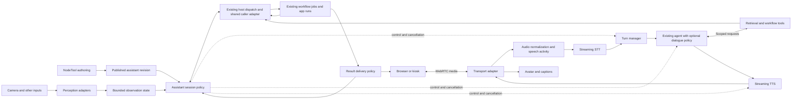

# Assistants: implementation plan

## Recommendation

Build Assistants as optional capabilities on NodeTool's existing agent and chat execution, presented through Mini Apps where possible. Reuse workflow execution, capabilities, jobs, provider access, and knowledge collections. Add only missing session coordination, conversation policy, and presentation integration. Personal assistants and museum guides are profiles of the same implementation. Existing agents remain usable without voice, guided modes, or an assistant presentation.

Own session semantics, guided conversations, retrieval policy, and authoring. Integrate an established WebRTC transport and speech services through replaceable adapters. Building these modules does not require implementing codecs, a media server, speech recognition models, or photorealistic avatar generation.

The separate [reactive sessions and workflow events plan](reactive-sessions-events.md) starts with a small operation invocation/completion adapter over the existing app host. Assistants reuse that adapter where applicable while retaining existing agent execution. Broader streaming and trigger adapters follow demonstrated needs. This plan adds no workflow executor or job scheduler. Reserve **harness** for NodeTool's headless testing and debugging surfaces.

Use **Assistants** as the feature name and **assistant** for each configured instance. Templates name specific roles such as Personal Assistant or Museum Guide.

The codebase already uses "assistant" for the editor chats bound to one surface. `ChatSource` in [api-types.ts](../../packages/protocol/src/api-types.ts) lists `game_assistant`, `sketch_assistant`, `timeline_assistant`, and others, and their UI copy says assistant. Those are workspace chats, not configured assistants. Keep the two apart in code identifiers, routes, and copy before A2 ships (Q7).

This is an implementation proposal, not a shipped feature. Source findings are based on repository inspection and the [pinned Pipecat and integration research](../research/realtime-agent-runtime.md). No live provider benchmarks or venue tests were run. Recheck adapter compatibility against chosen SDK versions during implementation. Pipecat is a reference, not a production dependency.

Start with A1's existing-agent, Mini App, and finite-tool fixtures. A2 delivers a text assistant using those paths. Streaming-host evaluation and voice feasibility are separate A1 checks and do not block the text delivery. A3 adds voice, while A4 adds guided authoring independently of voice. A5 is the first deployed browser/kiosk pilot. The [delivery plan](#delivery-plan-and-gates) defines implementation order and exit evidence.

## Product model and ownership

This section sets the direction for the detailed proposals below. The [shared variables plan](shared-variables-input-bindings.md) and [control-flow regions plan](control-flow-regions.md) remain separate deliveries with shared contracts. Their proposed behavior is not treated as implemented functionality.

### One creator model

An assistant is a saved configuration that can hold a conversation and use selected NodeTool capabilities. An assistant session is one interaction managed by the existing agent host with assistant-specific policy. Its workflow calls can use the shared caller adapter. A tool is an allowed action, often implemented by an ordinary workflow. A mode changes the conversation's available tools, knowledge, and behavior. A topic path guides progress within a mode.

The default experience is configuration and preview. Guided paths and modes are optional. Conversation graphs edit policy, while action workflows open in the ordinary workflow editor. The authoring section below defines the user flow.

### Building blocks and customization levels

Treat Assistant as a defined feature built from modular parts. Its session supplies the coordination that makes those parts behave as one assistant. Creators should be able to replace useful behavior without assembling turn-taking, interruption handling, conversation history, permission enforcement, and background-result delivery themselves.

| Level | Creator-facing building blocks | Contract |
| --- | --- | --- |
| Assistant configuration | Personality, models, knowledge, tools, modes, topic paths | A working assistant with defaults. Configuration and advanced editing preserve the same saved definition |
| Reusable workflows | Retrieval, perception, research, generation, answer checking, scene actions | Ordinary nodes and execution semantics, with declared inputs, outputs, permissions, and cancellation behavior |
| Advanced modules | Custom turn detection, context selection, conversation policy, presentation | Defined event/value interfaces and lifecycle contracts. Use a workflow where its execution semantics fit, or a specialized adapter where realtime behavior requires it |

Extract a smaller building block when it enables a demonstrated reuse or replacement. Separating retrieval from answering lets a creator change search behavior and reuse the retrieval workflow elsewhere. Exposing every internal speech event as a freely wired node would require creators to reconstruct ordering and cancellation rules. Keep that coordination inside the session module.

Custom modules may propose actions, context, or transitions through their interfaces. The session still enforces authorization, state revisions, response identity, interruption, and cleanup. Replacing a module must not bypass those rules. An ordinary workflow used as a tool need not understand speech timing or manage conversation history.

Do not promise that an arbitrary graph of existing nodes can reproduce the complete Assistant feature. A future Assistant node can expose the same session module inside a workflow, with declared event inputs and outputs. It must preserve the same lifecycle rather than create a second implementation. Start with a working Assistant and workflow tools, then expose additional modules when concrete examples justify them.

Every custom module must pass the same relevant interruption, authorization, and session-isolation checks as its default implementation. Smaller nodes are an outcome of useful reuse, not a prerequisite for delivering assistants.

### Ownership across features

| Feature | Responsibility | How assistants use it |
| --- | --- | --- |
| Shared caller adapter | Operation request/result correlation and observer cleanup over existing host dispatch | Reuses finite-operation coordination. App or assistant state retains value ownership. Streaming and trigger adapters are later work |
| Existing agent/chat execution | Provider turns, gated tool execution, history, and budgets | Runs the configured agent with optional mode, guidance, and media policies |
| Mini Apps | Layout, typed bindings, shared UI state, widgets, and operation presentation | Hosts Try and published assistant layouts through a session binding |
| Existing workflow execution | Run nodes, stream inputs/results, cancel runs, manage execution resources | Executes perception, retrieval, generation, research, and other actions. Can host a persistent assistant controller if the streaming prototype passes |
| Existing capabilities and app operations | Authorized invocation, declared arguments, operation identity, applicable budgets and run policy | The same approved action can be used from an assistant or its existing surface |
| Shared variables proposal | Typed values, bindings, snapshot reads, checked publication | Supplies tool settings and bound controls. Session-owned facts use the same value/revision conventions where supported |
| Control-flow regions proposal | Selected branches, sequential iteration, explicit completion and shared budgets | Composes work inside action workflows, including conditional retrieval or bounded research/refinement |
| Assistant conversation policy | Session context, modes, topic progress, allowed transitions, effective tool and knowledge scope | Decides what may happen next in response to an event |
| Media and presentation adapters | Speech turns, capture, playback, avatar timing, observation sampling | Turns user input into events and presents authorized results through voice, text, or a scene |
| Existing jobs and artifacts | Execution status, outputs, usage, result history | Holds tool work and generated results. Assistant records correlate these resources rather than replacing them |

Keep **values, events, and streams** distinct throughout the product. A language setting is a value. “Start the tour” is an event. Microphone audio is a stream. A value edit does not become an action unless an explicit trigger policy says so. Existing Instant Update remains an opt-in editing behavior, not the default trigger for assistant tools.

### Shared reactive session integration

The [reactive sessions and workflow events plan](reactive-sessions-events.md) owns extraction of common invocation/observation mechanics from existing hosts. It validates reuse with a Mini App and an agent-free game fixture. This plan owns assistant behavior, conversation state, and the Mini App's assistant-session binding. That binding is distinct from the shared finite-operation adapter: send-message and interrupt-response are not generic workflow-run operations.

### Assistant behavior on the shared layer

Use one optional conversation-policy implementation over the existing agent path. Its small interface accepts validated events and returns updated state plus requested actions. The existing host authorizes and dispatches actions through capabilities, then sends results back as events. The policy owns no model/tool loop, workflow scheduling, provider credentials, or job persistence. The same interface supports deterministic tests and preview.

The assistant session integration adds published-revision binding, conversation state, response interruption, and delivery policy where existing agent lifecycle contracts lack them. It reuses existing subscriptions and operation dispatch, adopting the shared caller adapter as demonstrated. The current agent host is the initial implementation path. Evaluate streaming workflow hosting only where a live-graph use case requires it, without creating a second agent loop. Hosting is not a creator-facing assistant type.

Use concrete adapters for actual variation: workflow versus app-operation invocation, text versus voice input, and browser versus scene presentation. Begin with existing contracts and add only missing assistant-specific information. Do not build a universal plugin framework, new scheduler, global reactive variable bus, or new state-machine library before a demonstrated requirement.

### Example: a museum guide

A creator selects Museum Guide, describes its tone, adds an exhibit collection, and enables an existing exhibit-lookup workflow. The default conversation already works in Try. They add a Guided tour mode with Welcome, Choose exhibit, Explore, and Finish steps. Quiz is another optional mode with a narrower tool set and different hints.

During a visit, selecting an exhibit sends an event. The policy validates the selection and commits the visitor's session state. An admitted lookup captures the exhibit and language as inputs. Its workflow uses ordinary nodes and, once available, control-flow regions to choose the applicable content branch. Results return with sources. Speech and avatar adapters present the answer. An optional image-generation tool creates an ordinary background job while conversation continues.

If the visitor switches to Quiz, the session changes policy without restarting unrelated generation. A completed image becomes a result card only if current policy permits it. Changing the creator's project default does not silently rewrite the visitor's active session or a running action's snapshot. Publishing a new assistant revision applies to new sessions.

## Assistant profiles

| Configuration | Personal assistant | Museum guide |
| --- | --- | --- |
| Identity and continuity | Authenticated person, optional explicitly retained preferences and tasks | Anonymous visitor by default, isolated session per visit |
| Knowledge | Authorized personal sources and selected web research | Published curator content, optionally bounded external research |
| Conversation policy | Open goals, clarification, task updates | Guided route with open questions and return points |
| Tools and effects | User-authorized connected services, generation, research | Exhibit lookup, media generation, approved installation actions |
| Perception | Explicitly enabled camera, images, screen, or other sensors | Selected exhibit, kiosk location, opt-in camera or object detection |
| Presentation | Voice, text, result cards, generated artifacts | Voice, captions, character/avatar, exhibit display |
| Background lifetime | A retained task may outlive the current connection | Work normally ends with the visitor session |

Keep these as data and policies over one runtime. A profile references allowed capabilities, knowledge revisions, memory policy, input sources, conversation graph or open-ended policy, presentation bindings, and resource limits. Creating a profile must not require copying the engine or writing a new agent loop.

## Creating and configuring an assistant

This is a proposed product flow. Follow the [UX guidelines](../UX_GUIDELINES.md), [design system](../DESIGN.md), and [UI primitives strategy](../../web/src/components/ui_primitives/STRATEGY.md) when implementing it.

This section describes the target experience across milestones. A2 exposes identity, a conversation model, knowledge/tools, boundaries, and text Try. Guided controls arrive in A4, publication in A5, and advanced modalities in their respective milestones. Hide unavailable controls rather than making the complete editor a prerequisite for the text assistant.

The entry point is **Assistants → New assistant**, also available from a project's creation menu. Offer Personal Assistant, Museum Guide, and Start from scratch. Each template states what it does and which provider connections or content it needs. Templates supply editable defaults, not a separate assistant type.

```text
Choose a starting point → Describe the assistant → Try the draft
                                                ↕
                            Refine settings, knowledge, and tools
                                                ↓
                                      Publish when ready
```

Creation asks for a name and a short purpose, with an optional audience. For example: “A friendly museum guide that helps families explore ancient pottery.” Create and autosave a draft immediately. Everything else can be configured in the editor. Do not require completing a long wizard before trying a conversation.

### Editor layout

Keep **Configure**, **Try**, and **Publish** visible. Configure has five labeled sections. On a wide screen, Try remains beside the settings. In a small window, it becomes a labeled tab with the draft and conversation preserved. A saved-state indicator distinguishes saving, saved, and failed to save.

| Section | Main controls | Optional detail |
| --- | --- | --- |
| **Identity** | Purpose, audience, tone, response length, language | Opening message, personality notes, example exchanges |
| **Knowledge & goals** | Add sources, desired outcomes, topic paths | Source priority, path branching, completion rules |
| **Tools** | Add capabilities, inspect enabled tools | Per-tool settings, permissions, workflow bindings |
| **Boundaries** | No-go topics/actions, unknown-answer behavior, limits | Memory, retention, tool approval rules, deployment constraints |
| **Voice & appearance** | Conversation model, voice/text mode, voice, avatar or scene | Speech models, perception models, transport and rendering configuration |

Show a compact summary above these sections: purpose, current conversation model, enabled capabilities, and readiness issues. Defaults should make a text conversation possible when a compatible provider is connected. Voice, camera, scenes, and extra tools are optional additions.

### Identity and personality

Use a few understandable choices: tone such as Warm, Neutral, or Playful, response length such as Brief or Detailed, and an optional free-text personality note. Show example phrasing, not numerical personality sliders. Keep the purpose editable in plain language.

A creator can specify “Curious and patient. Ask one question at a time. Avoid baby talk.” They can add preferred and unwanted example responses. Personality influences wording, but cannot expand permissions or override a boundary. Expose the generated instructions for inspection under Advanced, with extra instructions stored separately from structured settings.

### Models without repeated setup

Show the selected conversation model by name and provider. Use the connected Settings default when compatible. If none is available, offer Connect a provider at the point of testing. Never silently substitute an unavailable model.

Voice mode reveals a voice preview and the selected speech setup. Advanced reveals recognition, synthesis, and turn-detection choices. Image generation and vision models belong to their tool settings. Each picker inherits a compatible default and offers an explicit override. Display whether a value follows the workspace default or is customized. Publishing resolves model choices into the revision so a later default change does not silently change a deployed assistant.

Filter choices by capability and explain incompatibilities beside the setting. Changing a model should preserve other settings and show any resulting issues. Fallback models are explicit, ordered, and capability-checked. A creator should not need to understand pipeline topology to choose a voice.

### Knowledge, goals, and several topic paths

Separate factual sources from desired outcomes. A goal might be “Help the visitor understand how this vase was made.” It is not a requirement to force the visitor through a script. Goals can be assistant-wide or attached to a path, with an optional completion condition such as a confirmed visitor choice, a completed scene interaction, or a model-assessed learning outcome. Label inferred completion as an assessment rather than a verified event.

Offer three conversation styles: **Open conversation**, **Guided paths**, and **Guided paths with open questions**. The museum template selects the third. Paths appear as cards with a title, purpose, and ordered steps. The starting view is a list, with a graph available under Advanced.

| Example path | Steps | Completion |
| --- | --- | --- |
| How it was made | Select exhibit → Explain materials → Play demonstration → Invite questions | Demonstration completed and visitor chooses to continue |
| Look more closely | Choose a detail → Highlight it → Ask what the visitor notices → Explain | Visitor finishes or skips the observation activity |
| Compare cultures | Choose comparison → Retrieve evidence → Show similarities and differences | Sourced comparison presented |

Each step initially needs only a title and an instruction. Expand it to configure supporting knowledge, allowed tools, an optional scene action, a question, and what happens next. Branches use readable conditions such as “Visitor chooses another exhibit” or “Lookup returns no evidence.” Support skip, back, pause, resume, and exit. A required prerequisite applies to the dependent action, not to the visitor's ability to leave.

The creator chooses how paths start: visitor selection, a relevant request, or an approved scene event. Specify whether switching is offered or automatic. Keep one active path by default, with a return point after a question or digression. Show what happens on silence, off-topic questions, tool failure, and unknown answers. Advanced can define additional states and guarded transitions without losing the list view of supported steps.

### Tools and their settings

Present tools as capability cards: **Search Knowledge**, **Research the Web**, **Create Images**, **Understand Images**, and **Interact with a Scene**. Adding a card opens its settings and a Test tool action. An enabled card shows a one-line scope summary, connection status, and any missing setup. Disable a card without deleting its configuration.

| Tool | Settings shown first | Advanced settings |
| --- | --- | --- |
| Search Knowledge | Collections, source display, behavior when no answer is found | Retrieval limits, filters, ranking and timeout |
| Research the Web | Quick or thorough by default, allowed sources, background delivery | Time/source budgets, research workflow, cancellation policy |
| Create Images | Model, style, result destination | Workflow binding, parameters, concurrency and spend limit |
| Understand Images | Uploaded images or opt-in camera, when to analyze | Sampling, regions, detection workflow and observation expiry |
| Interact with a Scene | Scene and allowed actions | Event bindings, semantic command mapping and revision policy |

Give tools three distinct questions: **When may it run?**, **What may it access or change?**, and **How should results arrive?** Defaults come from the template. Optional controls choose request-only versus automatic use, confirmation for effects, and silent display versus announcement at a pause. “Automatic” never grants access to additional sources or actions.

Allow **Add a workflow as a tool**. The creator supplies a name and a short “Use when” description, selects exposed inputs and outputs, and marks the invocation as foreground or background. Derive parameter controls from the workflow schema. Each input is a fixed setting, an explicitly bound value, or an argument the assistant may supply. Resolve required inputs before invocation. Credentials and permission settings remain server-bound and cannot be supplied by the model. Validate compatibility and show a sample invocation before enabling it.

### Boundaries, constraints, and no-gos

Keep behavioral directions and enforced restrictions visibly distinct. “Avoid speculation about provenance” is model guidance that needs evaluation. “Use only these collections” and “Never edit the saved scene” are permissions enforced outside the model. A free-text no-go does not become a security guarantee because it appears in this section.

| Boundary | Creator-facing configuration | Runtime behavior |
| --- | --- | --- |
| Topics | Allowed focus, no-go topics, suggested redirect | Guide the response and test representative cases |
| Evidence | Use approved knowledge, cite sources, say when uncertain | Restrict retrieval scope and apply the configured answer policy |
| Actions | Allowed actions and when confirmation is required | Validate capability calls before execution |
| Resources | Session duration, task budget, concurrency | Enforce limits and return an understandable stopped/partial outcome |
| Memory | This conversation only or explicitly retained personal context | Apply ownership, retention, and reset policy |

Show conflicting settings before publishing, such as a path requiring web research while that tool is disabled. Apply the inheritance rules in [Effective policy and transitions](#effective-policy-and-transitions).

### Try, diagnose, and publish

Try supports text first, then voice and a connected scene when configured. Show useful diagnostics in an optional activity panel: current path and step, tool calls, task status, sources, and boundary decisions. Show observable events and configuration reasons, not private model reasoning. A setting change applies on the next fresh preview session, with a Restart with changes action and a clear indication when the current test uses older settings.

Let creators save a test conversation as a reusable scenario. Include tests for a normal request, a no-go request, switching paths, interrupting speech, a slow background task, and a missing source. Tests that spend money or affect connected services clearly show that before running. Preview defaults to simulated effectful tools, with explicit selection of live execution.

Publish presents the destination, model/provider requirements, enabled tools and scopes, memory policy, and blocking issues. Offer a shareable web experience, embed, or kiosk profile as supported destinations. Publishing creates an immutable revision of personality, models, conversation policy, tool bindings, knowledge references, presentation, and session limits. Active sessions retain their revision. Editing continues in the draft, with rollback and explicit republish available. Keep saved drafts usable even when credentials or an optional tool are missing, and identify the exact blocked setting rather than presenting a generic failure.

### Advanced modularity without a second product

Each section has its own Advanced disclosure. A global advanced view can show workflow bindings, model adapters, input/output mappings, and session policies over the same document. Do not make the first experience a node graph.

Use one versioned assistant document and one validation path for forms, templates, advanced edits, and API authoring. Fields distinguish inherited defaults from overrides and provide Reset to default. Tool definitions supply their configuration schemas. Structured settings compile into runtime configuration and model instructions with source attribution so a creator can inspect where a setting came from.

Advanced constructs that the simple editor cannot represent remain intact and appear as a labeled Custom configuration block. Never silently flatten a custom graph or discard unknown configuration on save. Template updates are explicit changes to review, not automatic rewrites of an existing assistant.

### Authoring acceptance criteria

| Criterion | Evidence required |
| --- | --- |
| Simple start | A creator reaches a working text preview from a template without opening Advanced or choosing each model separately |
| Relevant controls | Voice, camera, and scene fields appear only when enabled, while their settings survive temporary disabling |
| Editable paths | A creator adds two paths, branches one step, and tests a switch and return without graph editing |
| Clear permissions | A tool card explains its scope and result delivery, and a denied action remains denied despite conflicting model instructions |
| Round-trip preservation | Form, advanced, and API edits retain each other's supported settings and custom extensions |
| Work preservation | Refresh, navigation, missing credentials, and failed publishing preserve the draft |
| Preview fidelity | The tested revision, model choices, effective permissions, and publication revision are inspectable |

Treat this flow as a design hypothesis to validate with creators. Implement its entry points and forms with the repository's existing primitives and verify keyboard access and navigation at small laptop sizes.

## Multimodal inputs, tools, and background work

The conversational model is one consumer of session state. It does not need to inspect every camera frame or coordinate each detector invocation itself. Scheduled perception, explicit tool requests, and background completions enter the runtime through distinct typed events.

| Execution class | Examples | Scheduling and result behavior |
| --- | --- | --- |
| Continuous or sampled perception | VAD, object detection, presence, selected camera frames | Run at a bounded rate, coalesce observations, publish meaningful changes without creating an LLM turn for every frame |
| On-demand perception | Describe an image, OCR a label, identify a pointed-at object | Bind the request to a specific frame or region and return evidence with capture time and source identity |
| Foreground tools | Exhibit retrieval, quick lookup needed to answer | Run within a reply deadline, then answer or report that the lookup is still pending |
| Background tasks | Generate an image, compare sources, short or long web research | Acknowledge accepted work, return a task handle, continue conversation, deliver progress and artifacts asynchronously |
| Presentation actions | Show an image, update a result card, point an avatar at an exhibit | Validate against allowed UI actions and the current audience before rendering |

This is a proposed extension, not a claim that these scheduling semantics already exist. Reuse NodeTool's [capability contracts](../../packages/agents/src/capabilities/types.ts) and [job inspection/cancellation tools](../../packages/agents/src/capabilities/jobs.specs.ts) where they fit. Audit ownership, persistence, and event delivery before treating an existing workflow job as a durable assistant task. Do not build a second general-purpose workflow scheduler.

### Observation contracts

Each observation carries source identity, capture time, expiry, session scope, and a typed payload. A detection may include object class, bounding box, track identity, and model-specific confidence. A vision description includes the image reference and relevant region. Preserve provenance and uncertainty. A detector label is evidence, not an established fact or permission to act.

Maintain a bounded current-scene summary and retain selected evidence only under the profile's policy. Debounce repeated detections and expire absent objects. Resolve phrases such as “this one” against the scene at the visitor's utterance, asking for clarification when several objects fit. A delayed analysis of an old frame must not silently describe the current scene.

### Background task contracts

A task binding records its existing job or app-run ID, owner, originating session and turn, accepted brief revision, input snapshot, authorization scope, and delivery policy. Execution status, progress, usage, and artifacts remain authoritative in the existing run record. Store assistant-specific states such as awaiting clarification separately, rather than introducing a second job state machine. Cancellation can be requested without being confirmed by the provider. Record that distinction and ignore late results for presentation when the task is no longer eligible.

Speech interruption cancels the current response by default, not every accepted task. “Stop talking” and “cancel the image” have different effects. “Make it blue instead” may revise or supersede a task only after resolving which task it refers to. Attach revisions to the accepted brief and prevent a superseded result from replacing the newer one.

Short and long research use the same task contract with different depth, time, and source budgets. Return a sourced answer and, for longer work, a retained report. Describe progress from actual job events. Do not let retrieved web content expand tool permissions or change the task brief. Deadline expiry returns a clearly partial result when useful rather than pretending research finished.

Visitor-scoped work is cancelled or quarantined on kiosk reset and can never appear for the next visitor. Authenticated personal tasks may survive disconnect only when the profile and task authorization permit it. Persist task identity and reconcile completion after reconnect without replaying side effects. Cross-session notification or external delivery is a separate authorized capability.

### Result delivery policy

Tool completion emits a result event. It does not automatically trigger speech. A session-owned policy checks ownership, freshness, task revision, relevance, and whether the visitor is speaking. It may update a card silently, queue a brief spoken announcement at the next pause, request clarification, or discard a stale presentation event while retaining the authorized artifact.

Use one conversational speaker even when several tools run concurrently. Coalesce progress updates and prevent research/image jobs from monopolizing it. Keep model concurrency, media processing, and tool budgets separate so expensive background work cannot starve microphone or playback processing.

## Game and 3D scene interaction

A scene can be an input source, a tool target, and an output surface for an assistant. The assistant may inhabit a character, guide a visitor around an exhibit, explain selected objects, or manipulate a demonstration while speaking. A visible avatar is optional.

Existing foundations include [3D scene operations](../../packages/model3d/README.md), [model tools](../../packages/agents/src/capabilities/model3d.specs.ts), [game authoring and playtest tools](../../packages/agents/src/capabilities/game.specs.ts), and the [game simulation lifecycle](../../packages/game-runtime/README.md). These establish editing and simulation capabilities. Simulation runs in process through `createGameSession(...).step(input)`, and the game editor's agent panel is an authoring chat (`chatSource: "game_assistant"`). No channel exists for a deployed assistant to issue scoped commands to a running visitor scene. That live-session adapter is proposed work.

| Capability | Example | Boundary |
| --- | --- | --- |
| Observe scene state | Read selected exhibit, visible objects, available interactions, or puzzle progress | Prefer structured engine state to image recognition when the engine owns the scene |
| Receive scene events | Visitor selects an object, enters a region, or finishes an interaction | Subscribe to relevant changes and coalesce repeated events |
| Direct presentation | Highlight an object, focus a camera, display a generated image on a surface | Apply bounded session-local changes, respect visitor camera control and reduced-motion settings |
| Act within the simulation | Open an allowed door, trigger a demonstration, direct a character to a destination | Issue approved semantic commands through engine rules, preserving physics and script ownership |
| Author persistent content | Create an object, edit a scene, install a generated asset | Separate permission and revision checks from temporary visitor interactions |

Expose semantic actions such as “focus exhibit” or “start demonstration,” with stable target IDs and validated arguments. The model selects an action and goal. The engine handles animation, movement, navigation, collision, and frame updates. Do not put an LLM in the per-frame control loop or let arbitrary model-generated code execute in the renderer. Existing sandbox rules apply to authored scripts.

Bind tools to an authorized scene instance, document revision, and session. Commands carry an operation ID and, where needed, an expected state version. Return accepted, completed, rejected, or cancelled results, plus relevant observed state. Acknowledging a movement request does not mean the character arrived. Reject stale targets after scene replacement and prevent a retried request from applying twice.

Keep temporary focus, highlights, visitor progress, and character actions separate from saved document edits. The engine is authoritative for simulation state. An assistant must not independently overwrite a physics-owned transform. A stop request can cancel a camera move or demonstration without deleting an authored asset or cancelling unrelated research. Generated textures, images, and models pass through existing asset validation before a scene references them.

The simple configuration is **Interact with a Scene → choose scene → choose allowed actions**. Advanced creators can bind semantic actions and events to existing scene/game workflows. The assistant should work with a text result card when no live scene renderer is connected.

## Scope and experience

| Surface | Required behavior |
| --- | --- |
| Website | Start explicitly, grant microphone access, talk or type, interrupt, see captions and sources, end the session |
| Museum kiosk | Start by touch, choose language or tour, ask about the current exhibit, return to the tour after a question, reset fully for the next visitor |
| Animated character | React to listening, thinking, speaking, and errors, optionally synchronize mouth shapes with speech |
| Video avatar, later | Render a live generated character with synchronized audio and interruption support |
| Optional visitor camera | Explicit opt-in, bounded visual context capture, no camera requirement for voice or avatar output |

Assume one active conversation per kiosk for the first release. Groups can listen together, but simultaneous speaker identification and separate personal conversations are later work. A physical installation can use a fullscreen browser or Electron client. It does not require robotics.

## Existing NodeTool capabilities and gaps

The inspected files establish useful components, but do not establish a complete public virtual-agent product. No live provider calls, audio benchmarks, or venue tests were run during this research.

| Finding | Evidence | Implication |
| --- | --- | --- |
| F1. Microphone streaming exists | [useRealtimeAudioStream](../../web/src/hooks/useRealtimeAudioStream.ts) captures PCM16 and sends base64 chunks through workflow inputs. [RealtimeAudioInputNode](../../packages/core-nodes/src/nodes/input.ts) exposes a streaming input. | Reuse the integration knowledge. Current capture uses a 4096-sample ScriptProcessor buffer, which represents about 171 ms at its default 24 kHz before other latency. Evaluate AudioWorklet or WebRTC capture. |
| F2. Streaming speech services exist | [ElevenLabs STT](../../packages/elevenlabs-nodes/src/nodes/realtime-stt.ts) and [TTS](../../packages/elevenlabs-nodes/src/nodes/realtime-tts.ts) connect to provider WebSockets. | Extract reusable service adapters where practical. Existing workflow-node interfaces alone do not define per-turn interruption and playout acknowledgment. |
| F3. A realtime conversational node exists | [RealtimeAgentNode](../../packages/llm-nodes/src/nodes/openai.ts) configures server VAD and forwards audio/text. Its implementation uses the `gpt-4o-realtime-preview` and `gpt-4o-mini-realtime-preview` model identifiers and the `OpenAI-Beta: realtime=v1` header. | Audit provider compatibility before reuse. In the inspected class, tools, guided transitions, explicit playback truncation, and visitor lifecycle are not implemented. This is a source finding, not a reproduced provider failure. |
| F4. Playback already avoids React on its fast path | The [realtime chunk bus](../../web/src/lib/audio/realtimeAudioChunkBus.ts) is a publish/subscribe channel. The [playback hook](../../web/src/hooks/browser/useRealtimeAudioPlayback.ts) feeds the `nodetool-chunk-player` AudioWorklet and records `RealtimeAudioStats` on `window.__nodetoolRealtimeAudio`. | Preserve this separation. Add session/utterance identity, interruption flushing, and acknowledged playout progress. |
| F5. Retrieval and access checks exist | [Vector store](../../packages/vectorstore/README.md) provides collections and embedding adapters. [Collection capabilities](../../packages/agents/src/capabilities/collections.ts) check `canAccessCollection` before a named query. | Add deployment-specific collection scopes and stable source references. The named-query response is `{ id, document, score }`. Indexing already accepts metadata, so citations need the query to return it rather than a new ingestion format. |
| F6. Streaming execution and cancellation exist | [Execution IO](../../packages/execution-core/src/io.ts) exposes a run cancellation signal. [Audio nodes](../../packages/audio-nodes/src/nodes/realtime-audio.ts) process streaming chunks. | Investigate reuse, but distinguish cancelling one spoken response from cancelling a whole workflow or visitor session. |
| F7. App authoring and deployment bindings exist | [App runtime](../../packages/app-runtime/README.md) defines UI documents, operation bindings, state, and shared host semantics. | Extend app bindings for live sessions. Do not force every microphone packet to become an app operation or UI-store update. |

## Existing agent, Mini App, and operation reuse

The initial implementation hypothesis is an existing agent session with optional assistant policy and a Mini App presentation. These are source-backed reuse candidates. Their combination still needs the A1 fixtures.

| Finding | Existing implementation | Proposed reuse and limit |
| --- | --- | --- |
| F12. Agent execution is already composed, in two hosts | The [web chat host](../../packages/websocket/src/session/chat-turn.ts) builds a [CodeAct session](../../packages/agents/src/codeact/chat-codeact.ts) with `createChatCodeActSession` and runs `provider.generateLoop`. The CLI host uses `processChat` from the [chat processor](../../packages/chat/src/message-processor.ts) instead | Reuse gated tool dispatch, provider execution, budgets, history handling, and cancellation. The web chat host is the assistant host candidate because it already owns threads, permission waits, and WebSocket delivery. The CodeAct helper exposes tool execution and prompt sections, not a complete persistent conversation lifecycle. Trace `chat-turn.ts` and the provider loop together |
| F13. Mini Apps already present conversation and choices | [Widget catalog](../../packages/app-runtime/src/widgets.ts), [actions](../../packages/app-runtime/src/actions.ts), and [shared app runtime](../../packages/app-runtime/README.md) | Compose ChatThread, ChatComposer, ChoiceCards, Approval, and existing media/result widgets. Add the missing assistant-session binding instead of another chat renderer. The six existing actions are `run`, `cancel`, `setVariable`, `toggleVariable`, `resourceCommand`, and `openResource`. None of them sends a message, interrupts a response, or submits a session event |
| F14. Operation contracts already describe more than arguments | [Recipe operation contracts](../../packages/app-runtime/src/recipe-compiler.ts) and [shared-operation guidance](../recipes/shared-operations.md) | Reuse compatible typed ports, pinned targets, spend/effect metadata, and stale-input conventions for assistant tool cards. Keep Recipe-specific preservation fields optional or local. Contract declarations do not replace runtime authorization |
| F15. Durable memory already exists with user scope | [Memory capabilities](../../packages/agents/src/capabilities/memory.ts) | Reuse for explicitly authorized personal continuity. A thread ID is a filter, not an isolation boundary. Anonymous visitor sessions must not inherit the deployment owner's memories or memory tools |
| F16. Triggers already separate ingestion, acceptance, and completion | [Trigger wakeup](../../packages/execution-core/src/trigger-wakeup.ts), [dispatcher](../../packages/websocket/src/triggers/dispatcher.ts), and [scheduler](../../packages/websocket/src/triggers/scheduler.ts) | Reuse existing event/run ownership. Durable input storage does not imply exactly-once effects or hard realtime timing. The dispatcher documents an at-least-once acceptance crash window |

### Optional features over the existing agent

Separate stable assistant identity and permitted capabilities from per-turn mode instructions and tool availability. The CodeAct interface already distinguishes stable prompt content from turn-specific tool descriptions, and its host routes calls through a gate. Validate actual permissions on every dispatch, including sandbox capability imports and direct tool calls. Hiding a tool from discovery is not sufficient enforcement.

Reuse existing direct-tool routes for short actions and CodeAct composition where useful. Measure their latency before changing agent execution strategy. Do not make voice support depend on exposing sandbox code to creators. Keep optional media dependencies out of ordinary text-agent installations and preserve existing agent behavior when assistant features are disabled.

Add bounded conversation context through the current host's history mechanisms. Session facts, user-retained memory, and retrieved evidence have different ownership and lifetimes. Disable personal memory access for anonymous deployments at the capability and context-loading layers. Visitor approval cannot grant access to an operator's private data or credentials.

### Mini App presentation and authoring

The Assistants editor configures behavior. Its default Try and published experience should use a normal Application layout bound to that assistant revision, with custom layouts editable in App Builder. Assistant identity can be reused by several layouts without copying the behavior definition. Saving a layout must not overwrite assistant policy, and published layout/assistant references must resolve consistently.

Use a narrow, typed session binding for send-message, validated choice/event submission, interrupt-response, end/reset, and observed transcript/activity state. The exact schema is A1 work. Keep it separate from ordinary workflow operation invocation where lifetimes differ. Route workflow actions through existing operation bindings, folding, invocation ownership, and result presentation. Do not route audio frames through application variables or the UI reducer.

Reuse approval UI only with the existing permission gate and the correct approving identity. An Approval widget alone cannot authorize an action. Test the binding through the existing app harness and browser host. Shared schemas can support mobile later, but browser voice support does not establish mobile parity.

## Research basis

The [research note](../research/realtime-agent-runtime.md) contains the pinned Pipecat source analysis and provider references. Keep that evidence there rather than duplicating it in this plan. The implementation uses its findings on interruption priority, tool settlement, stale synthesis output, transition ordering, and provider capability validation.

Evaluate LiveKit's transport independently of its Agents framework. Reuse existing NodeTool audio for the local baseline, then measure the chosen WebRTC integration for the deployed pilot. Neither integration availability nor a successful loopback demo establishes venue reliability.

## Build and integration decisions

| Decision | Proposal | Reason and boundary |
| --- | --- | --- |
| D1. Runtime ownership | Extend the existing agent/chat path with optional assistant session policy | Reuse its model/tool execution and permission routing. Add only the missing conversation and media lifecycle behavior |
| D2. Media transport | Integrate WebRTC, initially evaluate LiveKit's transport and Node SDKs without adopting its Agents runtime | Own conversation behavior while reusing media transport. Raw WebRTC would still require signaling, NAT traversal, TURN, and operational work |
| D3. Speech pipeline | Start with streaming STT → text LLM → streaming TTS | Makes transcripts, retrieval, guarded transitions, and speech rendering independently observable and replaceable |
| D4. Alternative model mode | Later support a separate duplex speech-model adapter | Such a service owns more of turn detection and audio generation. Do not pretend it implements independent STT and TTS adapters |
| D5. Visual presentation | Start with a local abstract avatar, then a rigged character or video provider | The conversation can be validated before adding video latency and provider cost |
| D6. Workflow integration | Reuse workflows as bounded tools and authoring configuration | Use existing execution owners for graph runs. Transport adapters own media timing and playout, with per-response interruption in the assistant coordinator |
| D7. Pipecat role | Reference and optional benchmark | No production dependency in the proposed initial architecture |
| D8. Turn ownership | Select one endpointing authority per profile | Use provider end-of-turn events or a local turn strategy. Do not run competing detectors that independently commit the same turn |
| D9. Speculation | Disable eager replies in the initial release | Add only after committed-turn behavior passes. Speculation needs provisional context, output gating, and blocked side effects |
| D10. Provider compatibility | Validate capabilities when publishing an assistant | Unsupported cancellation, timing, language, or mid-session updates must produce a clear error or an explicit fallback |
| D11. Background execution | Attach existing jobs to explicit assistant task records | Accepted work can continue through speech interruption without duplicating the workflow scheduler |
| D12. Input and output policy | Separate observations, task results, and presentation decisions | Every detected object or completed job must not become an unsolicited spoken turn |
| D13. Session hosting | Use the existing full-backend agent host first | Reuse Mini Apps for presentation. Test streaming workflow hosting only for a demonstrated live-graph need. Lean-server support remains optional |
| D14. Invocation routing | Dispatch workflow tools through the saved-workflow service and app operations through the app-operation service | Preserve each surface's ownership, budgets, tracing, persistence, and invocation rules. Do not create a second job for an already owned app run |
| D15. Lifetimes | Separate connection, assistant session, response, and tool-run lifetimes | Interrupt speech locally. Cancel jobs through their existing owner. Reconnect support does not imply process-crash recovery |
| D16. Conversation graph | Store modes, topic steps, and transitions as a declarative hierarchical state machine | Reuse graph editing components. Execute actions with ordinary workflows. Transition edges must not be interpreted as ordinary workflow data edges |

## Fit with current execution options

These findings come from the current repository sources. The assistant mappings are proposals. The [execution lifecycle boundary](../execution-lifecycle.md) already defines full-server, lean-server, browser, and nested execution ownership.

| Current option and evidence | Assistant integration | Limits to preserve |
| --- | --- | --- |
| Full server: [ExecutionSession](../../packages/execution/src/session.ts), used by CLI, DSL, WebSocket jobs, and services | Keep this lifecycle owner for full-server workflow runs. Use `pushInput`, `finishInputStream`, captured `messages`, and `cancel` when an integration needs a live graph | Cancellation ends a run. It is not a speech-response interrupt. Message capture is opt-in and must be consumed |
| Saved or inline workflow: [runWorkflow service](../../packages/execution/src/service/workflow-run.ts), already called by [agent workflow capabilities](../../packages/agents/src/capabilities/workflows.ts) | A tool binds named inputs and invokes this service with the authenticated owner, workspace, and project. Image generation and research can use background jobs | The inspected service exposes job receipts/results, not the full session's live input/message interface. Add a narrow service bridge if needed, retaining its job ownership |
| App operation: [executeAppOperation](../../packages/execution/src/service/app-operation.ts) and [run policy](../../packages/app-runtime/src/policy.ts) | An assistant embedded in an app invokes its declared operation with a stable invocation ID. Reuse reservation, budget, trace, and parallel/queue/replace policy | The host must implement policy decisions. Avoid wrapping the same operation in an additional independently persisted workflow job |
| Browser graph: [inline routing](../../web/src/lib/workflow/runInlineGraphJob.ts) and [browser runner](../../web/src/lib/workflow/browserWorkflowRunner.ts) | Eligible whole graphs can run through the existing browser worker and event pipeline. Other graphs follow the existing server route | This is not automatic partitioning of arbitrary mixed graphs. Browser lifetime and credential availability constrain use |
| Lean host: [server-core](../../packages/server-core/src/index.ts), [server-minimal](../../packages/server-minimal/src/index.ts), and [nodes-core](../../packages/nodes-core/src/index.ts) | Preserve this independent execution option. Add assistant support only through an optional feature with explicit capabilities | Do not import full agents, Python, or media dependencies into the lean default. Its command and lifecycle contracts differ from the full host |
| Nested graph: [run-inner-graph](../../packages/core-nodes/src/nodes/run-inner-graph.ts) | Ordinary workflow composition continues to inherit the parent execution environment | A nested action should not accidentally become an unrelated top-level job |
| Standalone app: [app export](../../packages/app-export/README.md) | Reuse its server execution adapter if assistant export is later supported | Existing workflow/script export does not establish that assistant sessions, transports, or checkpoints are exportable today |

### Continuous execution and related plans

The inspected code has two relevant mechanisms. [Instant Update](../../web/src/hooks/nodes/useInputNodeAutoRun.ts) responds to property edits by running the downstream subgraph, with debounce and an active-run guard. [Live slider updates](../../web/src/hooks/nodes/useLiveSliderWriter.ts) provide a specialized browser path. These are repeated computations driven by edits, not a single persistent conversation run.

For an open workflow run, the [execution runner](../../packages/execution-core/src/runner.ts) keeps external streaming-output input edges open for `pushInputValue`. Ordinary inputs signal end-of-stream after their initial value. `ExecutionSession.pushInput` and `finishInputStream` expose that lifecycle, alongside cancellation. This is the existing mechanism to evaluate for a continuously listening assistant graph. Streaming support alone does not prove response-level interruption, bounded memory over a long session, or restart recovery.

Persistent workflow hosting and finite tool runs are compatible. Start with the existing backend agent host. A1.4 evaluates a streaming adapter when needed, while tool invocations continue through existing execution services. Neither placement requires a new executor, and the adapter evaluation does not delay A2.

| Related proposal | Reuse for assistants | Boundary to keep explicit |
| --- | --- | --- |
| [Shared variables and direct input bindings](shared-variables-input-bindings.md) | Typed bindings for language, selected exhibit, audience, and tool parameters. Capture values/revisions when an action starts. Use checked writes for returned artifacts and progress | Editing configuration must not implicitly start paid work. Run snapshots stay fixed. Live conversation events and mode changes need explicit events, not accidental Watch subscriptions |
| [Control-flow regions](control-flow-regions.md) | Execute only the chosen action branch, await sequential tool work, collect results, and share budgets through nested actions | A region controls execution within an invocation. A conversation state waits for future events across invocations. Region loops do not by themselves define session persistence or state transitions |

The variables plan defers general Watch and automatic execution for new bindings. Existing Instant Update and app reactive execution remain separate opt-in behaviors. Assistant draft edits apply to a fresh preview session or a newly published revision. Explicit live session inputs, such as selected exhibit, can affect the next admitted action. Neither kind of value edit implicitly starts paid work.

Keep creator configuration separate from visitor state. A shared project variable can supply an authorized default. Selected exhibit, current mode, topic progress, and pending actions belong to the visitor's assistant session. Reuse typed value/revision contracts where possible, but add explicit session ownership if existing scopes cannot represent it. Never put anonymous visitors' mutable progress in a shared project variable. Controls submit validated events for mode/step changes. The state reducer commits those transitions and publishes selected state to bound controls.

A long-lived streaming run needs a documented distinction between its immutable admission snapshot and explicitly updated live state. New turns can start finite child actions with fresh authorized snapshots. Existing `updateNodeProperties` support is executor-specific and must not become an implicit bypass of snapshot or publication rules.

### Workflow binding and invocation

Keep graph scheduling, executor resolution, Python bridging, workspace access, job accounting, and run cleanup with their current owners. Neither the conversation reducer nor the media adapter constructs a new kernel runner.

Published tools should bind authorized workflow snapshots or explicitly versioned references. The current service can accept an inline graph, but publication resolution and authorization still need implementation. Do not silently run a newly edited saved graph under an older assistant's permissions. Map tool arguments to declared inputs and return bounded outputs or asset references. Preserve existing workspace and temporary-media resolution rules.

Reuse existing model/tool invocation contracts beneath the dialogue policy. The new policy determines the current instructions, eligible tools, and state events. It must not duplicate provider credential handling or bypass capability authorization.

### Cancellation, reconnect, and retained work

| Lifetime | Owner and behavior |
| --- | --- |
| Media connection | Transport reconnects or closes. Stop playback immediately on interruption. Do not replay old audio |
| Assistant session | Coordinator owns visitor identity, published revision, state, and explicit reset. Losing a connection does not automatically start a new visitor |
| Response | Its cancellation scope stops generation, synthesis, and interruptible work. Accepted background actions keep their own lifetime |
| Workflow or app run | Existing execution owner settles status, output, usage, and cancellation. Assistant task records refer to its job or app-run ID |
| Retained task | Requires explicit retention policy and recoverable status. A persisted receipt alone does not make computation restartable |

The [WebSocket job registry](../../packages/websocket/src/job-run-registry.ts) already supports detachment, bounded message replay, and reconnect grace. Its delivery attachment is not a general multi-subscriber assistant event bus. The [active-run registry](../../packages/execution/src/service/active-runs.ts) is process-local. [Job cancellation](../../packages/websocket/src/job-control.ts) also supports remote-owner paths, whose latency is unsuitable for stopping audible speech. Reuse these mechanisms for jobs and add assistant-specific reconnect state without claiming crash-resumable execution.

Store correlations between assistant session, response, state revision, tool call, and existing run IDs. On reconnect, reconcile job status and artifacts before delivery. After a process failure, recover an explicit conversation checkpoint or offer a new session. Never replay an external side effect merely because its result was not delivered. Crash-resumable tasks remain a separate capability to prove against the existing execution infrastructure.

### Integration acceptance checks

| Check | Required evidence |
| --- | --- |
| Existing execution ownership | A workflow tool appears once in existing job history and usage accounting. An app operation reuses its invocation identity |
| Background response | Image generation continues while the assistant answers another question. Its result arrives through the delivery policy |
| Cancellation scopes | Barge-in stops speech without cancelling retained work. Explicit task cancellation reaches its execution owner |
| Connection loss | Reconnect attaches to the correct visitor and reconciles jobs without duplicate effects or old audio |
| Host capability | Browser eligibility and server fallback follow existing routing. Unsupported lean-host features fail explicitly |
| Failure recovery | A process restart does not report an unfinished job as successfully resumed. Checkpoint restoration and uncertain side effects are visible |

## Modular architecture



These are logical modules, not a requirement for new packages. A1 identifies existing implementations to extend or extract. Keep pure conversation and turn reducers independent of SDKs, and keep heavy dependencies optional so the lean CLI and execution server retain their dependency separation. Follow the [backend package rules](../../packages/AGENTS.md).

| Module | Responsibility | Required contract behavior |
| --- | --- | --- |
| Existing host/shared caller adapter | Authorized operation dispatch, request correlation, completion observation, observer cleanup | Reuse state and execution ownership. Broader event/stream adapters follow the separate plan |
| Assistant session policy | Published revision, conversation state, response scopes, result relevance | Uses shared session mechanics and existing agent execution. Keeps visitor and response identity isolated |
| Transport | Capture/receive tracks, publish audio/video, signaling | Report connection state, timestamps, device failures, playout state, and flush completion |
| Audio normalization | Decode/resample/channel conversion at boundaries | Explicit sample rate, channel count, encoding, sequence, and media clock |
| Speech activity and turns | VAD, end-of-turn detection, push-to-talk, barge-in | Distinguish partial transcripts, finalized input, and interrupted responses |
| STT adapter | Stream audio to partial/final transcript events | Cancellation, language configuration, stable segment IDs, documented finalization |
| Dialogue policy over existing agent | State-specific instructions and allowed transitions | Reuse model/tool execution. Validate model-proposed actions and guards before changing state |
| Tool gateway | Scoped retrieval and selected workflow execution | Authorization, deadline, cancellation, result bounds, and idempotency for effects |
| TTS adapter | Incremental text to audio and optional timing cues | Flush input, cancel output, expose supported timestamps/visemes |
| Presentation adapter | Captions, abstract animation, rigged character, or live video | Follow actual playout, stop on interruption, degrade to voice/text |
| Session telemetry | Correlate events, latency, cost, and errors | Content-free defaults and configurable retained diagnostic content |

Use discriminated event schemas. Shared events carry session/source identity and request correlation or state revision where needed. Assistant events add `turn_id` and `utterance_id`. Stream adapters supply sequence and media timestamps within their own clock domain. Do not assume a global ordering across independent sources. Assistant events include speech start/end, transcript updates, accepted turns, tool requests/results, playout progress, interruption, state change, and session end. Keep binary media in the transport path and NodeTool workflow control on its existing MsgPack protocol through `GlobalWebSocketManager`.

Give each response its own `AbortController`, linked to session cancellation. A monotonically increasing response generation identifier lets every downstream module reject identifiable late output from a cancelled response. A provider that returns no synthesis identity may require reconnecting before starting new speech. Bound queues by media duration and bytes. Initialization must complete before processing media. Interrupt and forced-close events take priority, while graceful drain and committed tool outcomes survive response interruption. Do not silently drop input speech to hide overload: surface degraded quality, reduce admission, or ask the visitor to repeat.

### Adapter capabilities and lifecycle contracts

Validate each published profile against the actual adapter/model combination. Include supported languages and audio formats, endpointing ownership, partial/final transcript semantics, synthesis context IDs, cancellation behavior, word/viseme timing, playout measurement, and reconnect behavior. Duplex adapters also declare whether instructions, tools, and context can change mid-session and whether assistant history can be truncated. See the [adapter evidence](../research/realtime-agent-runtime.md).

Keep these operations distinct:

| Operation | Meaning |
| --- | --- |
| Commit input turn | Accept the final transcript as the basis of one response |
| Flush synthesis input | Ask the provider to generate buffered text, preserving the response |
| Clear playout | Discard queued speech for a response at the rendering boundary |
| Interrupt response | Invalidate speech and interruptible work, retaining the visitor session |
| Drain and close session | Finish permitted work within a deadline, then release resources |
| Force close session | Stop media immediately and reconcile any durable tool outcomes separately |

Represent session, input-turn, response, and playout state separately. A visitor can speak while the agent is speaking. A response can finish generating while its audio is still playing. One `listening/thinking/speaking` enum cannot be the runtime's authoritative state, though the UI can derive a simple status from it.

### Interruption correctness

On accepted barge-in, stop local playout promptly, invalidate the response generation, abort model generation and interruptible tool work, clear pending TTS and avatar output, then acknowledge the flush. Settle cancelled tool calls before awaiting provider cancellation so a late callback cannot reopen them. Preserve any already-committed tool side effect and its audit record. Cancelling speech cannot undo an action.

Maintain generated, synthesized, sent, and rendered progress separately. LiveKit's server-side `waitForPlayout` measures its local queue, not sound heard at the browser. Use browser-rendered progress where available and label transport-derived timing as estimated. Store the confirmed rendered prefix, or conservatively mark a response interrupted when word alignment is unavailable. No software acknowledgment proves a person actually heard the audio. [AudioSource implementation](https://github.com/livekit/node-sdks/blob/7af545433d9b923eb496da4274f65e122d44ef40/packages/livekit-rtc/src/audio_source.ts#L68)

Distinguish a brief acknowledgment such as “mm-hm” from a genuine interruption. Start with explicit push-to-talk and configurable VAD/transcript rules. Evaluate a backchannel classifier only if venue tests justify its added latency and deployment requirements. Keep a visible stop control that always stops speech.

Do not replay old audio after reconnect. Restore a bounded dialogue checkpoint or offer a fresh session. Test races where an old tool result or audio frame arrives after interruption and after a new visitor starts.

For custom browser processing, AudioWorklet runs processing off the main thread and is a better candidate than expanding the current ScriptProcessor capture path. Transport-managed WebRTC capture may make custom capture unnecessary. [AudioWorklet reference](https://developer.mozilla.org/en-US/docs/Web/API/AudioWorklet)

## Guided conversations and knowledge

Use a hierarchical state machine for conversation modes and topic steps. This is session policy interpreted by a small reducer, with actions dispatched through existing execution services. It does not schedule workflow nodes.

### Modes, paths, and steps

An assistant starts with one implicit default mode. Creators can add named modes when they need different behavior, such as Explore, Guided tour, or Quiz. Within a mode, a topic path groups steps with explicit goals, entry behavior, branches, completion conditions, and timeout/error destinations. Start with one active mode and one active leaf step. Concurrent background jobs do not require concurrent conversation states.

| Level | Configurable content | Example |
| --- | --- | --- |
| Assistant | Overall identity, allowed capabilities, authorized knowledge, goals, and boundaries | Family museum guide |
| Mode | Available subset of tools and sources, response style, goals, permitted paths | Quiz uses exhibit facts and answer checking, with hints before revealing answers |
| Topic path | Ordered or branching steps, shared context, completion goal | Discover how a ceramic vessel was made |
| Step | Local prompt hints, narrower tools/retrieval, entry actions, event guards, exit actions | Ask the visitor to identify a material, then branch on a validated answer |

Keep mode selection within **Knowledge & goals → Conversation**, with “Add mode” under optional detail. Step cards expose “What should happen?”, “Use these tools/sources”, and “Continue when…” controls. Preserve stable state IDs across list and graph editing. Preview shows the active mode/step and the event that caused the last transition.

Modes describe conversation policy. They are separate from listening/speaking status, connection state, and tool job status. For example, Quiz remains active while the visitor speaks or a lookup runs.

### Which parts should be normal graph nodes?

Normal workflow nodes are suitable for the actions: retrieve passages, classify an observation, check an answer, generate an image, or issue a scene command. Reference those workflows from a step's actions or tools. Their inputs and outputs retain normal graph semantics.

Topic steps should be graph nodes in the conversation editor, but their transition edges need a distinct schema and validation. An edge means “when this event passes this guard, enter that state,” rather than “send this value downstream.” Existing [workflow cycle validation](../../packages/execution-core/src/correlation-analysis.ts) only permits specific Loop feedback edges. A conversation can revisit any valid state and wait for a new visitor event, so serializing its transitions as ordinary workflow edges would change execution semantics.

Reuse canvas components, selection, node inspectors, and workflow reference pickers where appropriate. Proposed state, transition, and mode-group node types are authoring elements, not newly executable actors. Do not implement each waiting step as a persistent workflow actor or use a workflow Loop to repeatedly ask a model whether a state has changed.

### Effective policy and transitions

Tool authorization is the intersection of deployment restrictions, assistant permissions, and each active state's configured subset. An omitted state setting inherits its parent. An explicit empty subset disables those tools. Knowledge access follows the same restriction rule. A preferred collection or search hint can adjust relevance only within the authorized scope. Different modes may enable different subsets of the assistant's allowed capabilities.

Apply behavior hints from assistant to mode to path to step, with more specific wording taking precedence only where compatible with global boundaries. Distinguish prompt guidance from enforced restrictions. Required steps, tool permissions, source scope, budgets, and prohibited actions need deterministic checks at execution boundaries.

Each event has an identity and originating session. State-changing proposals carry an expected state revision. Tool completions retain their originating revision for reconciliation, even when the conversation has moved on. Inputs include committed user intent, a touch choice, tool completion, a scene event, and a timeout. The model may propose a typed intent or transition, but the reducer validates it. Guards use declared facts and bounded expressions, with explicit ordering when branches overlap. Publication rejects missing targets, ambiguous priorities, structurally unreachable required steps, and unbounded automatic transition cycles. Loops that wait for new input are valid. Dynamic conditions require runtime limits and scenario tests.

Commit one state change atomically, then dispatch its declared actions with invocation identities derived from the session and transition. An action failure emits a new event with an explicit recovery destination. Prerequisite actions use a pending step until their result is known. Do not claim atomicity between saving state and an external side effect: reconcile known invocation results after failure and surface uncertain outcomes instead of replaying them automatically.

On a mode change, invalidate old response instructions and pending transition proposals. Recheck current authorization before dispatching a queued action and at any later effect boundary NodeTool controls. Already-submitted external effects cannot be revoked by changing modes. Each accepted task declares whether it cancels on exit or continues independently. Completed work can remain in task history, but delivering its content into the current conversation requires the current source and tool policy. A background task cannot restore the mode that launched it.

For questions during a guided path, retain a bounded return location. Resume only if the published revision, mode, permissions, and required facts still permit it. A mode switch can explicitly reset or preserve path progress. The default is to ask before abandoning unfinished guided work, while End and visitor reset always remain available.

Handle ambiguous intent with a short question or touch choices. Deduplicate result delivery by tool-call and run identity, reject stale transition proposals, and wait only for a transition's declared prerequisites. Unrelated background work must not block mode changes. The [Pipecat transition analysis](../research/realtime-agent-runtime.md) explains the ordering risks.

### Knowledge and grounding

Ingest curator-approved documents through existing collection infrastructure. Preserve exhibit IDs, titles, language, source location, publication revision, and access scope. Retrieval must bind collections server-side from the deployment, never accept an unrestricted visitor-selected collection. Apply exhibit and language filters, cap results, and return source references alongside passages. Exact labels and names may benefit from lexical plus semantic retrieval, but measure this on the museum's own question set before choosing ranking behavior.

Use fixed approved content for essential opening messages and institutional policy. If retrieval lacks evidence, say so and offer another topic or staff help. Retrieved text is evidence, never tool instructions. Evaluate answer grounding separately from conversational fluency. A historical persona should distinguish documented facts from fictional characterization.

Preload a short exhibit brief with the published revision. For knowledge questions, evaluate retrieval on committed text before generation to avoid an extra model/tool round trip. Keep optional searches as tools. Apply a retrieval deadline and an explicit timeout response. Do not begin speaking factual claims before the evidence needed for them arrives. [Retrieval integration reference](https://docs.livekit.io/agents/logic/external-data/)

## Avatar and video strategy

| Option | Implementation | Tradeoff |
| --- | --- | --- |
| O1. Abstract animated avatar | Local canvas/SVG/WebGL reacting to actual audio level and session state | Lowest integration burden. Expressive motion without a lip-sync claim |
| O2. Rigged 2D or 3D character | Local character renderer driven by timed mouth shapes, gaze, and gesture events | Requires character assets and timing support. Audio amplitude alone is not phoneme-accurate lip sync |
| O3. Live video avatar | Adapter to a streaming avatar service such as Simli, Tavus, or LiveAvatar | Adds provider latency, session lifecycle, cost, likeness rights, and outage behavior |

Use one audio playout authority. If the avatar service returns synchronized audio and video, suppress the separate original TTS playback to avoid duplicate speech. Validate interruption at the service and client, not just the model. Fall back to the abstract avatar if video stalls.

Visitor camera input is a separate feature. Start with explicit exhibit selection, kiosk location, or a QR code. If visual questions are needed later, send bounded snapshots or sampled frames with consent and a clear capture indicator. Do not send continuous video merely to animate the agent.

## Public web and physical deployment

| Area | Required work |
| --- | --- |
| Session admission | Short-lived scoped credentials, deployment-bound permissions, origin policy, per-device/session quotas, concurrency and spend limits |
| Host lifecycle | Extend existing backend supervision with session admission, maximum duration, idle timeout, cleanup, deployment draining, and revision rollback. Add dedicated worker deployment only if measurements require it |
| Venue audio | Test directional microphones or handsets, speaker placement, echo cancellation, room reverberation, crowd noise, and adjacent kiosks |
| Network | Verify venue firewall and TURN behavior, reconnect, packet loss, bandwidth, and provider-region latency |
| Visitor turnover | Explicit end control and inactivity reset that clears transcripts, history, media buffers, camera state, and credentials |
| Device operation | Fullscreen start, watchdog/relaunch, remote health, scheduled maintenance, protected staff controls, and USB-device recovery |
| Accessibility | Captions, touch/text alternatives, keyboard control, visible listening state, volume controls, reduced motion, and reachable physical controls |
| Privacy | Microphone notice, explicit camera opt-in, recording off by default, defined retention, and no personal memory across anonymous visitors |
| Failure behavior | Clear unavailable state, cached approved exhibit content, and an actionable route to staff |

These are proposed product and operational requirements, not a jurisdiction-specific compliance assessment. Confirm recording, child-visitor, likeness, and data-processing requirements with the institution before launch.

An offline fallback of approved text and prerecorded audio is feasible independently of conversational inference. Fully offline conversation requires local STT, model, TTS, retrieval, and device-specific performance testing. Treat that as a distinct deployment profile, not an automatic benefit of building the runtime ourselves.

## Delivery plan and gates

Action IDs are local to this plan. A2 requires A1.1–A1.3 and the contract mapping in A1.6, not completion of the separate reactive-session plan. A1.4 is a conditional hosting experiment. A1.5 gates A3 voice work only. A7 expands background behavior already required in A2. A3 and A4 can proceed independently after A2. A5 combines them for the pilot. A6–A10 are optional extensions.

### A1. Prove agent, Mini App, and execution reuse

Build a small headless fixture before adding the full editor, a new package, or a new host. Use existing execution harness conventions and fake providers for deterministic behavior. Inspect the relevant package rules before implementation.

| Step | Work | Evidence required |
| --- | --- | --- |
| A1.1. Adapt the existing agent path | Trace `chat-turn.ts`, `createChatCodeActSession`, `provider.generateLoop`, the capability gate, history, and permission wait. Inject a small assistant profile with fake providers. Reuse or extract the narrow host interface instead of copying the chat-turn implementation | Successive turns use the existing model/tool path. Turn-specific policy restricts direct and sandbox calls. Ordinary agents behave unchanged with assistant options disabled. Anonymous sessions load no owner memory |
| A1.2. Bind an existing Mini App | Compose ChatThread, ChatComposer, ChoiceCards, and a result widget. Connect the same agent integration through a minimal typed session binding. Map workflow actions to existing operation contracts. The headless app runtime behind `debug_app` folds a run's messages only after the run returns, so prove streamed text in the web host and use the headless runtime for binding, choice, and reset checks | Browser and app-harness fixtures send a message, receive streamed text, submit a choice, display a tool result, and reset without cross-instance updates. Missing binding semantics are recorded explicitly |
| A1.3. Exercise existing tools | Invoke one bounded workflow and one delayed background workflow through their current capability/service paths. Continue conversation, cancel a selected task, and deliver a completion twice | Existing run IDs and accounting remain authoritative. Response cancellation leaves independent work running. Duplicate completion produces one presentation update. Session reset isolates the next visitor |
| A1.4. Evaluate streaming hosting when needed | For a demonstrated live-graph use case, feed the same agent integration through `pushInput` and `finishInputStream`. Reuse the reactive plan's streaming fixtures when available. Otherwise retain the current agent host | Distinguish input enqueue from a completed response. Successive turns, idle waiting, interruption without closing input, and cleanup pass before adopting this host. No new model loop or duplicate production host |
| A1.5. Check the voice path | Exercise current capture, speech nodes, chunk bus, and playback with recorded input. Audit cancellation and chosen SDK/platform support. Evaluate transport-only WebRTC integration | Measured baseline and a capability matrix distinguishing reuse, required adapter extraction, and missing playout/interruption support. No latency claim based solely on documentation |
| A1.6. Map the shared caller integration | Share the finite-operation fixture with the [reactive-session plan](reactive-sessions-events.md). Distinguish its operation observer from this plan's assistant-session binding | Assign identity, state, dispatch, cancellation, and cleanup to one owner each. Use existing host paths until extraction is proven. General streaming, triggers, and the game fixture do not block A2 |

A minimal Pipecat comparison is optional when it resolves a specific orchestration question. Keep it outside production dependencies. This gate ends with a working reuse fixture and a concrete change list, not a general framework design.

### A2. Deliver a text assistant using existing tools

Implement one versioned assistant profile over the selected existing agent host, with identity, one conversation model, allowed knowledge/tools, limits, and a default open mode. Reuse persistence, provider selection, schema validation, capability gates, and history handling where they fit. Consume the minimal reactive-session contracts as available, using existing interfaces for the initial fixture. A complete event platform is not a prerequisite. Keep the definition extensible for modes and paths without implementing their full editor yet. Keep personal memory disabled for anonymous sessions and enforce that restriction in context loading and tool dispatch.

Provide create/edit/save and a text Try experience using the Mini App composition proven in A1. Store behavior in the assistant definition and layout in a normal Application with a versioned reference. Expose Add workflow as tool with fixed versus model-supplied inputs, reusing compatible operation-contract fields. Invoke one scoped retrieval workflow and one background workflow, show existing run status and result widgets, and support explicit task cancellation and session reset. Add only identity, policy, cancellation, and task-delivery correlations missing from existing contracts. Map existing invocation IDs where available. For paths without retry-safe invocation, surface uncertain outcomes rather than automatically reissuing effects.

Accept A2 when a creator can save an assistant and test a sourced answer while background work continues. Editing the Mini App layout preserves behavior, and replacing the retrieval workflow preserves the assistant configuration. A denied tool stays denied through every invocation route, duplicate results do not duplicate cards, and late outputs cannot cross a reset. Run deterministic failure and cleanup fixtures through the same session binding as Try. Existing app-operation invocation owns its run without a second job record. The same agent host must still pass its ordinary non-assistant tests.

### A3–A10. Voice, guidance, pilot, and extensions

| Action | Deliverable | Dependency | Exit evidence |
| --- | --- | --- | --- |
| A3. Add voice and abstract presentation | One STT/model/TTS combination, selected transport, captions, push-to-talk, then automatic turns, abstract avatar | A2 and A1.5 | Interrupt stops rendered speech while input remains open. Initialization, late synthesis, graceful/forced close, and provider failure fixtures pass. Measure client-rendered timing separately from sender drain |
| A4. Add guided authoring | Modes, topic steps, guarded transitions, simple list and advanced graph over one definition, grounded retrieval configuration | A2 | Branch, digression/return, mode change during a task, unknown answer, and source-scope tests pass. List/graph round-trip preserves supported settings and custom configuration. Compare retrieval-before-generation with model-selected retrieval |
| A5. Publish the browser/kiosk pilot | Immutable publication and workflow bindings, app/session integration, admission limits, supervision, reconnect, kiosk reset, fallback content | A3, A4 | Publish/rollback, ownership, scoped reconnect, provider failure, and full-day venue soak pass. One creator-configured guide handles a topic branch, interruption, and background result without exposing host configuration |
| A6. Add richer presentation | Rigged character or one live video adapter | A5 | Lip-sync and interruption are measured. Changing presentation preserves conversation policy. Avatar outage retains voice/text operation |
| A7. Expand background tools | Image generation and short/long research presets, task revision/supersession, richer progress and delivery controls | A2, with A3 for speech-delivery checks | Conversation continues during work, stale results cannot replace newer briefs, partial research is labeled, and completion respects current delivery policy |
| A8. Add perception | Snapshot vision, then one sampled detector with evidence references and expiry | A2, A7 | Repeated frames do not flood model calls. Delayed observations cannot resolve current-scene references incorrectly. No dependency on video-avatar output |
| A9. Validate personal continuity | Personal-assistant profile, explicit memory and retained-task policy | A5, A7 | Authorized task status reconciles after reconnect without replaying effects. Personal data stays isolated. Crash resumption is supported only where separately proven |
| A10. Connect live scenes | Read/highlight/focus first, then approved simulation commands and generated-asset placement | A2, A4. Asset generation also requires A7 | The same command contract passes headless and renderer checks. Stale/unauthorized commands fail, retries do not duplicate effects, and visitor control and reset remain correct |

Adopt the shared-variable and region contracts as those plans ship. A2 uses existing workflow parameters and ordinary actions, so neither plan blocks the first assistant. Session-owned bindings must preserve snapshot, revision, and visitor-isolation rules. Region-based actions must prove that inactive branches make no provider calls and that nested actions retain shared budgets.

Keep richer avatars, camera perception, personal continuity, and live scene commands outside A5's required scope. Defer speculative generation, generalized multi-agent handoffs, arbitrary custom turn/policy plugins, and a generic frame-processing editor. Expose advanced modules when a concrete replacement requires them and its lifecycle tests exist. If speculation later becomes necessary, gate output and effects on final turn confirmation and measure discarded inference cost.

### Proposed acceptance budgets

These are initial targets to validate with the institution, not vendor guarantees or current NodeTool performance.

| Measurement | Initial target |
| --- | --- |
| End of visitor speech to first audible response | p50 ≤ 800 ms and p95 ≤ 1.5 s for ordinary questions, measured at the client |
| Accepted barge-in to audible silence | p95 ≤ 200 ms, also report speech-detection delay separately |
| Warm start to ready for speech | p95 ≤ 3 s, with cold-start timing reported separately |
| Video/audio synchronization | Absolute skew ≤ 100 ms in the selected avatar profile |
| Kiosk soak | Eight hours with repeated visitors, bounded memory, no previous visitor state, and successful device/network recovery |
| Isolation and cancellation fixtures | No cross-session data, replayed interrupted audio, or unauthorized tool effects |

Report voice and live-avatar profiles separately. Break response latency into endpoint detection, retrieval, model first token, synthesis first audio, buffering, transport, and client rendering. The first audible response must be substantive: a filler sound does not satisfy the response target. Measure both accepted-barge-in latency and acoustic-speech-onset-to-silence so a slow detector cannot hide behind a fast flush. Characterize rendered-progress uncertainty in each transport profile.

Measure stage timing, overall p50/p95, false interruptions, missed speech, turn truncation, retrieval accuracy, fallback rate, and cost per completed session. Run fixtures with long pauses, accents, each launch language, background voices, and speech over bot audio. Add packet loss, jitter, tab backgrounding, reconnect, provider timeout, and device removal.

Use deterministic tests for state and authorization, recorded audio for repeatable timing, and browser/venue tests for actual acoustics. Model-judged simulated conversations supplement those checks. Pipecat's scripted and simulated evals are a useful reference for this distinction. [Pipecat Evals](https://docs.pipecat.ai/pipecat/evals/overview)

Extend the existing [harness registry approach](../HARNESS_FIRST.md) with a session fixture runner when implementing the feature. Follow [mandatory repository verification](../../AGENTS.md) for code changes. This research document itself requires link and text checks, not the application test suites.

## Cost, risks, and unresolved choices

Estimate session cost as STT audio time + model input/output usage + TTS usage + transport participant time/egress + worker time + optional avatar time. Add idle warm capacity, TURN traffic, monitoring, hardware, support, and content maintenance. Use provider invoices and measured duty cycles before choosing a pricing model. No unverified per-minute price is assumed here.

| Risk | Mitigation and decision trigger |
| --- | --- |
| R1. The custom runtime grows into an unbounded framework project | Implement one vertical slice first. Keep module contracts small and defer unsupported providers and modalities |
| R2. Interruptions leave stale speech or incorrect conversation history | Generation IDs, playout acknowledgments, priority flush control, and race fixtures are release gates |
| R3. Venue noise defeats natural turn-taking | Test hardware in the actual room. Offer push-to-talk or a handset when open microphones fail |
| R4. Guided output is fluent but unsupported | Versioned curator sources, guarded actions, factual evaluation, and explicit unknown-answer behavior |
| R5. Transport or provider choices complicate Windows/Electron packaging | Validate native dependencies and deployed workers during A1. Keep remote worker deployment available |
| R6. Live avatars dominate latency and cost | Start with local animation, measure the added delay, and retain a non-video fallback |

| Open question | Working assumption until resolved |
| --- | --- |
| Q1. First target: website, fixed kiosk, or visitor phones? | One shared browser client with a kiosk presentation mode |
| Q2. Required languages, audience, and conversation length? | Explicit language selection, short exhibit conversations, no persistent visitor identity |
| Q3. Is full offline conversation mandatory? | Online inference with cached exhibit fallback |
| Q4. How realistic must the character be? | Abstract avatar for the first pilot |
| Q5. Peak concurrent sessions and permitted regions? | Obtain institution requirements before A5. Use A1/A3 measurements to size the selected host |
| Q6. Are actions limited to explanation, or do they operate exhibits and bookings? | Read-only retrieval initially. Add effectful actions with explicit permissions and idempotency |
| Q7. How is the feature named against the existing editor assistants? | Keep "Assistants" in product copy. Prefix new code identifiers and routes with `assistant_profile` or a similar distinct term, and rename editor-chat copy only if creator testing shows confusion |

