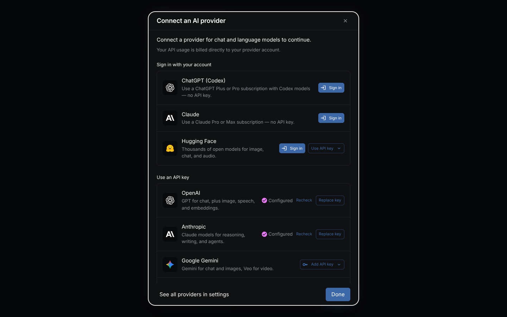
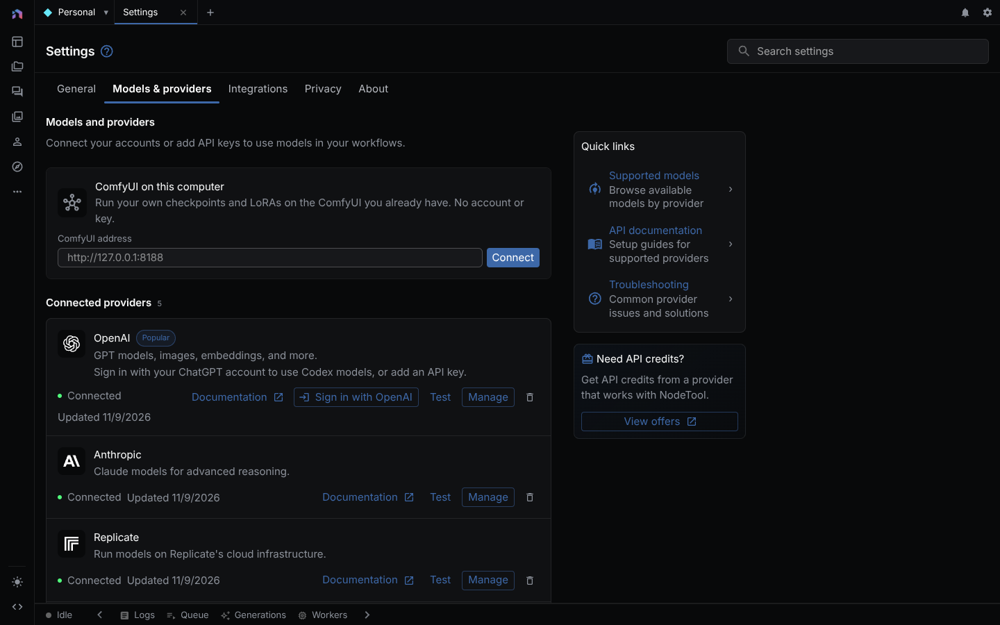
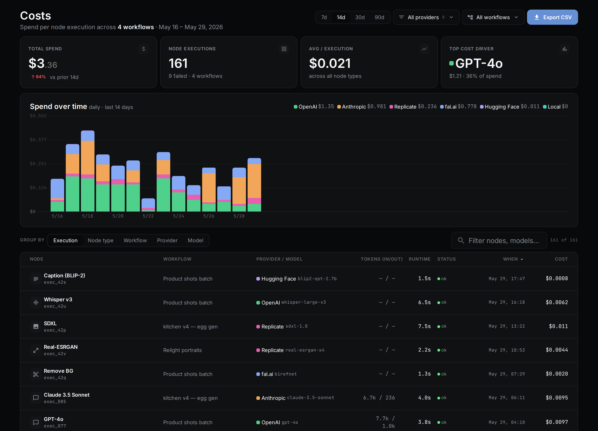

> **Runs:** cloud for API providers, local for Ollama, vLLM, LM Studio, llama.cpp, Wan2GP, and Transformers.js. **Needs:** one secret per cloud provider (named in each section), none for local servers. **Billing:** the provider bills you directly with no NodeTool markup. Only the `nodetool` provider, which exists in NodeTool's hosted cloud, is the exception (see [NodeTool managed models](#nodetool-managed-models)).
{: .callout-note}

Add keys in **Settings → Models & Providers**. See [Models & Providers](models-and-providers.md) for local versus cloud and [Supported Models](models.md) for the catalog.

## Capability matrix

Checked against each provider's implementation in `packages/runtime/src/providers/`. A blank cell means the provider doesn't expose the modality through NodeTool's generic nodes.

| Provider | Text | Image | Video | TTS | ASR | Embeddings | 3D |
|---|:---:|:---:|:---:|:---:|:---:|:---:|:---:|
| OpenAI | ✅ | ✅ | ✅ | ✅ | ✅ | ✅ | |
| Anthropic | ✅ | | | | | | |
| Azure OpenAI | ✅ | ✅ | | ✅ | ✅ | ✅ | |
| Amazon Bedrock | ✅ | ✅ | | | | | |
| Google Gemini | ✅ | ✅ | ✅ | ✅ | ✅ | ✅ | |
| Gemini (Google Cloud) | ✅ | ✅ | ✅ | ✅ | ✅ | ✅ | |
| xAI (Grok) | ✅ | ✅ | ✅ | | | | |
| DeepSeek | ✅ | | | | | | |
| Groq | ✅ | | | | | | |
| Mistral | ✅ | | | | | ✅ | |
| Cerebras | ✅ | | | | | | |
| Alibaba Cloud | ✅ | ✅ | ✅ | ✅ | | | |
| BytePlus | ✅ | ✅ | ✅ | | | | |
| GMI Cloud | ✅ | | | | | | |
| OpenRouter | ✅ | ✅ | ✅ | ✅ | ✅ | ✅ | |
| Requesty | ✅ | | | | | | |
| Opper | ✅ | | | | | | |
| Cheaper Inference | ✅ | | | | | | |
| API Route | ✅ | | | | | | |
| Runcrate | ✅ | | | | | | |
| Standard Compute | ✅ | | | | | | |
| UberLLM | ✅ | ✅ | | | | | |
| Together AI | ✅ | ✅ | ✅ | ✅ | ✅ | ✅ | |
| Moonshot (Kimi) | ✅ | | | | | | |
| Sarvam AI | ✅ | | | ✅ | ✅ | | |
| Meta AI | ✅ | ✅ | | | ✅ | | |
| MiniMax | ✅ | ✅ | ✅ | ✅ | | | |
| Z.ai | ✅ | ✅ | ✅ | | ✅ | | |
| Codex (Sign in with ChatGPT) | ✅ | ✅ | | | | | |
| Claude Agent SDK | ✅ | | | | | | |
| Antigravity | ✅ | ✅ | | | | | |
| GitHub Copilot | ✅ | | | | | | |
| Evolink | ✅ | ✅ | ✅ | | | | |
| kie.ai | ✅¹ | ✅ | ✅ | ✅ | | | |
| AKI | ✅ | ✅ | | | | | |
| Higgsfield | | ✅ | ✅ | | | | |
| UseAPI | | ✅ | ✅ | | | | |
| vgenv | | | ✅ | | | | |
| ToAPIs | | ✅ | ✅ | | | | |
| Kling AI | | ✅ | ✅ | | | | |
| Replicate | ✅ | ✅ | ✅ | ✅ | ✅ | ✅ | |
| FAL | ✅ | ✅ | ✅ | ✅ | | | |
| Comfy Cloud | | ⁵ | ⁵ | | | | |
| HuggingFace | ✅ | ✅ | ✅² | ✅ | ✅ | ✅ | |
| Ollama | ✅ | | | | | ✅ | |
| vLLM | ✅ | | | | ✅ | ✅ | |
| LM Studio | ✅ | | | | | | |
| llama.cpp | ✅ | | | | | | |
| llama.cpp local | ✅ | | | | | ✅ | |
| stable-diffusion.cpp | | ✅ | | | | | |
| Wan2GP | | ✅ | ✅ | ✅ | | | |
| Transformers.js | ✅ | | | ✅ | ✅ | ✅ | |
| ElevenLabs | | | | ✅ | ✅³ | | |
| Topaz | | ✅⁴ | | | | | |
| Reve | | ✅ | | | | | |
| AtlasCloud | | ✅ | ✅ | ✅ | ✅ | | ✅ |
| Cohere | | | | | | ✅ | |
| Voyage AI | | | | | | ✅ | |
| Jina AI | | | | | | ✅ | |
| Meshy AI | | | | | | | ✅ |
| Rodin AI | | | | | | | ✅ |

¹ Chat only for a fixed gateway list of GPT, Claude, Grok, Kimi, DeepSeek, and Gemini models (`KIE_CHAT_MODELS` in `kie-provider.ts`). Most kie.ai models are image, video, or audio.
² Text-to-video only; no image-to-video.
³ Via a dedicated Speech-to-Text node, not the generic ASR picker.
⁴ Upscale and enhancement, not text-to-image generation.
⁵ No models in the generic pickers — the Comfy API enumerates none. What comes out is whatever the ComfyUI graph you submit produces, through the `lib.comfy.RunWorkflowOnCloud` node.

### Provider capabilities

Each provider lists the operations it implements by overriding `BaseProvider.declaredCapabilities()` (`packages/runtime/src/providers/base-provider.ts`). `getCapabilities()` always adds the two chat methods, so providers with no chat models (Meshy, Rodin, Higgsfield) throw when asked to chat. Some providers declare more than the matrix shows. Video-to-video, lip sync, upscaling, and music are examples, and they surface through agent tools and dedicated nodes, not the generic pickers. To make a model usable outside the node graph (an agent, the `generate` CLI command, the generation API), implement the matching method on the provider and declare its capability. The contract test `packages/runtime/tests/providers/provider-capabilities-contract.test.ts` fails when a declared capability has no implementation or a model in the provider's catalog offers an undeclared task.

## OpenAI

OpenAI covers chat (GPT), image generation (GPT-Image), Sora 2 Pro video, TTS, Whisper transcription, and embeddings. Cloud only, keyed by `OPENAI_API_KEY`. Chat models are fetched live from the OpenAI API; image models are a maintained static list. See the [OpenAI provider guide](developer/providers/openai.md).

## Anthropic

Anthropic runs Claude chat models with tool calling and image input. Cloud only, keyed by `ANTHROPIC_API_KEY`; models are fetched live from the Anthropic API. See the [Anthropic provider guide](developer/providers/anthropic.md).

## Azure OpenAI

Azure OpenAI runs OpenAI models deployed in your own Azure OpenAI or Microsoft Foundry resource: chat, GPT Image generation and editing, TTS, Whisper transcription, and embeddings. Requests use OpenAI's wire format, so each call behaves like the OpenAI provider with the deployment name as the model. Cloud only, keyed by `AZURE_OPENAI_API_KEY` and `AZURE_OPENAI_ENDPOINT` (for example `https://<resource>.openai.azure.com`, with or without a trailing `/openai`).

Azure does not report what a deployment serves, so the models are the names in `AZURE_OPENAI_DEPLOYMENTS`, separated by commas. A name containing `image` or `dall-e` is an image model, `tts` a speech model, `whisper` or `transcribe` a transcription model, and `embedding` an embedding model. Any other name is a chat model. Add `:chat`, `:image`, `:tts`, `:asr`, or `:embedding` to a name to set its kind, for example `my-painter:image`. For custom deployment names, append `=underlying-model`, for example `speech-prod=gpt-4o-mini-tts` or `transcription-prod=whisper-1`. The underlying model controls media capabilities, including speech instructions and word timestamps, while requests still route to the deployment name. An explicit kind may precede the mapping, such as `speech-prod:tts=gpt-4o-mini-tts`. Without `AZURE_OPENAI_API_VERSION` the provider calls the v1 API at `<endpoint>/openai/v1`. Set a dated version such as `2025-04-01-preview` to use the `/openai/deployments/<name>` routes. Under the cloud profile the endpoint must be a public https host. A deployment named after its model, such as `gpt-5.5`, is priced from the Azure rates in `@pydantic/genai-prices`.

## Amazon Bedrock

Amazon Bedrock runs chat through the Converse API, which covers every Bedrock chat model: Claude, Llama, Mistral, Amazon Nova, and others. It streams text and tool calls, accepts images and documents, and passes Claude extended thinking through. Image generation runs Amazon Nova Canvas, Titan Image, and Stability models. Cloud only, keyed by an IAM access key in `BEDROCK_ACCESS_KEY_ID` and `BEDROCK_SECRET_ACCESS_KEY`, with `BEDROCK_SESSION_TOKEN` for temporary credentials. The keys are separate from the `AWS_*` variables so an S3 storage key is never used for Bedrock.

`BEDROCK_REGION` picks the region (default `us-east-1`). Models are listed from that region: on-demand foundation models plus the system-defined cross-region inference profiles such as `eu.anthropic.claude-sonnet-4-6`, which Claude needs in most regions. The IAM user needs `bedrock:ListFoundationModels`, `bedrock:ListInferenceProfiles`, `bedrock:InvokeModel`, and `bedrock:InvokeModelWithResponseStream`. Set `BEDROCK_MODEL_IDS` to a comma-separated list of model or inference profile IDs to offer only those and skip the listing calls. Costs are priced from the AWS rates in `@pydantic/genai-prices`.

## Google Gemini

Gemini handles chat with native multimodal input (images, audio, video as Blobs), Nano Banana image generation (the `gemini-*-image` models), Veo video, Gemini TTS, Lyria music, audio transcription, and text embeddings. Cloud only, keyed by `GEMINI_API_KEY`. Text models auto-fetch. The image, video, TTS, and music models are static lists. Imagen is not available because Google shut it down in the Gemini API. See the [Gemini provider guide](developer/providers/gemini.md).

## Gemini (Google Cloud)

The `gemini_vertex` provider runs the same Gemini models through Vertex AI (`aiplatform.googleapis.com`, which Google now calls Gemini Enterprise Agent Platform). Usage is billed to a Google Cloud project on its normal post-paid billing, not to an AI Studio key. Requests and features match the Gemini provider above. `GOOGLE_CLOUD_PROJECT` is required, and the project needs billing and the Vertex AI API enabled. `GOOGLE_CLOUD_LOCATION` defaults to `global`, the only location that serves preview models. Set `us`, `eu`, or a region such as `us-central1` to keep requests in one place.

The provider uses the first credential it finds:

1. `GOOGLE_VERTEX_CREDENTIALS`, a service account key file pasted as JSON. The service account needs the Vertex AI User role.
2. `GOOGLE_VERTEX_API_KEY`, a Vertex AI API key from express mode, or a Google Cloud API key bound to a service account. Key requests use the project-less publisher paths.
3. On a local or self-hosted install, the machine's Application Default Credentials: the file in `GOOGLE_APPLICATION_CREDENTIALS`, or the one `gcloud auth application-default login` writes. The cloud profile never reads these, because they would be the server's own identity.

Chat models are listed from Vertex's `publishers/google/models`. The image, video, TTS, and music lists are the Gemini provider's. Vertex has no Files API, so video or audio larger than 19 MB cannot be sent and fails with a message that says so. The `vertex` node namespace (shown as **Vertex AI**) has the same seven nodes as `gemini`, sent through this provider. Their model fields list this provider's models.

## xAI (Grok)

xAI runs Grok chat models plus Grok Imagine for text-to-video, image-to-video, and text-to-image, all classified from the same `/v1/models` response. Cloud only, keyed by `XAI_API_KEY`. See the [xAI provider guide](developer/providers/xai.md).

## DeepSeek

DeepSeek is chat only (DeepSeek-V3 and the R1 reasoning line), reached through an OpenAI-compatible endpoint. Cloud only, keyed by `DEEPSEEK_API_KEY`. See the [OpenAI-compatible providers guide](developer/providers/openai-compatible.md) for how its models are fetched.

## Groq

Groq runs chat models on its LPU inference hardware. Text only. Cloud only, keyed by `GROQ_API_KEY`. See the [OpenAI-compatible providers guide](developer/providers/openai-compatible.md).

## Mistral

Mistral runs chat models (Mistral, Mixtral) plus one embedding model, `mistral-embed`. Cloud only, keyed by `MISTRAL_API_KEY`. See the [OpenAI-compatible providers guide](developer/providers/openai-compatible.md).

## Cerebras

Cerebras runs chat models. Text only. Cloud only, keyed by `CEREBRAS_API_KEY`. See the [OpenAI-compatible providers guide](developer/providers/openai-compatible.md).

## Alibaba Cloud

Alibaba Cloud Model Studio serves the Qwen chat models (qwen3-max, qwen-plus, qwen-flash, qwen-turbo, and the qwen3-vl vision line) with streaming and tool calling. Cloud only, keyed by `DASHSCOPE_API_KEY`, over the DashScope OpenAI-compatible endpoint (default `https://dashscope-intl.aliyuncs.com/compatible-mode/v1`, the international/Singapore region); chat models are fetched live from its `/models` endpoint. Model Studio keys are region-scoped. Set `DASHSCOPE_BASE_URL` to your region's `/compatible-mode/v1` endpoint when the key was created outside Singapore. Tool calling is gated per model family: Qwen-Math, QVQ, OCR, translation, and audio models are outside Alibaba's function-calling list and are not sent tools. Get a key at [Model Studio](https://modelstudio.console.alibabacloud.com/). See the [OpenAI-compatible providers guide](developer/providers/openai-compatible.md).

The same key generates media through DashScope's native API, on the same regional host with `/api/v1` in place of `/compatible-mode/v1`:

- **Video:** Wan text-to-video (`wan2.7-t2v`, `wan2.6-t2v`, `wan2.5-t2v-preview`) and image-to-video (`wan2.7-i2v` with an optional last frame, `wan2.6-i2v`, `wan2.6-i2v-flash`, `wan2.5-i2v-preview`). Each clip is an async task that NodeTool polls every 15 seconds and downloads when it finishes. Clips take 1 to 5 minutes.
- **Image:** Qwen-Image 3.0, 2.1 and 2.0, Wan 2.7 Image and Wan 2.6 text-to-image. Qwen-Image 3.0 and 2.1 and Wan 2.7 Image also edit from input images.
- **TTS:** `qwen3-tts-flash` with its 48 system voices. Output is 24 kHz WAV, capped at 600 characters per request.

Media models are listed by hand because Model Studio has no listing endpoint that says which models generate video, images or speech. Not every model is offered in every region. Check the Model Studio console for your region.

## BytePlus

BytePlus ModelArk runs Seed chat models, Seedream image generation and editing, and Seedance text-to-video and image-to-video. Cloud only, keyed by `BYTEPLUS_ARK_API_KEY`.

- **Chat.** Requests go to Ark's OpenAI-compatible `/chat/completions` with streaming and tool calling. The picker reads `GET /models` and keeps rows whose output modalities include text. When the listing fails or comes back empty, it falls back to a short built-in list of Seed models.
- **Images.** Seedream 5.0 Pro, 5.0, 5.0 Lite, 4.5, and 4.0 run on `/images/generations`. Image-to-image sends up to 10 reference images to 5.0 Pro and up to 14 to the others. An aspect ratio becomes a pixel size at the chosen resolution tier, kept inside the model's documented pixel range. Output has no watermark.
- **Video.** Seedance 2.5, 2.0, 2.0 Fast, 2.0 Mini, 1.5 Pro, 1.0 Pro, and 1.0 Pro Fast run as tasks: NodeTool creates one on `/contents/generations/tasks` and polls it until it succeeds, fails, or expires. Image-to-video takes a first frame and, on every model except 1.0 Pro Fast, an optional last frame.

The default endpoint is `https://ark.ap-southeast.bytepluses.com/api/v3`. Ark keys work in one region only, so set `BYTEPLUS_ARK_BASE_URL` to your region's `/api/v3` endpoint when the key belongs to another region. Seed speech and transcription need a separate voice key and are not wired. Get a key in the [ModelArk console](https://console.byteplus.com/ark). See the [ModelArk docs](https://docs.byteplus.com/en/docs/ModelArk/).

## GMI Cloud

GMI Cloud is an OpenAI-compatible chat endpoint for open-weight models (Llama, DeepSeek, and Qwen variants). Text only. Cloud only, keyed by `GMI_API_KEY`.

## OpenRouter

OpenRouter proxies 300+ chat models, image generation, Gemini image editing, and text-to-video and image-to-video models (Veo, Seedance, Kling, Wan) through one key. Reference-to-video is not supported because OpenRouter accepts reference media only as public HTTPS URLs. Cloud only, keyed by `OPENROUTER_API_KEY`. See the [OpenAI-compatible providers guide](developer/providers/openai-compatible.md).

## Requesty

Requesty routes chat models from OpenAI, Anthropic, Google, DeepSeek, xAI and others through one OpenAI-compatible endpoint, `https://router.requesty.ai/v1`. Text only. Cloud only, keyed by `REQUESTY_API_KEY`. The model picker lists the managed models from `/v1/models/managed` (short ids such as `gpt-5.4-mini`) followed by the full `vendor/model` catalog from `/v1/models` (for example `openai/gpt-4o-mini`). Get a key at [Requesty](https://app.requesty.ai/api-keys). See the [OpenAI-compatible providers guide](developer/providers/openai-compatible.md).

## API Route

API Route serves hosted chat models through `https://global.api-route.com/v1`. Set `API_ROUTE_API_KEY` in Settings > API Keys or the environment. The model picker reads `/v1/models`, keeps OpenAI-compatible routes, and uses the shared model classifier to exclude image/video entries by metadata or model ID. Chat IDs without endpoint metadata remain available for older catalogs. This integration exposes text chat and tool calls. Get a key at [API Route](https://www.api-route.com/api-keys), then select a model available to that key. API Route is a paid service. See its [setup guide](https://www.api-route.com/docs/quickstart) and [pricing](https://www.api-route.com/pricing).

## Runcrate

Runcrate serves open-weight chat models (DeepSeek, Qwen, GLM, Kimi, gpt-oss and others) through one OpenAI-compatible endpoint, `https://api.runcrate.ai/v1`. Text only. Cloud only, keyed by `RUNCRATE_API_KEY`. The model picker reads `/v1/models` and keeps the rows whose `input_modalities` and `output_modalities` both include `text`, so embedding, image, video and speech models stay out. Tool calling follows each row's `supported_features`, and the context window comes from its `context_length`. Get a key at [Runcrate](https://runcrate.ai/dashboard/api-keys). See the [Runcrate docs](https://runcrate.ai/docs/models/overview) and the [OpenAI-compatible providers guide](developer/providers/openai-compatible.md).

## Standard Compute

Standard Compute serves open and frontier chat models through one OpenAI-compatible endpoint, `https://api.stdcmpt.com/v1`. Text only. Cloud only, keyed by `STANDARDCOMPUTE_API_KEY`. The default model, `StandardCompute`, is routed: each request goes to the cheapest enabled model that can handle it, with automatic fallback. The model picker reads `/v1/models`, which also lists model ids a request can pin, and uses the shared model classifier to keep chat rows. Tool calling follows each row's `supported_parameters`, and the context window comes from its `context_length`. Get a key at [Standard Compute](https://standardcompute.com/dashboard/api-keys). See the [Standard Compute docs](https://docs.standardcompute.com) and the [OpenAI-compatible providers guide](developer/providers/openai-compatible.md).

## UberLLM

UberLLM serves chat models (Claude, GPT, Gemini, DeepSeek, Qwen, GLM, Kimi and others) and image models through one OpenAI-compatible endpoint, `https://api.uberllm.dev/v1`, on one key. Cloud only, keyed by `UBERLLM_API_KEY`. The chat picker reads `/v1/models` and uses the shared model classifier to keep chat rows; tool calling follows each row's `supported_parameters`, and the context window comes from its `context_length`. The image picker reads `/v1/models?type=image` and keeps the models served on `/v1/images/generations`, which back the generic text-to-image nodes. Prices are per request from prepaid credit, listed per model at [uberllm.dev/models](https://uberllm.dev/models). Get a key at [UberLLM](https://uberllm.dev/signup). See the [UberLLM docs](https://uberllm.dev/docs) and the [OpenAI-compatible providers guide](developer/providers/openai-compatible.md).

## Opper

Opper is an EU-hosted AI gateway that routes chat models from 50+ providers, including OpenAI, Anthropic, Google, DeepSeek and Moonshot, through one OpenAI-compatible endpoint, `https://api.opper.ai/v3/compat`. Text only. Cloud only, keyed by `OPPER_API_KEY`. The model picker lists Opper's pools from `/v3/compat/models?type=pool` (bare ids such as `claude-sonnet-4-6`, routed across providers) followed by the full catalog from `/v3/compat/models`, which adds `provider/model` ids that pin one route. Get a key at [Opper](https://platform.opper.ai). See the [OpenAI-compatible providers guide](developer/providers/openai-compatible.md).

## Cheaper Inference

Cheaper Inference is an AI gateway that routes chat models from several providers through one OpenAI-compatible endpoint, `https://api.cheaperinference.com/v1`. Text only. Cloud only, keyed by `CHEAPER_INFERENCE_API_KEY`. The model picker reads `/v1/models` and keeps rows whose `type` is `text`, so image and video rows in the same listing are dropped. Get a key at [Cheaper Inference](https://cheaperinference.com/signup). See the [OpenAI-compatible providers guide](developer/providers/openai-compatible.md).

## Together AI

Together AI covers chat, manifest-driven image and video generation, TTS (Orpheus, Kokoro, Cartesia Sonic), ASR (Whisper Large v3, Voxtral, Parakeet), and one embedding model. Cloud only, keyed by `TOGETHER_API_KEY`. See the [Together provider guide](developer/providers/together.md).

## Moonshot (Kimi)

Moonshot runs Kimi chat models over its OpenAI-compatible endpoint (`https://api.moonshot.ai/v1`). Text only. Cloud only, keyed by `KIMI_API_KEY`. See the [OpenAI-compatible providers guide](developer/providers/openai-compatible.md).

## Sarvam AI

Sarvam AI covers chat, text-to-speech, and speech-to-text in Indian languages. Cloud only, keyed by `SARVAM_API_KEY`, which every request sends in the `api-subscription-key` header.

- **Chat** runs Token Factory models (Sarvam 105B, GLM, Gemma, DeepSeek, and others) over the OpenAI-compatible endpoint `https://api.sarvam.ai/v2`. The model list comes from `GET /v2/models`, so Provisioned Throughput models appear only for organizations that have them.
- **Text-to-speech** runs the Bulbul models `bulbul:v4-flash`, `bulbul:v3`, and `bulbul:v2` in 11 languages (`hi-IN`, `en-IN`, `bn-IN`, `ta-IN`, `te-IN`, `kn-IN`, `ml-IN`, `mr-IN`, `gu-IN`, `pa-IN`, `od-IN`). Each model lists its own speakers, and v4-flash personas are named `<name>_<language>_<style>`, such as `ritu_hi_kids`. With no language set, the provider picks one from the text's script, then from a v4-flash speaker's language, then falls back to `en-IN`. Output is WAV by default, or MP3, FLAC, or AAC when requested. Each request takes up to 2,500 characters on v3 and v4-flash and 1,500 on v2.
- **Speech-to-text** runs `saaras:v4` and `saaras:v3` through the REST endpoint, which takes clips under 30 seconds in 22 Indian languages plus English. Leave the language empty to auto-detect it. Timestamps come back per sentence or phrase, not per word.

Sarvam's translation, transliteration, and batch speech-to-text APIs are not wired into NodeTool.

## MiniMax

MiniMax covers chat, image (Image-01), video (Hailuo 2.3), TTS, and music generation. ASR and embeddings exist in MiniMax's API but are disabled in NodeTool's provider (embeddings need a GroupId NodeTool doesn't manage). Use another provider for those. Cloud only, keyed by `MINIMAX_API_KEY`. See the [MiniMax provider guide](developer/providers/minimax.md).

## Z.ai

Z.ai (Zhipu) serves its GLM models over an OpenAI-compatible API at `https://api.z.ai/api/paas/v4`. Cloud only, keyed by `ZAI_API_KEY`. Set `ZAI_REGION` to `china` to use the mainland host `https://open.bigmodel.cn/api/paas/v4` instead. Keys from one host do not work on the other.

- **Chat.** GLM-5.3, 5.2, 5.1, 5, 4.7 and 4.6 take text. GLM-5.3-Flash, FlashX and FlashX-Legal also read images. Streaming, tool calling and reasoning text are supported. Z.ai has no model-listing endpoint, so the list is copied from the API reference.
- **Image.** GLM-Image text-to-image. NodeTool snaps the requested shape to the nearest of Z.ai's seven recommended sizes.
- **Video.** CogVideoX-3 text-to-video and image-to-video with a first and optional last frame, 5 or 10 seconds, at 16:9, 9:16 or 1:1 up to 4K for 16:9. Each video is an asynchronous task that NodeTool polls, then downloads. A stopped run stops waiting, but the task still finishes and is billed.
- **Speech to text.** GLM-ASR-2512 transcribes WAV or MP3 files up to 25 MB and 30 seconds.

## Meta AI

Meta AI serves the Muse family at `https://api.meta.ai/v1`. Cloud only, keyed by `META_API_KEY`.

- **Chat.** Muse Spark runs on Meta's Responses API with tool calling. A `web_search` tool is answered by Meta's hosted search grounding, and tools marked `deferLoading` are loaded on demand by Meta's hosted tool search. Messages can carry images, video and audio, which Muse Spark reads natively. If the model list cannot be fetched, the picker falls back to four built-in Muse Spark ids.
- **Images.** Muse Image (`muse-image-1.0`) generates and edits images, with up to 10 source images per edit.
- **Speech to text.** Muse Voice Transcribe (`muse-voice-transcribe-1.0`) returns the transcript and timed turns. Audio that is not mono 16-bit WAV at 16 or 24 kHz is converted in process first. It has no word-level timestamps.
- **Segmentation.** SAM 3.1 (`sam-3.1`) segments an image from a short noun phrase, a box, or points, and returns one full-frame mask per object.

## Codex (Sign in with ChatGPT)

The `codex` provider runs GPT models on your ChatGPT plan instead of an API key, and usage counts against that plan. Sign in with the **ChatGPT** card in Settings → Models & Providers. NodeTool follows OpenAI's [Sign in with ChatGPT](https://developers.openai.com/cookbook/articles/sign-in-with-chatgpt) flow: the first sign-in registers NodeTool as an app on your ChatGPT account, and you approve plan usage on the consent screen. Requests go to the public Responses API (`https://api.openai.com/v1/responses`), and the model list comes from `GET /v1/models` for the signed-in account. The provider reads the stored `CODEX_ACCESS_TOKEN`, so no `OPENAI_API_KEY` is needed.

The plan token reaches only the Responses API, so the `codex` node namespace has Web Search and Create Image. Embeddings, moderation, speech, transcription, translation, and realtime nodes need an API key and stay in `openai`. When you reach your plan's usage limit, the error links to [ChatGPT usage settings](https://chatgpt.com/settings/usage). Disconnecting revokes the sign-in. You can also remove NodeTool from ChatGPT's connected apps. Sign-ins made with the earlier Codex CLI login no longer work, so sign in again once.

## Claude Agent SDK

Claude Agent SDK reaches Claude by running your local, logged-in `claude` CLI in headless mode instead of calling the Anthropic API directly, billing against your Claude subscription rather than per-token API spend. Install [Claude Code](https://claude.com/claude-code) first. NodeTool finds `claude` on your PATH or in the usual install locations, or set **CLAUDE_CLI_PATH** in Settings → Integrations to point at it. It supports tool calls, which run inside NodeTool while the CLI drives the loop. Images in the prompt are forwarded when they are inline PNG, JPEG, GIF, or WebP data. A remote image URL is rejected, so resolve media references before the call. There is no API key. Sign in with the **Claude Code** card in Settings → Models & Providers or run `nodetool auth claude login` (add `--manual` on a headless host). The provider is not available in NodeTool's hosted cloud because it needs a local executable. The `claude_code` node namespace has Web Search, which uses the CLI's own web search. The `anthropic` namespace has the same node on an API key. See the [Anthropic provider guide](developer/providers/anthropic.md).

## Antigravity

Antigravity reaches the models in Google's Antigravity CLI (`agy`), including Gemini, by running the CLI in [headless mode](https://antigravity.google/docs/cli/headless/) on your signed-in Antigravity account. There is no API key. In a local NodeTool instance, open **Settings → Models & providers → Antigravity** and select **Install Antigravity**. After installation, copy the sign-in command into a terminal, complete Google sign-in, and select **Refresh models**. NodeTool prefers its [managed CLI installation](https://github.com/nodetool-ai/nodetool/blob/main/packages/antigravity-cli/README.md), stored under its data directory. It falls back to `agy` on PATH and also searches `~/.local/bin`, where the official installer puts it. The model list is whatever `agy models` prints, and effort is part of each model id (for example `gemini-3.1-pro-high`).

Each turn spawns `agy` in an empty scratch directory under the system temp folder, so the CLI's own file tools cannot touch your files. Shell commands stay blocked because NodeTool never passes `--dangerously-skip-permissions`. Prompts must be text: a message with images fails instead of losing them. A turn that offers NodeTool tools runs on `agy acp`, the CLI's Agent Client Protocol server, where the tools are served as an MCP server on a loopback port with a per-turn bearer token. NodeTool approves only those tools there, and denies the CLI's shell and file tools. A forced single tool call (structured output) uses the CLI's `--json-schema`. Other follow-up turns in a chat resume the same Antigravity conversation with `--conversation`. Image generation also runs on `agy acp`: the provider starts the CLI's `image-generator` subagent and waits for the image file it saves, which takes tens of seconds. The provider is not available in NodeTool's hosted cloud because it needs a local executable.

## GitHub Copilot

GitHub Copilot reaches the models your Copilot account offers by running the GitHub Copilot CLI (`copilot`) over its Agent Client Protocol server (`copilot --acp`). There is no API key. Install the CLI (`npm install -g @github/copilot`), then run `copilot login` once in a terminal. The model list comes from your account, and `auto` lets Copilot pick.

Each turn runs in an empty scratch directory under the system temp folder. NodeTool starts the CLI with `--deny-tool` rules for its shell, file read and write, URL and memory tools, and with its built-in GitHub MCP servers disabled, so the CLI can reach only the tools NodeTool offers. Those tools are served to the CLI as an HTTP MCP server on a loopback port, protected by a random bearer token that lives for one turn. A forced single tool call (structured output) is offered as that tool and returned from the call. Prompts must be text, and each turn starts a fresh session primed with the conversation so far. Copilot does not generate images in this provider.

## Evolink

Evolink is an OpenAI/Anthropic-compatible gateway for GPT, Claude, Gemini, and DeepSeek chat, plus image (GPT Image 2, Nano Banana 2, Seedream) and video (Seedance, Wan, Veo, Sora, Grok) generation. Cloud only, keyed by `EVOLINK_API_KEY`.

## kie.ai

kie.ai is a multi-model aggregator: manifest-driven image, video, TTS, and music models (Seedance, Runway, Wan, Kling, FLUX.2, Suno, and more), plus chat for a fixed list of gateway models (GPT, Claude, Grok, Kimi, DeepSeek, and Gemini families). Cloud only, keyed by `KIE_API_KEY`. See the [KIE provider guide](developer/providers/kie.md).

## AKI

AKI is an OpenAI-compatible gateway for chat plus text-to-image and image-to-image generation. Cloud only, keyed by `AKI_API_KEY`.

## Higgsfield

Higgsfield generates image and video from a manifest of models (text-to-image, image-to-image, text-to-video, image-to-video, reference-to-video, video-to-video, extend). No chat. Cloud only. It needs two secrets, `HIGGSFIELD_API_KEY_ID` and `HIGGSFIELD_API_KEY_SECRET`. The Higgsfield card in Settings accepts them as one pasted `key-id:secret` value.

## UseAPI

UseAPI generates image and video through your own Google Flow and Dreamina accounts on useapi.net: Nano Banana and Veo models through Google Flow, Seedream, Seedance, and Sora 2 through Dreamina. No chat. Cloud only, keyed by `USEAPI_API_TOKEN`. Set `USEAPI_GOOGLE_FLOW_EMAIL` (Google Flow account email) and `USEAPI_DREAMINA_ACCOUNT` (`region:email`) so reference image uploads use the right account.

## vgenv

vgenv is an independent API for MiniMax H3 video, not affiliated with MiniMax. It runs text-to-video, image-to-video with a first and optional last frame, and reference-to-video with up to nine ordered images. Models are the Fast, Standard, Enhanced, and Quality tiers at 480p or 768p, 4 to 15 seconds. Prompts are sent as written, with vgenv's prompt rewriting turned off. No chat. Cloud only, keyed by `VGENV_API_KEY`. vgenv bills each video from a prepaid balance at creation and releases the hold when a preparing or queued job is cancelled or the platform fails it. NodeTool cancels the job when a run is stopped or times out.

## ToAPIs

ToAPIs (toapis.com) is an independent API gateway for third-party image and video models. NodeTool uses it for GPT Image 2, GPT Image 2 VIP, and GPT Image 2.5 Flare and Sunburst (text-to-image and image-to-image at 1K, 2K, or 4K) and for Seedance 2, Seedance 2 Fast, and Seedance 2 Mini (text-to-video, image-to-video with a first and optional last frame, and reference-to-video with up to nine images, 4 to 15 seconds). Input images are uploaded to ToAPIs first, because its image models take URLs only. Every generation is an asynchronous task that NodeTool polls, then downloads within the 24-hour result window. ToAPIs has no cancel endpoint, so a stopped run stops waiting but the task still finishes and is billed. No chat. Cloud only, keyed by `TOAPIS_API_KEY`.

## Kling AI

The `kling` provider calls Kling AI (Kuaishou) directly at its global endpoint, `api-singapore.klingai.com`. Video covers Kling 4.0, 4.0 Flash, 3.0 Turbo, 3.0, 3.0 Omni, O1, and 2.6, each for text-to-video and image-to-video. Kling 4.0, 3.0, 3.0 Omni, O1, and 2.6 also take a last frame. Images cover Kling Image 3.0 (`kling-v3`), Image 3.0 Omni (`kling-v3-omni`), and Image O1 (`kling-image-o1`), for text-to-image and image-to-image. Image 3.0 takes one reference image and the two omni models take up to ten. Kling has no model listing endpoint, so these models are a static list kept in `kling-provider.ts`. Every generation is an asynchronous task that NodeTool polls, then downloads. Kling keeps results for 30 days. Kling has no cancel endpoint, so a stopped run stops waiting but the task still finishes and is billed. No chat. Cloud only, keyed by `KLING_API_KEY`, an API key from the Kling AI console. The older Access Key and Secret Key pair is not supported, because Kling's newer video endpoints accept only API keys. Kling models are also reachable through kie.ai and other gateways, which use their own keys.

## Replicate

Replicate runs chat, image, video, and music, plus curated TTS, ASR, and embedding models. Chat calls `replicate.run()`/`.stream()` on whatever model id you pass, so it isn't limited to a fixed model list the way most other providers are; image, video, and music nodes are generated from Replicate's schemas. Cloud only, keyed by `REPLICATE_API_TOKEN`. See the [Replicate provider guide](developer/providers/replicate.md).

## FAL

FAL generates image, video, TTS, and music from models whose nodes are generated straight from FAL's OpenAPI schemas. Chat goes through fal's OpenAI-compatible route, which is OpenRouter's router, so chat model ids are OpenRouter's catalog. Cloud only, keyed by `FAL_API_KEY` (`FAL_KEY` also works). See the [FAL provider guide](developer/providers/fal.md).

## Comfy Cloud

Comfy Cloud runs a ComfyUI workflow graph on cloud.comfy.org, with no local ComfyUI install or GPU. It is reached through the `lib.comfy.RunWorkflowOnCloud` node rather than a model dropdown: the graph you paste in names its own checkpoints and LoRAs, so the provider lists no models and doesn't appear in the generic image or video pickers. Cloud only, keyed by `COMFY_API_KEY` from https://platform.comfy.org. The same key also authenticates partner API nodes inside the submitted graph. See [ComfyUI](comfyui.md).

## HuggingFace

HuggingFace routes chat, image, text-to-video, TTS, ASR, and embeddings to Hugging Face Inference Providers. The model lists are the most-liked warm inference models for each task, fetched from the Hub and cached for 10 minutes. Tool calling is off for this provider. A `HF_TOKEN` is required: paste a token with the Inference Providers permission into the HuggingFace card, or set `HF_TOKEN` in the environment. The 19 `huggingface.*` task nodes use the same token. See [HuggingFace Integration](huggingface.md).

## Ollama

Ollama runs chat and embedding models locally, with no API key and no per-token cost. It is a separate program: install it from [ollama.com](https://ollama.com) and keep it running, because NodeTool does not ship or start it. Pull a model with `ollama pull <model>` and it appears in NodeTool. The server URL comes from `OLLAMA_API_URL` (default `http://127.0.0.1:11434`), set in **Settings → Integrations → Local Model Servers** or the environment. `OLLAMA_CONTEXT_LENGTH` and `OLLAMA_KEEP_ALIVE` are in [Configuration](configuration.md#environment-variables-index). See the [Ollama provider guide](developer/providers/ollama.md).

## vLLM

vLLM points NodeTool at a self-hosted, OpenAI-compatible vLLM server for chat, embeddings (`/v1/embeddings`), and transcription (`/v1/audio/transcriptions`). Models appear from its `/v1/models` endpoint once the URL is set. `/v1/models` does not report a model's task, so every served model is offered for each task and the server rejects an unsupported call. Set `VLLM_BASE_URL` (no default) and `VLLM_API_KEY` if your deployment requires one. See [Local Inference](developer/providers/local-inference.md).

## LM Studio

LM Studio connects to the local server that LM Studio's desktop app exposes. Enable it in LM Studio → Local Server and NodeTool picks up loaded models automatically. The default URL is `http://127.0.0.1:1234`, overridden with `LMSTUDIO_API_URL`. `LMSTUDIO_API_KEY` is optional. See [Local Inference](developer/providers/local-inference.md).

## llama.cpp

llama.cpp points NodeTool at a local `llama-server` instance for chat. `llama-server` constrains generation with a grammar built from the tool schemas, so tool calling works for any model it serves. Set `LLAMA_CPP_URL` (required, no default). See [Local Inference](developer/providers/local-inference.md).

## llama.cpp local

llama.cpp local (provider id `node_llama_cpp`) runs GGUF models inside the NodeTool backend through the `node-llama-cpp` binding, with no separate server. It serves chat and embeddings. Models are GGUF files in `NODE_LLAMA_CPP_MODELS_DIR`, which defaults to the shared llama.cpp cache, and the Hugging Face hub cache. `MODEL_FOLDERS` in **Settings › Folders** adds folders, such as a ComfyUI `models` folder, and their subfolders. Every GGUF language model in them appears in the model picker. `NODE_LLAMA_CPP_GPU_BACKEND` selects `auto`, `metal`, `cuda`, `vulkan`, or `cpu`. No key. Local only.

The model picker also offers GGUF models to download: a curated list in `node-llama-cpp-models.ts`, then the trending models in `node-llama-cpp-trending.generated.ts`. A nightly workflow (`.github/workflows/gguf-trending-sync.yml`) runs `npm run sync:gguf-trending`, which reads the [trending GGUF repos](https://huggingface.co/models?library=gguf&sort=trending) and opens a PR when the list changes. It keeps chat models from the trusted publishers in `scripts/gguf/sources.json`, skips uncensored and merged variants, and picks one Q4 file of 20 GB or less from each repo. It keeps up to 50 models, one repo for each base model.

whisper.cpp (`whisper_cpp`) transcribes audio inside the backend through the
optional `@fugood/whisper.node@1.1.3` package. Install it from Package Manager.
GGML models use the Hugging Face hub cache. `WHISPER_CPP_MODELS_DIR` adds a
directory, and `WHISPER_CPP_GPU_BACKEND` selects `auto`, `metal`, `cuda`,
`vulkan`, or `cpu`. Restart the backend after changing the GPU backend.
`whisper_cpp.LiveTranscription` transcribes streaming PCM16 audio, with Silero
VAD or fixed windows when no VAD model is installed. Local only.

whisper.cpp server (`whisper_cpp_server`) posts audio to a user-run
`whisper-server` at `WHISPER_CPP_SERVER_URL`. Its model id is `default`.
It requires no native package. Local only.

## Wan2GP

Wan2GP (provider id `wangp`) generates video, images, speech and music with
[Wan2GP](wan2gp.md) over MCP: text-to-video, image-to-video,
reference-to-video, text-to-image, image-to-image, text-to-speech (with
voice cloning on the models that take a reference voice) and text-to-music. Install it in
**Settings › Packages**, or run `nodetool runtime add wan2gp`. NodeTool then
starts its server on demand, and the model picker downloads each model's
weights through Wan2GP's own downloader. `WAN2GP_MCP_URL` names a server you
run instead. The model list is the server's own. Local only.

## stable-diffusion.cpp

stable-diffusion.cpp (provider id `stable_diffusion_cpp`) generates images locally: text-to-image and image-to-image. It starts the `sd-server` binary from the `sd-cpp` runtime package on the first generation and keeps it running while the same model is in use. Install the package in **Settings › Packages**, or run `nodetool runtime add sd-cpp`. `SD_CPP_SERVER_PATH` selects another `sd-server`. The model picker offers each model with a Download button. A model can load files from several Hugging Face repositories, and one click downloads all of them into the Hugging Face cache. Text encoders and VAEs that several models share download once.

`MODEL_FOLDERS` in **Settings › Folders** adds the single-file checkpoints in a folder and its subfolders, such as a ComfyUI `models` folder. A checkpoint qualifies when its `.safetensors` file holds the diffusion model, the VAE and the text encoders: SD 1.x and 2.x, SDXL, and SD3 or FLUX.1 files that bundle their encoders. LoRAs, VAEs, and diffusion models that need separate encoders are left out. The provider reads the architecture from the tensor names and picks default steps, guidance and size for it. The model id is the file's absolute path.

The catalog is in `packages/runtime/src/providers/sdcpp-models.ts`:

- Text-to-image: SD-Turbo, Stable Diffusion 1.5 and 3.5 Medium, FLUX.1 schnell and dev, Z-Image and Z-Image Turbo, Z-Image L2P, Krea 2 Raw and Turbo, Ideogram 4, Iris 3B.
- Text-to-image and editing with a reference image: FLUX.2 dev, FLUX.2 klein 4B and 9B (distilled and base), FLUX.3 Image Klein and Klein Base, Qwen Image 2.1, LLaDA-Image Turbo.
- Editing only: FLUX.1 Kontext dev, Qwen Image Edit 2509 and 2511, LongCat Image Edit, Boogu Image Edit, Mage-Flow Edit Turbo, and the PiD 4× upscaler.

An edit model receives the source image as a reference. Other models denoise from it, controlled by `strength`. Some weights have a non-commercial license, for example FLUX.1 dev, FLUX.2 klein 9B and PiD. The macOS build needs macOS 26 or later. Windows and Linux use the Vulkan build. No key. Local only. The `lib.stable_diffusion_cpp.GenerateImage` node is separate: it calls an `sd-server` that you start yourself.

## Transformers.js

Transformers.js (provider id `transformers_js`) runs small ONNX models in-process: chat, TTS, music (MusicGen, instrumental only), ASR, and embeddings. Models download from the Hugging Face Hub on first use into `<data-dir>/transformers-js-cache`, or the directory in `TRANSFORMERS_JS_CACHE_DIR`. Tool calling is off. No key. Local only. The matching workflow nodes are the `transformers.*` nodes in [HuggingFace Integration](huggingface.md#transformersjs-nodes-local-onnx).

## Local Python providers

When the Python worker runs with the matching pack installed, it registers its own providers over the stdio bridge, such as MLX on Apple Silicon and local Hugging Face execution. Install the packs from **Package Manager → Python nodes**, or see [Python nodes without the desktop app](installation.md#python-nodes-without-the-desktop-app). With `NODETOOL_PYTHON_ON_DEMAND=true`, these providers appear only after a workflow has started the worker. The worker's `huggingface` provider appears as `huggingface-local` because the TypeScript runtime already owns the `huggingface` id for the hosted API. These providers offer image, video, TTS, music, ASR, and embedding models from the worker's pack.

## NodeTool managed models

The `nodetool` provider runs a curated model catalog on NodeTool's own platform keys and meters usage against a credit balance. It exists only in NodeTool's hosted cloud. Desktop and self-hosted installs do not register it, and they use your own keys for every provider here.

## Custom OpenAI-compatible endpoints

Any endpoint that speaks the OpenAI API can be a provider. In **Settings → Models & Providers**, use **Add endpoint** and enter a name, a slug, a base URL, and an optional API key. Chat models come from `GET <base_url>/models` unless you list ids yourself. Image models (`/images/generations`) and video models (`/videos`) are detected from the list, and you can add ids the detection misses. The provider id is `custom_<slug>`. On a server you can skip the UI and set `CUSTOM_<SLUG>_BASE_URL` and `CUSTOM_<SLUG>_API_KEY` as environment variables. See [Custom Providers](custom-providers.md) for the fields, model discovery, and editing.

## ElevenLabs

ElevenLabs covers text-to-speech, with a large static voice and model catalog, and speech-to-text, plus realtime WebSocket variants of both. Cloud only, keyed by `ELEVENLABS_API_KEY`. See the [ElevenLabs provider guide](developer/providers/elevenlabs.md).

## Topaz

Topaz enhances existing images and video (upscale, sharpen, denoise, restore) rather than generating from a prompt. Only the enhance and enhance-gen endpoints appear in the generic image-model picker; the rest (sharpen, denoise, lighting, matting, restore) are dedicated nodes. Cloud only, keyed by `TOPAZ_API_KEY`. See the [Topaz provider guide](developer/providers/topaz.md).

## Reve

Reve creates, edits, and remixes images through three dedicated nodes (`CreateImage`, `EditImage`, `RemixImage`); the runtime provider also exposes create and edit to the generic image picker. Cloud only, keyed by `REVE_API_KEY`. See the [Reve provider guide](developer/providers/reve.md).

## AtlasCloud

AtlasCloud generates image, video, speech, music, and 3D assets from a hand-maintained manifest (Seedance, GPT Image 2, Nano Banana, and more), transcribes audio, and lists chat models from its API. Cloud only, keyed by `ATLASCLOUD_API_KEY`. See the [AtlasCloud provider guide](developer/providers/atlascloud.md).

## Cohere

Cohere provides text embeddings (`embed-v4.0` and the English/multilingual v3 line). No chat and no reranking in NodeTool's current provider. Cloud only, keyed by `COHERE_API_KEY`.

## Voyage AI

Voyage AI provides text embeddings only. Cloud only, keyed by `VOYAGE_API_KEY`.

## Jina AI

Jina AI provides text embeddings only. Cloud only, keyed by `JINA_API_KEY`.

## Meshy AI

Meshy generates textured 3D meshes from text or a reference image, through the generic `nodetool.model3d.TextTo3D` / `ImageTo3D` nodes. Cloud only, keyed by `MESHY_API_KEY`.

## Rodin AI

Rodin generates 3D assets from text or a reference image, through the generic `nodetool.model3d.TextTo3D` / `ImageTo3D` nodes. Cloud only, keyed by `RODIN_API_KEY`.

## Generic nodes: provider-agnostic workflows

Nodes in the `nodetool.*` namespace take a `model` property and route to whichever provider owns that model, so switching providers is a dropdown change.

| Node | Switches between |
|---|---|
| `nodetool.agents.Agent` | Any chat provider, such as OpenAI, Anthropic, Gemini, xAI, DeepSeek, Ollama |
| `nodetool.image.TextToImage` | FLUX.2, Nano Banana 2.0, GPT Image 2, Ideogram V3, Z-Image, HuggingFace, MLX |
| `nodetool.image.ImageToImage` | HuggingFace, local servers, cloud services |
| `nodetool.video.TextToVideo` | Sora 2 Pro, Veo 3.1, Seedance 2.0, Runway, Grok Imagine, Wan 2.6, Hailuo 2.3, Kling 3.0, HuggingFace |
| `nodetool.video.ImageToVideo` | Sora 2 Pro, Veo 3.1, Seedance 2.0, Runway, Luma, Grok Imagine, Wan 2.6, Hailuo 2.3, Kling 3.0 |
| `nodetool.model3d.TextTo3D` / `ImageTo3D` | Meshy AI, Rodin AI, AtlasCloud |
| `nodetool.audio.TextToSpeech` | OpenAI TTS, ElevenLabs, HuggingFace, local TTS |
| `nodetool.text.AutomaticSpeechRecognition` | OpenAI Whisper, HuggingFace, local ASR |

A generic node drops parameters the selected provider doesn't support instead of erroring. Negative prompt, guidance scale, and seed apply mostly to diffusion-style backends, and GPT-Image and similar API-only models ignore them.

Use a provider-specific node only for controls the generic interface lacks, such as MiniMax text to speech with `emotion` and `pitch`.

## Getting keys in

When a missing provider blocks you (a model dropdown, a node warning, the getting-started checklist), NodeTool opens the **Connect an AI provider** dialog. It groups providers under **Sign in with your account** (Claude subscription, OpenAI, Hugging Face) and **Use an API key**. On desktop and localhost it also points at Ollama for running locally at no cost. A pasted key is checked against the provider before it is saved. If the provider rejects it, the dialog does not save it unless you choose to. If the provider cannot be reached, the key is saved and the dialog says it is unverified.



**Settings → Models & Providers** is the full list, grouped as Popular, Language Models, Media Generation, Gateways & Hubs, Web Search, Compute & Local, and Services & Advanced. Each configured provider has a **Test** button that calls the provider to confirm the key still works, and a **Manage** button to replace it. Codex and Claude Code offer sign-in with your account instead of a key. The dialog's ChatGPT sign-in stores a ChatGPT plan token, so it enables the `codex` provider and leaves `openai` unconfigured until you paste an API key. Claude Code sign-in is hidden on hosted deployments because it finishes on the server's own machine.



NodeTool stores every key encrypted (AES-256-GCM) in a local SQLite database, not in a plaintext config file. See [Configuration](configuration.md#secret-storage-and-master-key) for how the encryption key itself is managed.

From the CLI:

```bash
nodetool secrets store OPENAI_API_KEY   # prompts for the value, stores it encrypted
nodetool secrets list                   # list stored keys (values are never shown)
nodetool secrets get OPENAI_API_KEY     # print a stored value
```

Or set the variable directly in `.env.development.local` or your shell environment. A secret stored in the database wins over an environment variable of the same name, and the environment variable is the fallback when nothing is stored (the exceptions are `SUPABASE_URL`, `SUPABASE_KEY`, `SUPABASE_SERVICE_ROLE_KEY`, and `SERVER_AUTH_TOKEN`, where the environment wins). `FAL_KEY` is accepted in place of `FAL_API_KEY`. See [Configuration](configuration.md) for the full load order.

Local providers (Ollama, vLLM, LM Studio, llama.cpp) take a server URL instead of a key. Set `VLLM_BASE_URL`, `LLAMA_CPP_URL`, or `LMSTUDIO_API_URL` under **Settings → Integrations → Local Model Servers** or as an environment variable. Ollama reads `OLLAMA_API_URL` from the environment or the secret store. In NodeTool's hosted cloud these providers are not registered, unless the server runs with `NODETOOL_NODE_PROFILE=full`.

## If it fails

- **Missing key:** the provider throws when called, naming the secret. Examples: `OPENAI_API_KEY is required`, `CEREBRAS_API_KEY is required`, `AKI_API_KEY is not configured`, `AZURE_OPENAI_ENDPOINT is required`, and for Anthropic `Anthropic authentication is not configured (API key, auth token, credentials, config, or profile required)`. The node fails with that message.
- **Rejected key:** HTTP 401 or 403 is classified `auth`, as is a 400 that says the key is not valid (Gemini). Saving a key, or **Test** on the provider in **Settings → Models & Providers**, probes the provider's listing endpoint and reports `valid`, `invalid`, or `unverifiable` (a 429, a 5xx, a timeout, or a provider with no probe).
- **Key with no credit or quota:** a listing endpoint accepts a key on an empty account. For OpenAI, Anthropic, Gemini, DeepSeek and OpenRouter, the key check then asks about the account: DeepSeek's balance endpoint, OpenRouter's key endpoint, or a one-token request to the provider's cheapest model. It reports `no_credit`, `no_quota` or `free_tier`, and the key is saved with that warning.
- **Rate limit or quota:** HTTP 429 is classified `quota` when the provider's message names a quota (Gemini's free tier answers `limit: 0`), otherwise `rate_limit`. Replicate calls wait with backoff and honor `Retry-After` before the original error is thrown. Other providers pass the provider's message through.
- **Insufficient balance:** HTTP 402 is classified `payment`, as are OpenAI's `insufficient_quota` 429 and Anthropic's "credit balance is too low" 400.
- **Model not served:** HTTP 404, or a 400 that says the model is not found, is classified `not_found`. The web app then leaves that model out of the user's model pickers for a week, or until a key is saved or removed.
- **In chat:** a `payment`, `quota`, `auth` or `not_found` failure shows one card with the fix and a switch to another model. When the same failure repeats, the card drops Retry. The rules are `classifyProviderFailure` in `packages/protocol/src/provider-failure.ts`, shared by the server and the web app.
- **Failure report:** a failed provider call produces a `provider_call_failed` message with provider, model, operation, kind, status, and message. A cancelled run produces none.

Sources: `provider-call-failure.ts`, `credential-check.ts`, `replicate-retry.ts` in `packages/runtime/src/providers/`.

## Tracking spend

Every cloud call records its token counts and cost. The **Costs** page (`/costs`, or **Costs** under the app pages in the left panel's **More** tab) shows them over 7, 14, 30, or 90 days, grouped by execution, node type, workflow, provider, or model, so you can see which pipeline is expensive before the invoice does.



The same records are readable from the terminal: `nodetool costs summary`, `costs list` (filter with `--provider` and `--model`), `costs by-provider`, and `costs by-model`. Each takes `--json`. For estimates before a run, spend limits, and hosted credits, see [Costs and credits](costs-and-credits.md).

## Adding a new provider

Every provider is a class in `packages/runtime/src/providers/` extending `BaseProvider` (or `OpenAIProvider` / `AnthropicProvider` for OpenAI- or Anthropic-compatible APIs), registered in `provider-registry.ts` with the environment variables it needs. Follow the [Provider Guides](developer/providers/index.md) runbook for live model discovery, a hand-maintained manifest, or codegen from upstream schemas.

## See also

- [Installation](installation.md) — install NodeTool on Windows, macOS, Linux
- [Comparisons](comparisons.md) — NodeTool vs. ComfyUI, n8n, Dify, Flowise, Langflow, Weavy
- [Chat API](chat-api.md) — WebSocket API for chat interactions and provider routing
- [Global Chat](global-chat.md) and [Agent Mode](global-chat.md#agent-mode) — using providers interactively and through the planning agent
- [Workflow API](workflow-api.md) — building workflows with providers
- [Provider Guides](developer/providers/index.md) — runbooks for adding models and nodes to each provider
