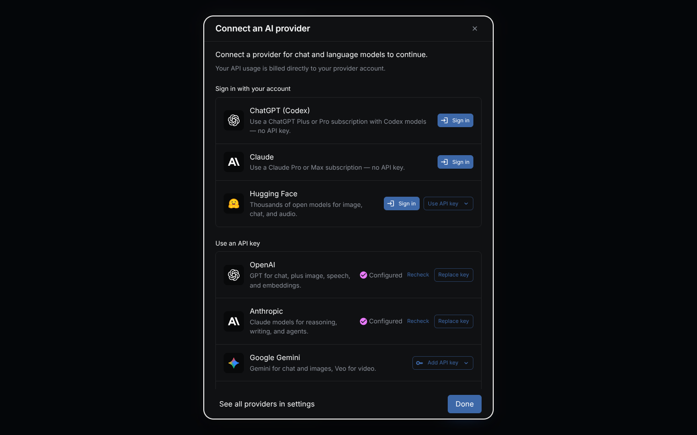
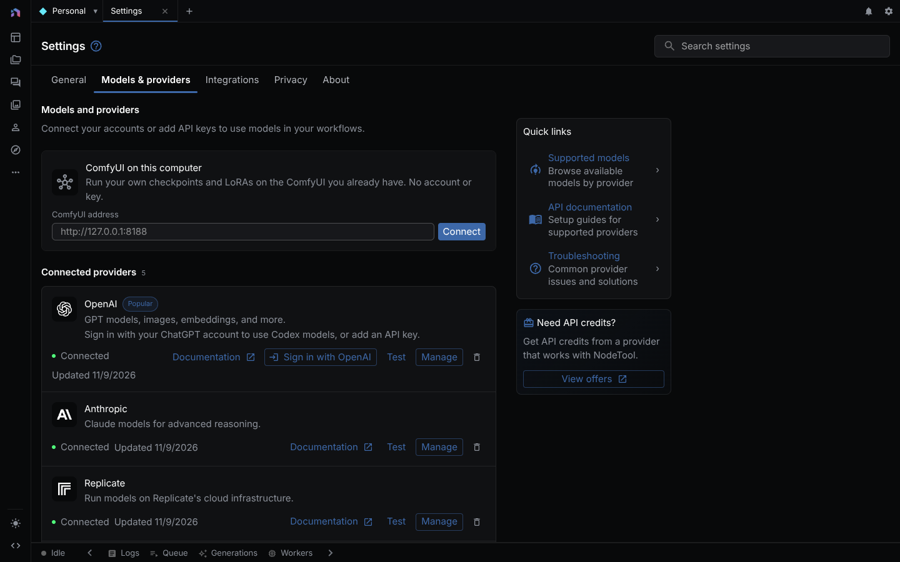
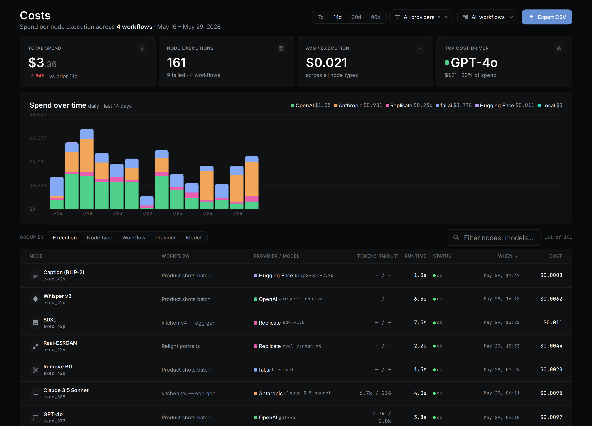

Open **Settings → Models & Providers**, find the provider, and paste its key. The provider's models then appear in every model dropdown. A **Test** button on each card checks that the key works. See [Getting keys in](#getting-keys-in) for the sign-in dialog and the command line.

> **Runs:** cloud for API providers, local for Ollama, vLLM, LM Studio, llama.cpp, ACE-Step, Wan2GP, and Transformers.js. **Needs:** one secret per cloud provider (named in each section), none for local servers. **Billing:** the provider bills you directly with no NodeTool markup. Only the `nodetool` provider, which exists in NodeTool's hosted cloud, is the exception (see [NodeTool managed models](#nodetool-managed-models)).
{: .callout-note}

[Models & Providers](models-and-providers.md) lists which models exist for each task, and [Local Models](models.md) covers what runs on your machine. This page says which key each provider needs and what it offers. Self-hosting or setting up a cloud account such as Azure, Bedrock, or Vertex AI? See [Cloud account configuration](developer/providers/index.md#cloud-account-configuration).

## Capability matrix

A blank cell means the provider does not offer that task through NodeTool's generic nodes. Providers are grouped as in [Models & Providers](models-and-providers.md#text--chat-models-llms). Find a provider by name in the group tables below.

### Major cloud providers (direct)

The company that makes the models also serves them.

| Provider | Text | Image | Video | TTS | ASR | Embeddings | 3D |
|---|:---:|:---:|:---:|:---:|:---:|:---:|:---:|
| [OpenAI](#openai) | ✅ | ✅ | ✅ | ✅ | ✅ | ✅ | |
| [Anthropic](#anthropic) | ✅ | | | | | | |
| [Azure OpenAI](#azure-openai) | ✅ | ✅ | | ✅ | ✅ | ✅ | |
| [Amazon Bedrock](#amazon-bedrock) | ✅ | ✅ | | | | | |
| [Google Gemini](#google-gemini) | ✅ | ✅ | ✅ | ✅ | ✅ | ✅ | |
| [Gemini (Google Cloud)](#gemini-google-cloud) | ✅ | ✅ | ✅ | ✅ | ✅ | ✅ | |
| [xAI (Grok)](#xai-grok) | ✅ | ✅ | ✅ | | | | |
| [DeepSeek](#deepseek) | ✅ | | | | | | |
| [Mistral](#mistral) | ✅ | | | | | ✅ | |
| [Alibaba Cloud](#alibaba-cloud) | ✅ | ✅ | ✅ | ✅ | | | |
| [BytePlus](#byteplus) | ✅ | ✅ | ✅ | | | | |
| [Moonshot (Kimi)](#moonshot-kimi) | ✅ | | | | | | |
| [Sarvam AI](#sarvam-ai) | ✅ | | | ✅ | ✅ | | |
| [MiniMax](#minimax) | ✅ | ✅ | ✅ | ✅ | | | |
| [Z.ai](#zai) | ✅ | ✅ | ✅ | | ✅ | | |
| [Meta AI](#meta-ai) | ✅ | ✅ | | | ✅ | | |

### Routers and multi-model gateways

One key reaches models from many companies.

| Provider | Text | Image | Video | TTS | ASR | Embeddings | 3D |
|---|:---:|:---:|:---:|:---:|:---:|:---:|:---:|
| [OpenRouter](#openrouter) | ✅ | ✅ | ✅ | ✅ | ✅ | ✅ | |
| [Requesty](#requesty) | ✅ | | | | | | |
| [Opper](#opper) | ✅ | | | | | | |
| [Cheaper Inference](#cheaper-inference) | ✅ | | | | | | |
| [API Route](#api-route) | ✅ | | | | | | |
| [Runcrate](#runcrate) | ✅ | | | | | | |
| [Standard Compute](#standard-compute) | ✅ | | | | | | |
| [UberLLM](#uberllm) | ✅ | ✅ | | | | | |
| [Evolink](#evolink) | ✅ | ✅ | ✅ | | | | |
| [AKI](#aki) | ✅ | ✅ | | | | | |

### Open-model hosts

These companies serve models that anyone can download, on their own servers.

| Provider | Text | Image | Video | TTS | ASR | Embeddings | 3D |
|---|:---:|:---:|:---:|:---:|:---:|:---:|:---:|
| [Groq](#groq) | ✅ | | | | | | |
| [Cerebras](#cerebras) | ✅ | | | | | | |
| [Together AI](#together-ai) | ✅ | ✅ | ✅ | ✅ | ✅ | ✅ | |
| [GMI Cloud](#gmi-cloud) | ✅ | | | | | | |
| [HuggingFace](#huggingface) | ✅ | ✅ | ✅¹ | ✅ | ✅ | ✅ | |

¹ Text-to-video only, no image-to-video.

### Subscriptions

Sign in with an account you already pay for instead of pasting an API key.

| Provider | Text | Image | Video | TTS | ASR | Embeddings | 3D |
|---|:---:|:---:|:---:|:---:|:---:|:---:|:---:|
| [Codex (OpenAI sign-in)](#codex-openai-oauth) | ✅ | ✅ | | | | | |
| [Claude Agent SDK](#claude-agent-sdk) | ✅ | | | | | | |
| [Antigravity](#antigravity) | ✅ | ✅ | | | | | |
| [GitHub Copilot](#github-copilot) | ✅ | | | | | | |

### Media specialists

Image, video, audio, 3D, and embedding services, including the aggregators that carry many media models.

| Provider | Text | Image | Video | TTS | ASR | Embeddings | 3D |
|---|:---:|:---:|:---:|:---:|:---:|:---:|:---:|
| [kie.ai](#kieai) | ✅² | ✅ | ✅ | ✅ | | | |
| [FAL](#fal) | ✅ | ✅ | ✅ | ✅ | | | |
| [Replicate](#replicate) | ✅ | ✅ | ✅ | ✅ | ✅ | ✅ | |
| [ElevenLabs](#elevenlabs) | | | | ✅ | ✅³ | | |
| [Topaz](#topaz) | | ✅⁴ | | | | | |
| [Reve](#reve) | | ✅ | | | | | |
| [AtlasCloud](#atlascloud) | | ✅ | ✅ | ✅ | ✅ | | ✅ |
| [Higgsfield](#higgsfield) | | ✅ | ✅ | | | | |
| [UseAPI](#useapi) | | ✅ | ✅ | | | | |
| [vgenv](#vgenv) | | | ✅ | | | | |
| [ToAPIs](#toapis) | | ✅ | ✅ | | | | |
| [Kling AI](#kling-ai) | | ✅ | ✅ | | | | |
| [Comfy Cloud](#comfy-cloud) | | ⁵ | ⁵ | | | | |
| [Cohere](#cohere) | | | | | | ✅ | |
| [Voyage AI](#voyage-ai) | | | | | | ✅ | |
| [Jina AI](#jina-ai) | | | | | | ✅ | |
| [Meshy AI](#meshy-ai) | | | | | | | ✅ |
| [Rodin AI](#rodin-ai) | | | | | | | ✅ |

² Chat only for a fixed list of GPT, Claude, Grok, Kimi, DeepSeek, and Gemini models. Most kie.ai models are image, video, or audio.
³ Through a dedicated Speech-to-Text node, not the generic speech recognition picker.
⁴ Upscale and enhancement, not text-to-image generation.
⁵ No models appear in the generic pickers. What comes out is whatever the ComfyUI graph you submit produces, through the **Run ComfyUI Workflow (Comfy Cloud)** node.

### Local

These run on your computer. No key and no per-use cost. See [Local Models](models.md).

| Provider | Text | Image | Video | TTS | ASR | Embeddings | 3D |
|---|:---:|:---:|:---:|:---:|:---:|:---:|:---:|
| [Ollama](#ollama) | ✅ | | | | | ✅ | |
| [vLLM](#vllm) | ✅ | | | | ✅ | ✅ | |
| [LM Studio](#lm-studio) | ✅ | | | | | | |
| [llama.cpp](#llamacpp) | ✅ | | | | | | |
| [llama.cpp local](#llamacpp-local) | ✅ | | | | | ✅ | |
| [stable-diffusion.cpp](#stable-diffusioncpp) | | ✅ | | | | | |
| [Wan2GP](#wan2gp) | | ✅ | ✅ | ✅ | | | |
| [Transformers.js](#transformersjs) | ✅ | | | ✅ | ✅ | ✅ | |

---

## Major cloud providers (direct)

### OpenAI

OpenAI covers chat (GPT), image generation (GPT Image), Sora 2 Pro video, text-to-speech, Whisper transcription, and embeddings. Cloud only, keyed by `OPENAI_API_KEY`. Chat models are fetched live from OpenAI. See the [OpenAI provider guide](developer/providers/openai.md).

### Anthropic

Anthropic runs Claude chat models with tool calling and image input. Cloud only, keyed by `ANTHROPIC_API_KEY`. Models are fetched live. See the [Anthropic provider guide](developer/providers/anthropic.md).

### Azure OpenAI

Azure OpenAI runs OpenAI models deployed in your own Azure OpenAI or Microsoft Foundry resource: chat, image generation and editing, text-to-speech, transcription, and embeddings. Cloud only, keyed by `AZURE_OPENAI_API_KEY` and `AZURE_OPENAI_ENDPOINT`. Azure does not report what a deployment serves, so list your deployment names in `AZURE_OPENAI_DEPLOYMENTS`. See [Cloud account configuration](developer/providers/index.md#azure-openai) for how to name and tag them.

### Amazon Bedrock

Amazon Bedrock runs chat for Claude, Llama, Mistral, Amazon Nova, and other models, plus image generation with Nova Canvas, Titan Image, and Stability models. Cloud only, keyed by an IAM access key in `BEDROCK_ACCESS_KEY_ID` and `BEDROCK_SECRET_ACCESS_KEY`. `BEDROCK_REGION` picks the region (default `us-east-1`). See [Cloud account configuration](developer/providers/index.md#amazon-bedrock) for permissions and model lists.

### Google Gemini

Gemini handles chat with image, audio, and video input, Nano Banana image generation, Veo video, Gemini text-to-speech, Lyria music, audio transcription, and text embeddings. Cloud only, keyed by `GEMINI_API_KEY`. Imagen is not available because Google shut it down in the Gemini API. See the [Gemini provider guide](developer/providers/gemini.md).

### Gemini (Google Cloud)

This provider (`gemini_vertex`) runs the same Gemini models through Google Cloud's Vertex AI and bills a Google Cloud project instead of an AI Studio key. It needs `GOOGLE_CLOUD_PROJECT` plus one credential, such as `GOOGLE_VERTEX_CREDENTIALS` or `GOOGLE_VERTEX_API_KEY`. See [Cloud account configuration](developer/providers/index.md#gemini-google-cloud) for locations and credential order.

### xAI (Grok)

xAI runs Grok chat models plus Grok Imagine for text-to-video, image-to-video, and text-to-image. Cloud only, keyed by `XAI_API_KEY`. See the [xAI provider guide](developer/providers/xai.md).

### DeepSeek

DeepSeek is chat only (DeepSeek-V3 and the R1 reasoning line). Cloud only, keyed by `DEEPSEEK_API_KEY`.

### Mistral

Mistral runs chat models (Mistral, Mixtral) plus one embedding model, `mistral-embed`. Cloud only, keyed by `MISTRAL_API_KEY`.

### Alibaba Cloud

Alibaba Cloud Model Studio serves the Qwen chat models, including the Qwen3-VL vision line, with streaming and tool calling. The same key generates media: Wan video, Qwen-Image and Wan image generation, and `qwen3-tts-flash` speech. Cloud only, keyed by `DASHSCOPE_API_KEY`. Get a key at [Model Studio](https://modelstudio.console.alibabacloud.com/). Keys belong to one region, and a key from the Beijing region needs `DASHSCOPE_REGION` set to `china`. Not every model is offered in every region. See [Regional endpoints](developer/providers/index.md#regional-endpoints).

### BytePlus

BytePlus ModelArk runs Seed chat models, Seedream image generation and editing, and Seedance text-to-video and image-to-video. Cloud only, keyed by `BYTEPLUS_ARK_API_KEY`. Keys work in one region only, so set `BYTEPLUS_ARK_BASE_URL` when your key belongs to another region. Seed speech and transcription are not available. Get a key in the [ModelArk console](https://console.byteplus.com/ark).

### Moonshot (Kimi)

Moonshot runs Kimi chat models. Text only. Cloud only, keyed by `KIMI_API_KEY`. Set `KIMI_REGION` to `china` for a key from platform.moonshot.cn. Keys from one platform do not work on the other.

### Sarvam AI

Sarvam AI covers chat, text-to-speech (Bulbul models), and speech-to-text (Saaras models) with a focus on Indian languages. Cloud only, keyed by `SARVAM_API_KEY`. Sarvam's translation, transliteration, and batch speech-to-text APIs are not available in NodeTool.

### MiniMax

MiniMax covers chat, image (Image-01), video (Hailuo 2.3), text-to-speech, and music generation. Speech recognition and embeddings are not available through NodeTool, so use another provider for those. Cloud only, keyed by `MINIMAX_API_KEY`. Set `MINIMAX_REGION` to `china` for a key from the mainland platform. See the [MiniMax provider guide](developer/providers/minimax.md).

### Z.ai

Z.ai (Zhipu) serves its GLM models: chat with streaming, tool calling and reasoning, GLM-Image text-to-image, CogVideoX-3 text-to-video and image-to-video, and GLM-ASR speech-to-text for WAV or MP3 files up to 25 MB and 30 seconds. Cloud only, keyed by `ZAI_API_KEY`. Set `ZAI_REGION` to `china` for the mainland host. Keys from one host do not work on the other. A stopped video run stops waiting, but the task still finishes and is billed.

### Meta AI

Meta AI serves the Muse family. Cloud only, keyed by `META_API_KEY`.

- **Chat.** Muse Spark supports tool calling, web search, and image, video, and audio input.
- **Images.** Muse Image generates and edits images, with up to 10 source images per edit.
- **Speech to text.** Muse Voice Transcribe returns the transcript and timed turns, with no word-level timestamps.
- **Segmentation.** SAM 3.1 segments an image from a short phrase, a box, or points.

## Routers and multi-model gateways

### OpenRouter

OpenRouter proxies 300+ chat models, image generation, Gemini image editing, and text-to-video and image-to-video models (Veo, Seedance, Kling, Wan) through one key. Reference-to-video is not supported. Cloud only, keyed by `OPENROUTER_API_KEY`. See the [OpenAI-compatible providers guide](developer/providers/openai-compatible.md).

### Requesty

Requesty routes chat models from OpenAI, Anthropic, Google, DeepSeek, xAI and others through one key. Text only. Cloud only, keyed by `REQUESTY_API_KEY`. Get a key at [Requesty](https://app.requesty.ai/api-keys).

### Opper

Opper is an EU-hosted gateway that routes chat models from 50+ providers, including OpenAI, Anthropic, Google, DeepSeek and Moonshot. Text only. Cloud only, keyed by `OPPER_API_KEY`. Get a key at [Opper](https://platform.opper.ai).

### Cheaper Inference

Cheaper Inference routes chat models from several providers through one key. Text only. Cloud only, keyed by `CHEAPER_INFERENCE_API_KEY`. Get a key at [Cheaper Inference](https://cheaperinference.com/signup).

### API Route

API Route serves hosted chat models with tool calling. Cloud only, keyed by `API_ROUTE_API_KEY`. It is a paid service. Get a key at [API Route](https://www.api-route.com/api-keys). See its [setup guide](https://www.api-route.com/docs/quickstart) and [pricing](https://www.api-route.com/pricing).

### Runcrate

Runcrate serves open chat models (DeepSeek, Qwen, GLM, Kimi, gpt-oss and others) through one key. Text only. Cloud only, keyed by `RUNCRATE_API_KEY`. Get a key at [Runcrate](https://runcrate.ai/dashboard/api-keys). See the [Runcrate docs](https://runcrate.ai/docs/models/overview).

### Standard Compute

Standard Compute serves open and frontier chat models. Its default model, `StandardCompute`, sends each request to the cheapest enabled model that can handle it, with automatic fallback. Text only. Cloud only, keyed by `STANDARDCOMPUTE_API_KEY`. Get a key at [Standard Compute](https://standardcompute.com/dashboard/api-keys). See the [Standard Compute docs](https://docs.standardcompute.com).

### UberLLM

UberLLM serves chat models (Claude, GPT, Gemini, DeepSeek, Qwen, GLM, Kimi and others) and image models on one key. Cloud only, keyed by `UBERLLM_API_KEY`. Prices are per request from prepaid credit, listed per model at [uberllm.dev/models](https://uberllm.dev/models). Get a key at [UberLLM](https://uberllm.dev/signup). See the [UberLLM docs](https://uberllm.dev/docs).

### Evolink

Evolink is a gateway for GPT, Claude, Gemini, and DeepSeek chat, plus image (GPT Image 2, Nano Banana 2, Seedream) and video (Seedance, Wan, Veo, Sora, Grok) generation. Cloud only, keyed by `EVOLINK_API_KEY`.

### AKI

AKI is a gateway for chat plus text-to-image and image-to-image generation. Cloud only, keyed by `AKI_API_KEY`.

## Open-model hosts

### Groq

Groq runs open chat models at high speed. Text only. Cloud only, keyed by `GROQ_API_KEY`.

### Cerebras

Cerebras runs open chat models at high speed. Text only. Cloud only, keyed by `CEREBRAS_API_KEY`.

### Together AI

Together AI covers chat, image and video generation, text-to-speech (Orpheus, Kokoro, Cartesia Sonic), speech recognition (Whisper Large v3, Voxtral, Parakeet), and one embedding model. Cloud only, keyed by `TOGETHER_API_KEY`. See the [Together provider guide](developer/providers/together.md).

### GMI Cloud

GMI Cloud serves open chat models (Llama, DeepSeek, and Qwen variants). Text only. Cloud only, keyed by `GMI_API_KEY`.

### HuggingFace

HuggingFace sends chat, image, text-to-video, speech, transcription, and embedding requests to Hugging Face Inference Providers. The model lists show popular models that a hosting partner is serving right now. Tool calling is off for this provider. A `HF_TOKEN` is required: paste a token with the Inference Providers permission into the HuggingFace card. The `huggingface.*` task nodes use the same token. See [HuggingFace Integration](huggingface.md).

## Subscriptions

### Codex (OpenAI OAuth)

Codex reaches GPT chat models and GPT Image generation through your ChatGPT sign-in instead of an API key, and usage bills against that subscription. Sign in with the **Codex** card in **Settings → Models & Providers**. No `OPENAI_API_KEY` is needed. The `codex` nodes are Web Search and Create Image. Embeddings, moderation, speech, transcription, translation, and realtime nodes need an API key and stay in `openai`.

### Claude Agent SDK

Claude Agent SDK reaches Claude through your local, signed-in Claude Code, and usage bills against your Claude subscription instead of per-token API spend. Install [Claude Code](https://claude.com/claude-code) first. NodeTool finds it automatically, or you can set **CLAUDE_CLI_PATH** in Settings → Integrations. There is no API key. Sign in with the **Claude Code** card in **Settings → Models & Providers**. It supports tool calls and inline PNG, JPEG, GIF, or WebP images. A remote image URL is rejected, so resolve media references first. It is not available in NodeTool's hosted cloud because it needs a program on your computer. See the [Anthropic provider guide](developer/providers/anthropic.md).

### Antigravity

Antigravity reaches the models in Google's Antigravity CLI, including Gemini, on your signed-in Antigravity account. There is no API key. In a local NodeTool, open **Settings → Models & providers → Antigravity** and select **Install Antigravity**. Then copy the sign-in command into a terminal, complete Google sign-in, and select **Refresh models**. The model list is whatever the CLI reports, with effort level part of each model name (for example `gemini-3.1-pro-high`). Prompts must be text, because a message with images fails. Image generation takes tens of seconds. NodeTool blocks the CLI's own shell and file tools. It is not available in NodeTool's hosted cloud.

### GitHub Copilot

GitHub Copilot reaches the models your Copilot account offers through the GitHub Copilot CLI. There is no API key. Install the CLI (`npm install -g @github/copilot`), then run `copilot login` once in a terminal. The model list comes from your account, and `auto` lets Copilot pick. Prompts must be text. Copilot does not generate images here. NodeTool blocks the CLI's shell, file, and URL tools, so the CLI reaches only the tools NodeTool offers.

## Media specialists

### kie.ai

kie.ai is a multi-model service for image, video, speech, and music models (Seedance, Runway, Wan, Kling, FLUX.2, Suno, and more), plus chat for a fixed list of GPT, Claude, Grok, Kimi, DeepSeek, and Gemini models. Cloud only, keyed by `KIE_API_KEY`. See the [KIE provider guide](developer/providers/kie.md).

### FAL

FAL generates image, video, speech, and music with models whose nodes come straight from FAL's published schemas. Chat uses OpenRouter's model catalog through your FAL key. Cloud only, keyed by `FAL_API_KEY` (`FAL_KEY` also works). See the [FAL provider guide](developer/providers/fal.md).

### Replicate

Replicate runs chat, image, video, and music, plus curated speech, transcription, and embedding models. Chat accepts any Replicate model id you type, so it is not limited to a fixed list. Cloud only, keyed by `REPLICATE_API_TOKEN`. See the [Replicate provider guide](developer/providers/replicate.md).

### ElevenLabs

ElevenLabs covers text-to-speech with a large voice and model catalog, and speech-to-text, plus realtime versions of both. Cloud only, keyed by `ELEVENLABS_API_KEY`. See the [ElevenLabs provider guide](developer/providers/elevenlabs.md).

### Topaz

Topaz enhances existing images and video (upscale, sharpen, denoise, restore) rather than generating from a prompt. Only the enhance endpoints appear in the generic image-model picker. The rest (sharpen, denoise, lighting, matting, restore) are dedicated nodes. Cloud only, keyed by `TOPAZ_API_KEY`. See the [Topaz provider guide](developer/providers/topaz.md).

### Reve

Reve creates, edits, and remixes images through three dedicated nodes: Create Image, Edit Image, and Remix Image. Create and edit also appear in the generic image picker. Cloud only, keyed by `REVE_API_KEY`. See the [Reve provider guide](developer/providers/reve.md).

### AtlasCloud

AtlasCloud generates image, video, speech, music, and 3D assets (Seedance, GPT Image 2, Nano Banana, and more), transcribes audio, and lists chat models. Cloud only, keyed by `ATLASCLOUD_API_KEY`. See the [AtlasCloud provider guide](developer/providers/atlascloud.md).

### Higgsfield

Higgsfield generates image and video: text-to-image, image-to-image, text-to-video, image-to-video, reference-to-video, video-to-video, and extend. No chat. Cloud only. It needs two secrets, `HIGGSFIELD_API_KEY_ID` and `HIGGSFIELD_API_KEY_SECRET`. The Higgsfield card in Settings accepts them as one pasted `key-id:secret` value.

### UseAPI

UseAPI generates image and video through your own Google Flow and Dreamina accounts on useapi.net: Nano Banana and Veo through Google Flow, Seedream, Seedance, and Sora 2 through Dreamina. No chat. Cloud only, keyed by `USEAPI_API_TOKEN`. Set `USEAPI_GOOGLE_FLOW_EMAIL` (Google Flow account email) and `USEAPI_DREAMINA_ACCOUNT` (`region:email`) so reference image uploads use the right account.

### vgenv

vgenv is an independent API for MiniMax H3 video, not affiliated with MiniMax. It runs text-to-video, image-to-video with a first and optional last frame, and reference-to-video with up to nine ordered images, in Fast, Standard, Enhanced, and Quality tiers at 480p or 768p and 4 to 15 seconds. Prompts are sent as written. No chat. Cloud only, keyed by `VGENV_API_KEY`. vgenv bills each video from a prepaid balance when it starts and releases the hold if the job is cancelled or fails on its side. NodeTool cancels the job when you stop a run.

### ToAPIs

ToAPIs (toapis.com) is an independent gateway for third-party image and video models: GPT Image 2 and its variants at 1K, 2K, or 4K, and Seedance 2, Seedance 2 Fast, and Seedance 2 Mini for video. Video takes a first and optional last frame, or up to nine reference images, at 4 to 15 seconds. Results stay available for 24 hours. A stopped run stops waiting, but the task still finishes and is billed. No chat. Cloud only, keyed by `TOAPIS_API_KEY`.

### Kling AI

The `kling` provider calls Kling AI (Kuaishou) directly. Video covers Kling 4.0, 4.0 Flash, 3.0 Turbo, 3.0, 3.0 Omni, O1, and 2.6 for text-to-video and image-to-video, and images cover Kling Image 3.0, Image 3.0 Omni, and Image O1. Kling keeps results for 30 days. A stopped run stops waiting, but the task still finishes and is billed. No chat. Cloud only, keyed by `KLING_API_KEY`, an API key from the Kling AI console. Set `KLING_REGION` to `china` for a mainland key. The older Access Key and Secret Key pair is not supported. Kling models are also reachable through kie.ai and other gateways, which use their own keys.

### Comfy Cloud

Comfy Cloud runs a ComfyUI workflow on cloud.comfy.org, with no local ComfyUI install or GPU. It is reached through the **Run ComfyUI Workflow (Comfy Cloud)** node rather than a model dropdown, because the graph you paste in names its own models. Cloud only, keyed by `COMFY_API_KEY` from [platform.comfy.org](https://platform.comfy.org). The same key also authenticates partner API nodes inside the graph. See [ComfyUI](comfyui.md).

### Cohere

Cohere provides text embeddings (`embed-v4.0` and the English and multilingual v3 line). No chat and no reranking in NodeTool. Cloud only, keyed by `COHERE_API_KEY`.

### Voyage AI

Voyage AI provides text embeddings only. Cloud only, keyed by `VOYAGE_API_KEY`.

### Jina AI

Jina AI provides text embeddings only. Cloud only, keyed by `JINA_API_KEY`.

### Meshy AI

Meshy generates textured 3D models from text or a reference image, through the **Text To 3D** and **Image To 3D** nodes. Cloud only, keyed by `MESHY_API_KEY`.

### Rodin AI

Rodin generates 3D assets from text or a reference image, through the **Text To 3D** and **Image To 3D** nodes. Cloud only, keyed by `RODIN_API_KEY`.

## Local

### Ollama

Ollama runs chat and embedding models on your computer, with no API key and no per-token cost. It is a separate program: install it from [ollama.com](https://ollama.com) and keep it running, because NodeTool does not ship or start it. Pull a model with `ollama pull <model>` and it appears in NodeTool. The server address is `http://127.0.0.1:11434` unless you change `OLLAMA_API_URL` in **Settings → Integrations → Local Model Servers**. See the [Ollama provider guide](developer/providers/ollama.md).

### vLLM

vLLM connects NodeTool to a vLLM server you host, for chat, embeddings, and transcription. Models appear once the server address is set. vLLM does not report which task a model is for, so every served model is offered for each task and the server rejects an unsupported call. Set `VLLM_BASE_URL` (no default) and `VLLM_API_KEY` if your deployment requires one. See [Local Inference](developer/providers/local-inference.md).

### LM Studio

LM Studio connects to the local server in LM Studio's desktop app. Enable it under LM Studio → Local Server and NodeTool picks up loaded models. The default address is `http://127.0.0.1:1234`, changed with `LMSTUDIO_API_URL`. `LMSTUDIO_API_KEY` is optional. See [Local Inference](developer/providers/local-inference.md).

### llama.cpp

llama.cpp connects NodeTool to a `llama-server` you run, for chat. Tool calling works for any model it serves. Set `LLAMA_CPP_URL` (required, no default). See [Local Inference](developer/providers/local-inference.md).

### llama.cpp local

llama.cpp local runs GGUF models inside NodeTool, with no separate server. It serves chat and embeddings. Install it from the Package Manager. Models are GGUF files in the shared llama.cpp cache and the Hugging Face cache. To add other folders, such as a ComfyUI `models` folder, set `MODEL_FOLDERS` in the **Folders** settings. Every GGUF language model found there appears in the model picker. The picker also offers GGUF models to download. `NODE_LLAMA_CPP_GPU_BACKEND` selects `auto`, `metal`, `cuda`, `vulkan`, or `cpu`. No key. Local only.

### stable-diffusion.cpp

stable-diffusion.cpp generates images locally: text-to-image and image-to-image. Install it from **Tools → Package Manager → Engines & tools**. The model picker offers each model with a Download button, and one click downloads every file the model needs. Models include SD-Turbo, Stable Diffusion 1.5 and 3.5 Medium, FLUX.1 and FLUX.2, Z-Image, Qwen Image, and several edit-only models. An edit model receives the source image as a reference. Some weights have a non-commercial license, so check each model's license. On macOS it needs macOS 26 or later. Windows and Linux use the Vulkan build.

`MODEL_FOLDERS` in the **Folders** settings adds single-file checkpoints from a folder, such as a ComfyUI `models` folder. A checkpoint qualifies when one `.safetensors` file holds the image model, the decoder, and the text encoders. LoRAs and models that need separate encoders are left out. No key. Local only. The **Generate Image** node under stable-diffusion.cpp is separate: it calls a server you start yourself.

### ACE-Step

ACE-Step (provider id `acestep`) generates music for the timeline's music mode: text-to-music, repaint and lego (add an instrument to a mix). It starts the `ace-server` binary from the `acestep` runtime package on the first request, or uses the server `ACESTEP_SERVER_URL` names. Install it from **Tools → Package Manager → Engines & tools**, or run `nodetool runtime add acestep`. `ACESTEP_SERVER_PATH` selects another `ace-server`, and `ACESTEP_MODELS_DIR` another folder of ACE-Step GGUF files. The model files come from `Serveurperso/ACE-Step-1.5-GGUF`. The first-run set is the text encoder, the language model, the turbo DiT and the VAE. The base DiT downloads on the first Add instrument. The catalog is in `packages/config/src/acestep-models.ts`, and the provider routes turbo for text-to-music and repaint, base for lego. NodeTool builds `ace-server` for macOS on Apple silicon only. The native timeline runs the install and the model download through the `acestep_*` commands of the [WebSocket API](websocket-api.md#rpc-commands). No key. Local only.

### Wan2GP

Wan2GP generates video, images, speech, and music through [Wan2GP](wan2gp.md): text-to-video, image-to-video, reference-to-video, text-to-image, image-to-image, text-to-speech (with voice cloning on models that take a reference voice), and text-to-music. Install it from **Tools → Package Manager → Engines & tools**. NodeTool then starts its server on demand, and the model picker downloads each model's files. To use a server you run yourself, set `WAN2GP_MCP_URL`. The model list is the server's own. Local only.

### Transformers.js

Transformers.js runs small models inside NodeTool for chat, text-to-speech, music (MusicGen, instrumental only), transcription, and embeddings. Models download from the Hugging Face Hub on first use. Tool calling is off. No key. Local only. The matching workflow nodes are in [HuggingFace Integration](huggingface.md#transformersjs-nodes-local-no-key).

### whisper.cpp

whisper.cpp transcribes audio on your computer. Install it from the Package Manager. A second option, whisper.cpp server, sends audio to a `whisper-server` you run and needs no package. Live transcription of streaming audio is supported. Local only.

### Local Python providers

When the Python worker runs with a matching pack installed, it adds its own providers, such as MLX on Apple Silicon and local Hugging Face execution. Install the packs from **Package Manager → Python nodes**, or see [Python nodes without the desktop app](advanced-install.md#python-nodes-without-the-desktop-app). The local Hugging Face provider appears as `huggingface-local`, to keep it apart from the hosted `huggingface` provider. These providers offer image, video, speech, music, transcription, and embedding models.

## Custom and managed

### NodeTool managed models

The `nodetool` provider runs a curated model catalog on NodeTool's own keys and meters usage against a credit balance. It exists only in NodeTool's hosted cloud. Desktop and self-hosted installs do not have it and use your own keys for every provider here.

### Custom OpenAI-compatible endpoints

Any service that speaks the OpenAI API can be a provider. In **Settings → Models & Providers**, find **OpenAI-compatible endpoints**, select **Add endpoint**, and enter a name, a slug, a base URL, and an optional API key. Chat models come from the endpoint's model list unless you list ids yourself. Image and video models are detected from the list, and you can add ids the detection misses. See [Custom Providers](custom-providers.md) for the fields, model discovery, and server-side setup.

## Generic nodes: provider-agnostic workflows

Generic nodes take a `model` property and route to whichever provider owns that model, so switching providers is a dropdown change.

| Node | Switches between |
|---|---|
| **Agent** | Any chat provider, such as OpenAI, Anthropic, Gemini, xAI, DeepSeek, Ollama |
| **Text To Image** | FLUX.2, Nano Banana 2.0, GPT Image 2, Ideogram V3, Z-Image, HuggingFace, MLX |
| **Image To Image** | HuggingFace, local servers, cloud services |
| **Text To Video** | Sora 2 Pro, Veo 3.1, Seedance 2.0, Runway, Grok Imagine, Wan 2.6, Hailuo 2.3, Kling 3.0, HuggingFace |
| **Image To Video** | Sora 2 Pro, Veo 3.1, Seedance 2.0, Runway, Luma, Grok Imagine, Wan 2.6, Hailuo 2.3, Kling 3.0 |
| **Text To 3D** and **Image To 3D** | Meshy AI, Rodin AI, AtlasCloud |
| **Text To Speech** | OpenAI TTS, ElevenLabs, HuggingFace, local TTS |
| **Automatic Speech Recognition** | OpenAI Whisper, HuggingFace, local ASR |

A generic node drops parameters the selected provider does not support instead of erroring. Negative prompt, guidance scale, and seed apply mostly to diffusion-style models, and GPT Image and similar API-only models ignore them.

Use a provider-specific node only for controls the generic interface lacks, such as MiniMax text to speech with `emotion` and `pitch`.

## Getting keys in

When a missing provider blocks you (a model dropdown, a node warning, the getting-started checklist), NodeTool opens the **Connect an AI provider** dialog. It groups providers under **Sign in with your account** (Claude subscription, OpenAI, Hugging Face) and **Use an API key**. On desktop it also points at Ollama for running locally at no cost. A pasted key is checked against the provider before it is saved. If the provider rejects it, the dialog does not save it unless you choose to. If the provider cannot be reached, the key is saved and the dialog says it is unverified.



**Settings → Models & Providers** is the full list, grouped as Popular, Language Models, Media Generation, Gateways & Hubs, Web Search, Compute & Local, and Services & Advanced. Each configured provider has a **Test** button that confirms the key still works, and a **Manage** button to replace it. Codex and Claude Code offer sign-in with your account instead of a key. The dialog's OpenAI sign-in enables the `codex` provider and leaves `openai` unconfigured until you paste an API key. Claude Code sign-in is hidden on hosted deployments because it finishes on the server's own machine.



NodeTool stores every key encrypted in a local database, not in a plaintext config file. See [Server Configuration](server-configuration.md#secret-storage-and-master-key) for how the encryption key is managed.

From the command line:

```bash
nodetool secrets store OPENAI_API_KEY   # prompts for the value, stores it encrypted
nodetool secrets list                   # list stored keys (values are never shown)
nodetool secrets get OPENAI_API_KEY     # print a stored value
```

You can also set the variable in `.env.development.local` or your shell. A secret stored in NodeTool wins over an environment variable of the same name, and the environment variable is the fallback when nothing is stored. `FAL_KEY` is accepted in place of `FAL_API_KEY`. See [Environment files](server-configuration.md#environment-files) for the full load order.

Local providers (Ollama, vLLM, LM Studio, llama.cpp) take a server address instead of a key. Set it under **Settings → Integrations → Local Model Servers**. In NodeTool's hosted cloud these providers are not available. Self-hosting? See [Provider details for contributors](developer/providers/index.md#provider-details-for-contributors) for the environment variables.

## If it fails

- **Missing key:** the node fails with a message naming the secret, such as `OPENAI_API_KEY is required` or `AZURE_OPENAI_ENDPOINT is required`. Add it in **Settings → Models & Providers**.
- **Rejected key:** the provider answers 401 or 403, or Gemini says the key is not valid. Saving a key, or **Test** on the provider card, checks it and reports valid, invalid, or unverifiable. Unverifiable means the provider could not be reached or has no check.
- **Key with no credit or quota:** a new account can accept a key but still have nothing to spend. For OpenAI, Anthropic, Gemini, DeepSeek and OpenRouter, the key check also looks at the account and saves the key with a warning such as no credit, no quota, or free tier only.
- **Rate limit or quota:** the provider answers 429. Gemini's free tier reports a quota of zero. Replicate calls wait and retry. Other providers pass the provider's message through.
- **Insufficient balance:** the provider answers 402, or says the credit balance is too low. Add credit with the provider.
- **Model not served:** the provider answers 404 or says the model is not found. The web app then leaves that model out of your pickers for a week, or until a key is saved or removed.
- **In chat:** a payment, quota, key, or missing-model failure shows one card with the fix and a switch to another model. When the same failure repeats, the card drops Retry.

Self-hosting? See [Failure classification](developer/providers/index.md#failure-classification).

## Tracking spend

Every cloud call records its token counts and cost. The **Costs** page (`/costs`, or **Costs** under the app pages in the left panel's **More** tab) shows them over 7, 14, 30, or 90 days, grouped by execution, node type, workflow, provider, or model, so you can see which pipeline is expensive before the invoice does.



The same records are readable from the terminal: `nodetool costs summary`, `costs list` (filter with `--provider` and `--model`), `costs by-provider`, and `costs by-model`. Each takes `--json`. For estimates before a run, spend limits, and hosted credits, see [Costs and credits](costs-and-credits.md).

## Remaining credit

The provider card in **Settings → Models & Providers** shows the credit left on the account, for providers whose API reports it to the key NodeTool already holds. Press **Test** on a card to read it again. Providers that report nothing show nothing, which means unknown, not unlimited.

These providers report credit: OpenRouter, DeepSeek, Moonshot (Kimi), kie.ai, FAL, ElevenLabs, Meshy AI, Topaz, AtlasCloud, Evolink, and Comfy Cloud. OpenRouter reports only the spending cap left on a key, and FAL reports a balance only for a key with the billing permission.

When a call fails because the account cannot pay, NodeTool marks that key out of credit for 15 minutes. A rate limit does not count. While a key is marked, the model finder skips the provider and says so. A balance read that shows credit again clears the mark.

OpenAI, Anthropic, Gemini, Groq, Mistral, xAI, Together AI, Replicate, Cohere, Hugging Face, MiniMax, Z.ai, and Cerebras do not report remaining credit to a regular API key. Codex and Claude Agent SDK run on subscription plans with no public usage figure. These providers rely on the payment-failure mark alone. Self-hosting? See [Credit balance endpoints](developer/providers/index.md#credit-balance-endpoints).

## Adding a new provider

See the [Provider Guides](developer/providers/index.md) for how to add one.

## See also

- [Installation](installation.md): install NodeTool on Windows, macOS, Linux
- [Comparisons](comparisons.md): NodeTool vs. ComfyUI, n8n, Dify, Flowise, Langflow, Weavy
- [Chat API](chat-api.md): WebSocket API for chat interactions and provider routing
- [Global Chat](global-chat.md) and [Agent Mode](global-chat.md#agent-mode): using providers interactively and through the planning agent
- [Workflow API](workflow-api.md): building workflows with providers
- [Provider Guides](developer/providers/index.md): runbooks for adding models and nodes to each provider
