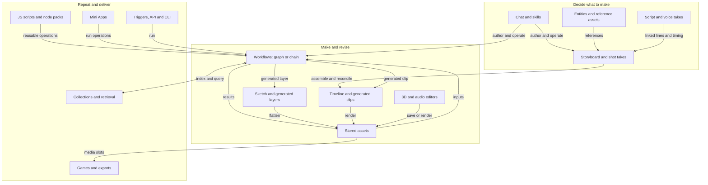
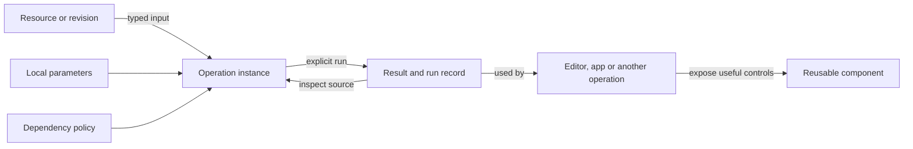

# NodeTool feature interplay

## Research question

How can someone combine NodeTool's features into an editable production system, predict what changes when an input changes, and reuse that system elsewhere?

This is an initial source and documentation study, with comparisons against first-party Houdini, TouchDesigner, and ComfyUI references. It is not a runtime usability audit. Connections marked **source** were inspected in implementation. Connections marked **guide** are documented behavior that still needs an end-to-end check. Proposed improvements are not claims that an equivalent feature is absent everywhere.

## Feature map from the creator's perspective

The arrows below show useful paths, not identical update behavior. The connection table distinguishes those behaviors.

Projects group the work and its ownership. Workspaces hold files used by runs. Models and providers supply generation capabilities. These support several paths rather than representing another production step. See [Projects](../projects.md), [Workspaces](../workspaces.md), and [Models and providers](../models-and-providers.md).

| Intent | Features available | What should carry into the next step | Evidence |
| --- | --- | --- | --- |
| Start from a brief | Chat, skills, guided flows, templates | The editable documents and references created by the agent | [Key concepts](../key-concepts.md), [Projects](../projects.md), guide |
| Keep a character or product consistent | Entities, reference images, descriptors, voice IDs | Entity identity as well as the current reference media | [Entities](../entities.md), guide |
| Write and direct | Scripts, voice takes, storyboards, shot takes | Line/shot identity, chosen takes, timing | [Script/storyboard link](../script-storyboard-link/design.md), guide |
| Generate and transform repeatedly | Typed nodes, graph/chain views, loops, streaming, local/cloud providers | Inputs, operation settings, outputs, run context | [Data types](../data-types.md), [Chain editor](../chain-editor.md), guide |
| Paint or composite | Sketch layers, masks, workflow-generated layers | Editable layers and their generation bindings | [Sketch router](https://github.com/nodetool-ai/nodetool/blob/main/packages/websocket/src/trpc/routers/sketch.ts), source |
| Edit over time | Tracks, clips, workflow generation, storyboard assembly | Placement, trims, chosen output, generation history | [Timeline router](https://github.com/nodetool-ai/nodetool/blob/main/packages/websocket/src/trpc/routers/timeline.ts), [reassembly](https://github.com/nodetool-ai/nodetool/blob/main/packages/timeline/src/reassemble.ts), source |
| Edit source media | Audio waveform editing, glTF scene editing and rendering | Stable asset identity, plus an explicit decision about whether dependents follow changes | [Audio editor](../audio-editor.md), [3D editor](../3d-editor.md), guide |
| Search reference material | Collections, extraction/indexing nodes, retrieval | Source identity and the processing recipe | [Collection upload](https://github.com/nodetool-ai/nodetool/blob/main/packages/websocket/src/collection-api.ts), source |
| Package a tool | Nested workflows, JS scripts, Mini App operations, node packs | Declared inputs/outputs, dependency and version policy | [Workflow node](https://github.com/nodetool-ai/nodetool/blob/main/packages/core-nodes/src/nodes/workflow.ts), source. [JS scripts](../js-scripts.md), [Mini Apps](../mini-apps.md), [Node packs](../node-packs.md), guide |
| Run without opening the editor | Triggers, API, CLI, server execution | The same intended inputs and observable results | [Triggers](../triggers.md), [Execution lifecycle](../execution-lifecycle.md), guide |
| Deliver interactive or finished work | Mini Apps, games, rendered media, project export | A deliberate release or exported result | [Games](../game-editor.md), [Projects](../projects.md), [Mini Apps](../mini-apps.md), guide |

This inventory covers the named surfaces inspected here. It does not enumerate every node, provider, platform feature, or external integration.

## What kind of connection is it?

File compatibility alone does not establish composability. A connection must also say whether it follows changes, what it preserves, and how to get back to its source.

| Connection | Current behavior | Evidence and limit |
| --- | --- | --- |
| Workflow → timeline clip | **Operation binding.** Stores source workflow ID, chosen output, local parameter overrides, dependency hash, and versions. | Source: [timeline router](https://github.com/nodetool-ai/nodetool/blob/main/packages/websocket/src/trpc/routers/timeline.ts), generated clip construction around lines 816–912. Linking does not mean automatic paid regeneration. |
| Workflow → sketch layer | **Operation binding.** Uses the same ingredients: workflow ID, selected output, overrides, hash, generated result and versions. | Source: [sketch router](https://github.com/nodetool-ai/nodetool/blob/main/packages/websocket/src/trpc/routers/sketch.ts), generated layer construction around lines 701–773. |
| Storyboard → timeline | **Semantic reconciliation.** Shot identity lets assembly replace media while preserving existing shot placement and trims. Foreign clips survive. Finished editable layers require the reconciliation path. | Source: [reassemble.ts](https://github.com/nodetool-ai/nodetool/blob/main/packages/timeline/src/reassemble.ts), `refillShotClips`, `foreignTimelineParts`, `assertStoryboardReassemblyAllowed`. This does not prove every type of edit survives every update. |
| Media → workflow through “Send to workflow” | **Current media reference.** Creates image/video/audio constant nodes. The payload carries asset identity, not the source shot's selected-take relationship. | Source: [useSendMediaToWorkflow](https://github.com/nodetool-ai/nodetool/blob/main/web/src/hooks/useSendMediaToWorkflow.ts), [useGenerationToCanvas](https://github.com/nodetool-ai/nodetool/blob/main/web/src/hooks/handlers/useGenerationToCanvas.ts). Other typed document-node paths exist. |
| Saved workflow → nested Workflow node | **Embedded graph with editor synchronization.** The runner executes `workflow_json`. The editor copies selected workflow data and subscribes to the selected workflow store when available. | Source: [workflow.ts](https://github.com/nodetool-ai/nodetool/blob/main/packages/core-nodes/src/nodes/workflow.ts), [WorkflowLoader](https://github.com/nodetool-ai/nodetool/blob/main/web/src/components/node/WorkflowNode/WorkflowLoader.tsx). Do not infer identical freshness in closed-editor and headless execution. |
| JS script → Code node | **Versioned reuse.** The guide describes a pinned/copied script version and explicit update to latest. | Guide: [JS scripts](../js-scripts.md). Compare with workflow bindings in a runtime study. |
| Assets → originating work | **Provenance/navigation.** Asset records include workflow, node, job, sketch, and timeline source fields. | Source: [asset schema](https://github.com/nodetool-ai/nodetool/blob/main/packages/models-core/src/schema/assets.ts), [asset viewer model](https://github.com/nodetool-ai/nodetool/blob/main/web/src/components/assets/assetViewerModel.ts). Provenance alone is not an update dependency. |
| 3D → shot reference | **Rendered media bridge.** The guide describes rendering a saved scene to an image, without a direct storyboard link. | Guide: [3D editor](../3d-editor.md). Test whether source camera and render settings remain recoverable through the complete path. |
| Collection → linked workflow | **Metadata association.** Listing resolves the workflow's name. The upload handler decodes, chunks and embeds text directly rather than invoking that workflow. | Source: [collections router](https://github.com/nodetool-ai/nodetool/blob/main/packages/websocket/src/trpc/routers/collections.ts), [collection upload](https://github.com/nodetool-ai/nodetool/blob/main/packages/websocket/src/collection-api.ts). |

## Findings

### F1 — A useful common operation pattern already exists

Timeline clips and sketch layers both bind a workflow, selected output and local overrides to a generated result. Storyboard reconciliation adds ownership and stable semantic identity. These are concrete starting points for a common user experience.

**Inference:** standardizing how these existing bindings are presented is a better first experiment than replacing the editors with one universal graph. Preserve each editor's useful controls and expose the same source, update policy, result history, and stale-state vocabulary.

### F2 — A convenient transfer can discard the relationship the person cares about

The inspected “Send to workflow” path sends current media. Someone may instead expect “use the selected take of shot 4.” Those are different contracts. An asset reference can survive, while the relationship to the selected take does not travel in that payload.

**Proposed experiment:** offer “Use this result” and “Follow this source” where a semantic source is known. The latter should retain document/element identity and make its update behavior visible. Test using existing typed document nodes before adding another representation.

### F3 — Update policies differ across surfaces

An embedded workflow graph synchronized by an open editor, a workflow-bound clip, and a pinned JS script do not have the same freshness contract. Each can be appropriate. The unresolved question is whether a person can predict which one they are using.

**Research candidate:** use consistent labels for “follow source,” “pinned revision,” and “independent copy.” Verify actual behavior before assigning these labels to every existing feature. Inspect both editor-open and headless runs.

### F4 — Some links and shared controls promise less than their appearance may suggest

The collection workflow link does not make dropped files run through that workflow. Separately, preset compilation only forwards a mode-specific settings allowlist and emits warnings for unsupported parameters. The generic path does not carry `fps` or `negative_prompt`. See [preset compiler](https://github.com/nodetool-ai/nodetool/blob/main/packages/presets/src/compile.ts) and [parameter allowlists](https://github.com/nodetool-ai/nodetool/blob/main/packages/presets/src/params.ts).

These are source-observed boundaries, not reproduced UI bugs. **Proposed experiments:** label a collection link as a reference unless ingestion actually uses it. Show model/mode compatibility and dropped settings before generation, wherever those warnings are not already visible. Do not treat a preset's name as proof of equivalent behavior across models.

### F5 — Project-wide change impact needs investigation

The inspected paths contain local dependency hashes, provenance fields, and document-specific links. This study did not establish a complete user-visible view of downstream dependencies.

**Hypothesis, not an absence claim:** people may struggle to answer “which approved outputs depend on this entity or source image?” Test that question before proposing new infrastructure. A useful view would distinguish current, stale, pinned, missing, and overridden dependencies, and explain why an output would change.

### F6 — Documentation drift obscures the existing system

The [video editor guide](../video-editor.md) describes cloning a private workflow for a clip, while current construction binds the source workflow ID. The [storyboard guide](../storyboard-editor.md) describes rebuilds replacing trims, while current shot refill preserves placement and trims. The [collections guide](../collections.md) says upload does not embed, while the current handler explicitly attaches the configured embedding function.

These contradictions were checked against the source paths above. They should not become false product-gap tickets. This report records them without changing unrelated guides. Documentation correction should accompany a focused verification of each user flow.

## Reference systems: what to borrow

| Reference | Verified mechanism | Application to NodeTool | Limit |
| --- | --- | --- | --- |
| [Houdini digital assets](https://www.sidefx.com/docs/houdini/assets/intro.html) | Networks become reusable nodes with promoted controls and optional bundled files. | Let a useful composition expose a small input/output interface and remain inspectable. Build on nested workflows, JS scripts and app operations. | Reusable-node packaging alone does not solve cross-document freshness. |
| [Houdini TOP cooking](https://www.sidefx.com/docs/houdini/tops/cooking.html) | Dirty work items indicate changes. Cooking can target selected work or an output. | Show downstream impact before rerunning expensive AI steps. Separate marking stale from spending money. | SideFX explicitly documents that replacing/deleting intermediate result files does not automatically dirty consuming work items. Do not idealize its dependency tracking. |
| [TouchDesigner custom parameters](https://derivative.ca/UserGuide/Custom_Parameters) | Components and script operators expose custom parameter pages with types, defaults and ranges. | Reusable tools should expose meaningful controls in a familiar inspector, regardless of their implementation. | This is a parameter-interface reference, not evidence that NodeTool should adopt continuous execution for paid model calls. |
| [ComfyUI subgraph blueprints](https://github.com/Comfy-Org/workflow_templates/blob/main/README.md) | Reusable subgraph components appear as single nodes, separately from full workflow templates. | Make the distinction between a starting example and a reusable operation explicit in discovery and authoring. | A convenient subgraph does not by itself establish a shared version/update policy. |

The design lesson is predictable composition: compatible values, reusable operations, explicit dependencies, inspectable intermediate results, and control over updates. It does not require every document to become the same kind of graph.

## Candidate core to investigate

This is a product model for discussion, not an agreed schema or implementation plan.

| Part | Question it answers | Existing foundation |
| --- | --- | --- |
| Resource identity and revision | What exactly am I using? | Assets, document IDs, document versions |
| Operation interface | What can I feed in, change, and receive? | Typed node ports, workflow inputs/outputs, JS script declarations |
| Operation instance | Which source and local settings produced this result? | Generated clip/layer bindings |
| Dependency policy | Follow changes, pin a revision, or make a copy? | Existing policies that need comparison and consistent presentation |
| Run/result record | What happened, what did it cost, and can I reuse it? | Runs, generated versions, provenance fields |
| Reusable component | Can someone use this without rebuilding its internals? | Nested workflows, scripts, apps, packs |

Keep creative entities distinct from game scene entities. Keep screenplay scripts distinct from JS scripts. Similar names do not imply the same object or lifecycle.

## Next research experiments

Prioritize one complete production loop before broadening the architecture. These experiments are proposed, not executed.

| Action | Scenario | Evidence to collect | Success condition |
| --- | --- | --- | --- |
| A1 | Change a product reference after a storyboard shot has been generated, trimmed on a timeline, and sent into another workflow. | Screen recording, stored references, changed hashes, actual rerun set, retained trims and manual edits. | The person can predict affected work, choose updates, preserve approved edits, and avoid paying for unchanged steps. |
| A2 | Reuse one operation in a sketch, timeline, nested workflow and Mini App. Change an input port and then run with source editors closed. | Port mappings, selected revisions/embedded graphs, errors, update prompts and actual executed inputs. | Breaking changes are explained and migration is explicit. Freshness does not depend on an invisible editor state. |
| A3 | Drop text and then a PDF into a collection with a linked extraction workflow. | Actual route called, embedding behavior, workflow execution or non-execution, error copy. | The displayed relationship accurately predicts ingestion behavior. |
| A4 | Change model and generation mode while keeping the same preset. | Accepted/dropped settings, warnings visible before the run, saved generation recipe. | The person sees what changed and can recover the settings used for a result. |
| A5 | Render a 3D reference into a shot, edit the source scene, then seek its dependents. | Saved versus unsaved scene behavior, source navigation, camera/settings retention, stale indication. | “Edit source and update result” has a discoverable, explicit meaning. |

For each experiment record completion, unexpected copies, lost relationships, manual relinking, discarded edits, unnecessary generation calls, and whether the participant predicted the result. Separate discoverability problems from missing semantics and implementation failures. Do not assign feature scores until these observations exist.

## Scope and verification

This report combines the linked guides with targeted source inspection. External comparisons use the first-party references linked in the table. Historical design documents were treated as pointers and checked against implementation where used for findings.

No running-app walkthrough, model call, automated behavioral test, or participant study was performed. Thus the report establishes specific connection mechanisms and research candidates, not overall usability or production reliability. Only this research document was added. The pre-existing plan and research files were left unchanged.
