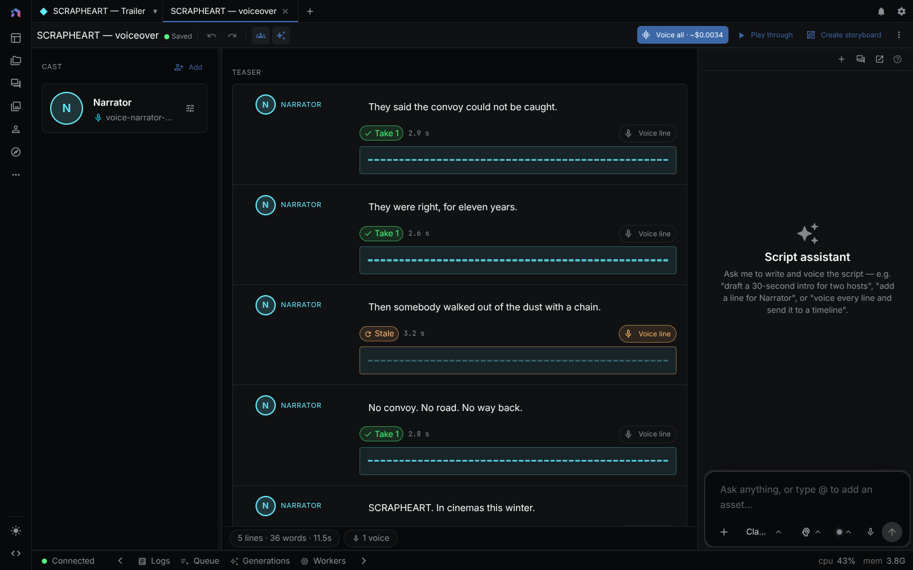

A script is a document of sections and lines with a cast and a set of voiced takes per line. It feeds the [Storyboard Editor](storyboard-editor.md), the [Video Editor](video-editor.md), and SRT files. The script owns words and voice, a linked storyboard owns pictures and motion, and a timeline owns placement. Edits to a line's text or a speaker's voice reach the storyboard and timeline (see [AI Video Production](ai-video-production.md)).

> **Runs:** locally or cloud, depending on the text-to-speech model you pick. **Needs:** a text-to-speech provider key for hosted voices (see [Providers](providers.md)). The agent tool `voice_script_lines` also transcribes each take for word timings by default with provider `openai`, model `whisper-1`, so it uses OPENAI_API_KEY unless you pass `transcribe: false`. **Costs:** voicing is billed by the provider at its own rates. Editing, linking, and SRT export are free.
{: .callout-note}



---

## Create a script

| Route | How |
|---|---|
| New menu | **+** in the tab bar, then **New script**. Opens an empty script titled "Untitled script". |
| Scripts panel | The **New script** button in the panel header creates and opens one. |
| Guided flow | Start **Script** from the guided starters. The flow runs Idea, Format, and Voices steps before the editor appears. See [Guided Flows](guided-flows.md). |
| From a storyboard | In the storyboard's script control, choose **Extract script**. It builds a script from the shots' dialogue and narration, and the button becomes **Open script**. |
| From a timeline | In the timeline's transcript panel, choose **Extract as script**. Each transcript paragraph becomes a line and each speaker label becomes a cast member without a voice. A recorded paragraph keeps its audio as the line's first take. |
| Agent | Ask the assistant, or an agent calls `create_script` (see [Agent tools](#agent-tools)). |

The guided flow's Idea step accepts a typed brief, a pasted script, an uploaded file, or an imported subtitle file. An imported subtitle file keeps its cue timings. Pasting text over it drops them.

A script still in its guided flow shows the flow in place of the editor until you finish or skip the last step.

---

## Write lines

Use **Add first line** in an empty script and **Add section** below the last section.

- Enter splits a line at the cursor. The **+** rule between two lines inserts a line.
- Drag the handle ("Drag to reorder line") to move a line between lines or into another section.
- The **More line actions** menu sets a pause after the line (No pause after, 0.5s, 1s, 2s), **Duplicate line**, or **Delete line**.

There are no line types. Dialogue and narration are the same kind of line, distinguished by speaker. Add a speaker called Narrator for voiceover.

### Speakers and directions

The speaker button in the gutter picks a cast member, **No speaker**, or **Add speaker**.

The theater-mask button (**Add direction** / **Remove direction**) adds a field, "Direction (e.g. whispering, tired)…". The direction is stored with the line and sent when you voice it.

The toolbar counts lines and words, and shows the total duration of the current takes.

---

## Cast voices

The **Cast** tab in the right dock lists the speakers. Each one has:

| Field | Purpose |
|---|---|
| Speaker name | |
| Voice | A text-to-speech model and voice from your configured providers. See [Models and Providers](models-and-providers.md). |
| Linked entity | A character or other [entity](entities.md) from the library. The entity's name, kind, and first reference image show under the field. |

If a linked entity was deleted, the panel shows "Linked entity not found" so you can pick another or clear it. **Add** creates a speaker named "Speaker 1", "Speaker 2", and so on.

A line can override its speaker's voice. A line cannot be voiced until it has an effective voice (its own or its speaker's).

---

## Voice lines and choose takes

Each voiced line stores its audio as a take, which records the text and voice it was made from.

| Line status | Meaning |
|---|---|
| Not voiced yet | No current take. |
| Voiced | The current take matches the line's text and voice. |
| Stale | The text or voice changed after the current take was made. The voice button reads **Re-voice line**. |

- **Voice line.** The waveform button on a line voices it. It is disabled with the tooltip "Assign a voice to this speaker first" until a voice exists.
- **Voice all.** The toolbar button voices every unvoiced or stale line that has text and a voice, up to three at a time. It shows an estimate such as "Voice all · ~$0.12" when the provider catalog has a rate. 
- **Retry.** After a run, a banner reports "Voiced N lines." or lists the failed lines with a retry action.
- **Play.** **Play current take** plays one line. **Play through** plays all current takes in order, and becomes **Stop** while playing.
- **Takes.** The **Takes (N)** button opens the take gallery. Each take shows its text, duration, and voice. Use **Use this take** to make it current, **Play take**, **Favorite**, **Send take to a workflow**, or **Delete take**.

Re-voicing adds a take and keeps the old ones.

---

## Link to a storyboard

The header control links the script to a storyboard.

- **Create storyboard** derives one shot per line, linked to its line, with the words projected into each shot. The button then reads **Open storyboard**.
- A line covered by a shot shows the shot's keyframe thumbnail in the gutter. Click it to open the storyboard on that shot. Until a still renders, the chip shows the shot number.
- A line with no shot on a linked board shows **No shot** in the gutter.
- Warnings about a broken link, such as a shot pointing at a deleted line, appear under the button.

The link is stored on both documents. Re-voicing a line changes shot durations on the board. See [Storyboard Editor](storyboard-editor.md).

---

## Send to a timeline

Once at least one line is voiced, the toolbar offers a timeline action. Its label depends on the link:

| State | Label |
|---|---|
| No storyboard, no timeline yet | **Send to timeline** |
| Already sent | **Update timeline** |
| Linked to a storyboard | **Assemble video** |

An unlinked script becomes a voiceover track with captions from the current takes. A linked script is cut with its storyboard: the board's rendered shots carry the picture and each line's take sits inside the shot that covers it. Shots without a render are left out and reported. The same actions appear in the command menu as **Send to Timeline**, **Update Timeline**, and **Assemble Video**.

The result opens in the [Video Editor](video-editor.md). The script keeps a pointer to the timeline, and a timeline links one script.

While the linked timeline is open, it follows the script live. A newly voiced line gets a clip after the clip of the line before it. A new take replaces the audio of its clip. A deleted line, or a line without a take, loses its clip. The timeline keeps the position of every clip: if you move a clip, it stays there when you edit or voice its line again. Delete a line's clip in the timeline and the line is deleted from the script. Undo in the timeline brings back the clip and the line with its takes. **Update timeline** applies the same rules to a timeline that is not open.

You can also link a script from the timeline. In the timeline's **Script** panel, choose the link button and pick a script or **New script**. The panel then lists the script's lines. Edit a line's text there, or voice a line that has no audio or whose text changed after its last take. Press Backspace in an empty line to delete it. Takes and waveforms stay in the script editor.

---

## Export subtitles

Choose **Export SRT** from the toolbar's **More actions** menu, or **Export Subtitles (SRT)** in the command menu. The `.srt` file is named after the script title. Cues come from the current takes, so voice at least one line first.

---

## Assistant

The **Assistant** tab in the right dock opens a chat that knows which script is open. It edits the script live through the `ui_script_*` tools.

---

## Saving and conflicts

Edits autosave. The toolbar shows **Unsaved changes**, **Saving…**, **Saved**, **Save failed** (changes are kept locally), or **Reloaded newer version** when the script was changed elsewhere. Undo and redo work for the open script. If an outside edit conflicts with a line you are still editing, a banner lets you accept or discard each change.

---

## Agent tools

Agents work on scripts without the editor. Tools are defined in `packages/agents/src/capabilities/scripts.specs.ts`. See [Chat & Agents](global-chat-agents.md).

Trace: the user asks "write a two-line ad read and voice it".

```json
{ "tool": "create_script", "args": { "name": "Bottle ad" } }
{ "tool": "edit_script", "args": { "script_id": "<id>", "ops": [
    { "op": "add_speaker", "name": "Narrator", "provider": "<provider>", "model": "<model>", "voice": "<voice id>" },
    { "op": "add_line", "text": "Cold water, all day.", "speaker": "Narrator" } ] } }
{ "tool": "voice_script_lines", "args": { "script_id": "<id>" } }
```

| Call | Change to the script document |
|---|---|
| `create_script` | An empty script. An existing `id` is returned as is, so a retry does not duplicate it. |
| `edit_script` | Ops apply in order. An argument an op does not take is refused instead of ignored. |
| `voice_script_lines` | With no `targets`, every unvoiced or stale line is voiced (3 at a time by default, 8 at most). Each take is saved as an audio asset, appended to its line, and made current. Earlier takes stay. Word timings are transcribed best-effort. |

Passing `provider`, `model`, and `voice` to `voice_script_lines` overrides every line's voice.

| Tool | Purpose |
|---|---|
| `list_scripts`, `get_script` | Find and read scripts. `get_script` reports each line's status: `draft`, `stale`, `voiced`, or `no_voice`. |
| `create_script`, `edit_script`, `write_script` | Create a script, change its cast, sections, and lines, or write lines with a language model. |
| `voice_script_lines` | Voice lines with the cast's voices. |
| `assemble_script_timeline` | Build the timeline the toolbar button builds. |
| `derive_storyboard_from_script` | Create a linked storyboard, as **Create storyboard** does. |
| `delete_script` | Delete a script. |
