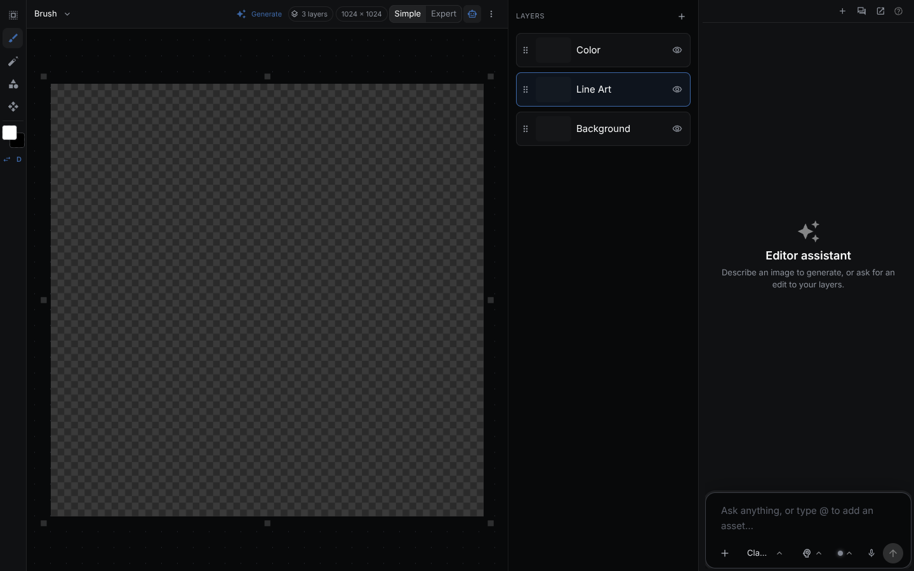

The Sketch Editor is a layered raster editor. A layer can be painted by hand or generated from a prompt or a workflow, and **Save to image** renders the composite back into the image asset.



> **Runs:** locally for painting. Generation runs on the provider you pick, or through one of your workflows. **Needs:** a provider key for the model you generate with (see [Providers](providers.md)). Painting needs no key.
{: .callout-note}

## Open a sketch

- **+** in the workspace tab bar, then **New sketch**. NodeTool creates a blank white image asset and opens it in edit mode. To edit an existing image, open the asset in a tab and switch it to edit mode.
- The left **Sketches** panel lists your sketch documents grouped by date.
- Every sketch has its own URL, `/sketch/<documentId>`. Changes autosave.

**Save to image** in the document bar renders the flattened composite back into the asset. The eye icon beside it returns the tab to view mode. The tab, the Sketches panel, and the standalone page share one document.

## Workspace

| Region | Contents |
|--------|----------|
| **Toolbar** (left) | Tools, foreground and background colors |
| **Tool options** (top) | Size, opacity, hardness, shape type, transform handles |
| **Layers** (right) | Add, reorder, blend, lock, hide, group. Mark a mask layer |
| **History** (right) | Jump to any earlier state |
| **Properties** (right) | Per-layer details, AI generation controls, vector layer settings |
| **Canvas size** (right) | Resize the canvas, toggle resize handles |
| **Assistant** (left) | Chat with the editor assistant |

The panels dock like the timeline and game editors. The **Layout** menu switches between **Essentials**, **Painting**, **Compositing**, and **Assistant**, saves your own layouts per user, and shows or hides each panel. `Tab` hides all panels.

## Tools

| Key | Tool | Notes |
|-----|------|-------|
| `V` | Move | |
| `B` | Brush | Round, soft, airbrush, and spray styles. Pen pressure and a stabilizer |
| `P` | Pencil | Hard-edged, aliased |
| `E` | Eraser | Shares brush size, hardness, and opacity |
| `G` | Fill | Contiguous flood fill with a tolerance setting |
| `T` | Gradient | Foreground to background color |
| `Q` | Blur | |
| `S` | Clone Stamp | `Alt`-click sets the source |
| `J` | Color Adjust | Paints hue, saturation, and brightness |
| `I` | Eyedropper | |
| `M` | Select | Rectangle, ellipse, lasso, or polygon lasso, set in the tool options |
| `W` | Magic wand | Tolerance, contiguous, and sample-all-layers options |
| none | Segment | AI selection (SAM). Click adds a point, `Alt`-click a negative point, or drag a box |
| `C` | Crop | `Enter` commits, `Esc` cancels |
| `F` or `Ctrl/⌘ + T` | Transform | See below |
| `U` | Shape | `L` line, `R` rectangle, `O` ellipse, `A` arrow |

Brush size is `[` and `]`, hardness is `{` and `}`, and a digit `0` to `9` sets opacity (`5` is 50%, `0` is 100%). `X` swaps colors, `D` resets them to black and white. With a selection active, edits apply only inside it.

Shapes: `Shift` constrains proportions or snaps lines and arrows to 30 degree steps. `Alt` draws from the center.

### Transform modes

| Mode | Behavior |
|------|----------|
| **Move/Scale** | Scale and rotate the box. `Ctrl/⌘` on a side handle shears. `Ctrl/⌘ + Alt + Shift` promotes the drag to Perspective |
| **Perspective** | Four-point projective transform. Dragging a corner mirrors the opposite edge |
| **Deform** | Free four-point quad. Only the dragged corner moves. `Shift` locks one axis |

Perspective and Deform produce a four-point quad, so a layer carrying one is transformed on its own. A multi-layer union applies one affine delta and cannot carry a quad. `.` resets the box. `Ctrl/⌘ + Shift + T` repeats the last transform.

## Layers

- **Blend modes**: Normal, Multiply, Screen, Overlay, Darken, Lighten, Color Dodge, Color Burn, Hard Light, Soft Light, Difference, Exclusion, Add. `↑` and `↓` in the Layers panel step through them.
- **Mask layer**: the document's mask. It is exported as the separate `mask` output for inpainting and compositing nodes.
- **Symmetry**: horizontal, vertical, dual, radial, or mandala. Radial and mandala take 2 to 12 rays (6 by default).
- **Pen pressure**: pressure can drive size, opacity, or both. The pen-pressure settings tune the light-press scale and curve.
- **History**: the last 30 steps. Older steps merge into the baseline.

## Generate onto a layer

Select a layer and open **Properties** to bind it to a generator.

- **Prompt**: pick a provider and model, write a prompt, and generate text-to-image or image-to-image. Image-to-image takes a source layer, edit strength, and inference steps. Properties shows an estimated cost before you generate. Typing `@` in the prompt picks an entity from the library. The prompt holds an `entity://` reference, and the server replaces it with the entity's name, descriptor, and reference image at generation time.
- **Workflow**: click **Generate Layer** in the Properties toolbar and pick a workflow with an image output node (`ImageOutput`, `MaskOutput`, or `Output`). If it has several, choose which node feeds the layer.

Each generation is a **version** on the layer. If a prompt, parameter, or upstream layer changes, the layer is flagged **stale**. **Re-generate Stale** runs all stale layers in dependency order and skips locked layers. Generation runs as a job over the WebSocket connection with progress on the layer.

## Agent editing

The agent edits a saved sketch's layer structure with `edit_sketch`, which takes `ops` that run in order against the stored document. An open editor picks the change up live. It never reads or writes pixels: painting and generation happen in an open editor or a workflow run.

From `packages/agents/tests/capabilities-sketches.test.ts`, on a sketch created with `create_sketch`:

```json
{
  "tool": "edit_sketch",
  "arguments": {
    "image_document_id": "<sketch id>",
    "ops": [{ "op": "add_layer", "name": "Ink" }]
  }
}
```

The result reports `applied: 1` and the layer list changes from `["Layer 1"]` to `["Layer 1", "Ink"]`. The id may be the full 32-character id or its first 12 characters. Run `validate_sketch` afterwards. Other sketch tools are `list_sketches`, `get_sketch`, `render_sketch`, and the `*_sketch_version` tools.

An open editor receives the `ui_sketch_*` tools. `nodetool sketch debug` replays them headlessly (see [CLI: nodetool sketch](cli.md#nodetool-sketch)).

## Recipes

**Sketch and generate.** Choose **+ → New sketch**, block in a composition on one layer, add a layer, select the region, bind it to a model or workflow in Properties, and generate. Then paint on top and **Save to image**.

**Mask for inpaint.** Open an image in a sketch, add a layer, paint the area to change, and mark it as the mask layer. Wire the [Render Sketch](nodes/nodetool/sketch/rendersketch.md) `image` and `mask` outputs into an inpaint node.

**Retouch.** Select Clone Stamp (`S`), `Alt`-click clean pixels, paint over the blemish, and adjust layer opacity.

## Keyboard shortcuts

| Shortcut | Action |
|----------|--------|
| `Ctrl/⌘ + Z` | Undo |
| `Ctrl/⌘ + Shift + Z` or `Ctrl/⌘ + Y` | Redo |
| `Ctrl/⌘ + C` / `X` / `V` | Copy, cut, paste |
| `Ctrl/⌘ + Shift + V` | Paste masked |
| `Ctrl/⌘ + A` | Select all |
| `Ctrl/⌘ + D` | Deselect |
| `Ctrl/⌘ + Shift + D` | Reselect |
| `Ctrl/⌘ + Shift + I` | Invert selection |
| `Ctrl/⌘ + Shift + Alt + T` | Repeat last transform on a copy |
| `Ctrl/⌘ + ]` / `[` | Move layer forward or back |
| `Ctrl/⌘ + J` / `Ctrl/⌘ + Shift + J` | Layer via copy or cut |
| `Ctrl/⌘ + I` | Invert colors of the active layer |
| `Delete` or `Backspace` | Clear layer or selection |
| `Ctrl/⌘ + Backspace` / `Alt + Backspace` | Fill with background or foreground color |
| Arrow keys | Nudge by 1 px |
| `+` / `=`, `-` | Zoom in, out |
| `Ctrl/⌘ + 0` / `Ctrl/⌘ + 1` | Fit, 100% |
| `Space` + drag, or middle-click drag | Pan |

## Workflow nodes

- [Create Sketch](nodes/nodetool/sketch/createsketch.md): puts an input image on the base layer.
- [Render Sketch](nodes/nodetool/sketch/rendersketch.md): flattens layers with blend modes and opacity. Outputs `image` and, when a mask layer is set, `mask`.
- [Sketch Layers](nodes/nodetool/sketch/sketchlayers.md): outputs each visible layer as an image (`layers`) with its name (`names`).

## Related

- [Asset Management](asset-management.md)
- [Workflow Editor](workflow-editor.md)
- [Game Editor](game-editor.md): use finished images as sprites and backgrounds
- [CLI: nodetool sketch](cli.md#nodetool-sketch): validate, replay an edit session, manage saved versions
- [Key Concepts](key-concepts.md#how-everything-fits-together)
