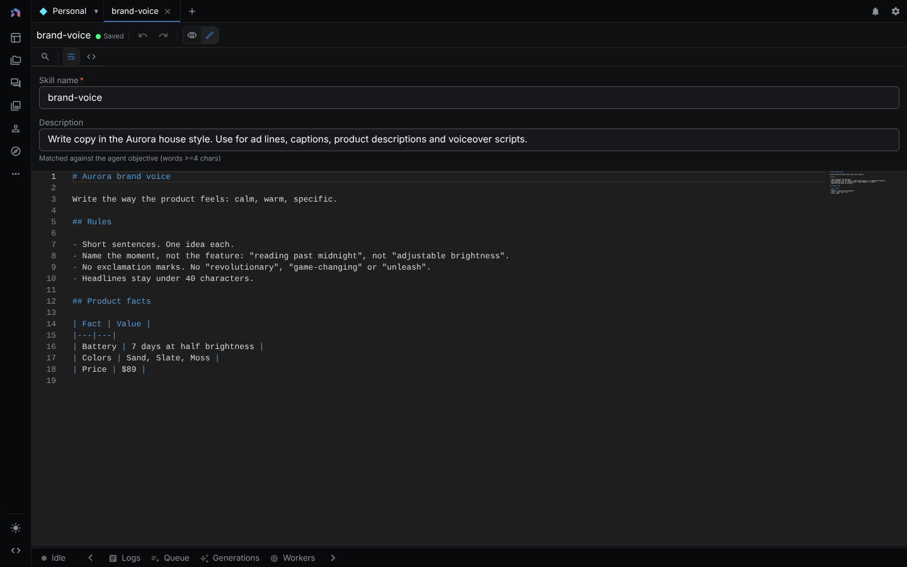

A skill is saved instructions the agent loads for one kind of work, such as writing release notes or building a commercial.

> **Runs:** locally or cloud, with no extra setup. **Needs:** no API key. Skills only add instructions to a chat turn.
{: .callout-note}

---

## Use a skill

Type `/` at the start of a word in the chat composer to open a list of your skills and the built-in ones. The list filters by name and description as you type. Pick one and the composer inserts `/<skill-name> ` into your message.

When a message names a skill this way, the agent receives that skill's full instructions with the message and follows them. A `/` inside a word, such as the path `src/utils`, does not count.

The prompt box on **New project** shows the same skills as pills. Picking a pill writes `/<skill-name>` into the prompt and the skill becomes the starter for the project.

You do not have to name a skill. The agent sees the name and description of your skills on every turn and loads one by itself when the request matches its description.

See [Chat](global-chat.md#slash-commands--for-skills) and [Projects](projects.md).

---

## Create a skill

1. Click **+** in the workspace tab bar and choose **New skill**, or click **+** at the top of the Skills panel. The Skills panel is in the left panel's **More** menu. A skill opens with a generated name such as `skill-m3x9k2`, a placeholder description, and a starter body.
2. Set the **Name**. Use lowercase letters, digits, and hyphens, up to 64 characters. The name cannot contain `anthropic` or `claude`.
3. Set the **Description**. Write it as when to use the skill, for example "Use when writing release notes from a changelog." The agent always sees the description, so it decides from this line whether to load the skill. It can be up to 1024 characters, must fit on one line, and cannot contain markup such as `<tag>`.
4. Write the instructions in the Markdown editor below the two fields. Keep one skill to one kind of work.

The editor autosaves about three-quarters of a second after you stop typing. **Save** saves immediately, and a dot beside it marks unsaved changes.

In the Skills panel, right-click a skill for **Rename**, **Delete**, and **Duplicate**. Duplicate creates `<name>-copy`.

You can also ask the agent: "Save these steps as a skill called weekly-report."

---

## Your skills and built-in skills

| | Your skill | Built-in skill |
|---|---|---|
| Who wrote it | You, or the agent for you | NodeTool ships it |
| Editable | Yes | No. It opens read-only |
| Shown in the panel as | A skill with a sparkle icon | A skill with a lock icon and the label **Built in** |
| Available to the agent | Yes | Yes, on every install |

Built-in skills cannot be renamed, edited, or deleted from the app or by the agent. Their names are reserved, so you cannot create a skill with the name of a built-in skill. If you already had a skill with that name before the built-in one shipped, yours keeps working and wins.

---

## Shipped skills

These skills ship with NodeTool. Open any of them read-only from the Skills panel, or type `/` and the name in chat.

### Video production

| Skill | Use it for |
|---|---|
| `storyboard-core` | Storyboards, entity casting, rendering, and timeline assembly, including the tool contracts the other video skills quote. |
| `product-commercial` | A polished product film or brand commercial. |
| `ugc-video` | Phone-shot creator videos, UGC ads, testimonials, and vlogs. |
| `script-video` | A video whose timing follows written voiceover, such as an explainer or narrated b-roll. |
| `short-film` | A narrative scene, short film, or trailer with characters, dialogue, and score. |
| `video-clone` | Analyzing a reference video and recreating its shot structure with a new product or cast. |
| `video-workflow` | A reusable video workflow for batches or repeated inputs. |
| `launch-kit` | A campaign with shared product and cast entities, stills, and several video cuts. |
| `launch-commercial` | A launch commercial built from a product page URL, delivered as an editable project with its real cost. |
| `motion-ad` | A short sound-off motion-graphics ad from a product's real screenshots and photos. |
| `commercial-beat-sheet` | A precisely timed commercial beat sheet stored as a storyboard. |
| `explainer-storyboard` | A 30 to 120 second explainer storyboard from a confirmed brief. |
| `music-video-treatment` | A beat-synced music-video treatment and storyboard from track metadata. |
| `trailer-template` | A trailer or teaser structured as eight audio-first beats. |
| `video-audio-continuity` | Keeping sound continuous across a multi-scene piece cut from generated video. |
| `ad-creative-testing` | Matched ad variants that test one storytelling choice at a time, a test plan, and reading the results. |
| `ad-story-loops` | The question-and-payoff structure of an ad, promo, or demo: hooks, open loops, rehooks, closure. |
| `nodetool-video-post` | Repairing or regenerating footage already on a timeline: cutouts, upscaling, outpainting, lip sync, and more. |

### Motion and timeline craft

| Skill | Use it for |
|---|---|
| `motion-graphics` | The entry point for building and reviewing a timeline piece. |
| `timeline-edit-ops` | Reference for editing an existing timeline with `edit_timeline` ops. |
| `motion-direction` | Setting one motion language for a piece and auditing a timeline against it. |
| `motion-principles` | Timing, easing, stagger, anticipation, and follow-through. |
| `motion-curves` | Animation curves written by hand or baked from a JavaScript body. |
| `frame-composition` | Grids, focal placement, safe areas, depth, and camera moves. |
| `beat-sync-editing` | Cutting to music and shaping pacing. |
| `color-motion` | Colour, gradients, grades, and 3D LUTs. |
| `caption-titles` | Titles, lower-thirds, captions, and end cards. |
| `logo-reveal` | Animating a brand mark for an intro sting or end card. |
| `motion-background` | Ambient backdrops and quiet loops. |

### Image, 3D, and games

| Skill | Use it for |
|---|---|
| `nodetool-sketch` | Building and editing sketches: layers, blend modes, placed images, version history. |
| `nodetool-3d-scene` | Building, editing, validating, and rendering 3D models. |
| `native-game` | Building or revising a playable game in NodeTool's built-in engine and preparing a web build. |
| `game-direction` | Setting game feel, level pacing, and art direction before building. |
| `native-game-performance` | Frame and tick targets, budgets per game type, and the `nodetool game bench`, `capture`, and `perf` loop. |
| `native-game-reference` | Field reference for native game documents. Load after `native-game`. |
| `manimgx` | ManimGX scenes: math and 3D animations run by the `nodetool.manimgx` nodes. |

### Workflows, apps, and code

| Skill | Use it for |
|---|---|
| `nodetool-concepts` | Explaining how NodeTool works: projects, threads, memory, assets, workflows, documents, and skills. |
| `nodetool-workflow-builder` | Creating and editing workflow graphs, connections, and properties. |
| `nodetool-app-builder` | Building or repairing a mini app. |
| `nodetool-js-scripting` | JavaScript for the QuickJS sandbox: Code node bodies and saved JS scripts. |
| `nodetool-custom-node-developer` | New TypeScript node types and node packages. |
| `nodetool-rag-indexing` | Document ingestion, vector indexing, and retrieval pipelines. |
| `nodetool-browser-agent` | Browser automation agents for navigation, extraction, and forms. |
| `nodetool-troubleshooter` | Diagnosing a failing run on any surface, including stuck media generations. |
| `nodetool-skill-author` | Writing or revising a skill, yours or a shipped one. |

### Model prompting guides

Each guide covers the prompt structure, controls, and common failures of one model line. The agent is pointed to the matching guide when it picks a model.

| Skill | Model line |
|---|---|
| `nano-banana-pro-prompting` | Google Nano Banana Pro (image) |
| `gpt-image-2-prompting` | OpenAI GPT Image 2 (image) |
| `flux-2-klein-prompting` | Black Forest Labs FLUX.2 [klein] (image) |
| `seedream-prompting` | ByteDance Seedream 4 and 5 (image) |
| `qwen-image-prompting` | Alibaba Qwen-Image (image, typography) |
| `veo-3-prompting` | Google Veo 3 (video) |
| `seedance-2-prompting` | ByteDance Seedance 2 (video) |
| `kling-video-prompting` | Kuaishou Kling 2.5-turbo and later (video) |
| `hailuo-prompting` | MiniMax Hailuo (video) |
| `minimax-h3-prompting` | MiniMax H3 (video) |
| `wan-2-6-prompting` | Alibaba Wan 2.6 (video) |
| `elevenlabs-audio-prompting` | ElevenLabs speech, dialogue, sound effects, and music |
| `stable-audio-prompting` | Stability Stable Audio (music and sound effects) |

### API and integration

| Skill | Use it for |
|---|---|
| `nodetool-api-reference` | Integrating over REST, tRPC, WebSocket, MCP, or the OpenAI-compatible chat API. |
| `nodetool-model-provider-config` | Providers, credentials, local models, and model selection. |
| `nodetool-chat-cli` | Chat CLI sessions, provider selection, and Chat features. |

The `api-*` skills document the object model that code actions call. They are listed in [Skill Files and Tools](developer/skill-files.md#api-skills).

### Operations

| Skill | Use it for |
|---|---|
| `nodetool-deployment` | Deploying and operating servers and workers with Docker, SSH, Runpod, or cloud configuration. |

---

## Related pages

- [Chat](global-chat.md): composer and slash commands
- [Editor Panels](editor-panels.md): the **More** menu that holds **Skills**
- [Projects](projects.md): starting a project from a skill
- [Skill Files and Tools](developer/skill-files.md): the `SKILL.md` format, where system skills load from, and the agent's skill tools
