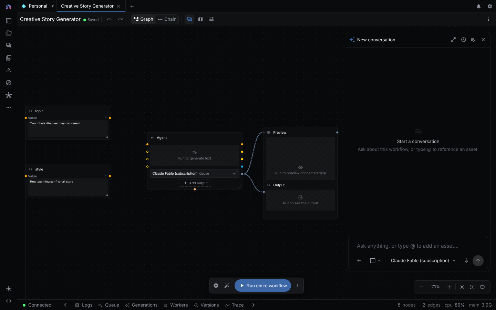
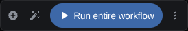
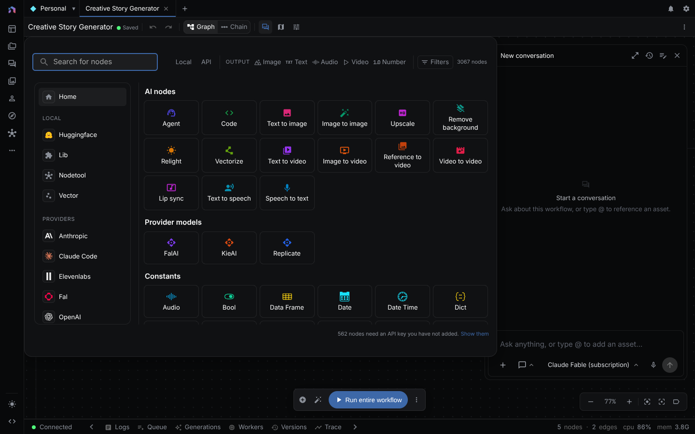
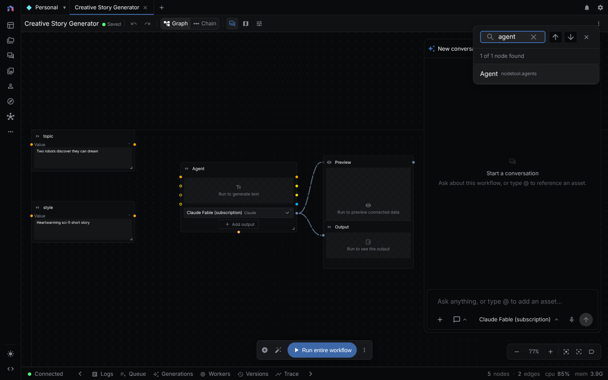
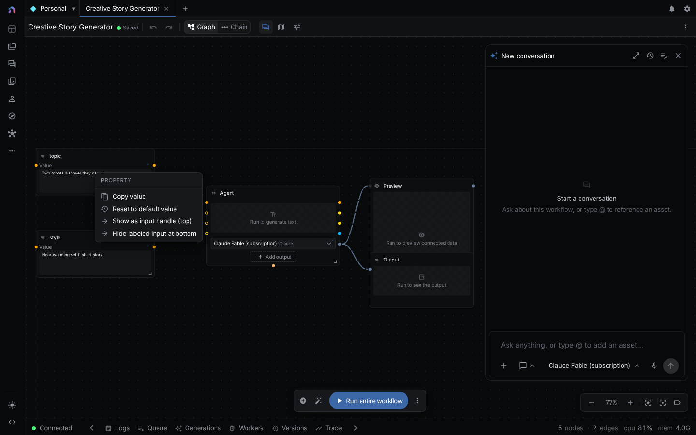
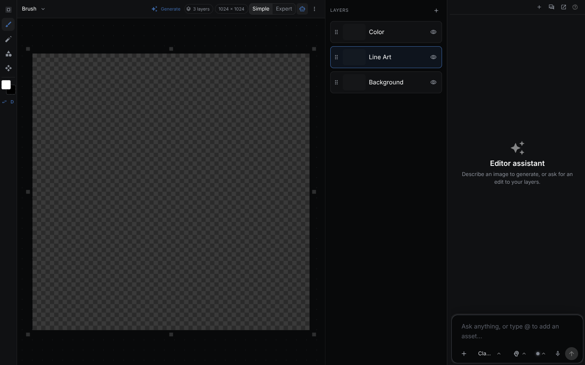
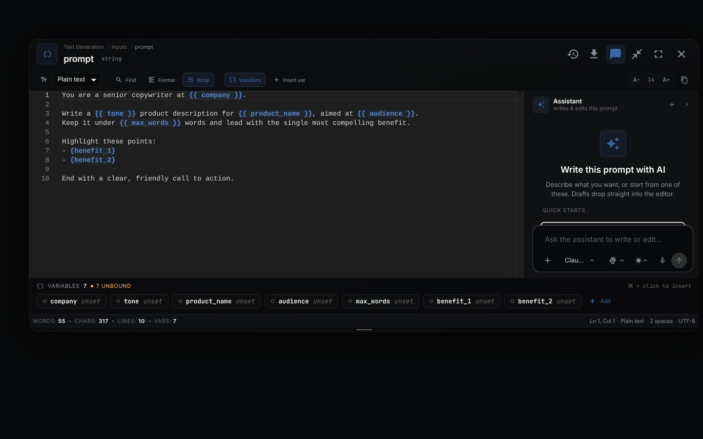
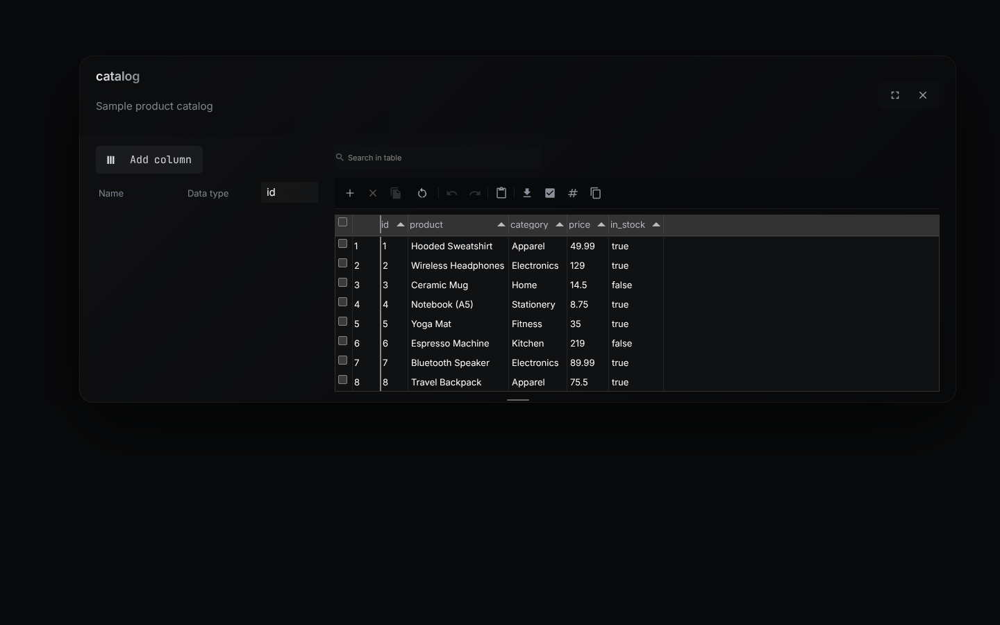
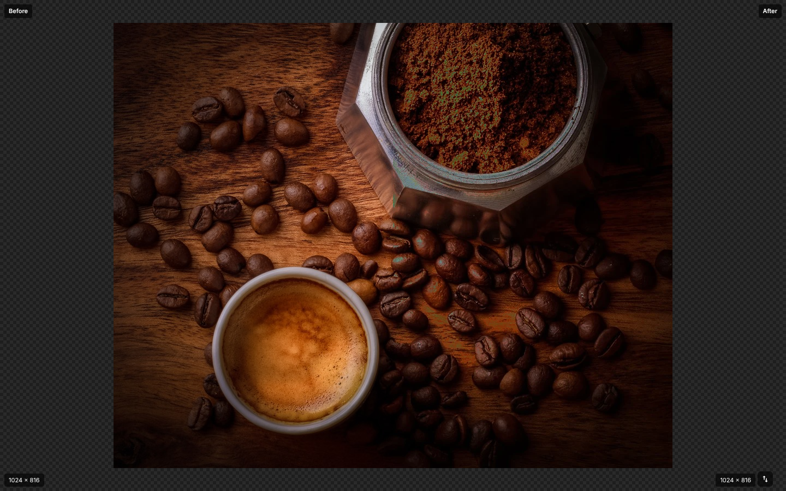
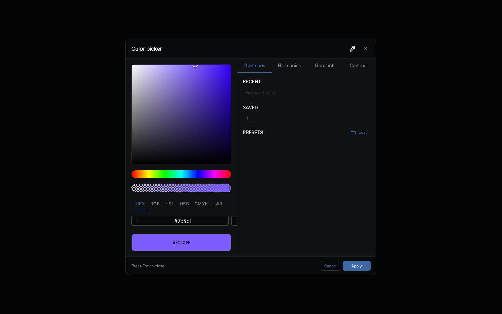

The editor builds and runs a workflow, a graph of nodes saved as one document. Place nodes, connect ports, run the whole graph or part of it, and read results on each node. New here? Start with [Getting Started](getting-started.md). Panel detail is in [Editor Panels](editor-panels.md).

## Editor Layout

| Area | Where | What It Does |
|------|-------|--------------|
| **Canvas** | Center | Place and connect nodes |
| **Left panel** | Left | Documents, chats, library, and nodes, plus a **More** panel with favorites, recent nodes, workflow settings, and app pages |
| **Inspector** | Right | Properties, I/O, and help for the selected node |
| **Bottom panel** | Bottom | Logs, queue, workers, versions, and trace |
| **Composer** | Floating over the canvas | Chat and media prompt, add node, auto-layout, save, run |

## Canvas Basics

| Do This | How |
|---------|-----|
| Pan | Left-drag on empty canvas (default on Windows and Linux). On macOS, two-finger scroll, or right or middle-button drag |
| Zoom | Scroll wheel, or pinch. On macOS, pinch |
| Fit everything | `F` |
| Reset zoom (to 50%) | `Ctrl/⌘ + 0` |
| Zoom in or out | `Ctrl/⌘ + =` / `Ctrl/⌘ + -` |
| Zoom to 50%, 100%, 200% | `Ctrl/⌘ + Alt + 5` / `1` / `2` |

**Left-Click Drag** in Settings → General → Canvas swaps the mouse roles. With **Select nodes (box)**, left-drag draws a selection box and panning moves to right or middle-button drag. The default is **Pan canvas** on Windows and Linux and **Select nodes (box)** on macOS. **Node Selection Mode** decides whether a box must enclose nodes (**Full**) or only touch them (**Partial**, the default).

**Snap to Grid**: turn on **Snap to Grid** in the View menu of the
desktop app, from the command menu (`Ctrl/⌘ + K`), or in Settings → General →
Canvas. The grid size is the **Grid Snap Precision** setting, and **Connection
Snap Range** sets how close a dragged connection must get to a port to snap.

The **⋮** menu on the composer has a **Mini Map** toggle.

---

## Working with Nodes

### Add Nodes

Press `Space` or double-click empty canvas, type a name, and click a result. Dropping a connection on empty space offers the compatible nodes, or **Preview**, **Reroute**, or a **Save** node for that type.

A node has a header (name, drag to move), input circles on the left, output circles on the right, and its properties.

### Select Nodes

| Do This | How |
|---------|-----|
| One | Click it |
| Multiple | `Shift` or `Ctrl/⌘` + click (again to remove), or draw a selection box (`Shift` + drag, or plain drag when **Left-Click Drag** is set to select) |
| All | `Ctrl/⌘ + A` |
| Connected nodes | `Shift + C` (inputs and outputs), `Shift + I` (inputs), `Shift + O` (outputs) |
| None | Click canvas |

### Move Nodes

- **Drag** header to move
- **Arrow keys** to nudge by 10 px
- **Auto Layout** button to organize
- `C` collapses or expands the selected nodes

### Disable Nodes

Right-click a node (or select it and press `B`) and choose **Disable Node**. The node dims, and it and every connection to or from it are excluded from the submitted graph. Data does not pass through it. Use it to run a smaller graph or skip a failing or costly branch.

Re-enable: right-click → **Enable Node**, or press `B` again. With several nodes selected, the context menu offers **Disable All** or **Enable All**.

---

## Connections

Data flows left to right, from an output port to an input port. Drag from an output circle to an input circle and release.

### Connection Rules

- Only compatible types connect. Line color shows the data type.
- Each input accepts one connection. An output can feed many inputs.

### Removing Connections

- Right-click a connection and choose **Delete Edge**, or **Insert Reroute** to add a reroute node at that point
- Drag the connection away from its target and release

### Smart Connections

Releasing on empty space opens a search over the nodes that can receive (or produce) that type, with **Preview**, **Reroute**, and a matching **Save** node as shortcuts. `Esc` cancels. Releasing on a node's body connects to a matching input. On a node with dynamic inputs, it creates a new input named after the source node.

### Lineage Links

A lineage link records that one node relates to another, such as "this clip comes from this shot" or "this sketch is the reference for that frame". It is a dotted line that carries no data and does not change the order nodes run in. A run gives the same result with or without it.

- Select exactly two nodes and click **Link** in the selection toolbar. The link runs from the node on the left to the node on the right.
- Click a link to select it, then press `Delete` or `Backspace`. You can also right-click it and choose **Delete Link**, or middle-click it.
- Deleting a node removes its links. Copy, paste and duplicate keep a link when both of its nodes are included.
- Agents add and remove links with the `add_workflow_link` and `remove_workflow_link` tools. `get_workflow` lists them under `graph.links`.

---

## Running Workflows

### Starting a Run

| Method | How |
|--------|-----|
| Button | Click **Run entire workflow** in the bottom toolbar |
| Keyboard | `Ctrl/⌘ + Enter` |
| Command menu | Select **Run Entire Workflow** |

All three methods run the entire enabled graph. They use the same checks for
missing models, search-provider setup, large runs, and additional concurrent
runs. The large-run warning is controlled by **Warn Before Large Runs** and
**Large-Run Threshold** in Settings → General → Execution.

To run part of a graph, right-click a node and choose **Run Node**, or
right-click a multi-node selection and choose **Run Selected**. Each runs as its
own job and uses previous results as inputs.

### Watching Progress

A moving colored ring marks a running node. **Completed in** and **Failed in** badges show how long it took. Streaming nodes show output as it generates, and Preview nodes show intermediate results. The main run control shows **Starting**, **Queued**, **Running**, **Stopping**, or **Error**.

### Stopping a Run

| Method | How |
|--------|-----|
| Button | Click **Stop** while a run is starting, queued, or running |
| Keyboard | `Esc` |

---

## Organizing Your Workflow

### Auto Layout

Click the **Auto Layout** button in the composer bar to arrange your nodes in a readable layout. The editor also auto-arranges nodes when Chat creates or modifies workflows. There is no keyboard shortcut for auto-layout. It is a toolbar button only.

### Grouping Nodes

Select multiple nodes and press `Ctrl/⌘ + G` to group them. Groups keep related nodes together and move as a unit. Click a group's label to select the group. A click on the group's body reaches the canvas, so a selection box can start inside a group. Copy, cut, duplicate and delete act on a selected group together with the nodes inside it. To take nodes out of a group, hold `Alt` (`Option` on macOS) while you drag them. The node context menu also offers **Group into Subgraph**, and the canvas context menu offers **Add Group**, **Add Comment**, **Add Subgraph**, **Add Workflow**, and **Add App**. An App node runs a mini app's workflow: the app's inputs become the node's inputs, its outputs become the node's outputs, and an output the app streams reaches downstream nodes one value at a time.

Alignment, arrangement, and add-node-at-cursor shortcuts are in [All Editor Shortcuts](#all-editor-shortcuts).

---

### Panels

The left rail has **Documents**, **Chats**, **Library**, **Nodes**, and **More**. See [Editor Panels](editor-panels.md#left-panel). The Inspector opens when you select a node, with **Params**, **I/O**, and **Help** tabs and validation errors for the node. With several nodes selected it edits their shared properties. Logs, Queue, Trace, and Version History are in the [Bottom Panel](editor-panels.md#bottom-panel).

---

## Finding Nodes

### The Node Menu

Press `Space` to open, then:

- **Search**: Just start typing ("whisper", "image", "agent")
- **Browse**: Explore the category tree on the left
- **Filter**: Use the input and output type chips next to the search box (All, Image, Text, Audio, Video, Number) to show only nodes that take or produce a type
- **Move**: Drag the menu header to reposition it, and drag its edges to resize it
- **Close**: `Esc`, `Space` on an empty search box, or click outside

### Find in Workflow

`Ctrl/⌘ + F` searches the workflow you already have: node names, types, and property values. Matches highlight on the canvas and the view pans to the one you pick.

---

## Context Menus

| Location | Options |
|----------|---------|
| **Canvas** | Paste, Fit Screen, your favorite nodes, Add Constant Node, Add Input Node, Add Comment, Add Group, Add Workflow, Add Subgraph, Add App |
| **Node** | Copy, Cut, Copy Node as JSON, Duplicate, Duplicate Vertical, Run Node, Disable or Enable Node, Collapse or Expand Node, Add Comment, Group into Subgraph, Convert to Input or Constant Node, Show Templates, select all nodes of the same type, Delete Node |
| **Selection** | Duplicate, Copy, Cut, Run Selected, Align, Arrange, Disable All, Collapse / Expand, Surround With Group, Group into Subgraph, Select All Connected, Select Inputs, Select Outputs, Delete |
| **Input or output port** | Searchable list of compatible nodes, plus Preview, Reroute, and Save shortcuts |
| **Connection** | Insert Reroute, Delete Edge |
| **Lineage link** | Delete Link |

**Copy Node as JSON** puts the node's data — its property values, title, and dynamic slots — on the clipboard as formatted JSON. Paste it into a bug report, or hand it to an agent.

---

## Built-in Editors

### Sketch Editor

Create one with **+ New → New sketch** in the workspace tab bar, or open an existing image. See [Sketch Editor](sketch-editor.md).

### Text and Code Editor

Long text or code properties open in a full editor with syntax highlighting, line numbers, and search, the same editor the code nodes use.

### DataFrame Editor

Add or remove rows and columns, edit cells, and sort.

### Image Comparer

Preview nodes with before/after images show a slider. Drag it left or right to compare the two images.

### Color Picker

Opens when you pick a color property. It accepts HEX, RGB, HSL, or CMYK, and has harmony modes, a gradient builder, swatches, a contrast checker, and an eyedropper.

---

## Keyboard Shortcuts

### Essential Shortcuts

| Shortcut | Action |
|----------|--------|
| `Space` | Open node menu |
| `Ctrl/⌘ + Enter` | Run entire workflow |
| `Ctrl/⌘ + S` | Save |
| `Ctrl/⌘ + Z` | Undo |
| `F` | Fit view |
| `Esc` | Stop / Cancel |

### All Editor Shortcuts

| Shortcut | Action |
|----------|--------|
| `Ctrl/⌘ + C` | Copy |
| `Ctrl/⌘ + V` | Paste |
| `Ctrl/⌘ + X` | Cut |
| `Ctrl/⌘ + D` | Duplicate horizontally |
| `Ctrl/⌘ + Shift + D` | Duplicate vertically |
| `Ctrl/⌘ + G` | Group selection |
| `Ctrl/⌘ + 0` | Reset zoom to 50% |
| `Ctrl/⌘ + =` / `Ctrl/⌘ + -` | Zoom in / out |
| `Ctrl/⌘ + Alt + 1` / `2` / `5` | Zoom to 100% / 200% / 50% |
| `Ctrl/⌘ + 1-9` | Switch to tab 1-9 |
| `Ctrl + PageUp` / `PageDown` | Previous / next tab |
| `Ctrl/⌘ + F` | Find in workflow |
| `Ctrl/⌘ + I` | Node info panel |
| `Ctrl/⌘ + /` | Show keyboard shortcuts |
| `Ctrl/⌘ + ,` | Open Settings |
| `B` | Disable or enable selected nodes |
| `C` | Collapse or expand selected nodes |
| `Shift + C` / `Shift + I` / `Shift + O` | Select connected / input / output nodes |
| `Shift + ←/→/↑/↓` | Align left, right, top, bottom |
| `Shift + H` / `Shift + E` | Align centers horizontally / vertically |
| `Shift + D` | Distribute horizontally |
| `V` / `G` | Stack / grid-arrange selected nodes |
| `Shift + P` / `G` / `V` / `L` | Add Prompt / Text to Image / Text to Video / Agent node at the cursor |
| `A` | Align selected nodes |
| `Shift + A` | Align and distribute |
| `Arrow keys` | Nudge selected nodes |
| `Delete` / `Backspace` | Delete selection |
| `i` | Toggle Inspector |
| `w` | Toggle Workflow Settings panel |
| `l` | Toggle Logs panel |
| `Ctrl + Shift + T` | Toggle Trace panel |

Alt-based keyboard navigation moves focus between nodes without the mouse: `Ctrl/⌘ + Alt + N` and `P` step to the next and previous node, `Alt + arrows` move focus to the nearest node in that direction, `Enter` selects the focused node, `Esc` leaves navigation mode, and `Ctrl/⌘ + Alt + B` goes back. `Ctrl/⌘ + T` (new workflow) and `Ctrl/⌘ + W` (close tab) work in the desktop app only.

---

## Debugging tips

- Add Preview nodes between steps to see what each node produces.
- A **Failed in** badge and an error panel mark a failed node.
- Disable downstream nodes and run smaller graphs to isolate a problem.
- Press `i` for validation warnings on the selected node. Run errors appear on the node itself.

To give someone else access to a workflow, see [Sharing Workflows](workflow-sharing.md). Related: [Cookbook](cookbook.md), [Workflow Examples](workflows/), [Tips & Tricks](tips-and-tricks.md), [Node Reference](nodes/).
