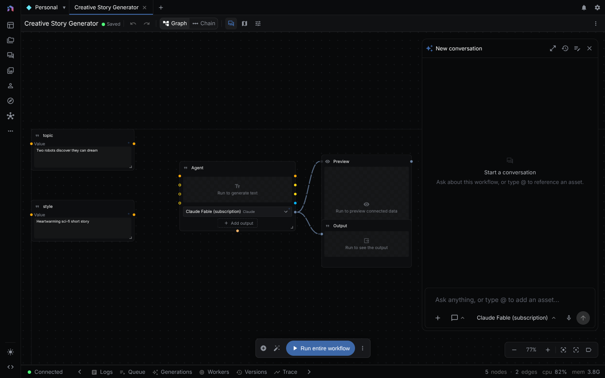

The graph view renders a workflow as a read-only, auto-laid-out graph. Use it to produce screenshots of a workflow from a script or headless browser. It is not part of the editor and nothing in the app links to it.



---

## Quick start

From `web/`, render a workflow JSON file to a PNG:

```bash
npx tsx scripts/screenshot-workflow.ts workflow.json out.png --width 1920 --height 1080
```

The script starts the Vite dev server on `--port` when none is running, opens `graph.html` in headless Chrome, waits for `[data-ready="true"]`, and saves the screenshot. It needs the `puppeteer` package, which `web/package.json` does not declare, so install it first.

| Flag | Default |
|------|---------|
| `--width` | `1920` |
| `--height` | `1080` |
| `--port` | `3199` |
| `--bg` | `#0F172A` (see the note under the standalone viewer) |

The output path defaults to `/tmp/workflow-graph.png`.

---

## Two entry points

| URL | Source | Notes |
|-----|--------|-------|
| `/graph/<workflowId>` | A stored workflow, fetched with the signed-in session | Reads `bg` and `padding` |
| `/graph/json?data=<base64>` | The inline payload, no fetch | Same route, so `bg` and `padding` apply |
| `/graph.html?data=<base64>` | The inline payload only, no backend | Fixed 15% fit padding. Ignores `bg` |

`graph.html` is a separate page of the web app. Its only input is `data`, and it is served by the Vite dev server. The production build config does not declare it as an entry, and a built `web/dist` was not checked.

### Query parameters

| Parameter | Default | Effect |
|-----------|---------|--------|
| `data` | none | Base64 of a workflow JSON document |
| `bg` | `#1a1a2e` | Background color. `/graph/...` routes only |
| `padding` | `60` | Fit-view padding as a percentage. `/graph/...` routes only |

Without `data` and without a workflow ID, the page shows an error and sets `data-ready="error"`.

### Payload shape

Either form works:

```json
{ "name": "My flow", "graph": { "nodes": [], "edges": [] } }
```

```json
{ "name": "My flow", "nodes": [], "edges": [] }
```

Build the URL in a shell:

```bash
b64=$(base64 -w0 workflow.json)
echo "http://localhost:3199/graph.html?data=$b64"
```

`graph.html` has no node metadata from the server. It infers each node's title from its type, and guesses property types from the values in the payload.

---

## Wait for the render

The page container carries `data-ready`:

| Value | Meaning |
|-------|---------|
| `false` | Still loading or laying out |
| `true` | Laid out and fitted to the viewport |
| `error` | Loading failed |

With Puppeteer:

```ts
await page.goto(url, { waitUntil: "networkidle2" });
await page.waitForSelector('[data-ready="true"]', { timeout: 20000 });
await page.screenshot({ path: "out.png" });
```

The `/graph/...` routes also set `data-workflow-name`.

---

## Behavior

- The view is a snapshot. Panning, zooming, dragging, connecting, and selecting are off.
- Node positions in the file are ignored. The layout is computed on load.
- There is no node menu, inspector, or run control.

---

## Access

`/graph/<workflowId>` loads the workflow through the `workflows.get` call that the editor uses. You need at least viewer access, or the workflow must be public. On a local install, loopback requests are trusted, so any workflow on your machine opens. See [Authentication]({{ '/authentication' | relative_url }}). Inline `data` payloads fetch nothing and need no access check.

Related: [Workflow Editor]({{ '/workflow-editor' | relative_url }}), [Developers]({{ '/developer/' | relative_url }}).
