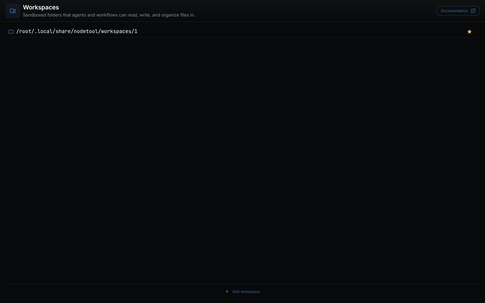

A workspace is a folder root that workflow runs, agent tasks, and chat sessions read and write through relative paths. Nodes and tools confine file operations to it.

```
<data dir>/workspaces/        # NODETOOL_WORKSPACES_DIR, the default workspace for each user
~/projects/campaign           # a workspace you added in the app
```

## Manage workspaces in the app

Workspaces have their own full-screen page at `/workspaces` (not a Settings tab):

1. Open the app menu (click the logo at the top of the left rail).
2. Choose **Workspaces**.
3. Click **Add Workspace** and pick a directory. The path must be absolute, exist, be a directory, and be writable.
4. Use the star on a row to make it the default workspace. The default workspace has no remove button.



A row marked **Inaccessible** points at a folder the server can no longer reach. Workspaces also appear in the **Workspace** view of the left panel (a file tree of the current one) and under **Advanced** in the workflow form, which pins a workflow to one. Every user gets a default workspace the first time the list loads.

## What a cloud deployment allows

A workspace pointing at a host folder browses the server's filesystem, so `NODETOOL_ENV=production` refuses create, update, and delete (`packages/websocket/src/trpc/routers/workspace.ts`). Each user's server-managed workspace under the data dir stays readable. `NODETOOL_WORKSPACE_STORAGE=cloud` (the production default) keeps it in the asset bucket instead of on disk. See [Configuration](configuration.md#environment-variables-index).

`workspace.list` returns `can_manage`, which the UI reads through `useWorkspaces()`. On a cloud deployment every workspace surface is present and only **Add Workspace** is missing.

## Where workspaces are used

- Agent and chat file tools.
- The Code node. Its `workspace.*` API (`read`, `write`, `list`, `stat`, `mkdir`, `remove`, `copy`, `move`) is confined to the workspace unless **Allow Host Filesystem** is on. The cloud profile ignores that switch.

## API

The tRPC `workspace` router has `list`, `create`, `update`, `delete`, `listFiles`, `readFile`, and `writeFile` (`packages/websocket/src/trpc/routers/workspace.ts`). Paths passed to the file procedures are workspace-relative. Absolute paths are refused and traversal answers `403`. Binary reads use `GET /api/workspaces/:id/download/:path` (`packages/websocket/src/workspace-api.ts`).

## If it fails

| Message | Cause |
|---|---|
| `Managing workspace folders is disabled in production` | Create, update, or delete with `NODETOOL_ENV=production` |
| `This workspace is not readable in production` | Reading a workspace row that points at a host folder, in production |
| `Path must be absolute`, `Path does not exist`, `Path is not a directory`, `Path is not writable` | Folder validation when adding a workspace |
| `Absolute paths not allowed, use relative paths` | A file procedure got a path starting with `/` |
| `Path traversal not allowed` (`403`) | A relative path escaped the workspace root |
| `Cannot delete the default workspace`, `Cannot delete workspace with linked workflows` | Delete refused |

## Related docs

- [Workflow Editor](workflow-editor.md)
- [Storage Guide](storage.md)
- [Node Reference: `nodetool.code`](nodes/nodetool/code/)
