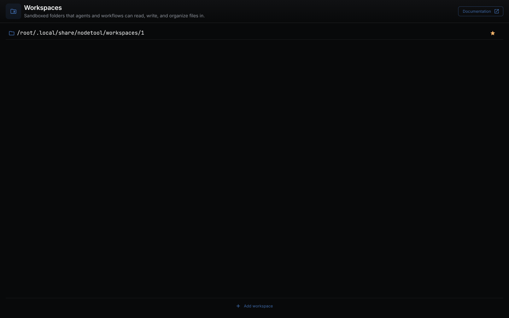

A workspace is a folder root that workflow runs, agent tasks, and chat sessions read and write through relative paths. Nodes and tools confine file operations to it.

```
<data dir>/workspaces/        # NODETOOL_WORKSPACES_DIR, the default workspace for each user
~/projects/campaign           # a workspace you added in the app
```

## Project folders

Every project has one folder, recorded as a workspace row. Creating a project creates `<PROJECTS_DIR>/<project name>` (default `~/NodeTool`, see [Configuration](configuration.md#environment-variables-index)) and adds ` 2`, ` 3` and so on when the name is taken. The projects folder must be an absolute path to a writable directory. A folder you name in Settings must already exist. With `NODETOOL_WORKSPACE_STORAGE=cloud` the folder is the key prefix `workspaces/<user>/projects/<sha256 of the project id>` in the asset bucket, or the next free `projects/` key when a game already uses that one. If the folder cannot be created, the project is not created either. Personal gets its folder when it is first created, and an imported project gets one at import. When either folder cannot be made, the project stays, runs in it report the missing folder, and the next startup tries again.

Each folder holds `.nodetool/project.json`, which names the project:

```json
{ "format": "nodetool.project", "version": 1, "id": "<project id>", "name": "My Film" }
```

Personal's folder is your default workspace, unless a native game uses it. Then Personal gets a new folder and the game keeps its workspace. On startup, each project from before project folders keeps its oldest workspace that no game uses, or gets a new folder when it has none. Its other workspaces and their files stay as they are.

A native game never writes into a project folder. Each game workspace is its own row under the managed workspaces folder. Deleting a project leaves the files in its project folder in place.

### Open a folder as a project

On the desktop app, **New project → Open folder…** makes a folder you already have into a project (`projects.openFolder({ path, name? })`). No file moves. NodeTool writes only `.nodetool/project.json`, and only when the folder has none. The folder must be inside `NODETOOL_LOCAL_FILE_ROOTS` (your home folder by default), exist, and be writable. A folder that is another project's folder, sits inside one, or contains one is refused with that project's name. The check compares real paths, so a symlink into a project folder is refused too. A server with `NODETOOL_ENV=production` refuses it and shows no **Open folder** entry.

When the folder already has `.nodetool/project.json`:

| The manifest's project | Result |
| --- | --- |
| Unknown on this install | The project is created under that id |
| Yours, and its recorded folder is gone | The project moves to this folder |
| Yours, and its recorded folder still exists | Refused: `This folder is a copy of project "<name>"` |

### Locate a moved folder

A project whose folder is renamed, moved or on an unplugged drive shows **Folder not found** on its card and above its Files. Runs in it do not start. **Locate** points the project at the folder's new place (`projects.relocate({ project_id, path })`) with the same checks as opening a folder. It refuses a folder whose `.nodetool/project.json` names a different project, and writes the manifest into a folder that has none.

The project API returns `folder: { path, origin, is_accessible }`, where `origin` is `created` or `adopted`. `path` is null for a cloud folder and for every folder on a server with `NODETOOL_ENV=production`, which also ignores a `PROJECTS_DIR` saved in a user's Settings.

## Where runs read and write

Every run reads and writes the folder of its own project:

| Run | Project |
| --- | --- |
| Chat turn, agent run | The thread's project |
| Workflow run | The workflow's project |
| Job, headless run | The job's project |
| JS script run | The script's project |
| `nodetool workflows run <file>` with no stored workflow | Personal |

A record with no project of its own runs in Personal. The folder is chosen once, when the run starts. A run started in one project keeps writing there after you switch to another project. When the folder is unreachable, the run does not start and reports `Project folder not found: <folder>`. No other folder is used in its place.

NodeTool owns `.nodetool/` in every folder. Agent file tools, the Code node, JS scripts and save nodes cannot read, write, list or delete anything in it, and listings leave it out.

## Assets are files in the folder

Every asset NodeTool creates is one file in its project's folder plus an asset row: a workflow output, an asset a node saves, an image an agent generates in a chat, and a file you upload. Generated files go to `Generated/`, which stays flat. Its name is the asset's name with whitespace as dashes and the extension of its content type, so an image named "fox in snow" is `Generated/fox-in-snow.png`. A second asset of the same name is `fox-in-snow-2.png`. An auto-saved output takes the title of its node, or `<kind>_<node id>` when the node has none.

A file dropped on a directory in the Files tree is saved in that directory. A file uploaded anywhere else, such as on the canvas or in the asset browser, goes to `Imported/`. An upload names its project, and NodeTool refuses a project you do not own. An agent output with `output_file` is saved at that path, and a Save file node with "Save to workspace" on saves at its file name. Each is the asset's only file, so the agent and the next node read the same bytes the asset shows.

The row keeps the asset's ID and the file's path in `workspace_path`. URLs and document references use the ID, so they stay valid when the file is renamed. Renaming the asset in NodeTool renames its file, and deleting the asset deletes its file. Moving an asset to another project, as assigning an entity does, moves its file into that project's folder under the same directory. Each of these is refused while a folder it needs is unreachable.

### Use a Personal asset in a project

Personal is the library. In a named project, the image pickers (entity images, timeline references, **Replace clip…**) show **This project** and **Personal** tabs. Picking from Personal copies the file into the project's `Imported/` directory as a new asset, and the document stores the copy's ID. The copy is independent: editing or deleting it leaves the Personal original unchanged, and the reverse. Picking the same unchanged asset again returns the same copy. The copy's metadata records the source asset's ID and content hash (`copied_from_asset_id`, `copied_from_hash`), and a client cannot change them. A copied entity stays an entity, and its swapped reference image is copied with it.

Agent tools follow the same rule. When `edit_storyboard`, `edit_timeline`, `set_timeline_document`, the timeline code tools (`set_timeline_code`, `edit_timeline_code`, `rebake_timeline_code`) or `edit_sketch` stores an asset of another project, it copies the asset first, stores the copy's ID, and returns `copied_assets: [{ source_asset_id, asset_id }]`. The server function behind both is `copyAssetToProject` in `@nodetool-ai/asset-services`, reached from the web through `assets.copyToProject`.

NodeTool never replaces a file when it picks a name. The file is created exclusively, so when another NodeTool process took the name first, or a file with it already exists in the destination folder, the new file gets the next free suffix. An asset created before project folders keeps its bytes in [asset storage](storage.md) and reads as before.

## Manage workspaces in the app

Workspaces have their own full-screen page at `/workspaces` (not a Settings tab):

1. Open the app menu (click the logo at the top of the left rail).
2. Choose **Workspaces**.
3. Click **Add Workspace** and pick a directory. The path must be absolute, exist, be a directory, and be writable.
4. Use the star on a row to make it the default workspace. The default workspace has no remove button.



A row marked **Inaccessible** points at a folder the server can no longer reach. Workspaces also appear in the **Workspace** view of the left panel (a file tree of the current one) and under **Advanced** in the workflow form. Runs no longer read the workflow form's workspace. Every user gets a default workspace the first time the list loads.

## What a cloud deployment allows

A workspace pointing at a host folder browses the server's filesystem, so `NODETOOL_ENV=production` refuses create, update, and delete (`packages/websocket/src/trpc/routers/workspace.ts`). Each user's server-managed workspace under the data dir stays readable. `NODETOOL_WORKSPACE_STORAGE=cloud` (the production default) keeps it in the asset bucket instead of on disk. See [Configuration](configuration.md#environment-variables-index).

`workspace.list` returns `can_manage`, which the UI reads through `useWorkspaces()`. On a cloud deployment every workspace surface is present and only **Add Workspace** is missing.

## Where workspaces are used

- Agent and chat file tools.
- The Code node. Its `workspace.*` API (`read`, `write`, `list`, `stat`, `mkdir`, `remove`, `copy`, `move`) is confined to the workspace unless **Allow Host Filesystem** is on. The cloud profile ignores that switch.

## API

The tRPC `workspace` router has `list`, `create`, `update`, `delete`, `listFiles`, `readFile`, and `writeFile` (`packages/websocket/src/trpc/routers/workspace.ts`). Paths passed to the file procedures are workspace-relative. Absolute paths are refused and traversal answers `403`. Binary reads use `GET /api/workspaces/:id/download/:path` (`packages/websocket/src/workspace-api.ts`).

## If it fails

| Message | Cause |
|---|---|
| `Managing workspace folders is disabled in production` | Create, update, or delete with `NODETOOL_ENV=production` |
| `This workspace is not readable in production` | Reading a workspace row that points at a host folder, in production |
| `Path must be absolute`, `Path does not exist`, `Path is not a directory`, `Path is not writable` | Folder validation when adding a workspace |
| `Absolute paths not allowed, use relative paths` | A file procedure got a path starting with `/` |
| `Path traversal not allowed` (`403`) | A relative path escaped the workspace root |
| `Cannot delete the default workspace`, `Cannot delete workspace with linked workflows` | Delete refused |
| `Project folder not found: <folder>` | A run's project folder is missing, unreachable or not recorded. Reconnect the drive, restore the folder, or use **Locate**, then run again |
| `This folder is inside the folder of project "<name>"`, `contains the folder of`, `is already the folder of` | Opening or locating a folder that overlaps another project's folder |
| `This folder is a copy of project "<name>"` | The folder's manifest names a project whose folder still exists |
| `This folder belongs to project "<name>"` | Locate was given another project's folder |
| `Opening a folder as a project is disabled on this server` | Open folder or Locate with `NODETOOL_ENV=production` |
| `Path '<path>' is inside .nodetool/, which NodeTool reserves for its own files` | A tool, node or script used a path in `.nodetool/` |

## Related docs

- [Workflow Editor](workflow-editor.md)
- [Storage Guide](storage.md)
- [Node Reference: `nodetool.code`](nodes/nodetool/code/)
