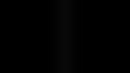

# Native timeline visual effects audit

The vignette concern has concrete causes: its control-card preview uses different math from the rendered effect, its falloff leaves a broad flat border, and track controls update the actual footage only on release. Remove the duplicate Canvas preview and make edits preview through the real renderer.

This audit covers visual clip/track effects, their controls, and the shared effect pipeline at `3df7fc227bba42a325f15b2668d62d87a20ba0b5`. It combines source inspection with Windows D3D11 still renders. Audio DSP and transitions are outside this audit. Individual stylize/generator modes, masks and blend modes were inspected as pipeline capabilities, not exhaustively validated visually.

**Render** means reproduced in native output. **Source** means established from code. **Design** means a proposed quality improvement, not a correctness failure. IDs continue from the [interaction plan](interaction-polish-plan.md). The original audit changed no production behavior. The checklist tracks subsequent implementation.

**Implementation guidance for these issues:** Effect implementations may closely follow [Filmcraft](https://github.com/storytold/filmcraft) or [EffectCraft](https://github.com/storytold/effectcraft), including their algorithms, parameter behavior and visual results. Adapt them to the native rendering pipeline and preserve compatibility with existing timelines. Carry this guidance into any implementation issues created from this audit.

## Implementation checklist

Check an item only after its implementation and relevant verification pass. Each item is committed separately. F39 precedes F35 so removing the decorative preview retains live feedback.

- [x] F35: Remove the duplicate Canvas effect preview. Vignette and Blur cards now use the live viewer feedback from F39. Native parameter-editor tests pass with the decorative component removed.
- [x] F36: Add a compatible gradual vignette falloff. The Soft centered oval preset extends feathering through the corners without changing existing documents or intensity. Native clip/track preset and undo tests, native pixels and CPU profile checks pass.
- [x] F37: Expose consistent vignette radius controls and units. The clip inspector now matches the track range/default. Catalogue regression passed after reproducing the missing control. Existing render geometry is unchanged.
- [x] F38: Add vignette center and roundness controls. Native, shared GPU and CPU tests verify shifted centers, circles at portrait/landscape aspect ratios and legacy defaults. Schema tests cover persistence and tool arguments.
- [x] F39: Preview track effects live with commit/cancel transactions. Native gesture tests verify model updates before release, cancel restoration and one undo entry. The preview entry-point regression also passes.
- [x] F40: Make sharpen radius affect rendering. Larger radii use a separable Gaussian low-pass before unsharp masking. Radius 1 retains the historical kernel and radius 0 is neutral. Native, GPU and CPU halo-width tests pass, with neutral, threshold and alpha checks.
- [x] F41: Apply glow color to the bloom contribution. Native D3D11, shared GPU and CPU halo tests pass. White/absent tint preserves source-colored glow, and the source image remains unchanged. GPU alpha checks pass.
- [x] F42: Render authored tone curves faithfully. Piecewise-linear transfer samples replace parametric fitting, applying master before channel curves. CPU, GPU export and native checks cover quarter-tone bends, endpoints and non-monotonic curves. Native tables use the bounded LUT cache.
- [x] F43: Remove gaps from large-radius blur kernels. Dense sampling replaces spaced taps within the supported 256-pixel radius. CPU, GPU and native impulse/line checks pass at 20/40/64/128, and checker patterns no longer alias. Large radii require more samples than the old fixed budget.
- [x] F44: Make processing order explicit and consistent. Fixed color/blur and video-track stages are displayed in processing order with explanations. Reordering is limited to ordered stages. Native row/reorder tests and independent ordering tests pass, including duplicate precedence and a large chain.
- [x] F45: Give clip effect controls explicit reset defaults. Every slider has an in-range reset value. Intensity controls can reset to neutral while new effects retain visible defaults. Catalogue regressions passed.
- [x] F46: Provide controls or specific explanations for imported effects. Pixelate, Posterize, Directional Blur and Lens Distortion have controls and Add entries. LUT, Stylize and Generator explain their editing limits. Catalogue and native add/edit tests pass.
- [x] F47: Edit imported Color effect instances. Inline controls target the authored ID and preserve other instances and unknown fields. Catalogue and native edit/undo/redo tests pass.
- [x] F48: Support exact numeric entry for track effects. Native keyboard tests cover live entry, Enter, Escape, invalid ranges, undo/redo and suppression of playback shortcuts while typing.
- [x] F49: Add independent effect sensitivity and lifecycle checks. CPU, GPU and native pixel expectations cover the repaired parameters. Native tests cover edit transactions, crop/alpha and bounded curve-table retirement. Disconnecting CPU curve dispatch makes the curve regression fail. See verification scope below.
- [x] F50: Evaluate and document precision and color-space behavior. The retained native ramp exposes shadow quantization. Shared GPU/CPU precision bounds and CPU translucent-edge checks pass. See the measured limits below.

## Vignette findings

| ID | Finding | Implementation recommendation |
| --- | --- | --- |
| F35 | **Source: the Canvas preview is misleading.** [VideoPreview] uses a linear radial gradient normalized to the corner and clamps stops to 1. The [shader] uses a smooth cubic falloff, different distance normalization, and supports radius above 1. | Remove the decorative Canvas approximation from the effect card. Preview the actual footage during editing. If a thumbnail remains necessary, generate it through the same effect renderer and parameter contract. Do not maintain a second hand-written vignette. |
| F36 | **Render + design: the falloff creates a flat dark outer region.** At radius 0.9, the shader reaches full darkening before the midpoint of every edge. Roughly 36% of the image lies outside that radius and gets the same maximum attenuation. | Review the intended visual profile on footage. Offer a gradual feather that can extend through the corners, with separate size and falloff controls. Preserve the current profile for existing documents rather than silently changing their appearance. |
| F37 | **Source: radius is inconsistently exposed and described.** [ClipCatalog] provides Amount/Softness only. Track controls expose Radius. The [type contract] calls radius relative to the half-diagonal, but actual normalized distance is 1 at edge midpoints and √2 at corners. | Expose Radius on clips and tracks with identical units/defaults. Correct the contract or version the geometry. Imported radius values must remain visible and editable. Verify square, landscape, portrait and cropped sources. |
| F38 | **Design: the vignette is limited to a centered, frame-shaped oval and black attenuation.** Center, roundness/aspect and highlight preservation are not parameters. Multiplication happens in the declared sRGB surface, so Amount is not an exposure-in-stops control. | After fixing preview fidelity, consider Center, Roundness and independent Feather. Add exposure or highlight protection only with an explicit color-space contract. Keep existing Amount semantics stable. These are enhancements, not proof that an oval vignette is mathematically wrong. |
| F39 | **Source: track effects do not preview against footage during a drag.** [EffectCard] updates a local draft; it commits to the timeline only on release. | Use a reversible render/model preview transaction for track effects, as clip effects already do. Update the program viewer while held, commit one undo entry on release, and restore on Escape/cancel. Removing the Canvas card must accompany this change. |

### What the current vignette actually renders

For a normalized pixel position `(u,v)`, the shader computes:

```text
d = length(2 * (u,v) - 1)
inner = max(0, radius - softness)
outer = max(inner + 0.001, radius)
t = clamp((d - inner) / (outer - inner), 0, 1)
gain = 1 - amount * t² * (3 - 2t)
RGBout = RGBin * gain
alphaOut = alphaIn
```

This is also the formula in the [shared vignette module][SharedVignette]. The native result is therefore not evidence of a Windows-only rendering divergence.

On a 640×360 white RGB image, Amount 0.5, Radius 0.9 and Softness 0.5 produced these channel values:

| Pixel | Measured RGB |
| --- | --- |
| Center `(320,180)` | `255,255,255` |
| Three-quarter width `(480,180)` | `241,241,241` |
| Near edge `(560,180)` | `155,155,155` |
| Edge midpoint `(639,180)` | `127,127,127` |
| Corner `(639,359)` | `127,127,127` |


For the same parameters, the control-card formula predicts about **0.693 gain** at the exact edge midpoint, versus **0.5** in the shader. This comparison is calculated from source, not a captured card image. The no-op Amount 0 render stayed white at the sampled positions. Softness 0 produced the expected hard boundary, which should not be confused with a rendering defect.

## Other effect findings

| ID | Finding | Implementation and acceptance |
| --- | --- | --- |
| F40 | **Render: Sharpen Radius does nothing.** Radius 1 and 8 produced byte-identical PNGs. [ClipCatalog] writes radius, but [EffectPlan] supplies only amount/threshold and the shader uses a fixed 3×3 neighborhood. | Implement radius-dependent unsharp masking consistently across rendering paths, or remove the ineffective control and expose the supported threshold. A radius-only change must change halo width on an edge pattern. Amount 0 must remain neutral. |
| F41 | **Render: Glow Color does nothing.** Red and blue settings produced byte-identical PNGs. The glow recipe never reads the authored color. | Tint the bloom contribution before adding it, leaving the original image unchanged. Preserve source-colored glow when color is absent. Test halo chroma outside a bright source shape, not just the saved setting. |
| F42 | **Render: tone curves do not reproduce the drawn graph.** Raising a red-channel point at input 0.25 from 0.25 to 0.4, while leaving input 0.5 unchanged, produced identical output. [EffectPlan] keeps only each channel's midpoint. Master curves are reduced to a few fitted parameters. | Evaluate the authored transfer curves directly or bake transfer LUTs. Match the interpolation drawn by [ToneCurve]. Preserve endpoints, off-midpoint bends and nonmonotonic curves. Test pixels at control-point inputs and between them. |
| F43 | **Render: large blur radii create separated stripes.** Radius 40 spreads 41 taps two pixels apart and uses discrete texel fetches. A white line produces alternating bright/black columns. | Replace sparse sampling with a continuous blur strategy, such as a prefiltered image pyramid. Fix the shared primitive used by blur and related recipes. Test impulses, thin lines and checkerboards at radii 20/40/64/128, with energy and continuity assertions. |
| F44 | **Render + source: the reorderable stack does not express execution order.** Swapping Color and Vignette produced identical output. Color/blur aggregate at the end. Track processing also keeps only the first enabled sharpen and vignette. This behavior is intentional in the current planner. | Decide between an ordered stack and explicit fixed processing stages. Make UI, native render and export agree with that decision. Test noncommutative pairs and duplicate effects. Version changed semantics so existing documents do not unexpectedly render differently. |
| F45 | **Source: many clip sliders do not reset.** Catalog fields omit `origin`/`resetValue`; [SliderRow] falls back to the current value. Both vignette sliders are affected. | Give every resettable field an explicit default. Distinguish neutral values from the values used when adding an effect. Double-click must restore the declared value in one undo step. |
| F46 | **Source: several rendered effects have no native parameter editor.** Pixelate, Posterize, Directional Blur, Lens Distortion, Stylize, Generator and LUT are recognized but return no fields and are absent from the add menu. | Add supported controls from authoritative metadata, or show a specific read-only explanation. Remove the generic instruction to use Color for unrelated effects. Preserve imported parameters during other edits. |
| F47 | **Source: imported Color instances cannot be edited through the advertised section.** [ClipEdits] selects only the ID `inspector:color`; ordinary Color IDs receive the same “use Color” message. | Bind controls to the actual effect instance, or offer an explicit conversion that preserves data and processing semantics. Editing imported brightness must change that instance rather than append a separate adjustment. |
| F48 | **Source: track knobs lack exact typed values.** [KnobList] draws the value as text. Dragging, wheel, key nudging and reset exist, but numeric text entry does not. | Add click-to-type with units, shared range validation, Enter commit and Escape cancel. Keep one undo entry and prevent timeline shortcuts from consuming field input. |

### Rendered blur evidence

For a one-pixel white vertical line on black, these are the measured red-channel values at horizontal offsets 0–10 from the line:

```text
Radius 20: 15,15,15,14,13,12,10,9,7,6,5
Radius 40: 15, 0,15, 0,15, 0,14,0,13,0,12
```



The shared Gaussian implementation and CPU fallback use the same sparse-sampling approach. Agreement between rendering paths therefore does not establish blur quality.

## Verification changes

| ID | Gap | Required check |
| --- | --- | --- |
| F49 | **Source: parity and data-edit tests miss shared defects.** Existing tests compare native output with export or assert that a control saved a value. Both paths can ignore the same parameter or share the same bad formula. | Retain parity tests, then add isolated parameter-sensitivity tests and independent pixel expectations. Cover neutral/disabled states, alpha, crop, clip versus track scope, order, reset, undo and canceled preview. A deliberately disconnected control must fail. |
| F50 | **Check: precision and color-space quality need targeted evaluation.** Effect intermediates use RGBA8. This limits precision but does not by itself establish visible banding in footage. | Test dark ramps and repeated grading for banding/clipping, plus translucent edges over light/dark backgrounds. Specify which operations use encoded versus linear-light values. Consider higher-precision intermediates only after measuring a failure and checking all rendering paths. |

The inspected vignette preserves alpha, and no new concrete defect was established in the examined chroma-key/spill or blend equations. Their broader quality remains a test question, not a clean bill of health for every configuration.

### Verification scope (F49)

[Native pixel tests](../src/preview/effects/tst_effectsblend.cpp) check curve bends, sharpen halo width, glow tint, vignette geometry, blur continuity, crop and alpha independently of export parity. [Clip inspector tests](../src/edit/clipeffects/tst_clipeffects.cpp) and [track inspector tests](../src/wiring/w/tst_wiringw.cpp) cover edits, reset, undo and cancellation. [Resource tests](../src/preview/effects/tst_effectresources.cpp) verify curve-table reuse, cache bounds and retirement after GPU use. Temporarily disconnecting CPU curve dispatch made [the regression](../../../packages/timeline/tests/render.curveFidelity.test.ts) fail, then it passed after restoration.

The Gaussian recurrence removes per-tap exponentials while retaining dense sampling. GPU and CPU checks keep radius and derived sigma bounded together. Run `node packages/gpu/tests/bench-blur.mjs` from the repository root after building the GPU package to measure warm two-pass blur at 720p/1080p and radii 20/128/256. Results depend on the device and concurrent work.

Native checks, inspector and affected-effect preview/export comparisons, package builds, typecheck and lint pass. Repository-wide verification is not green on this Windows checkout: affected-test and harness launchers encounter Windows command/symlink/tooling failures. The timeline suite also retains seven grain-parity failures reproduced with the pre-task renderer. These remain separate from the effects checklist and must be resolved before treating the branch as fully verified.

### Precision and color-space evaluation (F50)

The [precision ramp](effects-audit/precision-ramp.json) compares an untouched 256-level gray ramp with two inverse Levels adjustments, Gamma 0.5 followed by Gamma 2. The native D3D11 render exited 0 without a media fallback. The untouched result retained 256 distinct levels. The adjusted result retained 192, with a maximum error of 11 byte levels. Inputs 0–11 collapsed to black. This is measurable intermediate quantization, not a claim about all footage.

The [shared GPU test](../../../packages/gpu/tests/precision.test.ts) and [CPU tests](../../../packages/timeline/tests/render.precision.test.ts) enforce that precision floor while allowing improvements. The CPU edge test also verifies that hidden red pixels under zero alpha cannot contaminate a blurred white edge over black or white. The GPU glow tests separately check premultiplied alpha bounds.

Current timeline operations consume encoded RGB values. Vignette multiplies encoded RGB, Levels and Curves operate on encoded channel values, and blur/glow average their supplied values without a transfer-function conversion. A module's `linear` metadata does not perform that conversion. [Executor](../../../packages/gpu/src/executor.ts) currently defers color-space validation and bridges alpha representation only.

Retain current rendering semantics for existing documents. A future color-managed pipeline should version its working space, use floating-point intermediates across native/shared GPU and a float CPU reference, and convert/dither only at the display or export boundary. Recheck dark ramps, highlights, translucent edges, LUTs and compositing together. Changing only the texture format would improve precision but would not make current encoded-light operations physically linear.

## Reproduction assets and results

The retained fixtures use opaque RGB images to exercise the effect renderer without unsupported-alpha placeholders. All three render processes exited 0 and produced the expected 14 stills with no media fallback. The Windows executable's effect sources match the audited revision. This was a focused diagnostic run, not the full effects test suite.

Run from `native/timeline/` with the existing Windows dependency environment:

```powershell
. ./build-windows/environment.ps1
$env:QSG_RHI_BACKEND = 'd3d11'
# Use Start-Process -Wait when invoking this GUI executable from PowerShell.
Start-Process ./build-windows/Release/nodetool-timeline.exe -Wait -WindowStyle Hidden -ArgumentList 'docs/effects-audit/vignette-white.json --stills build-windows/audit-vignette --still-frames 0,30,60,90 --decode sw --audio none'
Start-Process ./build-windows/Release/nodetool-timeline.exe -Wait -WindowStyle Hidden -ArgumentList 'docs/effects-audit/parameter-pairs.json --stills build-windows/audit-pairs --still-frames 0,30,60,90,120,150,180,210 --decode sw --audio none'
Start-Process ./build-windows/Release/nodetool-timeline.exe -Wait -WindowStyle Hidden -ArgumentList 'docs/effects-audit/blur-line.json --stills build-windows/audit-blur --still-frames 0,30 --decode sw --audio none'
```

| Fixture | Frames and purpose |
| --- | --- |
| [Vignette](effects-audit/vignette-white.json) | 0: measured profile. 30: larger radius. 60: zero softness. 90: zero amount. |
| [Parameter pairs](effects-audit/parameter-pairs.json) | 0/30: sharpen radius. 60/90: glow color. 120/150: red curve. 180/210: color/vignette order. Each pair was byte-identical in this audit. |
| [Blur](effects-audit/blur-line.json) | 0: radius 20. 30: radius 40. Compare the middle scanline. |
| [Precision](effects-audit/precision-ramp.json) | 0: untouched ramp. 30: inverse Levels adjustments. Compare distinct levels and maximum byte error. |

## Implementation order

1. **A1:** Remove the fake card preview, add live track-effect preview, and expose consistent vignette radius controls. Retain current rendering semantics initially.
2. **A2:** Fix inactive parameters, curve fidelity and wide-radius blur with independent pixel tests. Coordinate changes with shared render/export implementations.
3. **A3:** Settle stack ordering, reset defaults and imported-effect editing. Add vignette shape/color-quality enhancements as explicit, compatible changes.

[VideoPreview]: https://github.com/nodetool-ai/nodetool/blob/3df7fc227bba42a325f15b2668d62d87a20ba0b5/native/timeline/qml/wiring/w/VideoPreview.qml
[shader]: ../shaders/effects/clip.frag
[EffectPlan]: ../src/preview/effects/EffectPlan.cpp
[ClipCatalog]: ../src/edit/clipeffects/ClipEffectsCatalog.js
[EffectCard]: ../qml/wiring/w/EffectCard.qml
[ToneCurve]: ../src/edit/clipeffects/ToneCurveEditor.qml
[SliderRow]: ../qml/Inspector/primitives/InspectorSliderRow.qml
[ClipEdits]: ../src/edit/clipeffects/ClipEffectsEdits.qml
[KnobList]: ../qml/wiring/w/KnobList.qml
[type contract]: ../../../packages/timeline/src/types.ts
[SharedVignette]: ../../../packages/gpu/src/shaders/filters/vignette/v1/module.ts

## Additional correction and repair effects

F51–F56 continue the implementation checklist, with one commit per task. The current catalogue already covers LUTs, RGB curves, levels, lift/gamma/gain, chroma key, grain, masks and several stylized effects.

- [x] F51: Linear-light exposure, highlight roll-off and whites, with clip/track controls and native/export parity.
- [x] F52: Separate luma/chroma filtering and motion-aware temporal reduction with bounded source frames, cut rejection and deterministic seeking. Native controls, CPU/GPU pixels and native/export fixtures pass, including five simultaneous video clips.
- [x] F53: Soft HSL qualification, matte preview and hue-versus-hue/saturation curves.
- [x] F54: Cached deflicker analysis with scene cuts, fade preservation and backward-seek consistency.
- [x] F55: Thresholded debanding with deterministic dither, alpha and detail preservation.
- [x] F56: Cached camera-motion analysis, foreground rejection, smoothing and crop limits. Native analysis/undo, source-time sampling, CPU/GPU pixels and preview/export comparisons pass.

| ID | Priority | Missing timeline capability | Implementation direction |
| --- | --- | --- | --- |
| F51 | High | Exposure in stops and highlight roll-off. Brightness is not an exposure control. | Use [linear-light exposure](../../../packages/gpu/src/shaders/color/exposureLinear/v1/module.ts) with explicit sRGB conversion and clip/track controls. Preserve highlights in floating-point calculations before output conversion. Keep existing grading behavior. |
| F52 | High | Noise reduction with separate luminance/chroma controls. | Start with an edge-preserving spatial filter. Add motion-aware temporal reduction with bounded neighboring-frame caches, scene-cut resets and deterministic seeking. Test moving edges for trails and fine detail for excessive smoothing. [Temporal denoising reference](https://docs.opencv.org/4.10.0/d1/d79/group__photo__denoise.html). |
| F53 | High | Secondary color correction by hue/saturation/luminance range. | Add a range qualifier with soft boundaries, matte preview and hue/saturation/luma adjustments. Include hue-versus-hue and hue-versus-saturation curves. Preserve hue wraparound and avoid hard selection seams. RGB curves and chroma-key removal do not provide these controls. |
| F54 | Medium | Deflicker for unwanted temporal brightness changes. | Analyze luminance over a bounded frame window and compensate gradually. Detect scene cuts and preserve intentional fades. Cache analysis by source/settings so backward scrubbing and export agree. [Deflicker reference](https://ffmpeg.org/ffmpeg-filters.html#deflicker). |
| F55 | Medium | Debanding for gradients and compressed source footage. | Use thresholded edge-preserving smoothing with optional low-amplitude dither. Expose strength/range, preserve alpha and detail, and test dark ramps. Keep source repair separate from fixing precision loss in our own pipeline. [Debanding reference](https://ffmpeg.org/ffmpeg-filters.html#deband). |
| F56 | Medium | Camera stabilization with motion analysis and crop control. | Estimate camera motion, reject independently moving foreground objects, and store a smoothed transform path. Expose smoothing/crop limits and an analysis state. Treat it as a clip analysis operation with cached results, not a stateless shader. [Two-pass stabilization reference](https://ffmpeg.org/ffmpeg-filters.html#vidstabdetect). |

The implementation guidance above also applies to these additions.

### Exposure contract (F51)

The new exposure effect decodes sRGB using the [standard transfer function](https://www.w3.org/TR/css-color-4/#color-conversion-code), multiplies linear light by `2^exposure`, then applies highlight-weighted Whites and a hue-preserving shoulder before encoding the result. Calculations retain values above 1 until the shoulder. Exposure is -5..5 stops, Whites is -2..2 stops, and roll-off is 0..1. Zero values are neutral. Existing color grading keeps its encoded-RGB behavior.

Track exposure runs after the clip's ordered effects and before the fixed color/blur stages. The track Color correction card exposes the new controls. Output still uses the existing 8-bit effect surfaces. The effect preserves highlight differences within its calculation, but does not recover detail already clipped in the source or an earlier effect.

Independent CPU/GPU/native pixel tests cover linear gain and highlight separation. Clip and track inspector tests cover editing and undo. The retained [clip](../src/preview/effects/fixtures/clip-exposure.json) and [track](../src/preview/effects/fixtures/track-exposure.json) fixtures match native preview and export exactly on the tested D3D11 device.

### Secondary color contract (F53)

Qualification uses [HSL over encoded sRGB](https://www.w3.org/TR/css-color-4/#the-hsl-notation). Hue center, half-width and feather use degrees. Saturation and lightness ranges intersect with soft boundaries. A limited hue selection excludes neutral grays. Hue curves wrap at red, with linked endpoints and neutral output 0.5. Hue-versus-hue spans ±180 degrees and hue-versus-saturation spans 0–2 times the saturation adjustment.

Selection matte is viewer state, excluded from saved documents and exports. It shows the selected effect's coverage after preceding ordered effects, before later grading. Switching clips or closing the effect clears it. CPU/GPU/native pixel tests, inspector undo checks and the [preview/export fixture](../src/preview/effects/fixtures/clip-secondary-color.json) cover the implementation.

### Debanding contract (F55)

Following the [thresholded-neighborhood approach](https://ffmpeg.org/ffmpeg-filters.html#deband), sample sixteen neighbors at two deterministic radii within a 1–64 pixel range. Smooth matching encoded RGB values, taper weights toward the threshold, exclude transparent samples and preserve center alpha. Strength zero bypasses processing. Optional monochrome dither uses a coordinate hash and stays fixed across seeks.

The [fixture generator](../src/preview/effects/make-deband-fixture.mjs) retains an opaque RGB dark ramp and a hard edge. CPU/GPU/native checks cover recovered intermediate levels, edge preservation, alpha and repeatability. Dither may change quantized output by one byte. The [preview/export fixture](../src/preview/effects/fixtures/clip-deband.json) matches exactly on the tested D3D11 device. Source repair still uses the current 8-bit surfaces.

### Deflicker contract (F54)

Analyze original video on a cancellable worker, following actual source timestamps. Measure trimmed-mean linear luminance and detect structural/color cuts after exposure normalization. Fit a symmetric local exposure trend within each shot, preserve monotone fades, ignore near-black frames and cap correction in stops. This extends the [windowed luminance approach](https://ffmpeg.org/ffmpeg-filters.html#deflicker) with source-time sampling and cut/fade handling.

Save the result as one undoable edit. Match its asset/local path, covered source interval and analysis settings before rendering. Strength stays interactive. Changing the window or correction limit requires analysis again. Failed, canceled or superseded work cannot replace the previous result. Analysis retains two reduced frames and at most 18,000 scalar samples. It uses the current SDR decode path.

The [fixture](../src/preview/effects/fixtures/clip-deflicker.json) covers alternating exposure, a color cut and a fade. Native/export comparisons pass at 45 dB or better on the tested device. Tests also cover variable-rate decoding, backward sampling, trimming, stale sources, cancellation and undo.

### Stabilization contract (F56)

Analyze original video with bounded corner matching, forward/backward consistency and [robust four-parameter similarity fitting](https://docs.opencv.org/4.13.0/d9/d0c/group__calib3d.html). Prefer distributed background matches over a moving foreground. Smooth translation, rotation and uniform scale within each tracked shot. Average relative translation before reconstructing rotation/scale, so a long pan cannot turn rotation jitter into sideways drift. Weak texture, scene cuts and failed fits start separate segments.

Store source-time corrections as one undoable edit. Window changes require analysis again. Strength and maximum zoom remain interactive. Use a fixed zoom for the analyzed interval, capped at 1–1.5 times the source. Reduce correction when that crop budget cannot keep every output corner inside the source. Apply stabilization after noise reduction and before clip effects and track keying, using aspect-correct, premultiplied cubic reconstruction. Zero strength and missing or stale analysis bypass it.

Analysis retains two reduced frames and at most 18,000 transform samples. The model does not correct perspective or rolling shutter. The [fixture generator](../src/preview/effects/make-stabilize-fixture.mjs) includes jitter, an independently moving foreground and a cut. Tests cover long pans, portrait/cropped bounds, backward sampling, cancellation, undo and alpha. The [preview/export fixture](../src/preview/effects/fixtures/clip-stabilize.json) passes at 45 dB or better on the tested D3D11 device.

### Noise reduction contract (F52)

Use separate luminance/chroma bilateral strengths, a 1–4 pixel spatial radius and an independent temporal strength. All strengths default to zero. Following the [separate-channel and multi-frame denoising approach](https://docs.opencv.org/4.13.0/d1/d79/group__photo__denoise.html), preserve center alpha and reject neighbors that differ too much in local detail, color or opacity.

For video, sample source time ±33.33 ms, clamped to the clip's source interval. Search up to four source pixels for matching cross-shaped patches. Reject large mean-color changes and mismatching local patches. Apply temporal reduction, then spatial reduction, before stabilization and grading. Temporal controls are disabled for nonvideo sources. Existing 8-bit SDR surfaces and the short motion search limit the recoverable detail.

Each active video uses two independent neighboring frame sources. Their caches follow the existing decoder lifecycle, with no accumulated playback history. Keep every visible layer's required sources even when they exceed the ordinary preroll pool budget. The [fixtures](../src/preview/effects/make-denoise-fixture.mjs) cover crops, moving edges, cuts, backward seeks and five simultaneous video layers. CPU/GPU tests cover independent strengths, alpha, neutral bypass and repeatability. Native inspector tests cover parameter editing and undo.

The tested native/export frames exceed 51 dB PSNR. A warmed 1080p shared-GPU render measured about 38 ms including readback on this Windows machine. Temporal reduction can reduce playback speed, especially with several clips.
